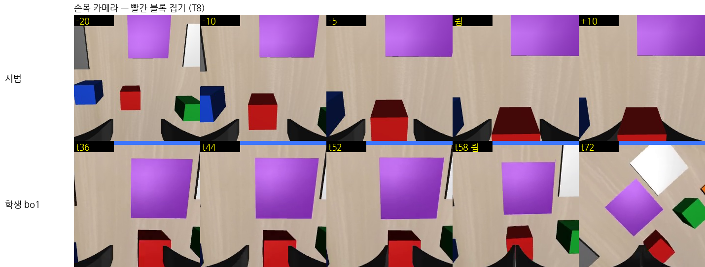

# 2026-10-14 다시 시작: 지연을 줄여 보기, 실패 영상, 새 쥐기 방식

> 목표: 블록 장면 28항목 정확도 100% 근접 (사용자: "act 다해서 한번 계속 해볼까 정확도 100 으로 해보자", "내가 그만하라고 할때까지 모든 기술 총동원해서").

## 한눈에

| 무엇 | 결과 |
|---|---|
| 지연을 줄이면? (bo1, 다시 학습 없이) | 지연 0 은 한 번도 못 쥠, 3 은 더 나쁨, 6·9 는 비슷하거나 조금 나음. 지연이 주원인이라는 가설은 이 모델에서 맞지 않았다 |
| CUDA 그래프 (`fastinfer.py`) | 출력은 원래와 완전히 같고 (차이 0.0), 계산 1번 554 → 452ms. 실제 지연 11 → 9스텝 |
| 시험 때 요령 (지연 9, 같은 노이즈, 반복 5번) | T0+T8 40장면 3cm 기준 12.5% → 최대 30%, 판 안 기준은 45% 그대로 |
| 실패 영상 | 학생은 손목 화면에서 블록을 가운데로 못 맞춘 채 내려가 손가락이 블록 윗면에 얹힌다. 빈손이 돼도 모르고 놓는 곳까지 간다 |
| 다음 | 새 쥐기 방식(블록 위에서 먼저 맞추고 똑바로 내려감) 시범 + 같은 방식으로 넘겨받는 교정 시범 → al1 학습 |

## 1. 지연이 원인인가 — 지연만 바꿔 재기

bo1 을 다시 학습하지 않고 평가 때 지연만 바꿨다 (장면 1000~1019, 20장면씩).

| 지연 (스텝) | T0 3cm / 판 안 | T8 3cm / 판 안 |
|---|---|---|
| 11 (원래) | 1 / 8 | 4 / 10 |
| 9 (CUDA 그래프) | 5 / 8 | 7 / 10 |
| 6 | 1 / 6 | 9 / 14 |
| 3 | 0 / 1 | 3 / 10 |
| 0 | 0 / 0 (한 번도 못 쥠) | — |

지연이 짧을수록 좋아질 줄 알았는데 아니었다. bo1 은 '지연 동안 실제로 할 동작(앞부분)'을 받아 그 뒤를 이어 계획하도록 학습했다 (TT-RTC). 지연 0 이면 붙잡을 앞부분이 없어 매 스텝 계획이 다른 갈래로 튀며 맴돈다 (9/18 Panda 에서 본 맴돌기와 같은 꼴). 그래서 이 모델에서는 지연이 주원인이 아니다.

## 2. 계산을 빠르게: CUDA 그래프

GPU 명령 수백 개를 한 번 녹화해 두고 통째로 다시 실행한다 (`fastinfer.py`, 평가·교정 시범 `--cuda-graph`). 녹화하려면 계산 중 CPU 가 GPU 를 기다리는 곳이 없어야 해서, 원래 코드의 그런 곳(사진 위치 번호를 매번 계산, 상수를 매번 GPU 로 보냄)만 같은 값이 나오게 바꿨다.

| 동작 만들기 반복 | 원래 | 그래프 | 지연 (스텝, 20Hz) |
|---|---|---|---|
| 10 | 554ms | 452ms | 9.0 |
| 5 | 372ms | 315ms | 6.3 |
| 3 | 298ms | 264ms | 5.3 |

- 같은 노이즈를 넣으면 출력 차이 0.0 (원래와 같은 값).
- 생각보다 덜 빨라진 이유: 동작 만들기 한 번이 여전히 27ms. 시작 모델(HuggingFaceVLA/smolvla_libero)이 VLM 32층·동작 전문가 32층을 모두 쓰는 설정이었다 (SmolVLA 논문 기본은 앞 16층만). 층을 줄이려면 다시 학습해야 한다.
- 실제 로봇 지연은 이제 11 이 아니라 **9스텝** 으로 잰다 (같은 1080 Ti, 같은 모델).

## 3. 시험 때 요령 (다시 학습 없이, T0+T8 40장면)

| 조건 | 3cm 기준 | 판 안 |
|---|---|---|
| 지연 11 (원래) | 5/40 | 18/40 |
| 지연 9 (그래프) | 12/40 | 18/40 |
| 반복 5번, 지연 7 | 8/40 | 17/40 |
| 같은 노이즈를 매 계획마다, 지연 11 | 8/40 | 18/40 |
| 반복 5번 + 같은 노이즈 | 7/40 | 10/40 |

판 안 기준이 45% 에서 움직이지 않는다. 시험 때 요령으로는 안 되고 학생을 더 잘 가르쳐야 한다.

작은 블록(3.5cm) 에 그대로 넣어 본 결과(지연 11): T0 3/9, T8 5/9 (3cm/판 안). 4.5cm 와 차이가 오차 범위 안이다.

## 4. 실패 영상: 손목 화면에서 블록을 가운데로 못 맞춘다

- 시범(위): 내려가는 내내 블록이 손목 화면 가운데에 있고, 그대로 두 손가락 사이로 들어온다.
- 학생(아래, T8 장면 1002): 블록이 한쪽 손가락 아래로 치우친 채 내려가다, 58스텝에 손가락 하나가 블록 윗면에 얹힌 채 오므린다. 블록은 1스텝 만에 빠지고, 학생은 빈손인 줄 모르고 보라 판까지 가서 놓는 동작을 한다.
- T0 장면 1000 도 같은 꼴: 블록 옆에서 오므렸다 빗맞아 블록을 밀어 버리고, 엉뚱한 곳에 둔다.

새 평가 기록(쥔 구간)으로 나눈 실패 (지연 3·6, T0):

| | 못 집음 | 쥔 채 빠짐 | 놓았는데 판 밖 | 판 안 성공 |
|---|---|---|---|---|
| 지연 3 | 4 | 7 | 8 | 1 |
| 지연 6 | 3 | 6 | 5 | 6 |

판 밖에 놓은 블록은 판에서 6~25cm, 대부분 출발 쪽에 있다. 다 옮기지 못하고 놓았거나, 위 영상처럼 빈손으로 옮긴 경우다.

## 5. 새 쥐기 방식 (ACT 적재 논문에서 가져옴)

08_개인논문_ACT적재 에서 ACT 가 28% → 99% 가 된 것은 시연 규칙(여유 두고 잡기, 늘 같은 곳 잡기, 놓고 물러나기) 덕이었다. 우리 블록 시범을 같은 눈으로 보면:

- 늘 같은 곳 잡기: 시범의 오므리는 방향이 이미 거의 한 갈래다 (과제별 96~100% 가 세계 y 방향).
- **여유 두고 잡기가 문제**: 10/5 부터 시범의 70% 는 블록 옆 2.5cm 까지 빗나간 곳에서 비스듬히 내려가며 맞췄다. 시범 프로그램은 바로바로 고치니 괜찮지만, 0.45초 늦게 고치는 학생이 따라 하면 손가락이 블록 윗면에 먼저 닿는다 (4절 영상).

그래서 `PIPER_GRASP_STYLE=align` (task_experts): 블록 위 8cm 에서 먼저 정확히 맞추고(빗나간 출발이면 여기서 옆걸음으로 고침) → 똑바로 내려가 3cm 위까지 → 마지막 3cm 는 천천히 → 바닥에서 3~6스텝 멈췄다 쥔다.
시범 프로그램 점검 (장면 1000~1004): 단독 T0·T2·T3·T5·T8·T9, 일 바꾸기 2쌍, 돌아오기 2쌍 모두 5/5. 길이도 비슷 (130~170스텝).

## 6. 돌고 있는 것

- `run_align_collect.sh`: align 시범 — 정상 600 + 넓은 배치 600 + 일 바꾸기·돌아오기 12쌍 × 40 + 회복 300
- `run_al_dagger.sh`: bo1 교정 시범을 align 으로 넘겨받기 (단독 10과제 × 25, 전환 12쌍 × 10, 재개 6쌍 × 10, 지연 9)
- `run_al_round.sh`: 둘이 끝나면 사진 특징 미리 계산(`vis_cache.py`, 학습 약 3배 빠름 — 위치 입력 모델용으로 고침) → al1 학습 (bo1 에서, align 시범만, 모든 프레임, 한 번에 16장) → 28항목 (지연 9, CUDA 그래프)
