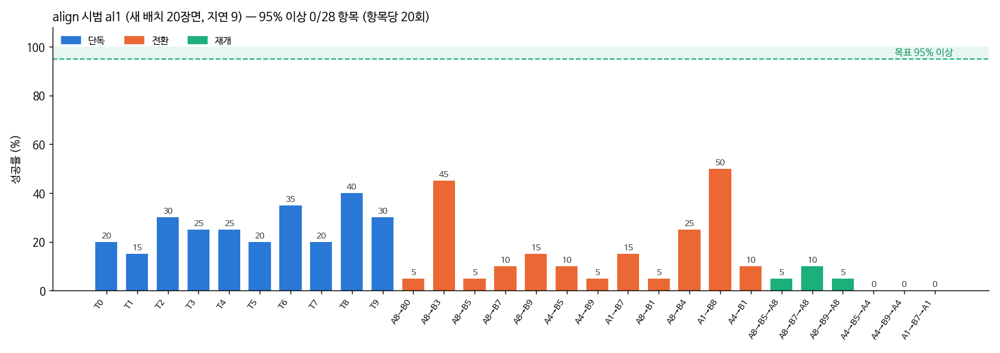

# 2026-10-15 al1 (새 쥐기 방식 시범으로 학습)과 정렬 보조

> 한 줄 요약: 새 쥐기 방식 시범으로 학습한 al1 은 28항목 3cm 17.1%, 판 안 32.9% 였다. 가장 많은 실패인 '쥐었다 빠짐'은 오므리는 순간 손가락이 블록 모서리를 스쳐 블록이 튕겨 나간 것이라, 쥐기 직전 앞뒤좌우만 맞추는 정렬 보조를 만들어 시험했다.

> 목표: 블록 장면 28항목 정확도 100% 근접.

## 한눈에

| 무엇 | 결과 |
|---|---|
| 밤새 한 일 | align 시범 2,692개 + bo1 교정 시범 269개 → 사진 특징 미리 계산 (5.1시간) → al1 학습 (3.5시간) → al1 28항목 |
| 학습 속도 | 사진 특징 미리 계산본으로 1초에 약 19장 (bo1 은 5.5장) — 3.5배 |
| al1 첫 결과 (단독 5과제 100장면, 지연 9) | 판 안 44%, 3cm 22%. 실패: 쥐었다 빠짐 30, 판 밖 20, 못 집음 6 |
| 빠짐의 정체 | 30건 중 21건은 '쥠'이 1스텝만 잡힘 — 오므리는 순간 손가락이 블록 모서리를 스쳐 블록이 튕겨 나감 |
| 다음 시험 | 정렬 보조: 정면 카메라로 잰 블록 위치에 쥐기 직전 앞뒤좌우만 맞춘다 (VLA 단독 성적과 따로 적음) |

## 1. 밤새 돈 순서

| 시각 | 단계 |
|---|---|
| 10/14 17:46 ~ 23:51 | align 시범 수집: 정상 600 + 넓은 배치 563 + 일 바꾸기·돌아오기 1,238 + 회복 291 |
| 10/14 19:06 ~ 22:43 | bo1 교정 시범 (align 으로 넘겨받기): 단독 206 + 일 바꾸기 63. 돌아오기 부분은 시뮬레이터가 갑자기 죽어(세그멘테이션 오류) 빠짐 |
| 23:53 ~ 04:59 | 사진 특징 미리 계산 (2,961개, 3장에 1장, 약 39만 장) |
| 04:59 ~ 07:41 | al1 학습 (bo1 에서, 15,000스텝, 한 번에 16장). 검증 손실 0.064 → 0.061 |
| 07:41 ~ | al1 28항목 (지연 9, CUDA 그래프, 4개 동시) |

밤에 고친 것:
- 일 바꾸기·돌아오기 교정 시범이 GPU 메모리 부족으로 꺼졌다. 같은 시간에 내가 돌린 속도 시험 때문이다. CUDA 그래프를 쓰는 평가·교정 시범은 하나에 2.2~3.4GB를 쓴다 → 시험은 남은 GPU 메모리를 보고 띄운다.
- bfloat16 → float32 로 바꾸면 빨라질까 재 봄: 오히려 느려지고(971 → 1,850ms) 출력도 달라졌다(평균 차이 0.06). 이 모델의 행렬곱은 토큰 수가 적어 가중치를 읽는 속도가 병목이라, 2바이트 bfloat16 이 낫다. 그대로 둔다.

## 2. al1 실패를 나눠 보기 (단독 T0·T1·T5·T6·T7, 100장면)

| | 못 집음 | 쥐었다 빠짐 | 판 밖에 놓음 | 판 안 성공 |
|---|---|---|---|---|
| 합계 | 6 | 30 | 20 | 44 |

빠진 구간 길이(스텝): 1스텝 21건, 2~11스텝 24건, 24~63스텝 4건. 대부분 오므리는 순간 스치고 끝났다. 실패 장면 다수는 2~4번 다시 쥐려 했다 (다시 시도는 한다).

## 3. 정렬 보조 (`grasp_assist.py`, 평가 `--grasp-assist`)

시범은 블록 가운데에서 쥔다 — 손목 화면의 블록 위치가 쥐기 30스텝 전부터 쥘 때까지 가로 0.499 ± 0.002. 학생은 0.45초 늦게 보고 1~2cm 어긋난다.
카메라 2대 + 로봇 상태만으로 이 어긋남을 메운다 (실물에도 그대로).

- 정면 카메라 화면의 블록 위치 → 책상 위 위치 2차 변환식 (`piper_sim/calib_front.py`, `front_calib.json`). 평가 장면 20곳에서 평균 0.09cm, 최대 0.24cm.
  손이 블록 가까이 오면 정면 카메라에서 블록이 손에 가릴 수 있어, 손이 8cm 넘게 떨어져 있을 때 잰 값을 기억해 쓴다.
- 그리퍼가 열려 있고 손이 지시문 속 블록에서 옆으로 4cm·위로 10cm 안일 때만: ① 앞뒤좌우를 블록 가운데로 ② 0.6cm 넘게 어긋나 있으면 쥐는 높이 3cm 아래에서는 조금 들어 올림 ③ 0.8cm 넘게 어긋나 있으면 오므리기를 미룸. 내려가기·손목·그리퍼 결정은 VLA 그대로.
- 손목 화면만으로 맞추는 방법도 재 봤다: 같은 높이에서도 손 기울기에 따라 블록이 보이는 자리가 0.01~0.02 (3~5mm) 달라 정면 카메라 쪽을 골랐다.
- 시범 프로그램으로 가짜 '빗나간 내려가기'를 만들어 시험했더니 보조가 오히려 나빴는데 (3/12 대 12/12), 가짜 동작이 손을 똑바로 아래로 둔 채 로봇 가까이 내려가 손목이 특이 자세에 걸린 탓이었다 (옆으로 움직이라 해도 손이 안 움직임). 실제 학생 모델로 다시 잰다.

## 4. 다음 (자동)

- al1 28항목 → al1 교정 시범 (95% 못 넘는 항목) → al2 → al3 → al4 (`run_al_round2.sh`)
- 교정 시범과 함께 정렬 보조 시험 (al1, T0·T8·T5·T6, `run_assist_test.sh`)

## 5. 오늘은 여기까지 (10시)

사용자 결정으로 오늘 작업은 여기서 멈춘다. al1 28항목 평가만 끝까지 두고(오후 1~2시 끝), 이어지던 교정 시범·al2·정렬 보조 시험은 껐다. 다시 시작할 때 할 일은 HANDOFF.md 맨 위 절.

## 6. al1 28항목 결과 (12:32 끝)

| 모델 | 혼자 | 일 바꾸기 | 돌아오기 | 28항목 평균 |
|---|---|---|---|---|
| bo1 3cm (지연 11) | 19.5% | 12.5% | 7.5% | 13.9% |
| al1 3cm (지연 9) | 26.0% | 16.7% | 3.3% | 17.1% |
| bo1 판 안 (지연 11) | 34.0% | 22.5% | 11.7% | 24.3% |
| al1 판 안 (지연 9) | 43.5% | 31.7% | 17.5% | 32.9% |

혼자·일 바꾸기는 올랐고 돌아오기는 여전히 낮다. 두 모델은 지연이 다르다 (al1 은 CUDA 그래프로 실제 지연 9). 같은 지연으로 잰 bo1 (T0+T8: 3cm 30%, 판 안 45%) 과 비교하면 차이는 크지 않다 — 새 쥐기 방식 시범만으로는 부족했다. 항목마다 20장면이라 95% 구간이 넓다.

## 7. 다시 시작 (16시) — 정렬 보조 시험

사용자: "다시 계속해줘 정확도 100 나오게 모든 기술 논문 적용해서 해보자 내가 그만하라 할때까지".

al1 에 정렬 보조(`--grasp-assist`)를 켜고 같은 장면 1000~1019 에서 쟀다 (지연 9).

| 항목 (20장면씩) | 보조 없음 3cm / 판 안 | 보조 켬 3cm / 판 안 |
|---|---|---|
| T0 파랑→흰 판 | 4 / 10 | 10 / 16 |
| T5 초록→흰 판 | 4 / 7 | 3 / 14 |
| T6 초록→빨강 위 | 7 / 7 | 12 / 12 |
| T8 빨강→보라 판 | 8 / 12 | 11 / 13 |
| A8→B5 의 B | 1 / 3 | 5 / 8 |
| A4→B9 의 B | 1 / 1 | 3 / 3 |
| A8→B5→A8 돌아오기 | 1 / 4 | 2 / 4 |
| A4→B9→A4 돌아오기 | 0 / 2 | 7 / 9 |
| **합계 160장면** | **26 (16%) / 46 (29%)** | **53 (33%) / 79 (49%)** |

160장면에서 3cm 기준 16% → 33%, 판 안 29% → 49%. 우연으로 보기 어려운 차이다. 학생이 쥐러 내려갈 때 1~2cm 어긋나는 것이 실패의 큰 몫이었다는 진단과 맞는다.
이것은 'VLA + 정렬 보조' 성적이다. 보조는 카메라 2대 + 로봇 상태만 쓰지만 사람이 짠 규칙이므로, 논문에서는 VLA 단독과 나눠 적는다.

## 8. 손 기준 물체 위치 입력 (`relfeat.py`)

보조가 규칙으로 하는 일을 학생이 스스로 하도록, 물체 입력을 '화면 좌표' 에서 '손에서 몇 m' 로 바꿨다.

- 정면 카메라 2차 변환식을 판까지 8개로 (`piper_sim/calib_front.py`): 평균 오차 0.05~0.11cm
- 블록 4·판 4: (물체 x − 손 x, 물체 y − 손 y). 블록은 손이 10cm 넘게 떨어져 있을 때만 새로 재고 (가까우면 손에 가려 틀어질 수 있다), 판은 처음 값. 손목 화면 블록 위치 8칸은 그대로 → 24칸 (모델 입력 크기 같음)
- 시범에서 쥐는 순간 '손 → 목표 블록' 값: 중앙 0.09cm, 최대 0.43cm — 손에 가린 순간에도 정확하다
- alr1: al1 에서 이어 학습, 정면 16칸은 뜻이 바뀌었으니 정규화 통계를 다시 재고 그 입력 열을 0 에서 다시 배움 (`--feat relfeat --reset-feat`). 17:13 시작

## 9. 실물 계획 (사용자)

이번 대회는 ACT 논문. SmolVLA 작업 전환은 다음 대회에서 실물 PiPER 까지 한다. 지금 만드는 것(카메라 2대 자리, 색 검출, 정면 카메라 변환식, 지연 재기)은 실물에서 한 번씩 다시 맞추면 그대로 쓴다. 실물 시범(원격 조종)을 시뮬 데이터와 섞어 학습할 계획.

## 10. 학생은 손 기준 위치를 쓰지 않는다 → 상태를 동작 쪽에도 (23시)

alr1 중간 결과(10항목)가 al1 과 같아서 (3cm 32 대 30, 판 안 64 대 65), 입력을 정말 쓰는지 직접 쟀다 (`sens_check.py`).
시범 한 장면(T8, 쥐기 25·10스텝 전)에서 '손 기준 빨강 블록 x' 만 +2cm 옮겨 넣으면 모델의 손 목표 위치가 얼마나 움직이나:

| 쥐기 전 | 목표 x 변화 (앞 1·5·10·20번째 동작) |
|---|---|
| 25스텝 | −0.04, −0.05, −0.05, −0.04cm |
| 10스텝 | −0.02, −0.03, −0.02, −0.03cm |

2cm 를 옮겼는데 0.05cm 도 안 움직이고 방향도 반대다. **학생은 이 입력을 거의 무시한다.**
SmolVLA 는 로봇 상태를 얼린 언어 모델 앞부분에 토큰 하나로만 넣는다. 그 언어 모델은 숫자를 실어 나르도록 배운 적이 없고, 사진만으로도 학습 손실이 충분히 줄어드니 학생이 이 입력을 쓸 이유가 약하다.

고침 (π0 처럼 상태를 동작 쪽에): 정규화된 상태 32칸(로봇 8 + 물체 24)을 선형층 하나로 동작 토큰마다 더한다 (`ttrtc.enable_sufstate`, 학습 `--sufstate`).
- 새 층은 0 으로 시작 → 처음 출력이 원래 모델과 같다 (차이 0.0 확인)
- 학습 때 기울기가 흐른다 (확인)
- 동작 전문가는 학습하는 쪽이라 이 값을 바로 쓸 수 있다

순서: alr1 28항목이 끝나면 als1 (alr1 에서, 상태를 동작 쪽에도) 학습 → 같은 민감도 확인 → 28항목 → 교정 시범 → als2 ...
