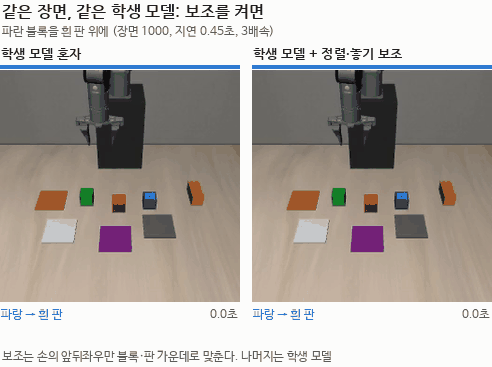
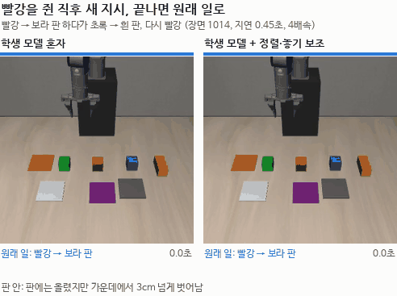
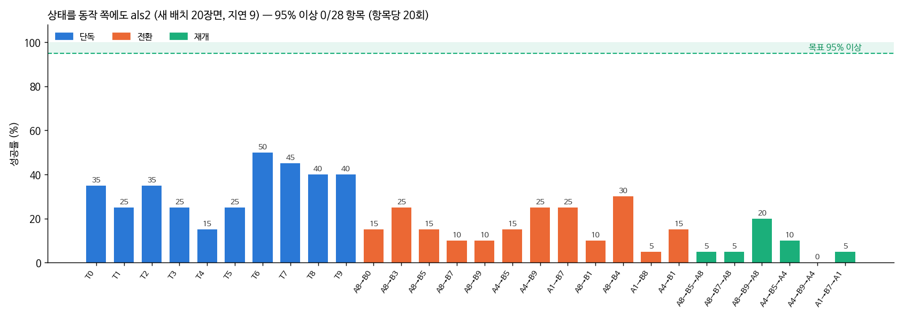

# 2026-10-16 alr1 결과와 als1 (상태를 동작 쪽에도)

> 한 줄 요약: 손 기준 물체 위치를 넣은 alr1 (28항목 3cm 15.5%), 상태를 동작 쪽에도 더한 als1 (19.6%), 교정 시범을 더한 als2 (20.7%) 모두 al1 (17.1%) 과 비슷했다. 학생이 위치 입력을 거의 쓰지 않아서다. 반면 VLA 에 정렬·놓기 보조를 붙이면 8항목 3cm 가 16% → 47% 로 올랐다.

> 목표: 블록 장면 28항목 정확도 100% 근접.

## 1. alr1 28항목 (01:22 끝, 지연 9)

| 모델 | 혼자 | 일 바꾸기 | 돌아오기 | 28항목 평균 |
|---|---|---|---|---|
| al1 3cm | 26.0% | 16.7% | 3.3% | 17.1% |
| alr1 3cm (손 기준 물체 위치) | 25.0% | 12.5% | 5.8% | 15.5% |
| al1 판 안 | 43.5% | 31.7% | 17.5% | 32.9% |
| alr1 판 안 | 42.0% | 25.0% | 14.2% | 28.7% |

al1 과 차이가 오차 범위 안이다 (조금 낮다). 10/15 밤 민감도 확인대로, 학생이 손 기준 위치 입력을 쓰지 않으니 성적도 그대로다.
입력을 바꾸면서 정면 카메라 16칸의 입력 열을 0 에서 다시 배우게 했는데, al1 이 화면 좌표에서 조금이나마 쓰던 정보를 잃었을 수 있다 (가설).

## 2. 지금

als1: alr1 에서 이어, 상태(로봇 8 + 물체 24)를 동작 토큰마다 더하는 층을 붙여 학습 (`--sufstate`). al1 교정 시범 135개도 더함.
학습이 끝나면 같은 민감도 확인 → 28항목.

## 3. als1 도 입력을 무시한다 (04:16)

als1 학습 (alr1 에서, 상태를 동작 토큰마다 더함, 15,000스텝, 검증 손실 0.061~0.062) 뒤 같은 민감도 확인:

| 쥐기 전 | 빨강 블록 x +2cm → 목표 x 변화 (앞 1·5·10·20번째 동작) |
|---|---|
| 25스텝 | +0.02, +0.03, +0.04, +0.04cm |
| 10스텝 | −0.10, −0.11, −0.12, −0.11cm |

상태를 동작 쪽에 바로 넣어도 학생은 그 값을 쓰지 않았다. 사진만으로 시범 동작을 거의 맞힐 수 있어 학습이 굳이 이 입력을 쓸 이유가 없었던 것으로 보인다 — 모방 학습의 '지름길 학습(copycat)' 과 같은 꼴 (가설). 28항목 평가는 그대로 돈다.

## 4. 놓기 보조 (`grasp_assist.py`, 평가 `--place-assist`)

정렬 보조(쥐기)가 160장면에서 성공을 두 배로 만들었으니, 놓기에도 같은 방식으로:
- 지시문에서 '어느 블록을 어디에' 를 읽는다. 어느 블록을 쥐었는지는 오므려 무언가를 쥔 순간 손에서 4cm 안의 가장 가까운 블록.
- 지시문의 블록을 쥐고 있을 때만: 놓을 곳(판 가운데, 쌓기면 아래 블록 가운데)에서 5cm 안이면 앞뒤좌우를 그 가운데로, 3cm 넘게 떨어져 있으면 손을 벌리지 않는다.
- 일 바꾸기 때 쥐고 있던 다른 블록을 아무 데나 내려놓는 것은 막지 않는다 (새 지시의 대상이 아니므로).
- 판 위치는 장면 처음에 정면 카메라로 잰 값 (블록을 올리면 가려져 틀어진다).
- 시험: al1 + 정렬 + 놓기 보조, 정렬 보조 시험과 같은 8항목 (`run_place_test.sh`, als1 평가가 끝난 뒤 남는 GPU 자리에서).

## 5. als1 28항목 (09:08 끝, 지연 9)

| 모델 | 혼자 | 일 바꾸기 | 돌아오기 | 28항목 평균 |
|---|---|---|---|---|
| al1 3cm | 26.0% | 16.7% | 3.3% | 17.1% |
| alr1 3cm | 25.0% | 12.5% | 5.8% | 15.5% |
| **als1 3cm** | **29.0%** | **17.9%** | **7.5%** | **19.6%** |
| al1 판 안 | 43.5% | 31.7% | 17.5% | 32.9% |
| alr1 판 안 | 42.0% | 25.0% | 14.2% | 28.7% |
| **als1 판 안** | **48.5%** | 31.7% | **22.5%** | **35.7%** |

지금까지 VLA 단독으로 가장 높다. 다만 al1 보다 2.5~3%p 높은 정도라 20장면씩 28항목으로는 우연과 나누기 어렵다.
민감도 확인(한 장면, 쥐기 직전)에서는 입력을 거의 안 쓰는 것처럼 보였다. 오른 이유가 더한 교정 시범 135개 때문인지, 다른 단계(놓기 등)에서 입력을 쓰기 때문인지는 아직 모른다.

지금: als1 교정 시범 (3개, 거의 모든 항목 15장면씩) ‖ 놓기 보조 시험 (al1 + 정렬 + 놓기, 8항목).

## 6. 보조 시험 결과 (VLA + 보조, VLA 단독과 따로 적음)

### al1 + 정렬 + 놓기 보조 (8항목 160장면, 장면 1000~1019, 지연 9)

| | 3cm | 판 안 |
|---|---|---|
| al1 단독 | 16% | 29% |
| + 정렬 보조 | 33% | 49% |
| + 정렬 + 놓기 보조 | 47% | 53% |

단독 4과제(T0·T5·T6·T8)는 70% / 76% 까지 올랐다. 일 바꾸기·돌아오기는 20~35% 에 머문다.

### als1 + 정렬·놓기 보조, 그리고 쥐기 마무리 (`run_complete_test.sh`, 14:52 끝)

쥐기 마무리 (`--grasp-complete`): 학생이 목표 블록 1cm 위에서 20스텝 넘게 맴돌며 내려오지 않으면, 규칙으로 내려가 쥐고 5cm 든 뒤 학생에게 돌려준다. 일 바꾸기 실패 영상(A8→B5 장면 1003)에서 B 블록 위 맴돌기를 봐서 넣었다.

| 항목 (20장면씩, 3cm / 판 안) | als1 단독 | + 정렬·놓기 | + 정렬·놓기·쥐기 마무리 |
|---|---|---|---|
| T0 파랑→흰 판 | 8 / 14 | 16 / 18 | 16 / 18 |
| T8 빨강→보라 판 | 9 / 10 | 16 / 16 | 16 / 16 |
| A8→B5 의 B | 2 / 4 | 9 / 10 | 9 / 9 |
| A8→B5 돌아오기 | 1 / 9 | 7 / 11 | 6 / 7 |
| A4→B9 의 B (쌓기) | 6 / 6 | 9 / 9 | 7 / 7 |
| A4→B9 돌아오기 | 0 / 1 | 4 / 4 | 3 / 5 |
| **합계 120** | **26 (21.7%) / 44 (36.7%)** | **61 (50.8%) / 68 (56.7%)** | 57 (47.5%) / 62 (51.7%) |

- 정렬·놓기 보조로 120측정 3cm 21.7% → 50.8%, 판 안 36.7% → 56.7%. 단독 과제는 80~90%.
- 쥐기 마무리는 더한 것이 없었다 (차이는 20장면씩이라 우연 범위). 단독 과제 결과가 둘이 똑같아, 단독에서는 마무리가 거의 켜지지 않은 것으로 보인다. 맴돌기가 실패의 큰 몫이 아니거나, 1cm·20스텝 조건이 맞지 않았다 (가설, 켜진 횟수를 아직 세지 않음).
- 남은 실패는 일 바꾸기의 B (45~50%) 와 돌아오기 (20~55%) 에 몰려 있다.

같은 장면을 보조 없이 한 번, 보조를 켜고 한 번 다시 돌려 찍었다 (als1, 지연 0.45초). 평가 때와 같은 결과가 나왔다.

파란 블록을 흰 판에 놓는 장면 1000. 혼자서는 블록 위에서 16초를 맴돈 뒤에야 쥐고, 옮기다가 판 가운데에서 9cm 떨어진 곳(판 밖)에 놓아 버린다. 그 뒤로는 다시 집지 못한다. 보조를 켜면 처음 내려갈 때 블록 가운데로 들어가 8초에 끝낸다.

빨강을 쥔 직후 '초록을 흰 판에' 로 바뀌고, 끝나면 빨강으로 돌아가는 장면 1014. 혼자서는 두 블록 모두 판에 올리긴 하지만 가운데에서 3cm 넘게 벗어나고 73초가 걸린다. 보조를 켜면 둘 다 가운데에 놓고 38초에 끝난다. 두 경우 모두 처음 자세로 돌아가지 않는다.

## 7. als2 (15:50 학습 끝) 와 민감도

als1 에서 이어, als1 교정 시범 220개를 더해 10,000스텝 (검증 손실 0.067, 검증 묶음이 바뀌어 앞 모델과 바로 비교는 못 함).
같은 민감도 확인 (빨강 블록 위치만 +2cm):

| 쥐기 전 | 목표 x 변화 | 목표 y 변화 |
|---|---|---|
| 25스텝 | −0.02 ~ −0.04cm | 0.03 ~ 0.07cm |
| 10스텝 | 0.00 ~ −0.01cm | 0.08 ~ 0.12cm |

여전히 입력을 거의 쓰지 않는다. 교정 시범을 더해도 사진만으로 맞히는 지름길이 그대로다.
als2 28항목 평가가 15:50 부터 돈다 (4개 동시, 약 5시간).

## 8. 다음 시도: 학습 때 정면 카메라를 가끔 가린다 (16:40)

학생이 손 기준 위치 입력을 쓰지 않는 것은, 사진만으로도 시범 동작을 맞힐 수 있어서라고 본다 (가설).
그래서 학습 장면의 30% 에서 정면 카메라 사진을 가린다 (주의 마스크로 그 사진 토큰을 보지 않게). 그 장면에서는 블록·판이 어디 있는지를 위치 입력으로만 알 수 있다. 여러 입력 중 하나를 가끔 빼고 학습하면 남은 입력도 쓰게 된다는 '입력 가리기(modality dropout)' 방식이다. 평가와 실물에서는 두 카메라를 모두 본다.

- `train_lora.py --cam-drop 0.3` → `ttrtc.STATE["cam_drop"]`. 학습 때만 가리고 평가에는 영향 없음 (CPU 로 확인: 학습 모드 마스크 [가림, 보임], 평가 모드 [보임, 보임], 평가 출력 같음)
- 사진 특징 미리 계산본을 그대로 쓸 수 있다 (사진을 바꾸지 않고 마스크만 바꿈)
- 순서 (`run_alc_round.sh`): als2 28항목 끝 → alc1 학습 (als2 에서, 같은 데이터) ‖ als2 + 정렬·놓기 보조 28항목 → alc1 민감도 → alc1 28항목
- 판단 기준: 민감도가 0.1cm 에서 1cm 넘게 오르면 위치 입력을 쓰기 시작한 것이다. 성적이 오르는지는 따로 잰다
- als3·als4 (교정 시범만 더하는 방식)는 als1 → als2 에서 민감도가 그대로여서 미뤘다

## 9. als2 28항목 (21:26 끝, 지연 9)

| 모델 | 혼자 | 일 바꾸기 | 돌아오기 | 28항목 평균 |
|---|---|---|---|---|
| al1 3cm | 26.0% | 16.7% | 3.3% | 17.1% |
| als1 3cm | 29.0% | 17.9% | 7.5% | 19.6% |
| **als2 3cm** | **33.5%** | 16.7% | 7.5% | **20.7%** |
| al1 판 안 | 43.5% | 31.7% | 17.5% | 32.9% |
| als1 판 안 | 48.5% | 31.7% | 22.5% | 35.7% |
| **als2 판 안** | **50.0%** | 32.1% | 19.2% | **35.7%** |

교정 시범 220개를 더한 als2 는 als1 과 거의 같다 (3cm +1.1%p, 판 안 같음). 혼자 과제만 조금 오르고 일 바꾸기·돌아오기는 그대로다.
민감도도 그대로였으니 (7절), 학생이 위치 입력을 쓰지 않는 한 교정 시범을 더해도 한계가 있다는 해석과 맞는다 (가설).
교정 시범 라운드(als3·als4)는 멈추고, 정면 카메라 가리기(alc1) 결과를 먼저 본다.

19:43 일: 'als2 + 보조' 평가 3개가 GPU 메모리 부족으로 죽었다. 남은 메모리를 보고 띄우는 일꾼과, 확인 없이 다음 항목을 바로 띄우는 als2 평가 줄이 겹쳤다 (MuJoCo 화면 그리기 EGL 도 GPU 메모리를 쓴다). 이제 모든 평가는 같은 자물쇠와 메모리 확인을 거쳐 하나씩 뜬다. 또 평가 2개 옆에서 학습이 2.7배 느려져 (2,500스텝에 40분 → 1시간 50분), 보조 평가는 학습이 끝난 뒤로 미뤘다 (`run_alc_round_d.sh`).

## 10. alc1 도 위치 입력을 쓰지 않는다 → 새 층 학습률 (23시)

alc1 (als2 에서, 학습 장면 30% 정면 카메라 가림, 10,000스텝) 민감도:

| 쥐기 전 | 두 카메라 보임 | 정면 카메라 가림 |
|---|---|---|
| 25스텝 | x −0.03 ~ 0.00, y 0.08 ~ 0.13cm | x −0.14 ~ −0.06, y 0.09 ~ 0.22cm |
| 10스텝 | x −0.08 ~ −0.04, y −0.02 ~ 0.01cm | 0.04cm 안 |

정면 카메라를 실제로 가려도 블록 위치 2cm 를 따라가지 않는다. 쥐기 25스텝 전이면 손목 카메라에 블록이 보이니 손목 화면만으로 가는 것 같다 (가설).

가중치를 직접 봤다. 상태를 동작 토큰에 더하는 새 층(state_suffix_proj) 의 입력별 열 크기:

| 모델 | 로봇 8 | 블록 8 | 판 8 | 손목 화면 8 |
|---|---|---|---|---|
| als1 | 0.031 | 0.051 | 0.047 | 0.027 |
| als2 | 0.040 | 0.062 | 0.059 | 0.032 |
| alc1 | 0.049 | 0.078 | 0.074 | 0.038 |

0 에서 시작한 층이 학습률 3e-5 로는 10,000스텝마다 0.01~0.02 씩만 자란다 (원소 하나는 0.003 수준). 블록·판 열이 로봇 열보다 크게 자라는 것을 보면 쓸모는 있는데 너무 천천히 배우는 것으로 보인다 (가설).
그래서 이 층만 학습률 1e-3 (`train_lora.py --new-lr`, 나머지는 3e-5 그대로). 새로 붙인 층에 큰 학습률을 주는 것은 미세조정에서 흔한 방법이다.

- alc1 28항목은 4쌍(8:0·8:3·8:5·8:7)만 재고 멈췄다 (민감도가 그대로라 als2 와 같을 것으로 봄)
- alc2: alc1 에서, 새 층 1e-3 + 정면 가리기 30%, 10,000스텝. 2,500스텝 저장본에서 먼저 민감도를 잰다 → 28항목 → als2 + 보조 28항목 (`run_alc2_round.sh`)

alc1 이 잰 4쌍 (A8→B0·B3·B5·B7, 80장면) 의 B 성공: 3cm 9 / 판 안 15. 같은 장면 als2 는 13 / 21. 20장면씩이라 우연 범위 안이지만, 정면 카메라 가리기만으로는 나아지지 않았다.
alc2 학습 23:09 시작 (GPU 혼자).
