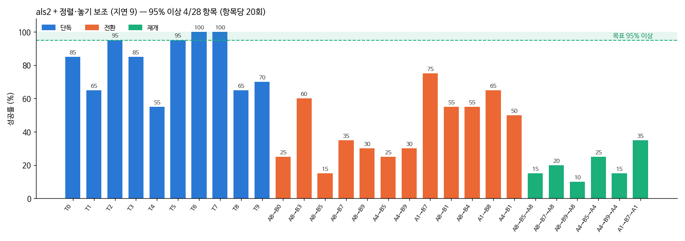
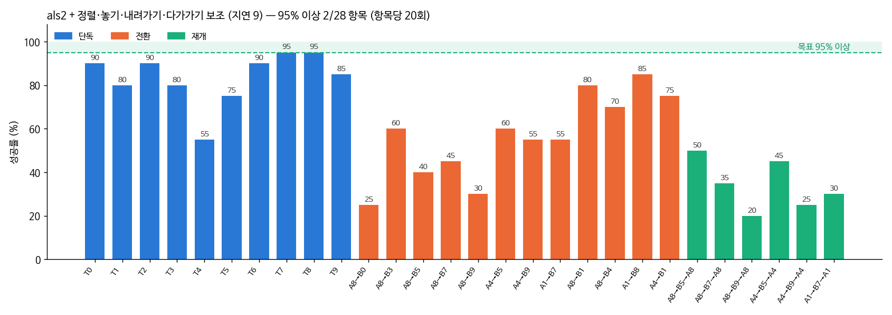

# 2026-10-17 학생이 위치 입력을 쓰게 만들기 (alc2, alc3p)

> 한 줄 요약: 새 층 학습률을 30배로 키워도(alc2), 두 카메라를 모두 가리는 장면을 섞어도(alc3p) 학생은 카메라가 보이면 손 기준 블록 위치를 쓰지 않는다. 이 방향은 여기서 접고 VLA + 보조의 남은 실패를 본다.

## 오늘 결과 한눈에

| 무엇을 봤나 | 결과 |
|---|---|
| alc2 (새 층 학습률 1e-3, 정면 가리기 30%) 민감도 | 2,500·5,000스텝 모두 0.1cm 안. 새 층 가중치는 3~4배 자랐는데 동작은 그대로 |
| 넓은 민감도 (처음 출발할 때, 블록 +5cm, 정면 가림) | 0.2cm 안. 학습 데이터에 입력이 들어가는 길은 정상 |
| alc3p (두 카메라 모두 가림 20% + 정면만 20%) | 카메라가 보이면 0.25cm 안. 두 카메라를 다 가려야 5cm 에 0.6cm, 15cm 에 1.4cm 따라감 |

## 1. alc2: 학습률 문제가 아니었다

어제(10/16 10절) 새 층(state_suffix_proj)이 거의 자라지 않는 것을 보고, 그 층만 학습률 1e-3 으로 alc1 에서 이어 학습했다.

| 저장본 | 로봇 8 | 블록 8 | 판 8 | 손목 화면 8 |
|---|---|---|---|---|
| alc1 | 0.049 | 0.078 | 0.074 | 0.038 |
| alc2 2,500스텝 | 0.163 | 0.211 | 0.185 | 0.155 |
| alc2 5,000스텝 | 0.209 | 0.272 | 0.231 | 0.180 |

(새 층의 입력별 가중치 열 크기)

가중치는 3~4배 자랐지만 민감도는 그대로다 (2,500스텝, 빨강 블록 +2cm: 쥐기 25스텝 전 x −0.05cm, 10스텝 전 0.02cm).

더 넓게 재 봤다 (`sens_wide.py`, 5,000스텝 저장본, 빨강 블록 +5cm, 20번째·49번째 동작 목표):

| 순간 | 정면 보임 | 정면 가림 |
|---|---|---|
| 처음 (t=0) | 0.18cm 안 | 0.11cm 안 |
| 15스텝 | 0.09cm 안 | 0.05cm 안 |
| 쥐기 25스텝 전 | 0.21cm 안 | 0.21cm 안 |

블록을 5cm 옮겨도, 처음 출발할 때도, 정면 카메라를 가려도 동작이 0.2cm 넘게 바뀌지 않는다. 학습 코드가 `.relfeat.npy` 를 읽어 상태 뒤에 붙이는 것도 다시 확인했다.

해석 (가설): 정면을 가려도 손목 카메라가 처음 자세에서 책상 전체를 내려다보고 있어 블록 4개가 다 보인다 (아래 그림 1초). 손목 사진만으로도 시범 동작을 맞힐 수 있으니, 학생은 여전히 위치 숫자를 쓸 이유가 없다.

## 2. alc3p: 두 카메라 모두 가리기 (짧은 시험)

- `ttrtc.STATE["cam_drop_both"]`, `train_lora.py --cam-drop-both`: 정면을 가리는 장면 가운데 일부는 손목 카메라까지 가린다. 이 장면에서는 블록이 어디 있는지를 위치 숫자로만 알 수 있다. 학습 때만 가리고 평가에는 영향 없음 (CPU 확인)
- alc2 에서 이어, 정면만 가림 20% + 둘 다 가림 20%, 2,500스텝 (GPU 혼자 약 30분) → 같은 넓은 민감도
- 판단: 블록을 5cm 옮겼을 때 동작 목표가 1cm 넘게 따라가면 위치 숫자를 쓰기 시작한 것. 그러면 길게 학습한다. 안 되면 이 방향은 접고 보조 쪽 실패(일 바꾸기의 B, 돌아오기)를 판다
- 그 뒤 als2 + 정렬·놓기 보조 28항목 (일꾼 4개) — VLA + 보조의 첫 전체 성적

## 3. alc3p 결과 (01:33)

| 순간 | 정면 보임 | 정면 가림 |
|---|---|---|
| 처음 (t=0) | 0.18cm 안 | 0.10cm 안 |
| 15스텝 | 0.04cm 안 | 0.14cm 안 |
| 쥐기 25스텝 전 | 0.17cm 안 | 0.25cm 안 |

(빨강 블록 +5cm 일 때 20번째·49번째 동작 목표 변화)

두 카메라를 모두 가린 채로도 재 봤다 (`sens_both.py`, t=0). 모델이 받는 정규화된 상태 값은 제대로 바뀐다 (빨강 x 1.82 → +5cm 에서 2.66 → +15cm 에서 4.34). 49번째 동작 목표는 5cm 에 0.6cm, 15cm 에 1.4cm 따라간다. 입력은 모델까지 가고, 사진이 없으면 조금은 쓴다. 사진이 있으면 거의 사진만 본다.

정리: SmolVLA 를 이 데이터로 미세조정하면 학생은 사진 쪽 길로 동작을 맞힌다. 같은 정보를 숫자로 더 줘도, 그 층을 키워도, 사진을 가끔 가려도 바뀌지 않았다 (alr1·als1·als2·alc1·alc2·alc3p, 6개 모델). 위치 숫자를 확실히 쓰게 하려면 동작 자체를 '목표 블록 기준'으로 바꾸는 방식이 남아 있지만, 그것은 지금의 정렬·놓기 보조가 규칙으로 하는 일과 거의 같다.
그래서 이 방향은 여기서 접는다. 정확도는 VLA + 보조 쪽에서 남은 실패(일 바꾸기의 B, 돌아오기)를 줄이는 데 쓴다. 성적은 계속 VLA 단독과 VLA + 보조를 나눠 적는다.

01:37 부터 als2 + 정렬·놓기 보조 28항목 (일꾼 4개, 아침 7~8시 끝 예상).

## 4. 실패를 나누는 도구 (`fail_classify.py`)

평가 기록에는 일 바꾸기 실패가 대부분 '시간 초과' 하나로만 남아 있었다. 쥔 구간 기록(hold_segs)과 손 궤적으로 다시 나눴다.
'블록 위에서 못 쥠' 은 손이 블록 위 3cm 안(옆으로)까지 왔는데 한 번도 못 쥔 경우, '블록까지 못 감' 은 그보다 멀리 있었던 경우다.
'A 를 못 쥐어 전환 안 됨' 은 원래 일의 블록을 쥐지 못해 새 지시가 아예 나오지 않은 경우다.

als2 단독 28항목 (혼자 200, 새 지시 B 240, 돌아오기 120):

| 구분 | 성공 | 판 안(3cm 밖) | 판 밖에 놓음 | 쥐었다 빠짐 | 쥔 채 시간 끝 | 블록 위에서 못 쥠 | 블록까지 못 감 | A 를 못 쥐어 전환 안 됨 |
|---|---|---|---|---|---|---|---|---|
| 혼자 | 67 | 33 | 38 | 25 | 3 | 20 | 14 | |
| 새 지시 B | 40 | 37 | 24 | 13 | 11 | 40 | 18 | 57 |
| 돌아오기 | 9 | 14 | 4 | 4 | 1 | 17 | 41 | 30 |

- 일 바꾸기 장면의 24% (57/240) 는 원래 일 블록부터 못 쥐어 새 지시가 나오지도 않았다
- '블록 위에서 못 쥠' 은 손이 블록 중심보다 **4~7cm 위**에서 멈춰 내려오지 않는다 (중앙: 혼자 3.6cm, B 5.9cm, 돌아오기 7.0cm)
- 돌아오기는 B 를 끝낸 뒤 원래 블록 쪽으로 아예 가지 않는 경우가 가장 많다 (41/120, 손-블록 최소 6cm)

als1 + 정렬·놓기 보조 (4항목) 와 + 쥐기 마무리를 같은 도구로 보면, 쥐기 마무리를 켠 쪽에서 B 의 '쥔 채 시간 끝' 이 1 → 8 로 늘었다. 마무리 동작이 블록을 쥐고 5cm 들어 준 뒤 학생에게 돌려주면, 학생은 그 자세에서 옮기기를 시작하지 못하고 쥔 채 멈춘다. 마무리 보조가 성적을 못 올린 이유다.

## 5. 새 보조 두 가지 (`grasp_assist.py`, 아직 재지 않음)

돌아오기 실패 장면을 하나씩 보니 (als1 + 보조 8, als2 8), 학생은 원래 블록을 집지 않고 **빈손으로 놓을 판 위를 서성였다**. 마지막 10초 동안 손이 70~110cm 움직여, 멈춘 것이 아니라 헤매는 것이다. 몇 장면은 B 블록을 다시 쥐었다.

- 내려가기 재촉 (`--descend-assist`): 손이 블록 위 0.8cm 안으로 맞춰졌는데 20스텝(1초) 동안 1cm 도 안 내려가면, 쥐는 높이까지 내려가게 한다 (그동안 오므리지 않음). 바닥에서 10스텝을 기다려도 오므리지 않으면 오므린다. 들어 올리기·옮기기는 학생이 한다 (쥐기 마무리는 들어 준 뒤 학생이 옮기지 못했다)
- 다가가기 (`--approach-assist`): 빈손인데 놓을 곳 6cm 안에 있거나, 3초 동안 지시문의 블록에 1cm 도 다가가지 않으면 (6cm 넘게 떨어져 있을 때), 높이 13cm 로 올라 그 블록 위로 데려가 8cm 위에서 학생에게 돌려준다
- 둘 다 카메라 2대 + 로봇 상태 + 지시문만 쓴다. 성적은 계속 'VLA + 보조' 로 따로 적는다
- 평가 기록에 보조가 손댄 스텝 수(`assist_steps`)를 남긴다
- 시험: als2 + 보조 28항목이 끝나면 같은 장면에서 6항목 (T0·T8, 8:5·4:9·8:9·4:5) — 정렬·놓기 + 내려가기, + 다가가기 (`run_assist2_test.sh`)

### 첫 결과 (05:30, 일 바꾸기 4항목 80장면, 3cm 기준)

시험 스크립트가 '끝' 이라는 낱말을 기다리게 했는데, 로그 앞쪽의 'alc1 평가 4개 끝' 에 걸려 28항목 평가와 같이 01:44 부터 돌았다. 둘 다 같은 자물쇠·메모리 확인을 거쳐 GPU 는 넘치지 않았다.

| 항목 | als2 혼자 B / 돌아오기 | + 정렬·놓기 | + 정렬·놓기·내려가기·다가가기 |
|---|---|---|---|
| A4→B5 | 3 / 2 | 5 / 5 | 12 / 9 |
| A4→B9 | 5 / 0 | 6 / 3 | 11 / 5 |
| A8→B5 | 3 / 1 | 3 / 3 | 8 / 10 |
| A8→B9 | 2 / 4 | 6 / 2 | 6 / 4 |
| **합계 80** | **13 / 7** | **20 / 13** | **37 / 28** |
| 새 지시까지 간 장면 | 58 | 60 | 78 |

다가가기는 원래 블록을 쥐는 단계(A)에도 켜져서, 원래 블록부터 못 쥐어 새 지시가 안 나오던 장면이 20 → 2 로 줄었다. 새 지시 B 성공은 거의 두 배, 돌아오기는 두 배 넘게 올랐다. 단독 T0 는 18/20.
28항목 전체를 이어서 잰다 (`run_apr28.sh`).

## 6. als2 + 정렬·놓기 보조 28항목 (07:15 끝) — 처음 재는 VLA + 보조 전체 성적

| 조건 | 혼자 | 일 바꾸기 | 돌아오기 | 28항목 평균 | 95% 넘는 항목 |
|---|---|---|---|---|---|
| als2 단독 3cm | 33.5% | 16.7% | 7.5% | 20.7% | 0 |
| **als2 + 정렬·놓기 3cm** | **81.5%** | **43.3%** | **20.0%** | **52.0%** | 4 |
| als2 단독 판 안 | 50.0% | 32.1% | 19.2% | 35.7% | 0 |
| **als2 + 정렬·놓기 판 안** | **87.0%** | **48.3%** | **24.2%** | **57.0%** | 5 |

혼자 과제는 80% 를 넘었다 (T6·T7 100%, T2·T5 95%). 일 바꾸기는 15~75%, 돌아오기는 10~35% 로 아직 낮다.

## 7. 내려가기·다가가기, 어느 쪽이 효과였나 (6항목, 3cm 기준)

| 항목 | als2 단독 | + 정렬·놓기 | + 내려가기 | + 내려가기·다가가기 |
|---|---|---|---|---|
| T0 | 7 | 17 | 16 | 18 |
| T8 | 8 | 13 | 14 | 19 |
| A4→B5 B / 돌아오기 | 3 / 2 | 5 / 5 | 5 / 4 | 12 / 9 |
| A4→B9 B / 돌아오기 | 5 / 0 | 6 / 3 | 7 / 2 | 11 / 5 |
| A8→B5 B / 돌아오기 | 3 / 1 | 3 / 3 | 3 / 3 | 8 / 10 |
| A8→B9 B / 돌아오기 | 2 / 4 | 6 / 2 | 5 / 1 | 6 / 4 |

내려가기 재촉만으로는 정렬·놓기와 같다. 오른 것은 다가가기 덕이다 (함께 켜야 다가간 뒤 내려가기도 이어진다).

보조가 손댄 스텝 비율 (6항목 120장면, 전체 스텝 대비):

| | 앞뒤좌우 맞춤 | 놓기 | 내려가기 | 다가가기 |
|---|---|---|---|---|
| + 내려가기 | 16.5% | 1.7% | 6.6% | 0% |
| + 내려가기·다가가기 | 46.9% | 3.1% | 25.9% | 12.5% |

다가가기까지 켜면 손 위치(앞뒤좌우)를 보조가 정하는 스텝이 절반을 넘는다. 학생은 쥐고 놓는 때, 손목 방향, 블록을 든 채 옮기는 길을 정한다. 성적은 오르지만 학생 몫은 줄어드는 방향이라, 논문에서는 보조 단계마다 성적과 손댄 비율을 같이 적어야 한다.

07:16 부터 + 내려가기·다가가기 28항목 (`run_apr28.sh`, 이미 잰 6항목 빼고 22항목, 낮 1시쯤 끝 예상).

## 8. + 내려가기·다가가기 28항목 (09:49 끝)

| 조건 | 혼자 | 일 바꾸기 | 돌아오기 | 28항목 평균 |
|---|---|---|---|---|
| als2 단독 3cm (판 안) | 33.5% (50.0%) | 16.7% (32.1%) | 7.5% (19.2%) | **20.7%** (35.7%) |
| + 정렬·놓기 | 81.5% (87.0%) | 43.3% (48.3%) | 20.0% (24.2%) | **52.0%** (57.0%) |
| + 내려가기·다가가기 | 83.5% (85.0%) | 56.7% (59.6%) | 34.2% (39.2%) | **61.4%** (64.3%) |

일 바꾸기 +13%p, 돌아오기 +14%p. 혼자 과제는 거의 같다.

남은 실패 (`fail_classify.py`, `outputs/piper/fail_piper_als2apr.md`):

| 구분 | 성공 | 판 안(3cm 밖) | 판 밖 | 빠짐 | 쥔 채 끝 | 블록 위에서 못 쥠 | 블록까지 못 감 | 전환 안 됨 |
|---|---|---|---|---|---|---|---|---|
| 혼자 (200) | 167 | 3 | 8 | 6 | 2 | 13 | 1 | |
| 새 지시 B (240) | 136 | 7 | 20 | 6 | 5 | **53** | 4 | 9 |
| 돌아오기 (120) | 41 | 6 | 17 | 1 | 3 | **42** | 4 | 6 |

다가가기로 '블록까지 못 감'(B 16 → 4, 돌아오기 47 → 4)과 '전환 안 됨'(54 → 9)은 거의 없어졌다. 이제 '블록 위에서 못 쥠' 이 가장 크다: 손이 블록 가운데 0.3cm 안까지 맞춰지고 블록 바닥 2.7cm 위까지 내려오는데 쥐지 못한다. (처음에는 '블록 중심 위' 로 잘못 읽었다 — 평가 기록의 물체 높이는 바닥 기준이다. 쥐는 높이는 바닥 2.25cm 위라, 손은 쥐는 높이 근처까지 와 있다. 10절)

## 9. 왜 못 쥐나 (1): 손가락이 블록 면과 어긋나 있다 — 일부만 맞음

A8→B0 장면 1003 을 다시 찍어 보니, 그리퍼는 끝까지 열려 있고 손이 블록 위에서 400스텝 넘게 내려가려다 막힌다.

- 옆 블록에 걸리나? 못 쥔 65장면의 '가장 가까운 다른 블록' 거리는 중앙 13.1cm, 쥔 장면도 13.4cm — 아니다
- 손이 기울어서? 못 쥔 장면 14°, 쥔 순간 9° — 차이가 작다
- **손가락 방향 vs 블록 면** (장면을 다시 만들어 블록 방향을 읽음, `yaw_check.py`): 못 쥔 장면 어긋남 중앙 **18°** (15° 넘음 55%), 쥔 순간 **4°** (12%)

학생이 손목을 블록 방향에 맞춰 돌리지 않는다. 처음에는 벌린 손가락 끝이 블록 모서리에 얹힌다고 봤는데, 10절에서 다시 재 보니 손은 아무것에도 닿지 않았다 (아래).

손목 맞추기 보조 (`--yaw-assist`, ⑨): 블록 바로 위(2.5cm 안, 높이 1~9cm)에서 손목 카메라 사진의 블록 덩어리 기울기(OpenCV minAreaRect)를 재, 손가락이 블록 면과 나란해지도록 손을 세계 z 축으로 돌린다. 6° 넘게 어긋나 있으면 윗면 근처 아래로 내려가지 않고 오므리지 않는다.
시뮬에서 맞춤 (`yaw_calib.py`): 손을 +10° 돌리면 사진 기울기 −8.5°, +20° 에 −18.4°, −10° 에 +10.5° — 거의 1:1 반대. 사진에서 m 이면 손을 +m 돌린다. 블록이 일부만 보이면 (1,500픽셀 아래) 기울기가 틀려 쓰지 않는다. 노란 막대는 손가락이 사진 가로로 벌어지므로 긴 축이 사진 세로가 되게 한다.

시험 (11시~): 못 쥠이 많던 A8→B0·B5·B7·B9, T3·T9 와 T0 (`run_yaw_test.sh`).

## 10. 왜 못 쥐나 (2): 쥐는 높이에서 학생이 손을 올린다

못 쥔 장면(A8→B0 장면 1003)을 다시 돌리며 손 근처의 접촉과 보조 안쪽 값을 10스텝마다 찍었다 (`stuck_contacts.py`).

- 손가락은 아무것에도 닿지 않았다. 블록 위치 추정은 실제와 0.04cm, 손은 블록 가운데 0.01~0.2cm
- 손이 쥐는 높이(바닥 위 2.7cm)에 오면 학생이 그리퍼를 벌린 채 위로 +1.0 을 명령한다. 내려가기 보조가 다시 누르면 내려오고, 다시 올라간다 (2.7 ↔ 3.9cm 를 수백 스텝)
- 쥐기 확정 보조 (`--close-assist`, ⑩: 쥐는 높이에 오면 올리지 못하게 잡고 3스텝 뒤 12스텝 오므림) 를 켜자 블록을 쥐었다 (두 손가락 모두 접촉). 그런데 **그 뒤 학생이 들어 올리지 않고** 쥔 채로 수백 스텝 머물렀다. 어제 쥐기 마무리(들어 주기까지)에서 '쥔 채 시간 끝' 이 늘어난 것과 같은 모습이다

해석 (가설): 이 장면들에서 학생은 지시문의 블록을 쥐려는 것이 아니다. 다가가기·정렬 보조가 손을 그 블록으로 끌고 오니 그 위에 있을 뿐, 학생은 다른 곳(원래 일, 또는 다른 단계)으로 가려 한다. 그래서 보조가 쥐어 줘도 다음 동작을 잇지 못한다. 규칙으로 더 막기보다 학습으로 고칠 부분이다.

손목 맞추기 시험 (7항목, + 내려가기·다가가기와 비교, 3cm):

| 항목 | 보조 다 켬 | + 손목 맞추기 |
|---|---|---|
| T0 | 18 | 17 |
| A8→B0 B / 돌아오기 | 5 / 3 | 6 / 11 |
| A8→B5 B / 돌아오기 | 8 / 10 | 7 / 14 |
| A8→B7 B / 돌아오기 | 9 / 7 | 10 / 6 |
| A8→B9 B / 돌아오기 | 6 / 4 | 11 / 4 |
| 새 지시까지 간 장면 | 80 | 68 |

새 지시 B 의 '블록 위에서 못 쥠' 은 35 → 22 로 줄고 B 성공은 28 → 34 로 조금 올랐지만, 원래 블록부터 못 쥐어 새 지시가 안 나온 장면이 0 → 12 로 늘었다 (손목을 다 돌릴 때까지 기다리느라 늦어지는 것으로 보임). 지금은 켜지 않는다.

## 11. 보조를 켠 채 교정 시범 (`run_asd_round.sh`, 12시~)

학생이 보조와 함께 실제로 가는 상태(블록 위에서 머뭇거리기 포함)에서 시범 프로그램이 넘겨받아 끝까지 하는 동작을 모은다. 배치될 때도 보조를 켜므로 그 상태를 가르치는 것이 맞다.

- `dagger_v6.py` 에 보조 옵션 (`--approach-assist --descend-assist`): 학생이 도는 구간에 보조를 켬. 넘겨받은 뒤는 시범 프로그램
- 항목·장면 수는 보조 다 켬 28항목 성적으로 (95% 아래 항목, 절반 규모)
- 순서: 손목 맞추기 시험 끝 → 교정 시범 3줄 → 정리 → als3a 학습 (als2 에서, 10,000스텝) → als3a + 보조 28항목 → als3a 단독 28항목

## 12. 단계 나누기 (사용자와 정함, 15시)

사용자가 '100 가까이 언제쯤' 을 물어서, 지금 속도로는 70~80% 까지 며칠, 90% 넘게는 지금 방법만으로 장담 못 한다고 답했다. 남은 실패 대부분이 일을 바꾼 뒤 학생이 '지금 무엇을 해야 하는지' 헷갈리는 것이라, 지시를 단계로 나누기로 했다.

| 지금 상태 | 학생에게 주는 지시 |
|---|---|
| 아무것도 안 쥠 | pick up the X block |
| 지시문의 블록 X 를 쥠 | put it on the Y (놓은 뒤 물러나는 구간도) |
| 다른 블록을 쥠 (일 바꾸기 직후) | put it down |

- 쥠 = 그리퍼 0.5~2.8mm 범위 + 오므리는 명령. 쥐기 시작은 그리퍼 값이 3프레임 멈춰야 인정 (빈손으로 오므릴 때 이 범위를 잠깐 지나가며 '놓기' 로 바뀌던 것을 막음), 쥔 동안은 범위·명령만 본다 (옮기는 동안 0.2mm 쯤 흔들린다)
- 무엇을 쥐었나 = 쥐기 시작한 순간 손에서 가장 가까운 블록. 학습 데이터는 relfeat(정면 카메라로 잰 손 기준 위치), 평가·실물은 정면 카메라 검출 — 같은 규칙 (`subtask.py` 의 `relabel` / `Sequencer`)
- 시범 3,427개에 프레임마다 붙였다: pick up 213,778 · put it on 236,989 · put it down 4,318 프레임. 예) 일 바꾸기 B 구간 SB17: 0~5 put it down → 6~97 pick up the yellow block → 98~ put it on the white square
- 사진 특징 미리 계산본은 글과 상관없어 그대로 쓴다
- 평가: 모델 폴더에 `subtask` 표시가 있으면 지시문을 단계 지시로 바꿔 준다. 보조는 원래 지시문을 그대로 읽는다. 기록에 단계가 바뀐 순간(`subtask_log`)
- 이 단계 바꾸기도 그리퍼와 정면 카메라만 쓰는 규칙이므로, 성적은 'VLA + 단계 지시' 로 따로 적는다. 나중에 한국어 명령 해석기가 이 단계 지시를 만들면 그대로 이어진다

순서 (`run_sub_round.sh`): als3a 학습 끝 (16시 반) → sub1 학습 (als2 에서, als3a 와 같은 데이터, 글만 단계 지시, 10,000스텝, 저녁 7시쯤) → 일꾼 4개: als3a + 보조 → sub1 + 보조 → sub1 단계 지시만 → als3a 단독 (28항목씩, 내일 낮까지)

## 다음에 할 것

- als2 + 보조 28항목 결과 기록
- 실물 PiPER 손목 카메라 자리를 재서 시뮬 카메라(`build_piper_xml.py` 의 eye_in_hand: 손 중심에서 옆 7cm·위 2cm, 시야각 75도)를 맞추기
