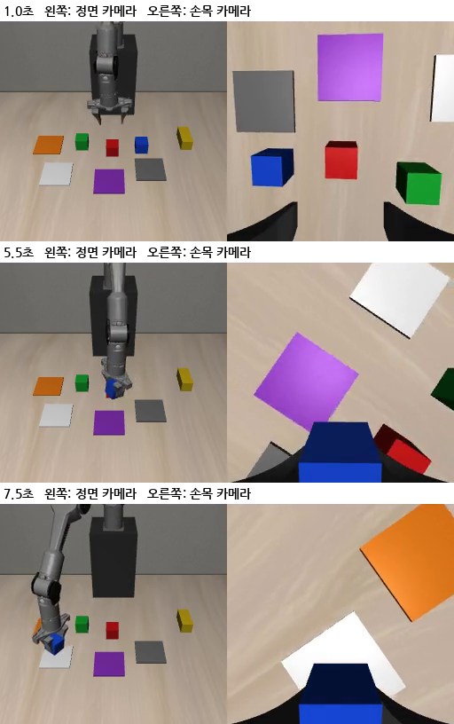

# 2026-10-17 학생이 위치 입력을 쓰게 만들기 (alc2, alc3p)

> 한 줄 요약: 새 층 학습률을 30배로 키워도(alc2) 학생은 손 기준 블록 위치를 쓰지 않았다. 두 카메라를 모두 가리는 장면을 섞어 다시 시험한다.

## 오늘 결과 한눈에

| 무엇을 봤나 | 결과 |
|---|---|
| alc2 (새 층 학습률 1e-3, 정면 가리기 30%) 민감도 | 2,500·5,000스텝 모두 0.1cm 안. 새 층 가중치는 3~4배 자랐는데 동작은 그대로 |
| 넓은 민감도 (처음 출발할 때, 블록 +5cm, 정면 가림) | 0.2cm 안. 학습 데이터에 입력이 들어가는 길은 정상 |
| 다음 시험 | alc3p: 두 카메라 모두 가리는 장면 20% + 정면만 20%, 2,500스텝 |

## 1. alc2: 학습률 문제가 아니었다

어제(10/16 10절) 새 층(state_suffix_proj)이 거의 자라지 않는 것을 보고, 그 층만 학습률 1e-3 으로 alc1 에서 이어 학습했다.

| 저장본 | 로봇 8 | 블록 8 | 판 8 | 손목 화면 8 |
|---|---|---|---|---|
| alc1 | 0.049 | 0.078 | 0.074 | 0.038 |
| alc2 2,500스텝 | 0.163 | 0.211 | 0.185 | 0.155 |
| alc2 5,000스텝 | 0.209 | 0.272 | 0.231 | 0.180 |

(새 층의 입력별 가중치 열 크기)

가중치는 3~4배 자랐지만 민감도는 그대로다 (2,500스텝, 빨강 블록 +2cm: 쥐기 25스텝 전 x −0.05cm, 10스텝 전 0.02cm).

더 넓게 재 봤다 (`sens_wide.py`, 5,000스텝 저장본, 빨강 블록 +5cm, 20번째·49번째 동작 목표):

| 순간 | 정면 보임 | 정면 가림 |
|---|---|---|
| 처음 (t=0) | 0.18cm 안 | 0.11cm 안 |
| 15스텝 | 0.09cm 안 | 0.05cm 안 |
| 쥐기 25스텝 전 | 0.21cm 안 | 0.21cm 안 |

블록을 5cm 옮겨도, 처음 출발할 때도, 정면 카메라를 가려도 동작이 0.2cm 넘게 바뀌지 않는다. 학습 코드가 `.relfeat.npy` 를 읽어 상태 뒤에 붙이는 것도 다시 확인했다.

해석 (가설): 정면을 가려도 손목 카메라가 처음 자세에서 책상 전체를 내려다보고 있어 블록 4개가 다 보인다 (아래 그림 1초). 손목 사진만으로도 시범 동작을 맞힐 수 있으니, 학생은 여전히 위치 숫자를 쓸 이유가 없다.

## 2. alc3p: 두 카메라 모두 가리기 (짧은 시험)

- `ttrtc.STATE["cam_drop_both"]`, `train_lora.py --cam-drop-both`: 정면을 가리는 장면 가운데 일부는 손목 카메라까지 가린다. 이 장면에서는 블록이 어디 있는지를 위치 숫자로만 알 수 있다. 학습 때만 가리고 평가에는 영향 없음 (CPU 확인)
- alc2 에서 이어, 정면만 가림 20% + 둘 다 가림 20%, 2,500스텝 (GPU 혼자 약 30분) → 같은 넓은 민감도
- 판단: 블록을 5cm 옮겼을 때 동작 목표가 1cm 넘게 따라가면 위치 숫자를 쓰기 시작한 것. 그러면 길게 학습한다. 안 되면 이 방향은 접고 보조 쪽 실패(일 바꾸기의 B, 돌아오기)를 판다
- 그 뒤 als2 + 정렬·놓기 보조 28항목 (일꾼 4개) — VLA + 보조의 첫 전체 성적

## 다음에 할 것

- alc3p 민감도 결과로 방향 정하기
- als2 + 보조 28항목 결과 기록
- 실물 PiPER 손목 카메라 자리를 재서 시뮬 카메라(`build_piper_xml.py` 의 eye_in_hand: 손 중심에서 옆 7cm·위 2cm, 시야각 75도)를 맞추기
