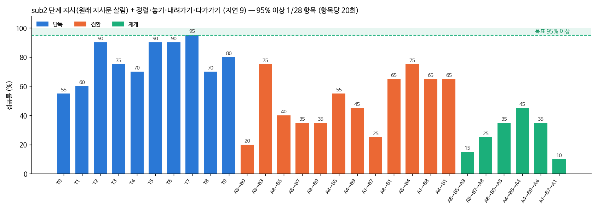

# 2026-10-19 단계 지시 다시: 원래 지시문을 살려서 (sub2)

> 한 줄 요약: 원래 지시문을 살린 단계 지시(sub2)는 놓을 곳을 뺀 sub1(48.2%)보다 나았지만(55.0%), 같은 데이터·같은 출발점의 als3a(57.5%)와 비슷하고 als2 + 보조(61.4%)보다 낮다. 단계 지시만으로는 오르지 않았다.

## 오늘 결과 한눈에

| 무엇을 봤나 | 결과 |
|---|---|
| 지금 가장 좋은 것 | als2 + 정렬·놓기·내려가기·다가가기 28항목 3cm 61.4% / 판 안 64.3% (VLA 단독 als2 20.7% / 35.7%) |
| sub2 + 보조 (10/20 06:40) | 3cm 55.0% / 판 안 59.5% |

## 1. sub2: 원래 지시문을 살린 단계 지시

10/17 sub1 은 'pick up the red block' 처럼 놓을 곳이 빠진 집기 지시를 받아, 원래 블록을 못 쥐어 새 지시가 안 나온 장면이 52/240 (als2 + 보조 9) 으로 늘었다. 시범 프로그램은 놓을 자리에서도 손이 닿는 쥐는 방향을 고르므로, 놓을 곳을 모르면 같은 상황에 정답이 여러 개가 된다는 가설.

| 지금 상태 | sub1 (10/17) | sub2 (오늘) |
|---|---|---|
| 아무것도 안 쥠 | pick up the red block | pick up the red block to put it on the purple square |
| 지시문의 블록을 쥠 | put it on the purple square | put the red block you are holding on the purple square |
| 다른 블록을 쥠 | put it down | put down the block you are holding, then put the red block on the purple square |

- 단계가 바뀌는 지점은 sub1 과 같다 (같은 규칙, 글만 다름). `subtask.py --style tag` → `.subtask_tag.npy`, `train_lora.py --subtask tag`, 모델 폴더 `subtask_style` 로 평가가 같은 글을 만든다
- 학습: als2 에서, als3a·sub1 과 같은 데이터, 10,000스텝 (`run_sub2.sh`)
- 평가: sub2 + 정렬·놓기·내려가기·다가가기 28항목 (비교: als2 61.4%, als3a 57.5%, sub1 48.2%, 모두 같은 보조)

## 2. 밤사이 고친 것

- **GPU 메모리** (02시): 평가 하나가 2.2 → 2.6GB 로 커졌다. CUDA 그래프를 입력 모양마다 따로 녹화하는데, 지시문 토큰 길이도 모양에 들어간다. 단계 지시는 길이가 세 가지라 그래프가 3개까지 늘어 2.9GB, 4개면 11.7GB 로 GPU 를 넘는다. → 단계 지시 모델 + CUDA 그래프일 때 지시문을 48토큰으로 채운다 (채운 토큰은 주의 마스크로 가려진다). 고친 뒤 새 평가는 2.2GB
- **쥔 블록 판정** (03시): sub2 A8→B5 장면 1000 에서 학생은 빨강을 쥐고 있었는데 단계 지시가 'put the green block you are holding ...' 이 됐다. 쥔 블록 = 손에서 가장 가까운 블록인데, 기억한 블록 위치는 손이 8cm 안이면 갱신하지 않아 여러 번 쥐다 움직인 빨강의 위치가 틀렸다. 학생은 빨강을 흰 판으로 옮겼다. → 쥐는 순간에는 지금 정면 사진으로 잰 위치를 쓴다 (손에 가려 안 보일 때만 기억한 위치)
- 그때까지 잰 3항목 (A8→B0·B5·B7) 은 `outputs/old_sub2apr_before_fresh` 에 두고, 28항목을 처음부터 다시 잰다 (03시~, 아침 8시쯤)

참고로 고치기 전 3항목 (B 3cm / 돌아오기 3cm, 20장면씩): A8→B0 7/5, A8→B5 7/6, A8→B7 7/4 — sub1 (2/2, 5/5, 3/5) 보다 높고 als2 + 보조 (5/3, 8/10, 9/7) 와 비슷하다. 새 지시까지 간 장면 18/20 (sub1 15).

## 3. sub2 + 보조 28항목 (10/20 06:40 끝)

| 조건 (모두 정렬·놓기·내려가기·다가가기 보조, 3cm / 판 안) | 혼자 | 일 바꾸기 | 돌아오기 | 28항목 평균 |
|---|---|---|---|---|
| als2 (원래 지시문) | 83.5 / 85.0 | 56.7 / 59.6 | 34.2 / 39.2 | **61.4 / 64.3** |
| als3a (원래 지시문, sub 와 같은 데이터·출발점) | 77.0 / 77.5 | 52.1 / 55.4 | 35.8 / 39.2 | 57.5 / 59.8 |
| sub1 (단계만, 놓을 곳 없음) | 72.5 / 74.5 | 40.0 / 40.4 | 24.2 / 25.0 | 48.2 / 49.3 |
| sub2 (원래 지시문 살린 단계 지시) | 77.5 / 80.0 | 50.0 / 52.9 | 27.5 / 38.3 | 55.0 / 59.5 |

- 놓을 곳을 살리자 sub1 보다 7%p 올랐다 — sub1 이 낮았던 큰 이유가 놓을 곳을 뺀 것이라는 가설과 맞는다
- 그러나 같은 데이터·같은 출발점의 als3a (원래 지시문) 와 비교하면 2.5%p 낮다 (20장면씩이라 우연 범위). 단계 지시 자체의 효과는 보이지 않았다

실패 나누기 (als2 + 보조 → sub2 + 보조):

| 구분 | 블록 위에서 못 쥠 | 원래 블록을 못 쥐어 전환 안 됨 | 판 안 (3cm 밖) |
|---|---|---|---|
| 새 지시 B | 53 → 39 | 9 → 26 | 7 → 7 |
| 돌아오기 | 42 → 34 | 6 → 17 | 6 → 13 |

'블록 위에서 못 쥠' 은 줄었지만, 그 대신 원래 일(A)의 블록을 처음에 못 쥐는 장면이 늘었다. 단계 지시가 '지금 무엇을 할지' 의 헷갈림은 조금 줄이지만, 집기 자체는 조금 나빠지는 것으로 보인다 (sub1 과 같은 방향, 정도는 작음).

## 4. 정리 (지금까지 시험한 것, 모두 같은 보조)

| 방법 | 28항목 3cm | 판단 |
|---|---|---|
| als2 (원래 지시문) | 61.4% | 지금 가장 좋음 |
| 보조 켠 교정 시범 더 배우기 (als3a) | 57.5% | 효과 없음 |
| 단계만 주는 지시 (sub1) | 48.2% | 나빠짐 (놓을 곳 빠짐) |
| 원래 지시문 살린 단계 지시 (sub2) | 55.0% | als3a 와 비슷, 효과 없음 |

10/16 이후 학생 모델 쪽 시도(위치 입력, 카메라 가리기, 학습률, 교정 시범, 단계 지시)는 모두 als2 를 넘지 못했다. 성적을 올린 것은 실행 보조(정렬·놓기 → 내려가기·다가가기)뿐이다.

## 다음에 할 것

- 학생 모델 쪽은 데이터 늘리기·더 오래 학습 같은 기본기부터 다시 보기 (als2 이후 데이터만 바꾼 시도가 모두 제자리)
- 남은 실패 중 큰 것: '블록 위에서 못 쥠' (쥐는 높이에서 학생이 손을 올림) — 쥐는 순간 장면을 영상으로 더 보기
- 95% 를 말하려면 항목당 50장면 이상으로 다시 재기
