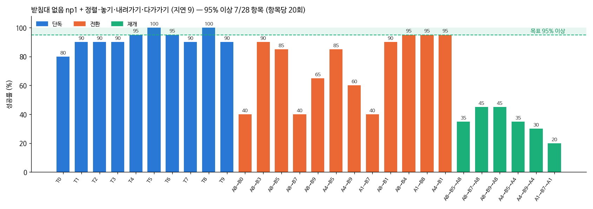
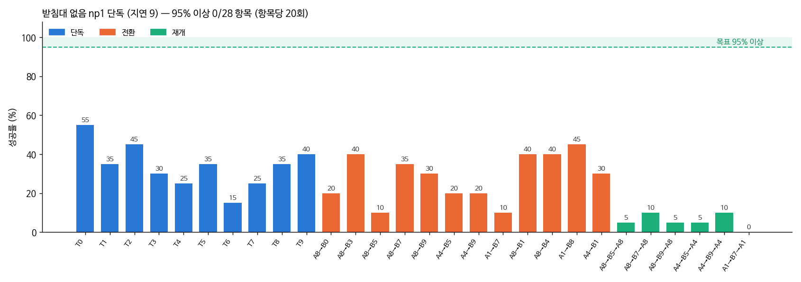
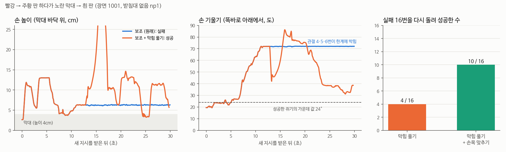

# 2026-10-21 받침대 없는 장면: 시범 새로 모으기와 첫 학습 (np1)

> 한 줄 요약: 받침대 없는 장면에서 새로 모은 시범으로 학습한 np1 + 보조가 28항목 3cm 71.8% (혼자 92.0%, 일 바꾸기 73.3%, 돌아오기 35.0%) 로, 받침대 장면의 가장 좋은 성적(61.4%)보다 높다. 돌아오기가 남은 숙제다.

## 오늘 결과 한눈에

| 무엇을 봤나 | 결과 |
|---|---|
| 받침대 없음 시범 | 정상 600, 넓은 배치 530, 일 바꾸기·돌아오기 1,194, 회복 218 (시도 300) |
| 올라가는 시범 (빈손으로 블록 바로 위에서 쥐지 않고 올라감) | 회복 48개 뺌, 나머지 0 |
| np1 학습 | als2 에서, 동작 정규화 다시, 15,000스텝. 검증 손실 0.054 → 0.049 |
| **np1 + 보조 28항목** | **3cm 71.8% / 판 안 74.3%** (혼자 92.0, 일 바꾸기 73.3, 돌아오기 35.0). 95% 넘는 항목 7개 |
| 블록 위에서 못 쥐는 까닭 | 손가락이 블록에 걸린 뒤 보조가 계속 눌러 손목 관절 4·5·6번이 한계에 박힘. 막힘 풀기 + 손목 맞추기로 실패 장면 16번 중 10번이 성공 (고른 장면만, 28항목은 오늘 밤) |

## 1. 수집 (10/20 17:26 ~ 10/21 00:34)

- 정상 600 / 600, 넓은 배치 530 / 600 (물체가 흩어져 시범 프로그램도 가끔 실패), 일 바꾸기 12쌍 × 40 = 원래 일·새 지시·돌아오기 1,194, 회복 218 / 300 (일부러 흐트러진 상태에서 시작)
- 일 바꾸기 수집이 가장 느려 (19:38) 남은 쌍을 뒤에서부터 모으는 수집기를 하나 더 붙였다. 이미 저장된 장면은 건너뛰므로 겹치지 않는다
- 회복 시범은 고친 시범 프로그램 (`PIPER_NEAR_GRASP=1`) 으로 모았는데도 218개 중 48개에 '올라가는' 모양이 있었다. 고친 경로는 손이 블록 바로 위(옆 1.5cm·방향 20° 안)일 때만 켜지기 때문이다. 학습에서 뺐다

## 2. 사진 특징 미리 계산과 충돌

GPU 가 빈 동안 다 모인 묶음부터 사진 특징을 미리 계산했다 (정상·넓은 배치 21:38~, 일 바꾸기 22:45~). 빨리 끝내려고 같은 묶음에 계산 줄을 여러 개 붙였다가, 두 줄이 같은 파일을 동시에 쓰며 임시 파일 이름 바꾸기가 충돌해 한 줄이 죽었다. 남은 줄이 끝난 뒤 한 줄로 다시 훑어 빠진 것을 채우고, 묶음마다 시범 수와 사진 특징 수가 같은지 확인한 다음 학습을 시작했다 (600·530·1,194·218 모두 같음).

## 3. 순서 (`run_np_round_d.sh`)

np1 학습 (02:04~, 아침 5시쯤 끝) → np1 + 정렬·놓기·내려가기·다가가기 보조 28항목 → np1 단독 28항목. 받침대 있는 장면의 성적과는 따로 적는다.

## 4. np1 + 보조 28항목 (07:3x 끝)

| 받침대 없음 (3cm / 판 안) | 혼자 | 일 바꾸기 | 돌아오기 | 28항목 평균 |
|---|---|---|---|---|
| np1 + 정렬·놓기·내려가기·다가가기 | 92.0 / 92.0 | 73.3 / 77.1 | 35.0 / 39.2 | **71.8 / 74.3** |

참고로 받침대 29cm 장면의 가장 좋은 것은 als2 + 같은 보조 61.4 / 64.3 (혼자 83.5, 일 바꾸기 56.7, 돌아오기 34.2). 장면(로봇 자리·처음 자세·쥐는 방향)이 달라 같은 비교는 아니다.

- 혼자 과제: T5·T8 20/20, T4·T6 19, 나머지 16~18
- 일 바꾸기: A1→B8·A4→B1·A8→B4 19/20, A8→B1·B3 18. 낮은 것은 A1→B7·A8→B7 (새 지시가 노란 막대) 8, A8→B0 8
- 돌아오기: 4~9/20 — 여전히 가장 약하다
- 새 지시까지 간 장면 240 중 238 (원래 블록을 처음에 못 쥐는 일이 거의 없어졌다)

실패 나누기 (`outputs/piper/fail_piper_np1apr.md`):

| 구분 | 성공 | 판 안(3cm 밖) | 판 밖에 놓음 | 쥐었다 빠짐 | 쥔 채 시간 끝 | 블록 위에서 못 쥠 | 블록까지 못 감 | 전환 안 됨 |
|---|---|---|---|---|---|---|---|---|
| 혼자 (200) | 184 | | 5 | 3 | 4 | 4 | | |
| 새 지시 B (240) | 176 | 9 | 19 | 7 | 4 | 21 | 2 | 2 |
| 돌아오기 (120) | 42 | 5 | 15 | 7 | 10 | 29 | 11 | 1 |

받침대 장면(als2 + 보조: B 못 쥠 53, 돌아오기 42)보다 '블록 위에서 못 쥠' 이 줄었다. 돌아오기는 못 쥠 29, 판 밖 15, 못 감 11 로 고르게 남았다.

왜 좋아졌나 (가설, 아직 나눠 재지 않음): ① 새로 모은 시범에 '올라가는' 교정 시범이 없다 (교정 시범 없이 정상·일 바꾸기·회복만, 회복의 올라가는 시범 48개 뺌) ② 손목을 기울여 쥐는 방향이 IK 로 장면마다 정해져 시범이 더 일관적일 수 있다 ③ 15,000스텝으로 더 오래 학습

## 5. np1 단독 28항목 (12:03 끝) — VLA 단독과 VLA + 보조

| 받침대 없음 np1 (3cm / 판 안) | 혼자 | 일 바꾸기 | 돌아오기 | 28항목 평균 |
|---|---|---|---|---|
| VLA 단독 | 34.0 / 54.5 | 28.3 / 42.1 | 5.8 / 8.3 | **25.5 / 39.3** |
| VLA + 정렬·놓기·내려가기·다가가기 | 92.0 / 92.0 | 73.3 / 77.1 | 35.0 / 39.2 | **71.8 / 74.3** |

VLA 단독도 받침대 장면의 가장 좋은 단독(als2 20.7 / 35.7)보다 조금 높지만, 보조가 성적의 큰 몫을 차지하는 것은 같다. 특히 돌아오기는 단독이면 거의 못 한다 (120장면 중 7).

## 6. np2 라운드 (12:03~, `run_np2_round.sh`)

- np1 교정 시범 (보조 켬, 고친 시범 프로그램): 단독 T0 15장면·T1·T2·T3·T7·T9 8장면, 일 바꾸기 A8→B0·B7·A1→B7 22장면 등, 돌아오기 6쌍 22장면씩
- 동시에 돌아오기 6쌍의 일반 시범을 쌍마다 40장면씩 더 (장면 3140~3179)
- → 정리·올라가는 시범 거르기 → np2 학습 (np1 에서, 10,000스텝) → np2 + 보조 28항목 → np2 단독 28항목

## 7. 블록 위에서 못 쥐는 까닭 — 손목 관절이 한계에 박힌다 (17~18시)

np1 + 보조에서 가장 많은 실패는 '블록 위에서 못 쥠' 이다 (새 지시 21, 돌아오기 29). 저장된 손 궤적을 보면 이때 손이 똑바로 아래에서 55~77° 기울어 있다. 성공한 쥐기는 가운데 값 24° (5~95% 구간 16~51°) 다.

같은 장면을 그대로 다시 돌리면 결과가 똑같이 나온다 (보조가 손댄 스텝 수까지 같음). 그래서 실패 장면 8개를 다시 돌리며 25스텝마다 손이 무엇에 닿는지, 한계 10° 안에 든 관절, 손가락 방향을 찍었다 (`diag_hover.py`). 8장면 모두 순서가 같았다.

1. 손가락이 블록 윗면·모서리나 책상에 걸린다. 노란 막대는 손가락이 벌어지는 방향이 막대의 짧은 쪽과 66~76° 어긋나 있었다. 7cm 로 벌린 손가락이 9cm 길이 쪽을 잡으려다 윗면에 얹힌다. 정육면체도 20~45° 어긋난 장면이 많았다
2. 내려가기 재촉 보조가 계속 아래로 누른다 (동작 z −0.30)
3. 손이 70° 넘게 기울며 손목 관절 4번(−100°)·6번(120°)·5번(70°)이 차례로 한계에 박힌다 → 30초 끝날 때까지 손이 움직이지 않는다
4. 손가락에 밀려 블록이 움직였는데, 보조가 기억한 위치는 손이 8cm 안이면 갱신하지 않아 옛 자리다. 블록 옆 2.4cm 를 계속 누른 장면도 있었다 (A8→B0 장면 1007)

고친 것 (`grasp_assist.py`, 실물에도 있는 정보만 씀: 관절 각도·손 자세·정면/손목 카메라)

- ⑪ 막힘 풀기 (`--unjam-assist`): 빈손으로 블록 근처에서 1초 동안 손이 3mm 도 안 움직이고 손목 관절 하나가 한계 3° 안이면, 손을 쥐는 높이 7cm 위까지 빼면서 처음 자세의 손 방향으로 되돌린다. 그 높이에서 정면 카메라로 블록 위치를 새로 잰 뒤 VLA 에 돌려준다
- ⑨ 손목 맞추기 (`--yaw-assist`, 손목 카메라로 블록 기울기를 재 손가락을 면과 나란히): 막힘 풀기와 같이 켜면 6번 관절 한계를 본다. 돌릴 방향이 관절을 한계 10° 안으로 넣으면, 손가락이 대칭이니 반대 방향으로 돌린다 (정육면체 90°, 막대 180°)

실패 장면 그대로 다시 돌리기 (`run_unjam_test.sh`, 9장면, 새 지시·돌아오기 중 실패 16번)

| 장면 | 원래 (새 지시 / 돌아오기) | + 막힘 풀기 | + 막힘 풀기 + 손목 맞추기 |
|---|---|---|---|
| A1→B7 1001 | 실패 / 실패 | 성공 / 성공 | 성공 / 실패 |
| A1→B7 1012 | 실패 / 실패 | 실패 / 성공 | 성공 / 성공 |
| A4→B5 1003 | 실패 / 실패 | 실패 / 성공 | 실패 / 성공 |
| A4→B9 1007 | 실패 / 판 안 | 실패 / 판 안 | 성공 / 성공 |
| A4→B9 1015 | 성공 / 실패 | 성공 / 실패 | 성공 / 실패 |
| A8→B0 1007 | 실패 / - | 실패 / - | 실패 / - |
| A8→B5 1017 | 실패 / 실패 | 실패 / 실패 | 실패 / 성공 |
| A8→B7 1012 | 실패 / 실패 | 실패 / 실패 | 성공 / 성공 |
| A8→B7 1013 | 실패 / 실패 | 실패 / 실패 | 실패 / 성공 |
| **실패 16번 중 성공으로** | | **4** | **10** |

고른 실패 장면만 본 것이라 아직 가설이다. 원래 성공하던 장면이 손목 맞추기 때문에 망가지는지는 28항목 전체로만 알 수 있다 (받침대 장면에서는 손목 맞추기가 섞인 결과였다). 그래서 오늘 밤 np2 평가에 'np2 + 보조 + 막힘 풀기 + 손목 맞추기' 28항목을 넣었다.

## 8. 오늘 밤 (`run_np2c_round.sh`, 18:40~)

np2 학습 (5,000스텝 검증 손실 0.0616) 이 끝나면 일꾼 4개로:

1. np2 + 보조 28항목 (`piper_np2apr`) — np1 + 보조 71.8% 와 모델만 다름
2. np2 + 보조 + 막힘 풀기 + 손목 맞추기 28항목 (`piper_np2uj`) — 1 과 보조만 다름
3. np2 단독 28항목 (`piper_np2h`) — VLA 혼자

## 다음에 할 것

- np2 결과 세 가지 비교 (모델 효과, 보조 효과, VLA 단독) — 내일 아침
- 막힘 풀기 + 손목 맞추기가 28항목에서도 좋으면 기본 보조로 쓰고, 그 보조를 켠 채 교정 시범을 모아 VLA 가 손목 방향을 배우게 한다
- VLA 단독이 손가락 방향을 못 맞추는 문제: 시범에서 쥐기 직전 손목 방향이 얼마나 일정한지, 학생 모델이 손목 카메라로 블록 방향을 보는지 확인
