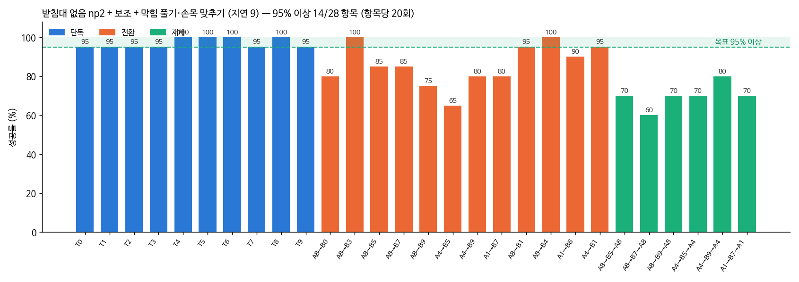
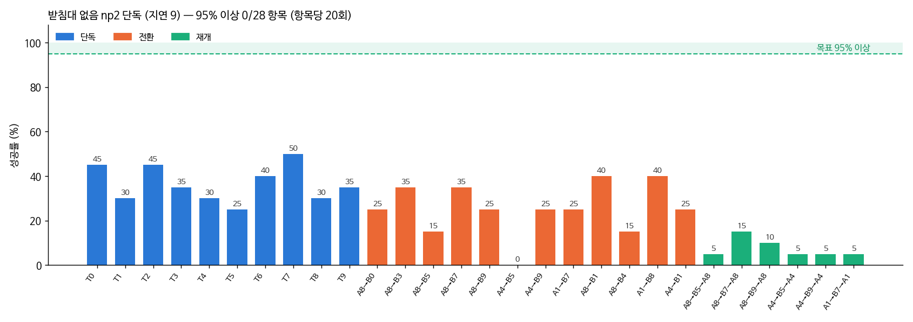
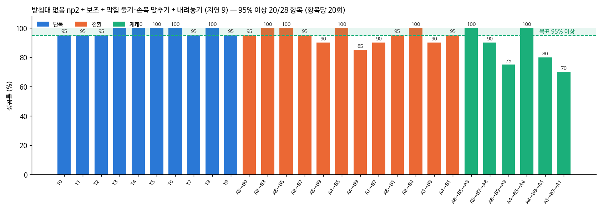
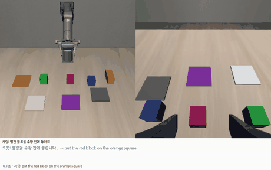
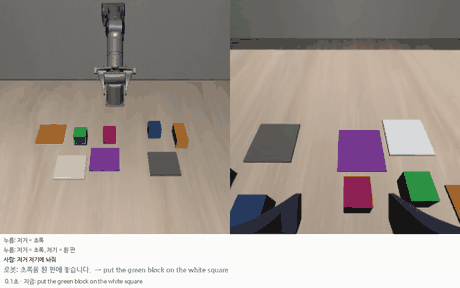
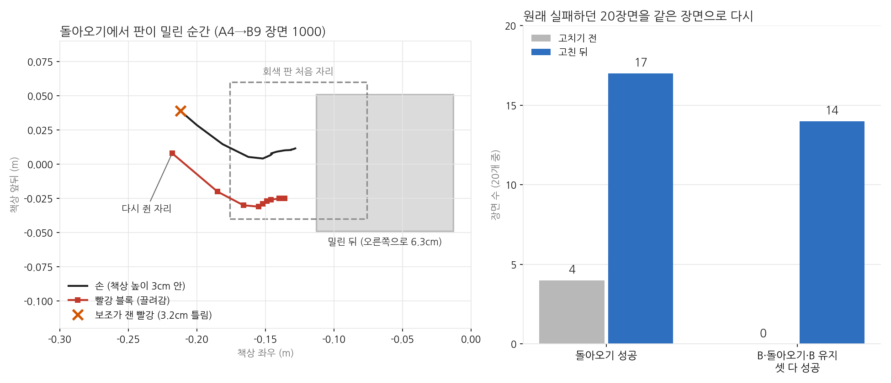

# 2026-10-22 막힘 풀기·손목 맞추기·내려놓기 보조: 받침대 없음 28항목 93.8%

> 한 줄 요약: 같은 np2 모델에 보조 두 가지를 더해 28항목 3cm 성공률을 74.1% → 86.4% (막힘 풀기·손목 맞추기) → **93.8%** (일 바꾸기 때 A 를 빈 자리에 내려놓기) 로 올렸다 (판 안 94.6%, 95% 넘는 항목 20개). 돌아오기는 40.8% → 85.8%. VLA 혼자는 25.5% 그대로다. 90% 를 넘어 한국어 해석기를 시작한다.

## 오늘 결과 한눈에

| 무엇을 봤나 | 결과 |
|---|---|
| **np2 + 보조 + 막힘 풀기·손목 맞추기 28항목** | **3cm 86.4% / 판 안 88.4%** (혼자 97.0, 일 바꾸기 85.8, 돌아오기 70.0). 95% 넘는 항목 14개 |
| 같은 np2 + 기존 보조 (10/21) | 3cm 74.1% / 판 안 77.3% (혼자 94.5, 일 바꾸기 73.8, 돌아오기 40.8) |
| 같은 장면끼리 짝 비교 | 기존 보조만 실패 → 새 보조로 성공 86번, 반대 17번 (부호 검정 p = 3×10⁻¹²) |

## 1. 무엇을 바꿨나 (10/21 7절)

10/21 저녁에 '블록 위에서 못 쥠' 실패 장면을 다시 돌려 원인을 찾았다. 손가락이 블록 윗면이나 모서리에 걸린 뒤에도 내려가기 보조가 계속 눌렀고, 손목 관절 4·5·6번이 한계에 박혀 끝까지 움직이지 못했다. 그래서 보조 두 가지를 더했다 (`grasp_assist.py`).

- **막힘 풀기**: 블록 근처에서 1초 넘게 손이 멈추고 손목 관절이 한계 3° 안이면, 손을 위로 빼며 처음 자세의 손 방향으로 되돌린다. 그 뒤 블록 위치를 새로 재고 VLA 에 돌려준다
- **손목 맞추기**: 손목 카메라로 블록 기울기를 재 손가락을 블록 면과 나란히 돌린다. 6번 관절이 한계로 가는 방향이면 대칭인 반대 방향으로 돌린다

모델(np2)과 장면(1000~1019번)은 10/21 의 'np2 + 보조' 와 같고, 보조만 다르다.

## 2. 28항목 결과 (00:45 끝)



| 받침대 없음 (3cm / 판 안) | 혼자 | 일 바꾸기 | 돌아오기 | 28항목 평균 | 95% 넘는 항목 |
|---|---|---|---|---|---|
| np1 + 보조 | 92.0 / 92.0 | 73.3 / 77.1 | 35.0 / 39.2 | 71.8 / 74.3 | 7 |
| np2 + 보조 | 94.5 / 94.5 | 73.8 / 77.5 | 40.8 / 48.3 | 74.1 / 77.3 | 10 |
| **np2 + 보조 + 막힘 풀기·손목 맞추기** | **97.0 / 97.5** | **85.8 / 88.8** | **70.0 / 72.5** | **86.4 / 88.4** | **14** |

VLA 단독 (보조 없음) 성적은 따로 잰다 (np2 단독 28항목, 지금 도는 중). np1 단독은 25.5 / 39.3 였다.

같은 장면끼리 짝 비교 (3cm 성공, 장면 번호가 같으면 처음 배치가 같다):

| | 기존 보조만 실패 → 새 보조 성공 | 기존 보조만 성공 → 새 보조 실패 | 부호 검정 p |
|---|---|---|---|
| 혼자 (200) | 8 | 3 | 0.23 |
| 새 지시 B (240) | 34 | 5 | 2×10⁻⁶ |
| 돌아오기 (120) | 44 | 9 | 1×10⁻⁶ |
| 전체 (560) | 86 | 17 | 3×10⁻¹² |

혼자 하는 과제는 차이가 작아 우연과 구별되지 않지만, 적어도 망가지지는 않았다. 일 바꾸기와 돌아오기는 뚜렷하게 올랐다.

돌아오기 쌍별 (20장면 중 성공): A8→B5→A8 7 → 14, A8→B7→A8 7 → 12, A8→B9→A8 9 → 14, A4→B5→A4 9 → 14, A4→B9→A4 8 → 16, A1→B7→A1 9 → 14.

## 3. 남은 실패

| np2 + 보조 + 막힘 풀기·손목 맞추기 | 성공 | 판 안(3cm 밖) | 판 밖에 놓음 | 쥐었다 빠짐 | 쥔 채 시간 끝 | 블록 위에서 못 쥠 | 블록까지 못 감 |
|---|---|---|---|---|---|---|---|
| 혼자 (200) | 194 | 1 | | 1 | 1 | 3 | |
| 새 지시 B (240) | 206 | 7 | 13 | 1 | 5 | 8 | |
| 돌아오기 (120) | 84 | 3 | 5 | 1 | 3 | 22 | 2 |

- 돌아오기에서는 여전히 '블록 위에서 못 쥠' 이 가장 많다 (22, 기존 보조 32). 손은 블록 0.7cm 안까지 가는데 못 쥔다
- 새 지시에서는 '판 밖에 놓음' 13 (놓은 곳이 판 가운데에서 4.2cm, 판 가장자리 바로 밖) 이 가장 많다

## 4. A 를 어디에 내려놓나 — 남은 실패의 가장 큰 원인 (02시)

일 바꾸기 때 쥐고 있던 블록 A 를 VLA 가 어디에 내려놓는지 셌다 (A 와 B 의 블록이 다른 7쌍, 140장면).

| np2 + 보조 + 막힘 풀기·손목 맞추기 | 장면 | 새 지시 B 성공 | 돌아오기 성공 |
|---|---|---|---|
| A 를 B 의 놓을 곳(6cm 안)에 내려놓음 | 59 | 32 / 59 (54%) | 17 / 47 (36%) |
| 다른 곳에 내려놓음 | 81 | 78 / 81 (96%) | 67 / 73 (92%) |

돌아오기를 A 와 가장 가까운 물체까지 거리로 나누면 6cm 안 16/44, 6~9cm 16/22, 9~12cm 30/32, 12cm 넘게 22/22 였다. '판 밖에 놓음' 으로 나뉜 새 지시 실패 13번 중 7번은, B 블록이 판 가운데 2cm 안에 있는데 책상 위 5~7cm 높이였다. 판 위에 먼저 내려놓은 A 위에 B 를 쌓은 것이다 (판에 닿아야 성공).

시범 프로그램은 A 를 쥔 자리에 그대로 내려놓는다 (`switch_v6.put_down_any`). 그런데 VLA 는 새 지시가 말하는 판 쪽으로 A 를 들고 가 거기 내려놓는 일이 많다.

고친 것: ⑫ 내려놓기 보조 (`--putdown-assist`). 쥔 블록이 지시문의 블록이 아니면 (일 바꾸기 직후) 빈 자리로 옮겨 내려놓고 6cm 든 뒤 VLA 에 돌려준다. 빈 자리는 다른 물체에서 9cm, 새 지시의 블록·놓을 곳에서 12cm 넘게 떨어진 곳이고, 되도록 그 블록이 처음 놓여 있던 자리를 쓴다 (시범과 같음). 정면 카메라 위치와 로봇 상태만 쓴다. np2 단독 평가가 끝나면 28항목으로 잰다 (`run_np2d_round.sh`, piper_np2pd).

이 실패들이 다 고쳐진다면 28항목 평균이 90% 를 넘을 수 있다는 계산이 나오지만, 재기 전에는 가설이다.

## 5. np2 단독 28항목 — VLA 혼자 (05:09 끝)



| 받침대 없음, VLA 단독 (3cm / 판 안) | 혼자 | 일 바꾸기 | 돌아오기 | 28항목 평균 |
|---|---|---|---|---|
| np1 단독 | 34.0 / 54.5 | 28.3 / 42.1 | 5.8 / 8.3 | 25.5 / 39.3 |
| np2 단독 | 36.5 / 51.0 | 25.4 / 35.8 | 7.5 / 13.3 | 25.5 / 36.4 |

VLA 혼자 성적은 np1 과 같다. 교정 시범과 돌아오기 시범을 더한 효과는 보조를 켰을 때만 보였다 (np2 + 보조 74.1 vs np1 + 보조 71.8). 보조 없이는 마지막 1~2cm 맞추기, 쥐기, 블록까지 가기가 모두 약하다.

| np2 단독 실패 나누기 | 성공 | 판 안(3cm 밖) | 판 밖에 놓음 | 쥐었다 빠짐 | 쥔 채 시간 끝 | 블록 위에서 못 쥠 | 블록까지 못 감 | A 를 못 쥐어 전환 안 됨 |
|---|---|---|---|---|---|---|---|---|
| 혼자 (200) | 73 | 29 | 45 | 24 | 3 | 18 | 8 | |
| 새 지시 B (240) | 61 | 25 | 18 | 13 | 2 | 42 | 36 | 43 |
| 돌아오기 (120) | 9 | 7 | 6 | 3 | | 20 | 52 | 23 |

돌아오기에서는 원래 블록까지 가지도 못하는 경우(52)가 가장 많다. 보조의 '다가가기'(빈손으로 서성이면 블록 위로 데려감)가 맡던 부분이다.

## 6. 내려놓기 보조 28항목 — 93.8% (07:33 끝)



| 받침대 없음, VLA + 보조 (3cm / 판 안) | 혼자 | 일 바꾸기 | 돌아오기 | 28항목 평균 | 95% 넘는 항목 |
|---|---|---|---|---|---|
| np2 + 보조 | 94.5 / 94.5 | 73.8 / 77.5 | 40.8 / 48.3 | 74.1 / 77.3 | 10 |
| np2 + 보조 + 막힘 풀기·손목 맞추기 | 97.0 / 97.5 | 85.8 / 88.8 | 70.0 / 72.5 | 86.4 / 88.4 | 14 |
| **+ 내려놓기** | **97.5 / 98.0** | **94.6 / 95.4** | **85.8 / 87.5** | **93.8 / 94.6** | **20** |
| (참고) np2 단독, 보조 없음 | 36.5 / 51.0 | 25.4 / 35.8 | 7.5 / 13.3 | 25.5 / 36.4 | 0 |

같은 장면끼리 짝 비교 (막힘 풀기·손목 맞추기까지 → + 내려놓기, 3cm 성공):

| | 앞만 실패 → 내려놓기로 성공 | 앞만 성공 → 내려놓기로 실패 | 부호 검정 p |
|---|---|---|---|
| 혼자 (200) | 1 | 0 | 1 |
| 새 지시 B (240) | 25 | 4 | 0.0001 |
| 돌아오기 (120) | 30 | 11 | 0.004 |
| 전체 (560) | 56 | 15 | 1×10⁻⁶ |

내려놓기는 일 바꾸기 때만 켜지므로 혼자 하는 과제는 거의 그대로이고, 새 지시와 돌아오기가 올랐다. 돌아오기 쌍별: A8→B5→A8 20, A4→B5→A4 20, A8→B7→A8 18, A4→B9→A4 16, A8→B9→A8 15, A1→B7→A1 14 (20장면 중).

남은 실패 (560번 중 35번): 돌아오기 판 밖에 놓음 6 (놓은 곳이 목표에서 30cm — 다른 판에 놓음), 블록 위에서 못 쥠 3·3·3 (혼자·새 지시·돌아오기), 쥐었다 빠짐 3·2. 가장 약한 쌍은 A1→B7→A1 (14/20) 과 A8→B9→A8 (15/20).

**사용자 규칙 "90% 넘으면 해석기 시작하자" (10/22) → 93.8% 로 넘었다. 다음은 한국어 명령 해석기와 지시 입력 창.**

## 7. 한국어 명령 해석기와 실행기 (08시~)

사용자 규칙("90% 넘으면 해석기 시작하자")대로 시작했다. 두 부분이다.

**해석기** (`korean_cmd.py`): 한국어 문장을 VLA 가 아는 영어 지시문과 '끼어들기·돌아오기' 순서로 바꾼다. 규칙으로 만들어 인터넷 없이 실물 PC 에서도 돈다.

| 사람이 친 문장 | 해석 |
|---|---|
| 빨간 블록을 보라 판에 올려줘 | 할 일: put the red block on the purple square |
| 파란 거 흰 판에 놔 | 할 일: put the blue block on the white square |
| 초록 블록을 파란 블록 위에 쌓아줘 | 할 일: put the green block on the blue block |
| 잠깐, 초록 블록 먼저 흰 판에 놓고 하던 거 이어서 해줘 | 끼어들기: 초록 → 흰 판, 끝나면 하던 일로 |
| 그 전에 노란 막대를 흰 판에 놓아줘 | 끼어들기 ('그 전에'·'먼저'·'잠깐' 이면 돌아온다) |
| 그거 말고 빨간 블록을 회색 판에 놔 | 하던 일 버리고 새 일 |
| 빨간 블록을 주황 판에 놓고 초록 블록을 빨간 블록 위에 쌓아줘 | 할 일 두 개를 차례로 |
| 빨간 블록 집어줘 | 되물음: 빨강을 어디에 놓을까요? |
| 이어서 해줘 / 멈춰 | 돌아가기 / 멈춤 |
| 파란 블록을 보라 판에 올려줘 | 하되 "배운 적 없는 조합 — 정확도 낮을 수 있음" 이라고 알림 |

**실행기** (`korean_live.py`): 시뮬 로봇을 돌리며 문장을 받는다. 터미널에 치거나 대본(시각·"처음 쥔 뒤 3스텝" 같은 때)을 준다. 지시가 바뀌면 평가와 같은 방식(keep)으로 VLA 에 새 지시를 준다. 보조 5가지는 다 켠다. 일이 끝났는지는 실물에서도 쓸 수 있게 **정면 카메라와 그리퍼만으로** 본다. 블록이 판 가운데 4.5cm 안(판 안)이거나 다른 블록 위 2.5cm 안이고, 손을 벌린 상태가 10스텝 이어지면 끝으로 친다. 끝나면 이어서 할 일이나 쌓아 둔 하던 일로 넘어간다.


| 시연 | 결과 |
|---|---|
| 장면 1002: "빨간 블록을 보라 판에 올려줘" → 빨강을 쥔 직후 "잠깐, 초록 블록 먼저 흰 판에 놓고 하던 거 이어서 해줘" | 10.5초에 초록 → 흰 판 끝 (시뮬 판정 성공), 스스로 빨강으로 돌아가 36.8초에 끝 (성공). 처음 자세에서 16.7cm |
| 장면 1005: "빨간 블록을 주황 판에 놓아줘" → 쥔 직후 "그 전에 노란 막대를 흰 판에 올려놓고 이어서 해" | 12.6초에 노란 막대 끝, 19.9초에 빨강 끝 (둘 다 3cm 성공) |



**고친 것: 정면 카메라 변환식.** 장면 1005 를 처음 돌렸을 때 노란 막대를 흰 판 가운데 0.6cm 에 놓았다. 그런데 일이 끝난 줄 모르고 2분 동안 붙잡고 있었다. 원인은 화면 위치를 책상 위치로 바꾸는 식이었다. 이 식은 블록마다 따로, 장면 처음 배치(제자리 ±2cm)로만 맞춰져 있었다. 그래서 흰 판 위의 막대를 11cm 옆으로 읽었다. 블록 4개를 책상 아무 데나 1,440번 옮겨 놓고 찍어 블록 공통 식 하나를 다시 맞췄다 (`piper_sim/calib_front_wide.py`).

| 같은 1,440점 (책상 전체) | 평균 오차 | 90% | 최대 |
|---|---|---|---|
| 예전 식 (블록마다, 처음 배치로) | 1.78cm | 4.96cm | 13.61cm |
| 새 식 (블록 공통, 책상 전체) | 0.28cm | — | 1.30cm |

실행기의 끝 판정은 새 식을 쓴다. 보조도 같은 예전 식을 써 왔으므로, 보조만 새 식으로 바꾼 28항목을 재고 있다 (`run_np2e_round.sh`, piper_np2pw, 07:58~). 학생 모델 입력(손 기준 블록 위치)은 예전 식으로 학습했으니 그대로 둔다.

직접 해 보려면 (연구실 PC 터미널):

```
cd ~/smolVLA && PIPER_NOPED=1 PIPER_BLOCKS=1 PIPER_GRASP_STYLE=align MUJOCO_GL=egl .venv/bin/python korean_live.py --show --episode 1005
```

## 8. '저거' 가리키기 (09시)

실행기 창 왼쪽(정면 카메라 화면)에서 블록을 누르면 '저거·이거·그거', 판(또는 두 번째로 누른 블록)을 누르면 '저기·여기·거기' 가 된다. 누른 자리 주변 12×12 화소에서 색 덩어리를 찾고, 판 위 블록을 누르면 블록을 고른다. 누른 것은 바로 다음 명령 하나에만 쓴다. 아무것도 안 누르고 '저거' 라고 하면 "어느 블록인지 화면에서 눌러 주세요" 라고 되묻는다. "그거 말고 ~" 의 '그거' 는 가리키기로 보지 않는다.

시연 (장면 1002, 대본으로 누르기):

| 때 | 누름 | 문장 | 해석 |
|---|---|---|---|
| 0초 | 초록 블록, 흰 판 | 저거 저기에 놔줘 | 초록 → 흰 판 |
| 3.5초 (초록을 쥔 직후) | 빨간 블록 | 잠깐, 이거 먼저 보라 판에 놓고 이어서 해 | 끼어들기: 빨강 → 보라 판, 끝나면 초록으로 |

12.9초에 빨강 → 보라 판 끝, 스스로 초록으로 돌아가 19.2초에 초록 → 흰 판 끝 (둘 다 시뮬 판정 3cm 성공).



## 9. 보조에 새 변환식 — 차이 없음 (10:19 끝)

7절에서 맞춘 책상 전체 변환식을 보조에도 써 28항목을 쟀다 (`run_np2e_round.sh`, piper_np2pw). 나머지는 6절(93.8%)과 같다.

| VLA + 보조 5가지 (3cm / 판 안) | 혼자 | 일 바꾸기 | 돌아오기 | 28항목 평균 |
|---|---|---|---|---|
| 예전 변환식 (블록마다, 처음 배치로) | 97.5 / 98.0 | 94.6 / 95.4 | 85.8 / 87.5 | **93.8 / 94.6** |
| 새 변환식 (블록 공통, 책상 전체) | 96.5 / 96.5 | 96.2 / 97.1 | 80.8 / 83.3 | 93.0 / 93.9 |

같은 장면끼리: 새 식만 성공 20번, 예전 식만 성공 24번 (부호 검정 p = 0.65) — 차이가 없다. 보조가 블록을 다루는 곳은 대부분 처음 자리 근처다 (내려놓기 보조도 처음 자리에 내려놓는다). 예전 식은 그곳에서 평균 0.09cm 로 정확하니, 책상 전체가 맞아도 얻을 게 적었다고 본다. 보조는 예전 식 그대로 쓰고, 블록이 판 위로 옮겨진 뒤를 봐야 하는 한국어 실행기의 끝 판정만 새 식을 쓴다.

## 10. 다음: 보조 증류 — VLA 혼자 성적 올리기 (11시~)

VLA + 보조는 93.8% 이고 남은 실패 35번(560번 중)은 여러 갈래로 흩어져 있다. 내려놓기 보조가 혼자 하는 과제에서 잘못 켜진 경우도 200번 중 8번 있었지만, 그중 실패는 1번이다. 그런데 VLA 혼자는 25.5% 로 np1 과 같다. 보조가 하는 일을 VLA 가 배우지 못했다.

가설: 보조가 고친 동작을 그대로 정답으로 삼아 학습하면 (성공한 것만 골라 따라 하기, filtered behavior cloning), VLA 가 보조 없이도 마지막 맞추기·막힘 풀기·빈 자리에 내려놓기를 하게 된다.

- `assist_collect.py`: np2 + 보조 5가지를 평가와 똑같이(지연 9, 쥔 지 3스텝에 새 지시) 학습용 장면(3300~3319)에서 돌린다. 성공한 구간의 (관측, 보조까지 거친 동작)을 시범으로 저장한다 (혼자 과제 A, 일 바꾸기 B, 돌아오기 A2)
- `run_np3_round.sh`: 22개 × 20장면 모으기 → 정리 → np3 학습 (np2 에서, 지금 데이터 + 보조 시범을 교정 시범 몫 35% 로, 10,000스텝) → np3 + 보조 5가지, np3 단독 28항목

## 11. 새 기준: 옮기는 도중에 끼어들기 (14~16시)

사용자: "지금 바로 쥐었다가 바로 놓잖아 어느정도 수행했다가 다른곳에 놨다가 다른 태스크하고 다시 하는걸로 못하나" → "이제 그 기준으로 하자". 앞으로 일 바꾸기는 이렇게 잰다. 예전 기준(쥔 직후, 93.8%) 점수와 섞지 않는다.

- 새 지시: 쥔 직후(3스텝)가 아니라 **들고 옮기는 도중**(쥔 뒤 30스텝 = 1.5초). 그때 블록은 처음 자리에서 9~12cm 옮겨져 있다
- 쥔 블록: 처음 자리로 되돌리지 않고 **손에서 가까운 빈 자리**에 놓는다 (보조 `--putdown-near`)
- B 가 끝난 것: 블록이 놓을 곳에 닿고 **손을 벌릴 때까지** (`--release-wait 40`, 아래). 한국어 실행기·실물과 같다
- 함께 적는 것: B 를 끝까지 지켰나, **셋 다**(B 성공·돌아오기 성공·B 유지) — 한국어 끼어들기 한 문장이 끝까지 된 것


(4K, 장면 1002: "빨간 블록을 보라 판에 올려줘" → 빨강을 들고 가는 4.5초에 "잠깐, 초록 블록 먼저 흰 판에 놓고 하던 거 이어서 해줘" → 빨강을 가까운 빈 자리에 놓고 초록 → 흰 판 (12.1초) → 빨강으로 돌아가 보라 판 (20.8초), 둘 다 시뮬 판정 3cm 성공. np2 + 보조, 4배속)

**새 기준 미리 보기** (돌아오기 6쌍 × 장면 1000~1004): 새 지시 27/30, 돌아오기 24/30, 둘 다 21/30.

**쌓기 B 가 끝까지 남지 않는다.** B 가 '초록을 파랑 위에' 인 두 쌍(A4→B9, A8→B9)에서 B 가 마지막까지 남은 장면이 예전 기준에서도 40 중 1이었다. 다시 돌려 보니 (`diag_stack.py`) 초록이 파랑에 닿는 순간 평가가 B 성공으로 보고 돌아오기로 넘어갔는데, 손은 아직 초록을 쥐고 있었다. 보조가 그것을 '지시문(빨강)이 아닌 블록' 으로 보고 빈 자리로 옮겨 가 쌓은 것이 무너졌다.

- 평가: B 성공 뒤 손을 벌릴 때까지(최대 2초) B 지시로 더 돌린 뒤 돌아오기로 (`--release-wait 40`)
- 보조 ⑭ `--wrong-guard`: 지시문의 블록이 아닌 블록 위에서 오므리려 하면 막고, 같은 지시 아래 엉뚱한 블록을 쥐면 쥐었던 자리·높이에 도로 놓는다
- '앞 지시의 놓을 곳 위면 그 자리에서 놓기' 도 해 봤지만, 목적지가 가까운 쌍(A4: 빨강 → 회색 판)에서 옮기는 도중 A 를 미리 놓아 버려 뺐다

| 새 기준, 4쌍 × 5장면 (A1→B7, A4→B9, A8→B7, A8→B9) | B 성공 | B 끝까지 | 돌아오기 | 셋 다 |
|---|---|---|---|---|
| 보조 | 18 | 11 | 15 | 9 |
| + 엉뚱한 블록 막기 | 17 | 10 | 14 | 9 |
| **+ 손 벌림 기다리기** | 17 | **15** | 15 | **14** |

장면 수가 적어 숫자는 거칠지만, 쌓기 B 를 끝까지 지킨 장면이 1 → 5 로 늘었다. 오늘 밤 새 기준 28항목(np2 + 보조, np3 + 보조, np3 단독, np2 단독)을 이 설정으로 잰다 (`run_np3c_round.sh`).

## 12. 새 기준 돌아오기가 왜 실패하나 (22시~)

새 기준(옮기는 도중 새 지시) 28항목을 밤에 재기 시작했다. 먼저 끝난 세 쌍의 돌아오기는 A8→B0 75%, A8→B5 85%, A8→B7 70%로 목표 90%에 한참 못 미친다. 실패 장면을 같은 장면 번호로 다시 돌리며 손·판·블록·보조의 기억을 스텝마다 찍어 보니(`diag_pad.py`) 원인이 네 가지로 갈렸다. 고친 보조로 원래 실패하던 20장면을 다시 돌리면 셋 다 성공(B·돌아오기·B 유지)이 0에서 14로 늘었다. 원래 성공하던 장면이 깨지지 않는지는 28항목 전체로 재는 중이다.

평가는 17:04에 한 번 멈췄다. 메모리 압박이 20초 넘게 이어지자 시스템(systemd-oomd)이 Claude 앱을 통째로 껐고, 그 안에서 띄운 평가도 같이 꺼졌다. 이제 긴 작업은 앱과 따로 도는 단위(`systemd-run --user`)로 띄운다.



**찾은 원인**

1. 블록 위치를 2~3cm 틀리게 잰다. 정면 카메라 사진을 책상 좌표로 바꾸는 식을 블록마다 처음 놓인 자리 근처로만 맞춰 두었다. 예전 기준에서는 쥔 블록을 처음 자리로 되돌려 놓아 문제가 없었지만, 새 기준은 가까운 빈 자리에 내려놓기 때문에 그 자리에서 2.2cm, 3.2cm씩 틀렸다. 그래서 정렬 보조가 손을 블록 옆에 정확히 맞췄고 손가락이 블록 윗면에 걸렸다.
2. 블록을 끌고 가다 판을 민다. 위 그림의 장면에서 빨강을 다시 쥐자마자, 놓기 보조가 아직 책상 높이인 손을 판 쪽으로 끌었다. 빨강이 책상 위를 미끄러지며 회색 판을 6.3cm 밀었고, 보조는 판의 옛 자리에 빨강을 놓았다(판 위치는 처음 한 번만 잰다). 내려놓은 빈 자리가 그 판에서 9.5cm밖에 안 떨어져 있었다.
3. 블록 위치 기억이 낡는다. 헛쥐기로 블록이 6cm 밀렸는데, 보조는 손이 블록 8cm 안에 있으면 위치를 다시 재지 않는다(손에 가려 틀릴까 봐). 그래서 손을 빈 자리 위에 400스텝(20초) 붙잡아 두었다.
4. 쥐는 높이에서 오므리지 않는다. 노란 막대 B에서 손이 막대 바로 위 쥐는 높이까지 내려오고 손목 방향도 맞았는데(어긋남 0°), VLA가 오므리지 않고 다시 손을 들어 손목을 돌렸다. 이게 열 번 넘게 되풀이됐다.

**고친 것** (모두 켜는 옵션이라, 끄면 예전과 똑같다)

| 번호 | 옵션 | 하는 일 |
|---|---|---|
| ⑮ | `--pad-safe` | 쥔 블록이 책상 높이(쥐는 높이 3cm 위까지)면 옆으로 끌지 않고 먼저 든다. 내려놓을 빈 자리는 그 블록의 목표 판에서 13cm 넘게 |
| ⑯ | `--pad-track` | 판이 밀리면 기억을 고친다 (판 근처에 블록이 없고 손이 멀 때만) |
| ⑰ | `--mem-refresh` | 손이 8cm 안이어도 블록이 계속 다른 자리에 보이면(2.5cm 넘게, 10스텝) 기억을 고친다 |
| | 넓은 변환식 | 책상 전체로 맞춘 식 (평균 0.28cm, 10/22 아침에 만든 것) |
| ⑩ | `--close-assist` | 쥐는 높이에 맞춰 내려왔으면 들지 못하게 잡고 오므린다 (10/17에 만든 것) |

**원래 실패하던 20장면을 같은 장면으로** (`run_fix_test.sh`, np2, 새 기준)

| | 돌아오기 성공 | B·돌아오기·B 유지 셋 다 |
|---|---|---|
| 고치기 전 | 4 | 0 |
| 고친 뒤 | **17** | **14** |

실패 장면만 골라 다시 돌리면 조금만 달라져도 일부는 우연히 살아날 수 있어서, 이 숫자만으로 효과를 말하기는 이르다. 다만 서로 다른 세 설정에서 계속 실패하던 장면(A4→B9 1004, A8→B7 1000)이 살아났다. 남은 실패 6개 중 4개는 노란 막대 B이고, 그중 2개는 원래 B가 성공하던 장면이었다(나빠짐). 고친 보조로 새 기준 28항목 전체를 재서 같은 장면끼리 짝지어 비교한다 (`run_np2f_round.sh`).

## 다음에 할 것

- 실물 PiPER 실행기 (WeGo 플러그인·실물 카메라 2대): 시뮬 실행기의 로봇·카메라 부분만 바꾸면 되게 나누기
- 새 기준 28항목: np2 + 예전 보조(짝 비교 기준), np2 + 고친 보조, np3 + 고친 보조, VLA 단독. 목표 28항목 90%, 돌아오기 90%
- 노란 막대 B: 고친 뒤에도 남은 실패와 나빠진 2장면 다시 돌려 보기
- 가장 좋은 설정으로 4K GIF
