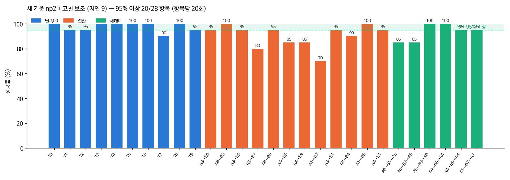
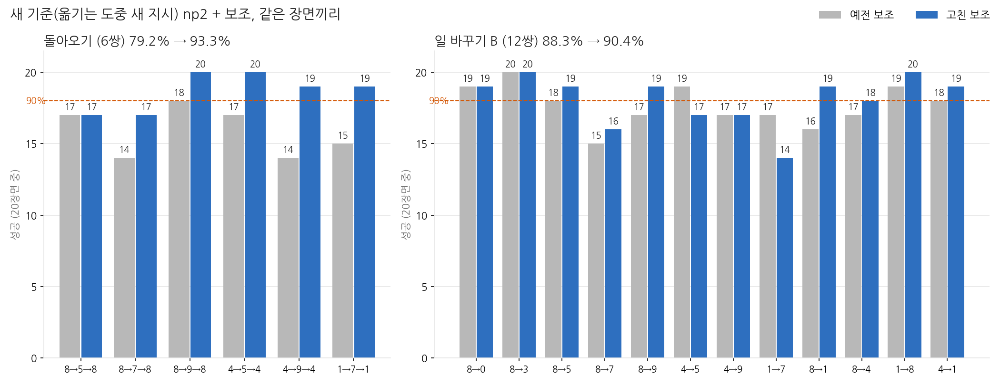
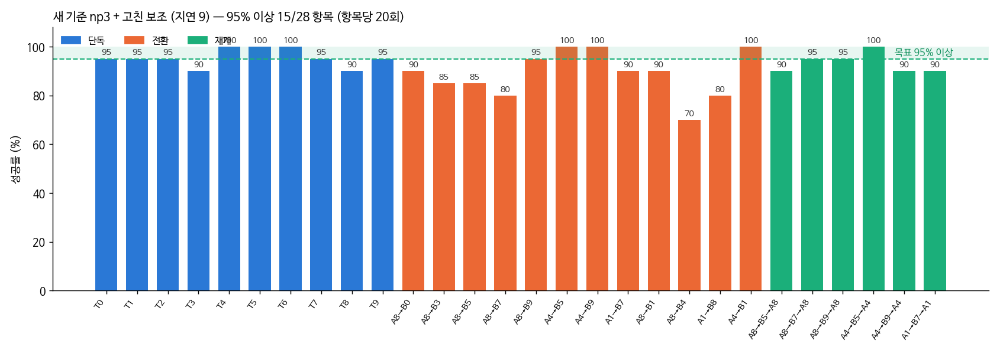

# 2026-10-23 새 기준 돌아오기 79% → 93%: 블록 위치를 다시 재고 기억을 고치게 함

> 한 줄 요약: 새 기준(옮기는 도중 새 지시) 28항목에서 np2 + 보조의 돌아오기를 **79.2% → 93.3%**, 28항목 평균을 **90.0% → 93.6%** 로 올렸다 (판 안 기준 94.2%, 94.6%). 같은 장면끼리 고친 보조에서만 성공한 장면이 36, 예전에서만 성공한 장면이 16 (부호 검정 p = 0.008). 목표였던 28항목 90%·돌아오기 90% 를 둘 다 넘었다. 고친 것 중 VLA 의 손을 직접 잡는 두 가지와 '판 따라가기'는 오히려 해로워 뺐다.

## 오늘 결과 한눈에

| 새 기준, np2 + 보조 (3cm / 판 안) | 혼자 | 일 바꾸기 | 돌아오기 | 28항목 평균 | 95% 넘는 항목 |
|---|---|---|---|---|---|
| 예전 보조 (10/22 밤) | 98.5 / 98.5 | 88.3 / 88.8 | 79.2 / 84.2 | 90.0 / 91.2 | 14 |
| **고친 보조** | 97.5 / 98.5 | **90.4 / 91.7** | **93.3 / 94.2** | **93.6 / 94.6** | **20** |

B 를 하고 돌아와 A 까지 마치고, 그동안 B 도 무너지지 않은 '셋 다 성공'은 71.7% → 78.3% 다. VLA 혼자(보조 없이) 새 기준 점수는 아직 재는 중이다.

## 1. 무엇을 바꿨나

10/22 밤에 새 기준 돌아오기 실패를 같은 장면으로 다시 돌려 원인 네 가지를 찾았다 (10/22 일지 12절). 그중 세 가지를 고친 것이 오늘 설정이다 (`grasp_assist.py`).

- **책상 전체로 맞춘 변환식**: 정면 카메라 사진을 책상 좌표로 바꾸는 식을 블록이 처음 놓인 자리 근처로만 맞춰 두어, 새 빈 자리에 내려놓은 블록을 2~3cm 틀리게 쟀다. 책상 전체로 맞춘 식(평균 0.28cm)을 쓴다
- **기억 고치기** (`--mem-refresh`): 손이 블록 8cm 안에 있으면 손에 가릴까 봐 블록 위치를 다시 재지 않았는데, 헛쥐기로 블록이 밀리면 옛 자리를 계속 가리켰다. 손 바로 밑이 아니고 계속(10스텝) 2.5cm 넘게 다른 자리에 보이면 고친다
- **먼 빈 자리** (`--putdown-far`): 쥐고 있던 블록을 내려놓을 빈 자리가 그 블록의 목표 판에서 9.5cm 밖에 안 떨어져, 다시 쥐고 끌다가 판을 밀었다. 목표 판에서 13cm 넘게 떨어진 자리를 고른다

## 2. 손을 직접 잡는 보조는 뺐다

처음에는 위 세 가지에 두 가지를 더 넣었다. 쥔 블록이 책상 높이면 옆으로 끌지 않고 먼저 드는 것(⑮), 쥐는 높이에 내려왔으면 VLA 대신 오므려 주는 것(⑩)이다. 원래 실패하던 20장면은 살아났지만, 짝 비교를 해 보니 B 가 떨어졌다.

| A8→B0·A8→B7 40장면, 같은 장면끼리 | B 성공 | 돌아오기 | 셋 다 |
|---|---|---|---|
| 예전 보조 | 34 | 29 | 27 |
| 다섯 가지 다 | 29 | 34 | 29 |
| **손을 잡는 두 가지 뺌** | **33** | **36** | **32** |

다시 돌려 보니(`diag_held.py`) 보조가 VLA 보다 먼저 블록을 쥐어 주면 VLA 는 쥔 직후부터 계속 손을 벌리려 했다. 놓을 곳에서 멀면 못 벌리게 하는 보조가 그것을 막는 동안 VLA 는 블록을 든 채 500스텝을 헤맸다. VLA 가 스스로 쥐었을 때는 성공하던 장면이다. 먼저 드는 보조가 45스텝 넘게 켜진 장면은 B 가 7번 중 2번만 성공했다.

## 3. 판 따라가기는 오히려 망쳤다

판이 밀리면 판 위치 기억도 고치는 보조(⑯)를 넣어 28항목을 돌렸더니, A4→B5→A4 돌아오기가 17/20 에서 8/20 으로 무너졌다. 실패 12장면 모두 회색 판은 1mm 도 움직이지 않았는데 보조가 판 기억을 7~29번 고쳤다. 회색 판은 오른쪽에 있어 팔이 지나가며 정면 카메라에서 판을 가리고, 가려진 판의 중심이 틀어져 보인 것이다. 엉뚱한 자리를 판으로 알고 '놓을 곳에서 멀면 못 벌림'이 계속 막아, 빨강을 끝까지 들고 있었다. 이 보조를 빼고 28항목을 다시 쟀고, 같은 쌍의 돌아오기는 20/20 이 됐다.

## 4. 28항목 결과 (06:10 끝)

- 돌아오기 6쌍이 모두 85% 이상이고 넷은 95% 이상이다. 가장 많이 오른 것은 A4→B9→A4 (14 → 19), A1→B7→A1 (15 → 19), A4→B5→A4 (17 → 20)
- 같은 장면끼리 돌아오기: 고친 보조에서만 성공 20, 예전에서만 성공 3 (부호 검정 p < 0.001)
- 일 바꾸기는 88.3% → 90.4% 로 거의 그대로다. 노란 막대 B 가 가장 약하다 (A1→B7 14/20, A8→B7 16/20)
- 혼자 과제 두 개(T1, T7)에서 1번씩 줄었다 (97.5%)

| 3cm 기준 | 예전 보조 | 고친 보조 | 고친 쪽만 성공 | 예전만 성공 | 부호 검정 p |
|---|---|---|---|---|---|
| 혼자 (200장면) | 98.5% | 97.5% | 0 | 2 | 0.50 |
| 일 바꾸기 (240) | 88.3% | 90.4% | 16 | 11 | 0.44 |
| 돌아오기 (120) | 79.2% | 93.3% | 20 | 3 | < 0.001 |
| 28항목 (560) | 90.0% | 93.6% | 36 | 16 | 0.008 |

## 5. 노란 막대: 오래 못 쥐면 쥐어 주기 (미리 보기)

노란 막대 B 실패 5개 중 4개는 손이 막대 바로 위 쥐는 높이에서 벌린 채 3~11초를 머물다 끝났다. 바로 쥐어 주는 보조는 VLA 를 헷갈리게 했으므로, 이렇게 오래(누적 2초) 못 쥘 때만 내려가 쥐고 5cm 든 뒤 VLA 에 돌려주는 보조(⑲ `--stuck-grasp 40`)를 만들었다.

| 노란 막대 B 두 쌍 40장면 | B 성공 | 돌아오기 | 셋 다 |
|---|---|---|---|
| 고친 보조 | 30 | 36 | 28 |
| + 오래 못 쥐면 쥐어 주기 | **34** | 35 | **31** |

두 쌍 모두 B 가 늘었다. 28항목 전체에서 다른 항목을 해치지 않는지 확인한 뒤 설정에 넣는다.

## 6. 4K 시연: 쌓기 끼어들기 (np2 + 고친 보조)

예전 보조로는 돌아오기에 실패하던 장면(A4→B9 1004)을 고친 보조로 한국어 명령 실행기에서 돌렸다. 빨강을 쥔 지 1.5초 뒤(4.3초) "잠깐, 초록 블록 먼저 파란 블록 위에 올리고 하던 거 이어서 해줘" 가 들어오자, 빨강을 빈 자리에 내려놓고 초록을 파랑 위에 쌓은 뒤(41.9초) 빨강으로 돌아가 회색 판에 놓았다(48.9초). 두 일 모두 시뮬 판정으로도 3cm 안 성공이다.

처음 돌렸을 때는 60초에 쌓아 놓고도 120초까지 그 위에서 맴돌았다. 실행기는 정면 카메라와 그리퍼만 보고 일이 끝났는지 판단하는데, 쌓은 블록은 책상보다 4.5cm 높아서 책상 높이로 맞춘 변환식으로 재면 위·아래 블록이 평균 7cm 떨어져 보였다 (일부러 쌓아 놓고 찍은 228번 중 2.5cm 안 0번). 위 블록과 가려진 아래 블록용 식을 따로 맞추니 평균 0.83cm, 228번 중 227번이 2.5cm 안이었다 (`piper_sim/calib_front_stack.py`). 정면 카메라만으로는 '위에 얹힘'과 '바로 뒤에 놓임'이 비슷하게 보일 수 있어, 마지막으로 손을 벌린 높이가 책상 5.5cm 위보다 높았을 때만 쌓기로 본다. 손 높이는 실물 로봇에서도 알 수 있는 값이다. 지금까지 시연은 모두 판 위에 놓는 일이라 이 문제가 드러나지 않았다.

## 7. np3 + 고친 보조 (09:30 끝)

np3 는 np2 에서 보조가 고친 동작을 시범으로 더 배운 모델이다 (10/22). 같은 고친 보조로 새 기준 28항목을 쟀다.

| 새 기준 + 고친 보조 (3cm / 판 안) | 혼자 | 일 바꾸기 | 돌아오기 | 셋 다 | 28항목 |
|---|---|---|---|---|---|
| np2 | 97.5 / 98.5 | 90.4 / 91.7 | 93.3 / 94.2 | 78.3 | **93.6 / 94.6** |
| np3 | 95.5 / 95.5 | 88.8 / 88.8 | 93.3 / 95.0 | **87.5** | 92.1 / 92.5 |

28항목 평균은 np2 가 조금 높지만 같은 장면끼리 차이는 우연 범위다 (np3 만 성공 34, np2 만 42, p = 0.42). 눈에 띄는 것은 '셋 다'(B 를 하고 돌아와 A 를 마치는 동안 B 도 지킴)로, np3 가 78.3% → 87.5% 다 (np3 만 22, np2 만 11, p = 0.08). 노란 막대 쌍 A1→B7→A1 이 13 → 18, 쌓기 쌍 A4→B9→A4 가 14 → 18 이다. 보조가 고친 동작을 배운 효과가 B 를 지키는 데서 나타나는지는 표본을 늘려 확인해야 한다.

## 8. '셋 다'도 90% 로 (12시~)

사용자 요청: "셋 다 성공도 90 넘기자". 셋 다 = B 를 하고, 돌아와 A 를 마치고, 그동안 B 도 무너지지 않은 것 (돌아오기 6쌍 120장면). 실패를 종류별로 나눠 하나씩 고쳤다.

- **B 를 못 함**: np3 의 B 실패 9개는 모두 B 블록을 한 번도 못 쥐었다. 손이 블록 바로 위 쥐는 높이에서 벌린 채 머물거나(⑲ 오래 못 쥐면 쥐어 주기), 손목 사진에서 각도를 못 읽었는데 예전 '어긋남' 판정이 남아 내려가기를 막았거나(⑨'), 기억한 블록 위치가 1.7cm 틀려 손가락이 블록 윗면에 걸렸다(⑰' 기억 고치기 문턱 2.5 → 1.2cm). 빈 그리퍼가 닫힌 채 헤맨 장면도 있었다(⑳). 넷을 넣자 B 실패가 9 → 5 로 줄었다
- **쌓은 B 무너짐**: 다시 돌려 보니(`diag_stack.py`) 4장면 모두 돌아오기 중 빨강을 든 손이 쌓은 블록 3~6cm 옆을 책상 높이 근처로 지나다 쳤다. 쌓은 블록 근처에서만 먼저 들게 하니(㉒) 무너짐은 5 → 0 이었지만, 회색 판이 쌓은 블록에서 9~12cm 라 판에 놓으러 내려갈 때도 들어 올려 돌아오기가 떨어졌다. 반경을 7cm 로 줄이고 놓을 곳 5cm 안은 막지 않게 하니(㉒') 무너짐 5 → 2
- **A 를 먼저 끝냄**: 빨강을 쥔 지 1.5초 안에 A 를 끝내 B 지시가 나가지 않은 장면 (1~3개). 평가 방식 때문에 생기는 실패에 가깝다

보조를 하나씩 고칠 때마다 한 종류는 줄지만 다른 종류가 늘어, 셋 다는 104~105/120 (87%) 에 머물렀다. 120장면으로는 ±1~3장면 차이를 가려내기 어렵다.

| 새 기준 28항목 (3cm) | 혼자 | 일 바꾸기 | 돌아오기 | 셋 다 | 28항목 |
|---|---|---|---|---|---|
| np2 + 고친 보조 | 97.5 | 90.4 | 93.3 | 78.3 | 93.6 |
| np3 + 고친 보조 | 95.5 | 88.8 | 93.3 | 87.5 | 92.1 |
| np3 + 새 설정 (⑲⑨'⑰'⑳) | 97.5 | 90.4 | 92.5 | 86.7 | **93.4** |

그래서 np2 → np3 때처럼 (셋 다 78 → 87.5) 보조가 고친 동작을 VLA 가 배우게 한다. np3 + 새 설정으로 새 기준을 그대로 돌려 성공한 구간만 모아 (학습용 장면 3320~3339) np3 에서 더 학습한 np4 를 오늘 밤 만든다 (`run_np4_round.sh`).

## 다음에 할 것

- VLA 혼자(np3, np2) 새 기준 점수 — 지금 도는 중
- np4 (새 기준 보조 시범으로 더 학습) 의 셋 다 — 오늘 밤
- 오래 못 쥐면 쥐어 주기(⑲)를 넣은 28항목
- 쌓기 B 가 끝까지 남지 않는 것: A4→B9→A4 셋 다 14/20 (돌아오기는 19/20)
- 실물 PiPER 실행기 (WeGo 플러그인·실물 카메라 2대)
