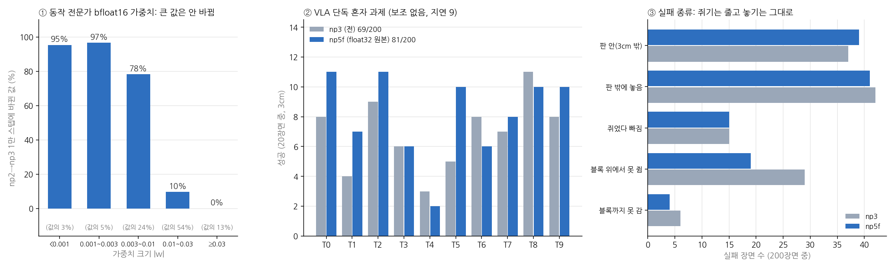
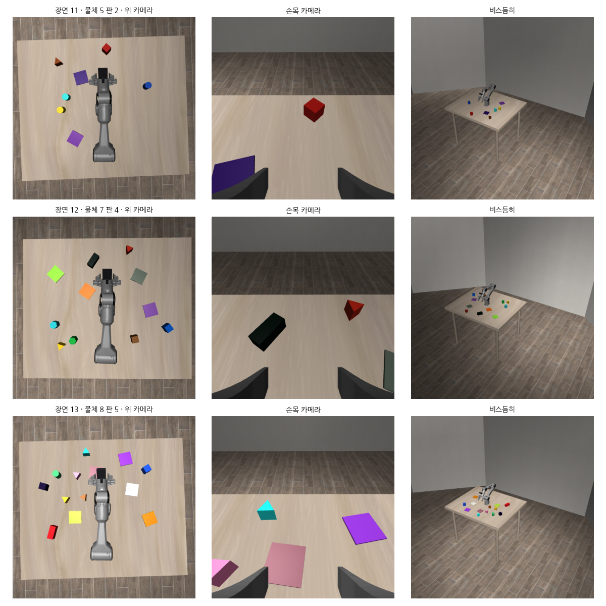
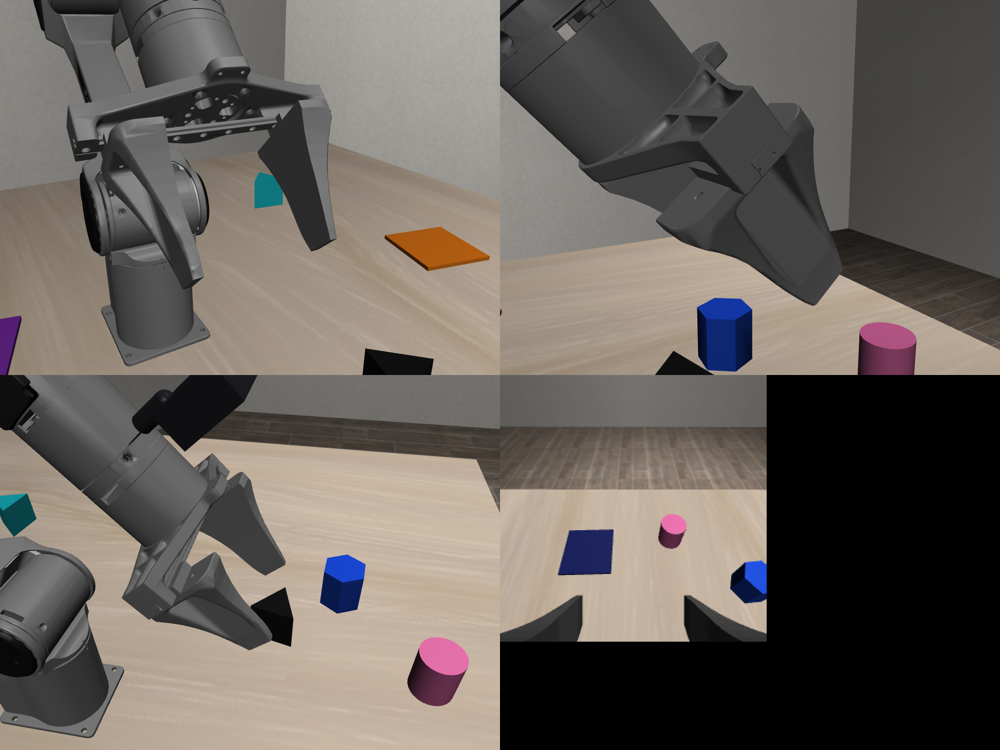

# 2026-10-24 새 기준 셋 다 90.4%, VLA 학습 반올림 문제, 여러 모양·N개 장면 (시범·물체 찾기·4K)

> 한 줄 요약: 끼어들기 명령이 끝까지 된 비율인 '셋 다'(B 를 하고, 돌아와 A 를 마치고, 그동안 B 도 무너지지 않음)를 np3 + 고친 보조 전부로 장면 1000~1019 에서 107/120, 처음 보는 장면 1020~1039 에서 110/120, 합쳐 **217/240 = 90.4%** 로 올렸다 (95% 구간 86~93.5%). 같은 설정의 28항목은 3cm 94.5% / 판 안 94.6%. 보조 시범으로 더 학습한 np4 는 오히려 83.3% 라 쓰지 않는다.

## 오늘 결과 한눈에

| 새 기준, 돌아오기 6쌍 | B 성공 | 돌아오기 | 셋 다 |
|---|---|---|---|
| np2 + 고친 보조 (10/23 아침) | 90.4% | 93.3% | 78.3% |
| np3 + 고친 보조 + ⑲⑨'⑰'⑳ (10/23 오후) | 93.3% | 92.5% | 86.7% |
| np4 + 같은 설정 | – | 89.2% | 83.3% |
| **np3 + 고친 보조 전부, 장면 1000~1019** | 94.2% | 91.7% | **89.2%** |
| **같은 설정, 처음 보는 장면 1020~1039** | 95.0% | 95.8% | **91.7%** |
| **합계 240장면** | 94.6% | 93.8% | **90.4%** |

셋 다 실패 23장면 중 4장면은 빨강을 쥔 지 1.5초 안에 A 를 끝내 B 지시가 나가지 않은 장면이다 (평가 방식 때문에 생기는 실패에 가깝다). 이 4장면을 빼면 217/236 = 91.9%.

## 1. np4: 보조가 고친 동작을 한 번 더 배우게 했지만 나아지지 않았다

np2 → np3 때 보조가 고친 동작을 VLA 가 배우게 하자 셋 다가 78 → 87.5% 로 올랐다. 같은 방법을 새 기준으로 한 번 더 했다. np3 + 새 설정으로 학습용 장면 3320~3339 를 새 기준 그대로 돌려 성공한 구간 461개를 모으고, np3 에서 10,000스텝 더 학습했다 (검증 손실 0.0570 → 0.0554). 결과는 셋 다 100/120 (83.3%) 으로 np3 (104) 보다 낫지 않았고, 돌아오기 실패가 3 → 9 로 늘었다. np4 는 쓰지 않는다.

## 2. 들고 못 가면 데려다 놓기 (㉓)

가장 좋은 설정의 돌아오기 실패 5개 중 2개는 빨강을 든 채 목표 판에서 6~15cm 떨어진 곳을 500스텝(25초) 맴돌다 끝났다. 놓기 보조는 판 5cm 안에 들어와야 켜지므로 돕지 못했다. 그래서 블록을 든 채 4초 동안 놓을 곳에 1cm 도 다가가지 않으면, 쥐고 있던 블록을 빈 자리에 내려놓을 때와 같은 동작으로 놓을 곳 위로 옮겨 놓고 VLA 에 돌려주게 했다 (`--deliver`). 쌓아 둔 블록이 있으면 그 위를 넘어가도록 책상 14cm 높이로 옮긴다.

같은 120장면에서 셋 다가 104 → 107 이 됐다 (np3 + 새 설정 대비 좋아진 장면 4, 나빠진 장면 1). 노란 막대 쌍 A1→B7→A1 은 20/20.

## 3. 처음 보는 장면으로 다시

120장면으로는 89% 와 90% 가 우연 범위 안이라, 같은 설정을 한 번도 쓰지 않은 장면 1020~1039 로 다시 쟀다. 110/120 (91.7%) 이었고, 합쳐 240장면 90.4% 다. 장면 1000~1019 에 맞춰 보조를 고친 것이 아니라는 확인도 된다.

## 4. 28항목 (05:00 끝)

| 새 기준 (3cm / 판 안) | 혼자 | 일 바꾸기 | 돌아오기 | 28항목 |
|---|---|---|---|---|
| np2 + 고친 보조 | 97.5 / 98.5 | 90.4 / 91.7 | 93.3 / 94.2 | 93.6 / 94.6 |
| **np3 + 고친 보조 전부** | 98.0 / 98.0 | 92.9 / 92.9 | 91.7 / 92.5 | **94.5 / 94.6** |

28항목 평균은 np2 + 고친 보조와 같은 수준이고 (같은 장면끼리 35:30), 셋 다는 78.3 → 89.2% 로 차이가 뚜렷하다 (23:10, 부호 검정 p = 0.035).

지금 설정: np3 + 보조 ⑦⑧⑨⑪⑫⑬⑭ + ⑰ 기억 고치기 (`--mem-refresh --mem-tol 0.012`) + ⑮' 먼 빈 자리 (`--putdown-far`) + ⑲ 오래 못 쥐면 쥐어 주기 (`--stuck-grasp 40`) + ⑨' (`--yaw-none-reset 10`) + ⑳ (`--open-empty`) + ㉒' 쌓은 블록 지키기 (`--stack-guard --stack-clear --guard-r 0.07`) + ㉓ (`--deliver`), 책상 전체로 맞춘 변환식, 평가 `--release-wait 40`.

## 5. 4K 시연: 노란 막대 끼어들기

np3 + 새 설정으로는 돌아오기에 실패하던 장면(A1→B7 1019, 빨강을 든 채 맴돎)을 지금 설정으로 한국어 실행기에서 돌렸다. 빨강을 쥔 직후 "잠깐, 노란 막대 먼저 흰 판에 놓고 하던 거 이어서 해줘" 가 들어오자, 빨강을 빈 자리에 내려놓고 노란 막대를 흰 판에 놓은 뒤(29.6초) 빨강으로 돌아가 주황 판에 놓았다(37.8초). 장면 1005·1010 도 같은 명령으로 모두 성공했다. 카메라를 조금 더 내려다보게 바꿔 앞쪽 판이 아래 글자 칸에 가리지 않는다.

## 6. VLA 혼자 점수 (보조 없이, 새 기준)

| VLA 단독 (3cm / 판 안) | 혼자 | 일 바꾸기 | 돌아오기 | 28항목 |
|---|---|---|---|---|
| np2 | 36.5 / 51.0 | 15.0 / 27.1 | 4.2 / 13.3 | 20.4 / 32.7 |
| np3 | 34.5 / 53.0 | 19.2 / 30.0 | 12.5 / 24.2 | 23.2 / 37.0 |

보조를 다 켜면 94.5% 인 같은 모델이 혼자서는 23% 다. 정확도의 대부분을 보조가 채우고 있다.

## 7. 학습이 반올림에 지워지고 있었다

사용자가 "보조 없이 VLA 정확도 올리는 방법 찾아줘" 라고 해서, VLA 혼자 점수가 10월 초부터 20~25% 에서 움직이지 않는 이유를 찾았다.

먼저 np3 단독 혼자 과제 실패 131개를 나눠 보니 79개가 놓기였다. 놓는 순간 손은 멈춰 있는데 판 가운데에서 3.5~4.4cm 떨어져 있고, 어긋나는 방향은 한쪽으로 몰리지 않았다 (평균 1cm). 위치를 흐릿하게 알고 있다는 뜻으로 읽었다.

그러다 학습 쪽에서 더 큰 문제가 나왔다. SmolVLA 를 불러오면 동작 전문가 가중치 257개가 bfloat16 으로 올라오는데, 학습 프로그램이 그 위에서 바로 학습률 3e-5 로 갱신하고 있었다. bfloat16 은 0.02 근처 값의 최소 간격이 약 1.2e-4 라 한 번의 갱신이 반올림에 지워진다. np2 → np3 1만 스텝 동안 실제로 바뀐 값은 32% 뿐이었고, 크기 0.03 넘는 값은 하나도 안 바뀌었다 (그림 ①). 가중치 이동평균(EMA)도 같은 형식이라 학습 후반은 거의 쌓이지 않았다. 10월 초부터 모든 PiPER 학습이 이 상태였다.

고친 방법은 float32 원본을 따로 두고 갱신을 거기에 쌓은 뒤, 모델에는 반올림해 복사하는 것이다 (`train_lora.py --fp32-master`). 앞으로 계산은 bfloat16 그대로라 로봇에서 돌리는 속도는 같다.

np3 에서 같은 데이터로 1만 스텝 더 학습한 np5f 는 혼자 과제 3cm 34.5 → 40.5%, 판 안 53 → 60% 가 됐다. 다만 같은 장면끼리 좋아진 장면 45, 나빠진 장면 33 이라 아직 우연 범위 안이다 (부호 검정 p = 0.21). 줄어든 것은 '블록 위에서 못 쥠' (29 → 19) 이고 놓기 실패는 그대로다 (그림 ③).

놓기는 위치를 읽는 쪽 문제라고 보고, 지금까지 얼려 둔 VLM 32층(사진·지시문·상태를 읽는 쪽)에도 LoRA 를 붙여 같이 학습하는 np5v 를 돌리고 있다 (`--vlm-lora 16`, 저장할 때 본체에 합쳐 추론은 그대로). 얼린 정면 카메라 토큰에서 판·블록 위치를 선형으로 읽으면 같은 분포 1.9cm, 넓은 장면 3.5cm 가 틀려 놓기 오차와 비슷했다.

## 8. 물체 여러 모양·N개, 로봇 둘레 전체로 (설정 파일 하나로)

오후에 사용자가 방향을 넓혔다: "객체도 여러모양으로 n개씩 늘리고 싹다 n개로 늘려서 무제한으로", "piper 360도 다 쓸수있게", "하드코딩 아닌걸로", "모든 변수 환경등에서도 정확도 95% 이상", "손목에 카메라도 보이게".

지금 블록 장면은 블록 4개·판 4개·지시문 10개가 코드 곳곳에 박혀 있어, 한 번 실행에 옮기는 블록이 많아야 2개였다. 그래서 새 장면을 따로 만들었다 (예전 파일은 그대로 두어 돌고 있는 실험에 영향이 없다).

- 설정 파일 `piper_sim/worlds/default.json` 에 모양 5가지(정육면체·막대·원기둥·육각기둥·삼각기둥), 물체 색 8, 판 색 6, 개수 범위, 카메라, 책상, 쥐는 높이 규칙, 손목 카메라 크기가 있다. 장면 이름, 지시문("put the yellow triangular prism on the black cube"), 할 수 있는 일, 정답 판정, 모양별 쥐는 방향이 모두 여기서 만들어진다.
- 로봇은 책상 가운데로 옮겼다. 팔이 닿는 범위는 숫자로 적지 않고 로봇 모델 파일의 관절 한계와 시범 프로그램의 길 찾기로 잰다. 1번 관절이 ±150° 라 등 뒤 60° 는 기계적으로 못 가고, 여유를 빼면 270° 를 쓴다. 정면 카메라는 등 뒤를 못 보니 위에서 내려다보는 카메라로 바꿨다.
- 위 카메라로 물체 찾기: 색 경계값을 손으로 정하지 않고, 시뮬 분할 그림(어느 픽셀이 어느 물체인지)으로 색 분포를 배우게 했다. 처음 보는 20장면 170개 중 165개를 찾았고 위치 오차는 중앙 0.31cm, 95% 가 1.1cm 안이다. 회색 판·검은 물체가 로봇 팔과 헷갈리던 것은 '그 물체가 사진에서 차지할 넓이'로 걸렀다.
- 시범 프로그램은 모양별로 쥐는 방향을 고르고, 옮기는 도중 끼어들기를 몇 겹이든 받는다 (A 를 빈 자리에 → B → B 를 빈 자리에 → C … → 쌓아 둔 순서로 되돌아감). 고치기 전 성공은 일 1개 15/15, 일 2개 겹침 10/21 이었고, 실패는 대부분 로봇 밑동 20cm 안에 놓인 물체를 못 쥔 것이었다. 닿는 범위를 길 찾기로 다시 재고 쥐는 방향을 다시 고르게 했다.
- 한국어 해석기도 낱말을 설정에서 읽는다. "삼각기둥을 회색 판에 놔줘" 처럼 모양만 말해도 그 모양이 장면에 하나면 알아듣고, 여럿이면 "어느 것인지 색까지 말해 주세요" 라고 되묻는다.
- '모든 환경'용으로 조명·물체 색·책상 색·카메라 자리를 장면마다 흔드는 설정(`random.json`)도 넣었다.

손목 카메라는 실물에 달 RealSense D405 크기(4.2 × 4.2 × 2.3cm)로 몸체와 고정대를 그렸다. 렌즈 뒤에 붙어 손목 화면을 가리지 않고, 충돌이 있어 물체에 부딪히면 시뮬에서도 걸린다 (왼쪽 아래 사진, 그리퍼 위 검은 상자).

## 9. VLM 까지 학습한 np5v: 더한 것 없음

| VLA 단독 혼자 과제 (200장면) | 3cm | 판 안 |
|---|---|---|
| np3 | 69 (34.5%) | 106 (53%) |
| np5f (float32 원본) | 81 (40.5%) | 120 (60%) |
| np5v (+ VLM LoRA 16) | 80 (40.0%) | 118 (59%) |

np5v 는 np5f 와 같은 장면끼리 좋아진 17, 나빠진 18 로 차이가 없다. '사진을 읽는 쪽을 학습하면 놓을 자리를 더 정확히 안다'는 가설은 이 설정(1만 스텝, 랭크 16)에서는 맞지 않았다. 세 모델을 거치며 '블록 위에서 못 쥠'은 29 → 19 → 14 로 줄었지만, 놓기 실패(판 밖 + 판 안 3cm 밖)는 79 → 80 → 82 로 그대로다. VLA 혼자 판 가운데에 놓지 못하는 이유는 아직 모른다.

## 10. 새 장면 손보기: 사진 512, 시범 프로그램 고침

- 위 카메라 사진을 256 에서 512 로 올렸다 (설정 `obs_size`). 256 에서는 물체가 9픽셀이라 같은 색 원기둥과 육각기둥을 구분하지 못했다. SmolVLA 는 사진을 어차피 512 로 늘려 보므로 처음부터 512 로 주면 늘리는 흐림도 없다.
- 물체 찾기는 로봇 팔 자리를 관절 각도로 계산해 가리고(실물도 관절 각도 + 카메라 보정이면 같다), 같은 색 덩어리가 여럿이면 덩어리 모양(넓이·길쭉함·둥근 정도·꼭짓점 수)으로 모양을 고른다. 처음 보는 장면에서 위치 오차 95% 가 기본 0.75cm, 물체 6~14개·색 겹침 1.2cm, 조명·색·카메라를 흔든 장면 1.2cm 다 (흔든 장면은 88개 중 10개를 못 찾아 더 볼 것).
- 시범 프로그램이 로봇 옆·뒤 물체를 못 쥐던 것은, 기울인 손으로 2.25cm 높이를 쥐면 손가락 끝이 책상을 파고들어 쥐는 자세 후보가 모두 빠졌기 때문이었다. 쥐는 높이를 최소 2.8cm 로 올리고(설정), 안 풀리는 자세는 역기구학을 일찍 멈추게 했다(한 장면 70초 중 69초가 이 계산이었다). 일 목록에서 쌓기 받침으로 쓴 물체를 나중 일이 옮기던 것도 고쳤다. 고친 뒤 수집은 319장면 중 316장면 성공(일 4개 겹침 포함)이다.
- 육각기둥은 면끼리가 아니라 꼭짓점끼리 쥐고 있었다(쥐는 방향 계산 90° 실수, 고침). 손목 맞추기는 그리퍼보다 확실히 작은 모양(육각·삼각·원기둥)에는 쓰지 않는다. 위에서 비스듬히 본 각기둥 윤곽으로는 각도를 25° 틀리게 읽었고, 어느 방향으로 와도 벌린 손가락(7cm) 사이에 들어가기 때문이다.

위 영상은 VLA 가 아니라 학습 시범을 만드는 시범 프로그램이다. 빨간 원기둥을 연두 판으로 옮기다 "잠깐, 하늘색 막대 먼저", 그것을 옮기다 다시 "노란 육각기둥 먼저"가 들어오면, 든 것을 가까운 빈 자리에 내려놓고 새 일을 한 뒤 쌓아 둔 순서대로 돌아가 셋 다 마친다.

밤새 도는 것: 기본 설정 시범 1,200장면 (02시쯤 끝) → w1 학습 (np5f 에서, 위치 입력 wfeat, float32 원본 + VLM LoRA) → 일 개수별 평가. 같이 흔든 환경 600장면, 물체 많고 색 겹치는 장면(일 1~6개) 600장면도 모은다 (w2 재료).

## 다음에 할 것

- np5v (VLM LoRA) 단독 점수, np5f 와 같은 장면끼리 비교
- 새 장면: 시범 성공률을 일 개수·모양별로 보고 실패를 고치기, w1 학습·평가, 보조(설정 기반 world_assist)로 VLA + 보조 점수, 같은 색 다른 모양 구분(위 카메라 윤곽)으로 물체 8개 넘기기, 흔든 환경에서도 재기. 목표는 조건마다 95%
- 실물 PiPER 실행기 (WeGo 플러그인·실물 카메라 2대): 위 카메라 보정, 손목 카메라 고정대
- 일 바꾸기 전에 A 를 끝내 버리는 장면(전환X): 평가에서 B 지시를 옮기는 도중에 확실히 주는 방법
