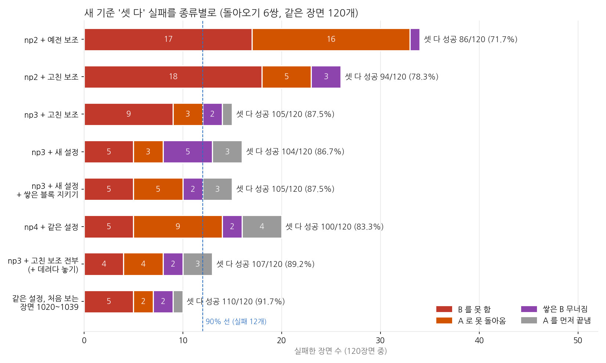
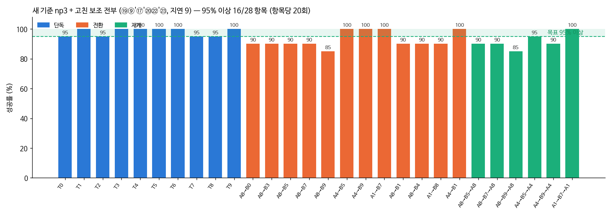

# 2026-10-24 새 기준 '셋 다' 90.4% (240장면): 들고 못 가면 데려다 놓기

> 한 줄 요약: 끼어들기 명령이 끝까지 된 비율인 '셋 다'(B 를 하고, 돌아와 A 를 마치고, 그동안 B 도 무너지지 않음)를 np3 + 고친 보조 전부로 장면 1000~1019 에서 107/120, 처음 보는 장면 1020~1039 에서 110/120, 합쳐 **217/240 = 90.4%** 로 올렸다 (95% 구간 86~93.5%). 같은 설정의 28항목은 3cm 94.5% / 판 안 94.6%. 보조 시범으로 더 학습한 np4 는 오히려 83.3% 라 쓰지 않는다.

## 오늘 결과 한눈에

| 새 기준, 돌아오기 6쌍 | B 성공 | 돌아오기 | 셋 다 |
|---|---|---|---|
| np2 + 고친 보조 (10/23 아침) | 90.4% | 93.3% | 78.3% |
| np3 + 고친 보조 + ⑲⑨'⑰'⑳ (10/23 오후) | 93.3% | 92.5% | 86.7% |
| np4 + 같은 설정 | – | 89.2% | 83.3% |
| **np3 + 고친 보조 전부, 장면 1000~1019** | 94.2% | 91.7% | **89.2%** |
| **같은 설정, 처음 보는 장면 1020~1039** | 95.0% | 95.8% | **91.7%** |
| **합계 240장면** | 94.6% | 93.8% | **90.4%** |

셋 다 실패 23장면 중 4장면은 빨강을 쥔 지 1.5초 안에 A 를 끝내 B 지시가 나가지 않은 장면이다 (평가 방식 때문에 생기는 실패에 가깝다). 이 4장면을 빼면 217/236 = 91.9%.

## 1. np4: 보조가 고친 동작을 한 번 더 배우게 했지만 나아지지 않았다

np2 → np3 때 보조가 고친 동작을 VLA 가 배우게 하자 셋 다가 78 → 87.5% 로 올랐다. 같은 방법을 새 기준으로 한 번 더 했다. np3 + 새 설정으로 학습용 장면 3320~3339 를 새 기준 그대로 돌려 성공한 구간 461개를 모으고, np3 에서 10,000스텝 더 학습했다 (검증 손실 0.0570 → 0.0554). 결과는 셋 다 100/120 (83.3%) 으로 np3 (104) 보다 낫지 않았고, 돌아오기 실패가 3 → 9 로 늘었다. np4 는 쓰지 않는다.

## 2. 들고 못 가면 데려다 놓기 (㉓)

가장 좋은 설정의 돌아오기 실패 5개 중 2개는 빨강을 든 채 목표 판에서 6~15cm 떨어진 곳을 500스텝(25초) 맴돌다 끝났다. 놓기 보조는 판 5cm 안에 들어와야 켜지므로 돕지 못했다. 그래서 블록을 든 채 4초 동안 놓을 곳에 1cm 도 다가가지 않으면, 쥐고 있던 블록을 빈 자리에 내려놓을 때와 같은 동작으로 놓을 곳 위로 옮겨 놓고 VLA 에 돌려주게 했다 (`--deliver`). 쌓아 둔 블록이 있으면 그 위를 넘어가도록 책상 14cm 높이로 옮긴다.

같은 120장면에서 셋 다가 104 → 107 이 됐다 (np3 + 새 설정 대비 좋아진 장면 4, 나빠진 장면 1). 노란 막대 쌍 A1→B7→A1 은 20/20.

## 3. 처음 보는 장면으로 다시

120장면으로는 89% 와 90% 가 우연 범위 안이라, 같은 설정을 한 번도 쓰지 않은 장면 1020~1039 로 다시 쟀다. 110/120 (91.7%) 이었고, 합쳐 240장면 90.4% 다. 장면 1000~1019 에 맞춰 보조를 고친 것이 아니라는 확인도 된다.

## 4. 28항목 (05:00 끝)

| 새 기준 (3cm / 판 안) | 혼자 | 일 바꾸기 | 돌아오기 | 28항목 |
|---|---|---|---|---|
| np2 + 고친 보조 | 97.5 / 98.5 | 90.4 / 91.7 | 93.3 / 94.2 | 93.6 / 94.6 |
| **np3 + 고친 보조 전부** | 98.0 / 98.0 | 92.9 / 92.9 | 91.7 / 92.5 | **94.5 / 94.6** |

28항목 평균은 np2 + 고친 보조와 같은 수준이고 (같은 장면끼리 35:30), 셋 다는 78.3 → 89.2% 로 차이가 뚜렷하다 (23:10, 부호 검정 p = 0.035).

지금 설정: np3 + 보조 ⑦⑧⑨⑪⑫⑬⑭ + ⑰ 기억 고치기 (`--mem-refresh --mem-tol 0.012`) + ⑮' 먼 빈 자리 (`--putdown-far`) + ⑲ 오래 못 쥐면 쥐어 주기 (`--stuck-grasp 40`) + ⑨' (`--yaw-none-reset 10`) + ⑳ (`--open-empty`) + ㉒' 쌓은 블록 지키기 (`--stack-guard --stack-clear --guard-r 0.07`) + ㉓ (`--deliver`), 책상 전체로 맞춘 변환식, 평가 `--release-wait 40`.

## 5. 4K 시연: 노란 막대 끼어들기

np3 + 새 설정으로는 돌아오기에 실패하던 장면(A1→B7 1019, 빨강을 든 채 맴돎)을 지금 설정으로 한국어 실행기에서 돌렸다. 빨강을 쥔 직후 "잠깐, 노란 막대 먼저 흰 판에 놓고 하던 거 이어서 해줘" 가 들어오자, 빨강을 빈 자리에 내려놓고 노란 막대를 흰 판에 놓은 뒤(29.6초) 빨강으로 돌아가 주황 판에 놓았다(37.8초). 장면 1005·1010 도 같은 명령으로 모두 성공했다. 카메라를 조금 더 내려다보게 바꿔 앞쪽 판이 아래 글자 칸에 가리지 않는다.

## 다음에 할 것

- VLA 혼자(보조 없이) 새 기준 점수 — 미뤄 둔 것 (np3 단독 일부, np2 단독 12쌍)
- 일 바꾸기 전에 A 를 끝내 버리는 장면(전환X): 평가에서 B 지시를 옮기는 도중에 확실히 주는 방법
- 실물 PiPER 실행기 (WeGo 플러그인·실물 카메라 2대): 보조가 쓰는 것(정면 카메라 변환식·손 높이·그리퍼)을 실물에서 맞추기
