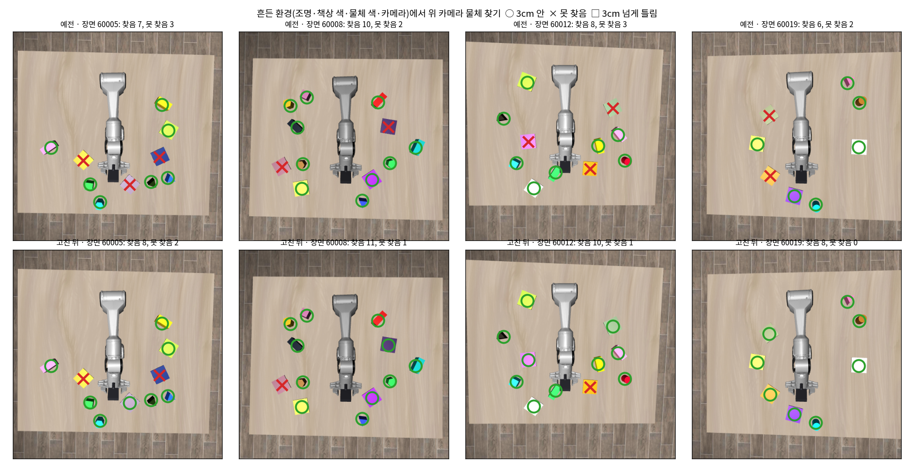
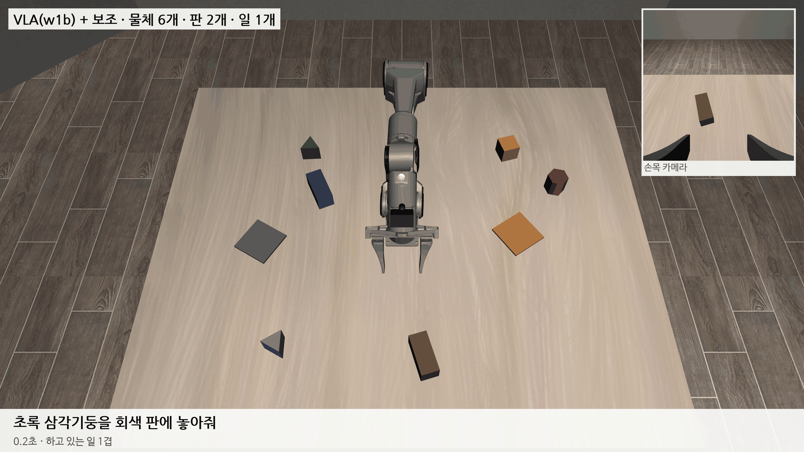

# 2026-10-25 여러 모양·N개 장면: 물체 찾기 고침, VLA w1 0% → w1b 5%, DAgger 시작

> 한 줄 요약: 위 카메라 물체 찾기를 흔든 환경·같은 색 여러 모양에서도 되게 고쳤다 (흔든 환경 못 찾음 + 틀림 15 → 8개/255, 같은 색 바꿔 읽음 16 → 1개/435). 새 장면에서 처음 학습한 VLA w1 은 단독 0% 였고, 원인은 학습 때 위치 입력이 예전 찾기 때문에 자주 비어 있던 것으로 보인다. 고친 입력으로 더 학습한 w1b 는 일 1개 단독 5%, 보조와 함께 10%. 손을 대상 근처까지만 가져가는 부정확함이 남아, 밤에 DAgger(학생이 하다 선생이 이어받기)와 세 설정을 다 넣은 w2 를 돌린다.

## 1. 물체 찾기: 흔든 환경에서 판을 못 찾던 이유

어제 만든 '흔든 환경'(random.json)은 장면마다 조명 세기·방향, 책상 색, 물체 색(±0.05), 위 카메라 자리(±1cm, ±1.5°)를 바꾼다. 여기서는 처음 보는 20장면의 물체·판 170개 중 24개를 못 찾았고, 거의 다 판이었다. 원인은 세 가지였다.

- **책상 색**: 색 분포를 여러 장면에서 한꺼번에 배우다 보니 '책상' 분포가 아주 넓어져, 주황·회색·흰 판을 책상으로 삼켰다. 이제는 사진마다 그 사진의 책상 자리(카메라 보정값으로 계산) 픽셀에서 책상 색을 다시 잰다. 조명 때문에 책상 한쪽이 밝거나 어두운 것까지 따라가도록, 책상 색을 사진 위치의 2차 함수로 맞춘다.
- **밝기**: 같은 회색 판이 조명에 따라 밝기 35~83(Lab L)으로 바뀌어, 흰 판·회색 판·로봇 팔과 겹쳤다. 사진마다 책상 밝기를 기준 밝기로 맞춘 뒤(카메라 자동 노출과 같은 일) 색을 비교한다.
- **비슷한 색**: 센 조명에서 주황 판이 노랗게, 남색 판이 파란 물체처럼 보였다. 보조처럼 장면에 무엇이 있는지 알 때는 그 장면에 있는 색만 고르고, 그래도 못 찾은 것은 남은 덩어리 중 모양이 맞고 색이 아주 멀지 않은 것을 한 번 더 찾는다. 로봇 팔은 관절 각도로 가리므로 '로봇' 색은 아예 고르지 않는다.

위 그림 네 장면에서 못 찾음이 10개에서 4개로 줄었다. 남은 것은 로봇 팔 밑에 깔린 판이나 손에 든 물체처럼 위에서 실제로 안 보이는 것이 대부분이다.

## 2. 같은 색 원기둥과 육각기둥

물체가 많고 색이 겹치는 장면(many.json)에서는 같은 색 물체를 서로 바꿔 읽었다. 위 카메라 512 사진에서 원기둥과 육각기둥은 넓이·길쭉함·둥근 정도·꼭짓점 수가 거의 같다. 덩어리 윤곽이 가운데에서 얼마나 떨어져 있는지를 각도마다 재고, 그 출렁임이 한 바퀴에 몇 번 있는지(육각기둥 6번, 삼각기둥 3번, 원기둥 거의 없음)를 특징으로 더했다. 처음 보는 물체 404개로 재 보니 모양 맞힘이 79%에서 97%로 올랐다.

VLA 에 주는 위치 입력은 장면에 무엇이 있는지 모르고 지시문만 보고 찾는다. 예전에는 지시문의 물체를 다른 모양으로 읽으면 '못 찾음'이 되어 버렸다. 이제는 그 색 덩어리를 모든 모양에 함께 짝지은 뒤 지시문 물체를 꺼내고, 짝을 못 얻으면 남은 덩어리 중 가장 그럴듯한 것을 준다.

| 처음 보는 30장면 | 물체·판 | 보조용 (장면 앎) 못 찾음 + 3cm 넘게 틀림 | VLA 입력용 (장면 모름) 못 찾음 + 3cm 넘게 틀림 |
|---|---|---|---|
| 기본 | 255 | 3 + 0 (예전 3 + 0) | 4 + 0 |
| 물체 많고 색 겹침 | 435 | 6 + 1 (예전 4 + 16) | 3 + 4 (예전 3 + 21) |
| 흔든 환경 | 255 | 5 + 3 (예전 13 + 2) | 15 + 2 |

흔든 환경의 VLA 입력용은 아직 6%를 못 찾는다. VLA 입력은 앞에서 본 자리를 기억해 두므로 한 장면에서 잠깐 못 찾는 것은 덜 해롭지만, 더 줄여야 할 곳이다.

w2 학습 재료(흔든 환경 2,080구간, 물체 많은 장면 2,924구간)의 위치 입력은 고친 찾기로 다시 계산하고 있다. 학습이 6장마다 한 장만 읽으므로 그 장만 계산한다(모든 장을 계산한 것과 차이 최대 0.5cm). 다 계산하면 6배 걸린다.

## 3. w1: 새 장면에서 처음 학습한 VLA 는 단독 0%

np5f(블록 장면에서 가장 좋은 모델)에서 시작해 새 장면 기본 설정 시범 4,203구간으로 20,000스텝 학습했다 (위치 입력 wfeat, float32 원본, VLM LoRA). 검증 손실은 0.1208 → 0.1139.

| w1 단독, 장면 1000~1019 | 전부 3cm | 판 안 |
|---|---|---|
| 일 1개 | 0/20 | 0/20 |
| 일 2개 끼어들기 | 0/20 | 0/20 |
| 일 3개 끼어들기 | 0/20 | 0/20 |
| 일 4개 끼어들기 | 0/20 | 0/20 |

80장면 모두 600스텝 동안 아무것도 들지 못했다. 한 장면을 돌리며 손·물체·위치 입력을 찍어 보니, 평가 때 VLA 가 받는 '옮길 물체 − 손' 값은 참값과 0.5cm 안으로 맞는데 손은 반대쪽 물체로 가거나 허공에서 손을 닫았다.

원인으로 보이는 것은 학습 재료다. w1 의 위치 입력은 1절을 고치기 전 찾기로 계산했는데, 그 찾기는 지시문의 물체를 다른 모양으로 읽어 '아예 못 찾음'이 원기둥 31.6%, 정육면체 23.3%, 삼각기둥 22.0%, 육각기둥 15.2% 였다. 학습하는 동안 위치 입력이 비어 있는 일이 잦으니 VLA 는 그것을 믿지 않게 배운 것으로 보인다 (가설). 실제로 모델 안에서 위치 입력이 들어가는 가중치 열은 크기가 0.08~0.35 로, 로봇 상태 열(3.3)의 10분의 1 아래였다. 0 에서 시작해 학습률 3e-5 로는 2만 스텝에 이만큼밖에 자라지 않았다.

고친 찾기로 다시 계산한 위치 입력은 '아예 못 찾음'이 4% 아래다. 이것으로 w1 을 6,000스텝 더 학습하고(w1b, 위치 입력이 들어가는 층만 학습률 3e-4), 일 1개를 다시 잰다. 오르면 세 설정(기본·흔든 환경·물체 많음)을 다 넣은 w2 로 간다.

## 4. w1b: 위치 입력을 고치자 쥐기 시작했지만 아직 5%

고친 위치 입력으로 w1 을 6,000스텝 더 학습했다. 위치 입력이 들어가는 두 층(state_proj, state_suffix_proj)만 학습률을 3e-4 로 올렸다. 검증 손실 0.1139 → 0.1059.

| 일 1개, 장면 1000~1019 | 3cm | 판 안 |
|---|---|---|
| w1 단독 | 0/20 | 0/20 |
| w1b 단독 | 1/20 | 1/20 |
| w1b + 보조 | 2/20 | 3/20 |

위 영상은 w1b + 보조가 성공한 두 장면 중 하나(장면 1008)를 평가와 같은 설정으로 다시 돌린 것이다. 20장면 중 이렇게 끝까지 된 것은 아직 2개뿐이다.

평가 기록에 일마다 '그 물체를 쥔 스텝 수, 손이 물체에 가장 가까이 간 거리, 끝났을 때 물체와 놓을 곳 거리'를 남기게 하고 실패를 나눴다.

| 일 20개 | 성공 | 판 안, 3cm 밖 | 쥐었지만 못 놓음 | 다가갔지만 못 쥠 | 다가가지도 못함 |
|---|---|---|---|---|---|
| w1b 단독 | 1 | 0 | 4 | 3 | 12 |
| w1b + 보조 | 2 | 1 | 5 | 8 | 4 |

같은 사진·상태에서 위치 입력만 앞뒤좌우로 바꿔 넣어 보니, w1b 는 그 방향으로 손을 움직인다. 이제 위치 입력을 쓰기는 한다. 문제는 정확도다. 손을 대상 5~13cm 앞까지만 가져가 엉뚱한 높이·자리에서 손을 닫고, 빈손으로 놓을 곳 쪽으로 간다 (시범의 움직임 모양만 흉내 냄). 보조를 켜도 보조는 손을 물체 13cm 위까지 데려다 놓고 VLA 에 돌려주는데, VLA 가 거기서 내려가지 않고 다른 데로 가 버린다. 보조는 블록 장면에서 'VLA 가 대체로 맞게 하고 마지막만 바로잡는' 용도로 만든 것이라, 지금 VLA 수준에서는 도울 틈이 없다.

그래서 오늘 밤에는 두 가지를 한다.

- **DAgger**: w1b 가 20~300스텝 동안 일을 하다 멈추면, 그 상태(엉뚱한 자리, 손을 닫은 채 등)에서 시범 프로그램이 이어받아 마무리하고 그 구간만 저장한다. 블록 장면 np_dagger 와 같은 생각으로, 학생이 실제로 가 있는 자리에서 바로잡는 법을 보여 준다. 시험 6장면은 모두 이어받아 성공했다.
- **w2**: 기본·흔든 환경·물체 많음 시범 9,207구간과 그때까지 모은 DAgger 구간을 합쳐 w1b 에서 30,000스텝 학습하고, 세 설정 × 일 1~4개 × (단독, + 보조)로 잰다.

## 다음에 할 것

- w2 성적표 (세 설정 × 일 개수 × 단독·보조), 실패 나누기
- DAgger 를 w2 로 한 번 더 (학생이 나아지면 바로잡는 자리도 바뀐다)
- 보조가 '손을 물체 위로 데려간 뒤 내려가기·쥐기까지' 하게 할지는 VLA 단독 점수를 보고 정한다 (보조가 너무 많이 하면 VLA 점수가 아니게 된다)
- 흔든 환경 VLA 입력용 물체 찾기 못 찾음 6% 줄이기
- 실물 PiPER 연결·WeGo 플러그인 설치 (사용자 허락 기다림)
