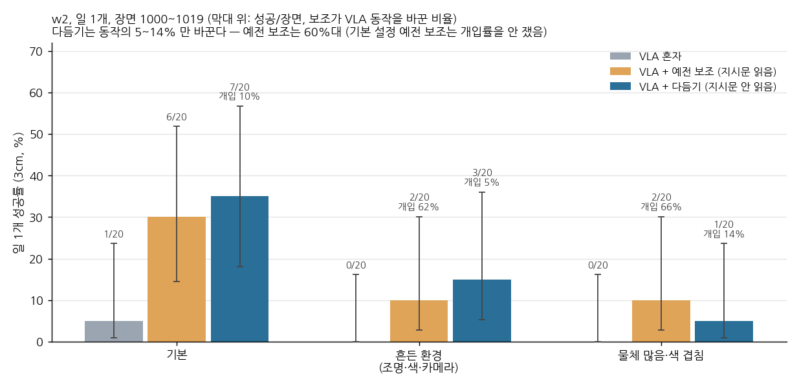
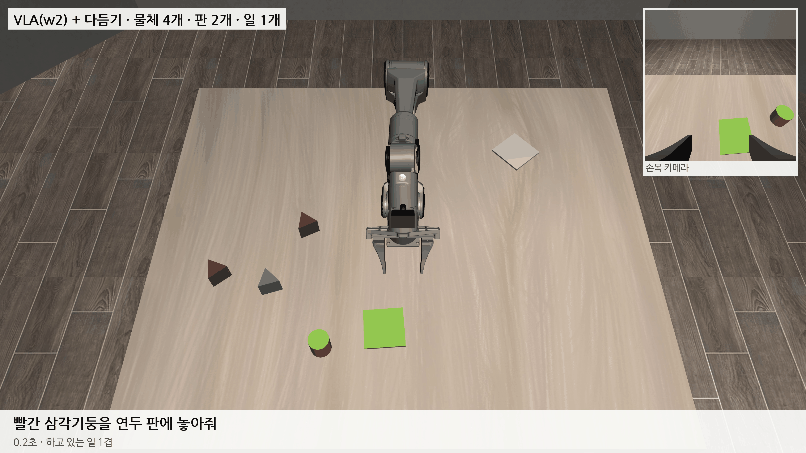

# 2026-10-26 새 장면 w2: VLA 가 물체를 쥐기 시작, 지시문을 읽지 않는 '다듬기'로 일 1개 35%

> 한 줄 요약: 시범 9,207구간 + DAgger 564구간으로 학습한 w2 는 거의 모든 장면에서 지시한 물체까지 손을 가져가고 4번 중 3번은 쥐지만, 놓기가 부정확해 혼자서는 일 1개 5% 다. 논문에서 VLA 의 몫을 가를 수 있도록 지시문을 읽지 않고 VLA 가 고른 물체·판 근처에서만 마지막 몇 cm 를 다듬는 보조(다듬기)를 새로 만들었다. 다듬기는 VLA 동작의 5~14% 만 바꾸고 기본 설정 일 1개 7/20 (35%), 지시문을 읽는 예전 보조(동작의 60%대를 바꿈)는 6/20 이다.

## 1. w2: 쥐기는 된다, 놓기가 안 된다

w1b 에서 이어 30,000스텝 학습했다. 재료는 기본·흔든 환경·물체 많음 시범 9,207구간과, 밤새 모은 DAgger 564구간이다 (w1b 가 20~300스텝 하다 멈춘 자리에서 시범 프로그램이 이어받아 마무리한 구간). 검증 손실 0.1059 → 0.0853.

| w2 단독, 장면 1000~1019 | 일 1개 3cm | 판 안 | 일 2~4개 |
|---|---|---|---|
| 기본 | 1/20 | 3/20 | 0/60 |
| 흔든 환경 | 0/20 | 2/20 | 0/60 |
| 물체 많음·색 겹침 | 0/20 | 1/20 | 0/60 |

점수는 거의 그대로지만 하는 일이 달라졌다. 기본 설정 일 1개 20장면에서 손이 지시한 물체 3.5cm 안까지 간 것이 8 → 20장면, 그 물체를 쥔 것이 5 → 15장면이다 (w1b → w2). 실패는 이제 대부분 '쥐었지만 못 놓음'이고, 쥔 물체는 판 가운데에서 4~17cm 떨어진 곳에서 끝났다. 블록 장면에서 VLA 혼자의 약점이던 놓기 부정확이 여기서도 그대로 나왔다.

## 2. 다듬기: 지시문을 읽지 않는 보조

예전 보조(world_assist)는 블록 장면 보조를 옮긴 것이라 지시문을 스스로 읽어 옮길 물체와 놓을 곳을 안다. 그러면 '무엇을 어디로'까지 보조가 하는 셈이어서, VLA + 보조 점수가 VLA 덕인지 보조 덕인지 가를 수 없다. 블록 장면 94.5% 가 이 문제를 안고 있었다.

다듬기(world_refine)는 지시문을 읽지 않는다.

- 빈손일 때 손 바로 아래 가장 가까운 물체를 'VLA 가 쥐려는 것'으로 본다. 손이 그 물체 윗면 + 10cm 안으로 내려왔을 때만 가운데·손목 방향을 맞추고 쥐기를 마무리한다.
- 들고 있을 때 손 아래 가장 가까운 판(또는 쌓을 수 있는 물체)을 'VLA 가 놓으려는 곳'으로 본다. 판 반대각선 + 5cm 안, 윗면 + 든 물체 높이 + 10cm 안으로 내려왔을 때만 판 가운데로 맞추고, 판에서 먼 곳에서는 놓지 않게 한다.
- 멀리서 데려가기, 엉뚱한 물체 막기, 데려다 놓기처럼 지시문을 알아야 하는 기능은 쓰지 않는다.
- 숫자는 물체·판 크기(설정), 그리퍼(모델 파일), 위치(위 카메라)에서만 읽고, 10cm·5cm 두 값은 모든 장면·설정에서 같다.
- 장면마다 '보조가 VLA 동작을 바꾼 스텝 비율'(개입률)을 남긴다.

| 일 1개, 장면 1000~1019 | 3cm 성공 (95% 구간) | 판 안 | 개입률 | 지시한 물체를 쥠 |
|---|---|---|---|---|
| 기본, w2 혼자 | 1/20 (1~24%) | 3 | – | 15/20 |
| 기본, w2 + 예전 보조 | 6/20 (15~52%) | 6 | 안 잼 | 10/20 |
| **기본, w2 + 다듬기** | **7/20 (18~57%)** | 7 | **9.9%** | 16/20 |
| 기본, 다듬기 쥐기만 | 2/20 (3~30%) | 5 | 5.3% | 16/20 |
| 기본, 다듬기 놓기만 | 3/20 (5~36%) | 4 | 5.8% | 15/20 |
| 흔든 환경, w2 + 예전 보조 | 2/20 | 2 | 61.5% | 10/20 |
| 흔든 환경, w2 + 다듬기 | 3/20 | 4 | 5.3% | 12/20 |
| 물체 많음, w2 + 예전 보조 | 2/20 | 2 | 66.4% | 5/20 |
| 물체 많음, w2 + 다듬기 | 1/20 | 1 | 13.9% | 12/20 |

위 영상은 다듬기를 켠 성공 7장면 중 다듬기가 가장 적게 손댄 장면(1010)이다. 물체를 고르고 가져가 놓는 것은 거의 VLA 가 했고, 다듬기는 352스텝 중 9스텝만 바꿨다.

다듬기는 동작의 5~14% 만 바꾸면서 예전 보조(60%대를 바꿈)와 성공이 비슷하다. 장면이 20개뿐이라 둘의 차이는 우연 범위다. 쥐기만(2/20)·놓기만(3/20) 켠 것보다 둘 다 켠 것(7/20)이 높아, 두 부분이 같이 있어야 하는 것으로 보인다 (가설, 장면을 늘려 다시 잴 것). 예전 보조는 지시문을 아니까 엉뚱한 물체를 내려놓게 하거나 멀리서 데려가는데, 그러는 동안 지시한 물체를 쥔 장면은 오히려 적었다 (물체 많음 5/20 대 12/20).

남은 큰 실패: 막대는 혼자일 때도 보조와 함께여도 거의 쥐지 못한다 (기본 설정 막대 6장면 중 0). 일 2개 이상은 아직 0 에 가깝다.

## 3. 밤사이 있었던 일

- 평가 4줄을 띄운 단위의 메모리 상한이 10GB (사진 특징 계산용으로 정한 값)라 08:17 에 단위째 꺼졌다. 평가만 상한 22GB 단위로 다시 돌렸다.
- 하드코딩 걷어내기 (동작은 그대로, 값을 읽는 곳만): 지시문 읽기는 설정 파일의 지시문 틀에서 자동으로 정규식을 만들고 (지시문 13,137개 예전과 같음), 보조의 손목 관절 한계와 그리퍼 '쥠·빈손' 값은 로봇·그리퍼 모델 파일에서 읽는다. 남은 것: 책상 높이 0.90, 예전 보조의 블록 기준 높이들, 그리퍼 길이 12cm, 로봇 팔 가리기 13cm.

## 다음에 할 것

- w3: w2 로 DAgger 2차 (40~450스텝 뒤 이어받기 — 들고 가서 놓는 단계 바로잡기까지, 세 설정 250장면씩) → w3 학습 → 일 1·2개 단독, 일 1개 다듬기 (오늘 밤)
- 장면 50개 이상으로 다시 재서 다듬기 대 예전 보조, 빼보기의 차이가 우연인지 가리기
- 막대를 못 쥐는 원인 보기
- 일 2개 이상(끼어들기): 다듬기가 '빈 자리에 내려놓기'를 판 놓기로 잘못 다듬지 않는지 확인
