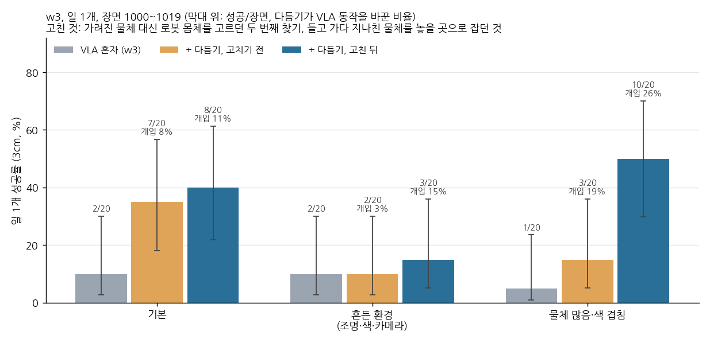
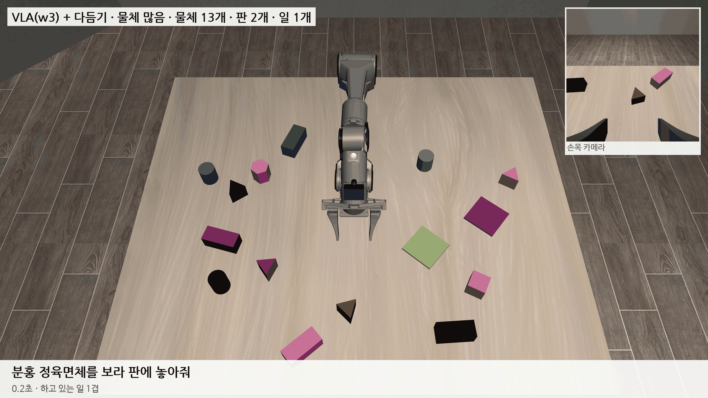

# 2026-10-27 새 장면 w3: 물체 방향을 VLA 에 주고, 다듬기 버그 두 개를 고쳐 일 1개 21/60

> 한 줄 요약: 막대를 못 쥐던 이유가 '방향을 모름'이라 위치 입력에 물체 방향을 더한 w3 를 학습했다 (VLA 혼자 일 1개 1/60 → 5/60). 다듬기를 켜고도 쥔 뒤 실패한 장면을 보니, 다듬기가 가려진 물체 대신 로봇 몸체를 고르거나 들고 가다 지나친 물체를 놓을 곳으로 잡고 있었다. 둘을 고치자 w3 + 다듬기는 세 설정 합계 12/60 → 21/60 (기본 8/20, 흔든 환경 3/20, 물체 많음 10/20), 다듬기가 바꾼 동작은 11~26% 다.

## 1. 막대는 방향을 맞춰야 쥔다

w2 는 막대(9 × 4 × 4cm) 6장면 모두 실패했다. 손은 막대 0.1~1.4cm 위까지 갔다. 막대는 길이 9cm 가 벌린 손가락 7cm 보다 길어 손목 방향을 맞춰야 쥘 수 있는 유일한 모양인데, VLA 에 주는 위치 입력에는 방향이 없었다. 원기둥·육각기둥·삼각기둥은 어느 방향으로 가도 벌린 손가락 안에 들어간다. 어느 모양이 방향을 맞춰야 하는지는 설정의 물체 크기와 그리퍼 폭으로 정한다 (지금은 막대 180°, 정육면체 90°).

- 위 카메라 덩어리의 긴 축으로 방향을 잰다. 처음 보는 30장면에서 막대 오차 중앙 0.6°·최대 1.5°, 정육면체 최대 3.2°. 각기둥은 잘 못 재지만 맞출 필요가 없다.
- 위치 입력 2판: 비어 있던 칸에 옮길 물체 방향 sin·cos(kθ) 와 '방향 있음' 표시를 넣는다 (k = 360 / 대칭 주기).
- 이어 학습할 때는 지금까지 늘 0 이던 칸만 정규화 통계를 다시 잰다. 그대로 두면 표준편차 0.001 로 나눠 새 값이 1000배가 된다.
- 흔든 환경에서 물체가 사진 가장자리에 걸리면 긴 축 끝이 사진 밖이라 계산이 멈췄다 (사진 끝으로 잘라 고침).

w3 는 w2 에서 15,000스텝, 재료는 시범 9,207구간 + DAgger 1·2차 1,185구간 (2차는 w2 가 40~450스텝 하다 멈춘 자리에서 이어받아, 들고 가 놓는 단계 바로잡기까지 들어감). 검증 손실 0.0894.

| 일 1개, VLA 혼자 | w2 | w3 |
|---|---|---|
| 기본 | 1/20 | 2/20 |
| 흔든 환경 | 0/20 | 2/20 |
| 물체 많음 | 0/20 | 1/20 |
| 판 안에 놓은 장면 (합) | 6/60 | 12/60 |

조금 올랐지만 혼자서는 여전히 10% 아래다. 일 2개는 세 설정 모두 0/20 (일 하나씩 세면 기본 4/40).

## 2. 다듬기 버그 두 개

다듬기를 켜고 물체를 쥐었는데 실패한 장면을 하나씩 돌려 보니, 다듬기가 엉뚱한 것을 보고 있었다.

**가려진 물체 대신 로봇 몸체.** 분홍 원기둥이 그리퍼 밑에 완전히 가려지자, 위 카메라 물체 찾기의 두 번째 찾기(처음에 못 찾은 것을 남은 덩어리에서 모양·색으로 다시 찾음, 흔든 환경의 판을 위해 10/25 에 넣음)가 로봇 가리개 밖으로 나온 손목 카메라 몸체를 그 원기둥으로 골랐다. 보조는 원기둥이 9cm 옆에 있다고 기억해 '쥐었다'는 판단(손 4cm 안)부터 빠졌고, 놓기 다듬기가 한 번도 켜지지 않았다. 두 번째 찾기는 로봇 가리개에 붙은 덩어리를 고르지 않게 했다. 정지 장면 시험은 그대로였는데, 로봇 팔이 물체 위에 있는 순간을 시험에 넣지 않아 놓친 것이다.

**들고 가다 지나친 물체를 놓을 곳으로.** 다듬기는 '들고 있을 때 손 아래 가장 가까운 판이나 쌓을 수 있는 물체'를 놓을 곳으로 봤다. 옮기는 도중 손이 다른 물체 위를 낮게 지나가면 그 물체에 쌓아 버리거나, 거기서 3cm 밖이면 손을 못 펴게 막아 수백 스텝을 들고 있었다 (물체 많음 개입 46%). 이제는 VLA 가 손을 펴려 할 때만 그 자리에서 놓을 곳을 정하고, 판을 먼저 보며 (다른 물체는 손 바로 아래 2cm 안일 때만), 손 펴기를 늦추는 것은 30스텝(1.5초)까지만 한다.

| 일 1개, 장면 1000~1019 | VLA 혼자 | 다듬기 (고치기 전) | 다듬기 (고친 뒤) | 고친 뒤 개입률 |
|---|---|---|---|---|
| 기본 | 2/20 | 7/20 | **8/20** (판 안 10) | 11.1% |
| 흔든 환경 | 2/20 | 2/20 | **3/20** (판 안 5) | 14.8% |
| 물체 많음 | 1/20 | 3/20 | **10/20** (판 안 10) | 25.6% |
| 합계 | 5/60 | 12/60 | **21/60** | |

10/26 에 보고한 다듬기·예전 보조 점수는 두 버그가 있는 채로 잰 것이다 (예전 보조도 같은 물체 찾기를 쓴다). 논문 표에는 고친 뒤 점수만 쓴다.

흔든 환경은 다듬기를 고쳐도 3/20 이다. VLA 가 지시한 물체를 쥐는 것 자체가 10/20 이라, 흔든 조명·색에서 VLA 가 물체를 잘 고르지 못하는 쪽이 먼저다.

## 3. 지금 도는 것

DAgger 3차 (w3 가 하다 멈춘 자리에서 이어받기, 세 설정 583구간) 를 더해 w4 를 학습 중이다 (낮 11시쯤 끝). 그 뒤 일 1개를 장면 50개 (1000~1049) 로 혼자·다듬기 둘 다 잰다. 20장면은 95% 구간이 ±20%p 라 둘 사이 차이를 가르기에 좁지 않다.

## 다음에 할 것

- w4 성적표 (50장면), 다듬기 고친 뒤 기준으로 예전 보조·빼보기 다시 재기
- 흔든 환경에서 VLA 가 물체를 못 고르는 원인 (위치 입력 6% 못 찾음, 조명)
- 일 2개 이상 (끼어들기) 다듬기 확인
- 남은 하드코딩: 책상 높이 0.90, 예전 보조의 블록 기준 높이, 그리퍼 길이·로봇 가리개 손끝 13cm
