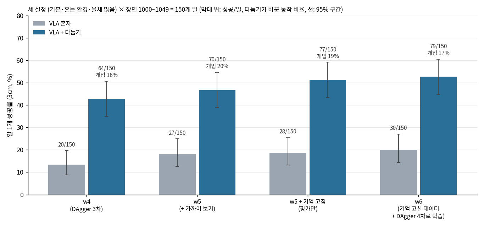
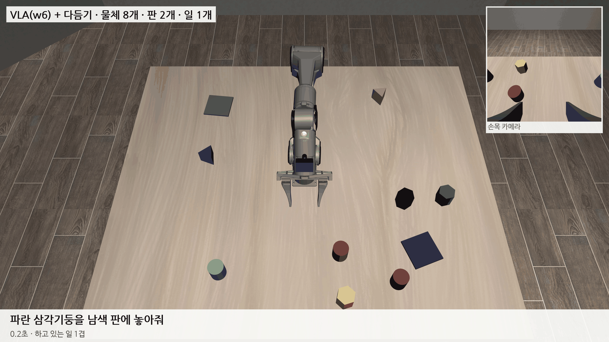

# 2026-10-28 새 장면 w5~w7: 물체 기억이 덮이던 버그를 고쳐 VLA + 다듬기 일 1개 53%, 일 2개는 아직 2/20

> 한 줄 요약: 다듬기를 켜도 물체 많음 장면에서 VLA 가 엉뚱한 물체로 가던 이유는, 팔이 옮길 물체를 가리면 물체 찾기가 같은 색 다른 모양을 대신 고르고 그 자리가 VLA 의 물체 기억을 덮어썼기 때문이었다. 대신 고른 찾기는 기억을 덮지 않게 하고 학습 데이터도 같은 방식으로 다시 계산해 w6 를 학습했다. 세 설정 150개 일에서 VLA 혼자 30/150 (20%), 다듬기를 켜면 79/150 (53%) 이고 다듬기가 바꾼 동작은 17% 다. 빼보기에서는 놓기 다듬기만 켜도 동작 1% 를 바꿔 성공이 두 배가 됐다.

## 1. 논문용 빼보기 (w4, 기본 설정 50장면)

| 다듬기 켠 부분 | 성공 (95% 구간) | 판 안 | 바꾼 동작 |
|---|---|---|---|
| 없음 (VLA 혼자) | 8/50 (8~29%) | 9 | – |
| 쥐기만 | 10/50 (11~33%) | 16 | 17.1% |
| 놓기만 | 17/50 (22~48%) | 22 | **1.0%** |
| 쥐기 + 놓기 | **27/50 (40~67%)** | 29 | 16.8% |
| 예전 보조 (지시문을 읽음) | 24/50 (35~61%) | 25 | 55.9% |

- 놓기 다듬기는 VLA 가 판 근처에서 손을 펴려 할 때만 끼어든다. 동작 1% 만 바꾸고 성공이 8 → 17. VLA 가 맞는 판까지는 스스로 가지만 마지막 몇 cm 가 빗나간다는 것과 맞는다.
- 지시문을 읽는 예전 보조는 동작 절반 이상을 바꾸는데 성공은 다듬기와 비슷하다. 다듬기 쪽이 '무엇을 어디로는 VLA 가 정했다'고 말할 수 있다.

## 2. w5: 가까이 보기 칸

어제 넣은 위치 입력 3판 (물체·판 − 손을 판 크기 절반으로 나눠 tanh) 으로 w4 에서 15,000스텝 학습했다. 데이터는 w4 와 같다.

| 150개 일 | w4 | w5 |
|---|---|---|
| VLA 혼자 | 20 (13%) | 27 (18%) |
| VLA + 다듬기 | 64 (43%) | 70 (47%) |

조금 올랐지만 95% 구간이 겹친다. 실패 장면에서 VLA 가 받은 판 위치는 참 자리에서 0~0.7cm 였는데 손은 여전히 판 가운데에서 몇 cm 떨어진 곳에서 폈다 (판 20cm 안에 놓은 82개: 로봇 쪽으로 평균 3cm, 사분 범위 −7~+2cm). 입력의 정밀도는 주된 원인이 아니었다.

## 3. 물체 기억이 덮이던 버그

w5 + 다듬기에서 물체 많음 장면 중 물체를 못 쥔 17개를 보니 11개가 같은 모양이었다. 손이 옮길 물체에 가장 가까이 갔을 때 VLA 가 받은 물체 위치가 17~57cm 틀렸고, VLA 는 그 자리의 같은 색 다른 물체로 갔다.

- 첫 사진에서는 VLA 길 물체 찾기가 14장면 중 13장면 맞았다. 틀어지는 것은 팔이 움직이면서다.
- 팔이 옮길 물체를 가리면 물체 찾기가 그 이름의 짝을 못 얻는다. 그러면 '남은 덩어리 중 그 이름 점수가 가장 좋은 것'으로 채우는데, 이때 같은 색 다른 모양 (파란 막대 대신 파란 육각기둥) 이 뽑혔다. 그 자리가 손에서 10cm 밖이라 VLA 의 물체 기억을 덮어썼다.
- 고침: 이렇게 대신 채운 찾기는 이미 있는 기억을 덮지 않는다. 실패 10장면을 다시 돌리니 물체 기억 오차가 16~72cm → 9장면이 0.1~2.5cm, 다른 물체를 쥔 장면 0.
- 학습 데이터도 같은 길로 계산돼 있었다. 물체 많음 시범 49개를 표본으로 보니 쥐기 전 프레임의 13% 에서 물체 위치 입력이 3cm 넘게 틀려 있었다. VLA 는 가끔 틀리는 입력으로 배운 셈이다.

학습 데이터 11,398개의 위치 입력을 고친 방식으로 다시 계산하고 (CPU 6시간), DAgger 4차 (w5 가 80~450스텝 하다 멈춘 자리에서 시범 프로그램이 이어받기, 세 설정 423구간) 를 더해 w5 에서 15,000스텝 학습한 것이 w6 이다. 검증 손실 0.0944 → 0.0855.

| 일 1개, 장면 1000~1049 | VLA 혼자 | 판 안 | VLA + 다듬기 (95% 구간) | 판 안 | 바꾼 동작 |
|---|---|---|---|---|---|
| 기본 | 11/50 | 18 | **32/50 (50~76%)** | 35 | 16.8% |
| 흔든 환경 | 9/50 | 16 | **20/50 (28~54%)** | 23 | 13.8% |
| 물체 많음 | 10/50 | 20 | **27/50 (40~67%)** | 30 | 22.3% |
| 합계 | 30/150 (20%) | 54 | **79/150 (53%)** | 88 | |

- w5 에 고친 기억만 평가 때 켜도 (재학습 없이) 다듬기 70 → 77/150. 물체 많음이 22 → 28/50 로 가장 크게 올랐다.
- 다듬기가 VLA 혼자보다 나빠진 장면은 150개 중 7개, 좋아진 장면은 56개. 나빠진 7개 중 다수는 VLA 가 낮게 다른 물체 위를 지나갈 때 다듬기가 그 물체를 쥐러 간 것이다 (다듬기의 '쥐려는 물체' 판정을 더 좁힐 것).
- VLA 혼자 실패는 여전히 놓기가 크다: 판 안에 놓았지만 3cm 밖 30개, 판이 아닌 곳에 놓음 35개.

## 4. 오후: 남은 실패 들여다보기

**다듬기 '쥐려는 물체'를 좁혀 봤다 (되돌림).** 손이 활짝 벌어져 있고 VLA 동작이 그 물체 쪽일 때만 쥐려는 물체로 보게 했더니, 물체 많음 27장면에서 16 → 11 로 떨어지고 다른 물체를 쥔 장면도 줄지 않았다. 원래대로 두었다.

**VLA 혼자 실패를 다시 나눴다.** '판이 아닌 곳에 놓음' 35개 대부분은 쥔 지 1~19스텝 만에 물체를 놓친 것이다 (집은 자리에 그대로 떨어짐). 놓기가 아니라 쥐기가 약한 것이다. 150개 일 중 못 쥠 27, 쥐었다 놓침 23, 판 안 3cm 밖 29, 판 근처 15cm 안 19.

**검은 물체.** w6 + 다듬기에서 검은 물체는 3/22 (파랑 16/20), 막대는 14/38 이다. 검은 막대 한 장면을 따라가 보니 VLA 가 막대 끝을 쥐어 손이 막대 가운데에서 6cm 떨어져 있었고, 다듬기는 '오므린 손 4cm 안의 물체'만 쥔 것으로 봐서 쥔 줄 몰랐다. 들어 올린 막대는 위 카메라에서 시차로 8cm 어긋나 보였다. 쥠 거리를 물체 크기로 늘려 봤지만 그 장면들은 그대로라 되돌렸다 (다음: 쥠 판단에 들어 올린 높이를 넣은 위치).

## 5. w7 과 일 2개

w6 로 DAgger 5차 (세 설정 433구간) 를 모아 w6 에서 15,000스텝 학습한 것이 w7 이다.

| 150개 일 | w6 | w7 |
|---|---|---|
| VLA 혼자 | 30 (20%) | 32 (21%) |
| VLA + 다듬기 | 79 (53%) | 80 (53%) |

흔든 환경만 올랐고 (혼자 9 → 13, 다듬기 20 → 25) 나머지는 그대로다. 일 1개 DAgger 를 되풀이해서는 혼자 20% 근처에서 더 오르지 않는다.

일 2개 끼어들기 (A 를 옮기는 도중 B 지시 → A 를 빈 자리에 내려놓고 B → A 로 돌아가기) 를 w6 + 다듬기로 기본 설정 20장면 재니 둘 다 성공 2/20, 일별 11/40 이다. A 를 쥐어 B 로 넘어간 14장면 중 6장면은 B 를 아예 쥐지 못했다. 지금까지 DAgger 는 일 1개만 모았기 때문에, 'A 를 든 채 B 지시를 받은 상태'에서 바로잡는 시범이 없었다.

그래서 끼어들기 DAgger 를 만들었다. VLA 가 A 를 30스텝 쥐면 B 지시로 바꾸고, VLA 가 B 지시로 0~300스텝 하다가 시범 프로그램이 이어받아 A 내려놓기 → B → A 돌아오기를 마무리한다 (지시문별로 저장). 오늘 밤 w7 로 세 설정 600장면을 모아 w8 을 학습하고, 일 1개·2개를 함께 잰다.

## 다음에 할 것

- w8 성적표 (일 1개 50장면, 일 2개 20장면 × 세 설정)
- 쥠 판단: 들어 올린 물체 높이를 넣은 위치, 막대 끝을 쥐었을 때
- 쥐었다 1~19스텝 만에 놓치는 원인 (쥐는 자리·힘)
- 남은 하드코딩: 책상 높이 0.90, 예전 보조의 블록 기준 높이, 그리퍼 길이·로봇 가리개 손끝 13cm
