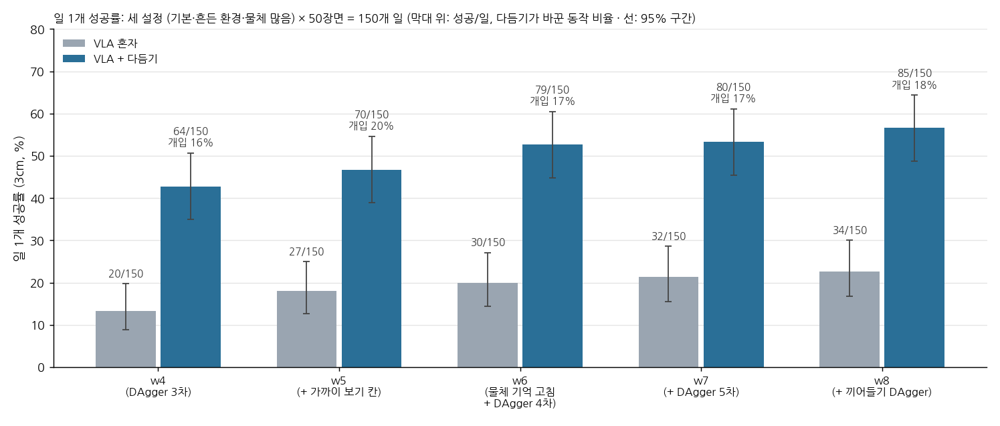
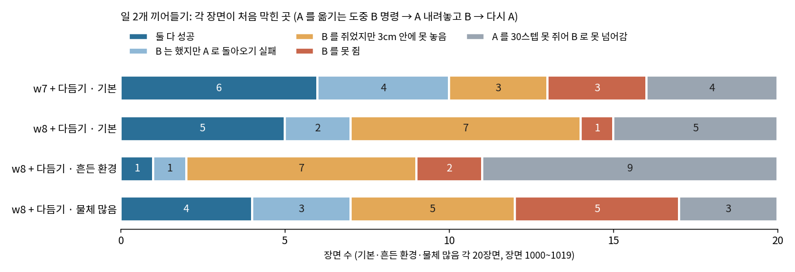
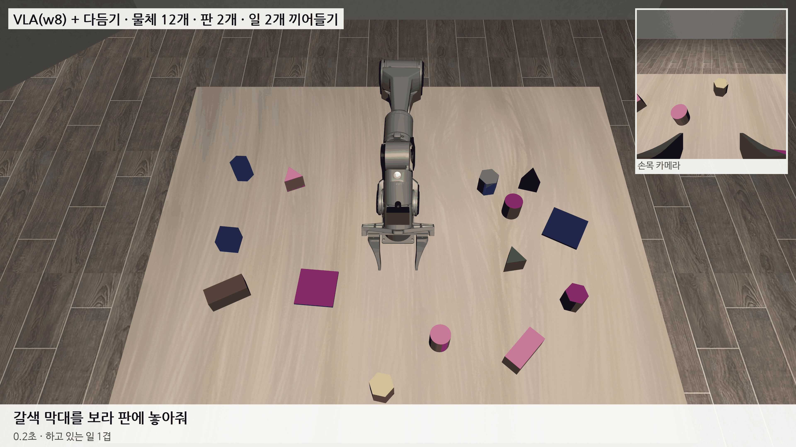
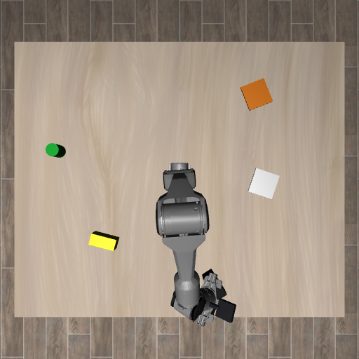

# 2026-10-29 w8: 끼어들기 시범을 더해도 일 2개는 그대로, 막히는 곳은 '마지막 몇 cm'와 검은 물체

> 한 줄 요약: 일 2개 도중 VLA 가 넘겨준 자리에서 시범 프로그램이 마무리한 구간(끼어들기 DAgger)을 더해 학습한 w8 은, 일 1개에서 VLA 혼자 34/150 (23%), 다듬기를 켜면 85/150 (57%) 로 w7 (32, 80) 과 우연 범위 안이었고, 일 2개 끼어들기는 기본 설정 5/20 으로 오르지 않았다. 일 2개 실패를 장면마다 처음 막힌 곳으로 나누면 'B 를 쥐었지만 판 가운데 3cm 안에 못 놓음'이 가장 많아, 끼어들기만의 문제가 아니라 일 1개와 같은 마지막 몇 cm 문제였다. 일 1개에서 다가가고도 못 쥔 20장면 중 15장면이 검정·갈색 물체였고, 한 장면을 따라가 보니 손이 검은 막대 1.5cm 앞까지 갔을 때 손목 카메라 몸체가 '검은 물체'로 잡혀 VLA 의 물체 기억이 10.5cm 튀었다.

## 0. 낮에 한 일

- 10/29 주간보고 (SmolVLA 첫 보고): 슬라이드는 전문 용어 없이, 대본은 짧은 문장 8개와 예상 질문 14개. [09_주간보고/2026-10-29](../09_주간보고/2026-10-29/)
- 저장소 정리: 첫 화면(README)을 새로 쓰고, 맨 위에 있던 문서 9개를 [10_문서](../10_문서/README.md)로 옮기고, 일지 목록을 달마다 나눴다.
- 사용자 지시: 연구 장면을 일 2개가 아니라 물체 N개를 끼어들기로 모두 옮기는 것까지 넓힌다. 95% 목표도 깊이 N 까지.

## 1. w8 성적 (일 1개)

w8 은 w7 에서 15,000스텝 더 학습한 모델이다. 더한 데이터는 끼어들기 DAgger 다. 세 설정에서 200장면씩, VLA 가 A 를 30스텝 쥐면 B 지시로 바꾸고, VLA 가 B 지시로 0~300스텝 움직인 뒤 시범 프로그램이 이어받아 A 내려놓기, B, A 돌아오기를 마무리했다. 이어받아 끝낸 장면은 379개, 프레임은 약 14.8만 장이다. 검증 손실은 0.0877.

| 일 1개, 장면 1000~1049 | VLA 혼자 | 판 안 | VLA + 다듬기 | 판 안 | 다듬기가 바꾼 동작 |
|---|---|---|---|---|---|
| 기본 | 12/50 | 17 | 31/50 | 35 | 22.2% |
| 흔든 환경 | 12/50 | 16 | 26/50 | 28 | 11.2% |
| 물체 많음 | 10/50 | 15 | 28/50 | 29 | 23.1% |
| 합계 (95% 구간) | 34/150 (23%, 17~30%) | 48 | **85/150 (57%, 49~64%)** | 92 | 18.5% |

w7 은 혼자 32/150, 다듬기 80/150 이었다. 같은 장면끼리 보면 혼자는 w8 만 성공 19, w7 만 성공 17, 다듬기는 19 대 14 로, 오른 것이 우연 범위 안이다.

## 2. 일 2개 끼어들기: 어디서 막히나

A 를 옮기는 도중 B 명령이 오는 일 2개를 장면마다 처음 막힌 곳으로 나눴다.

| 20장면 | 둘 다 성공 | B 는 했지만 A 돌아오기 실패 | B 를 쥐었지만 3cm 밖 | B 를 못 쥠 | A 를 30스텝 못 쥐어 못 넘어감 | 판 안 둘 다 |
|---|---|---|---|---|---|---|
| w7 + 다듬기, 기본 | 6 | 4 | 3 | 3 | 4 | 6 |
| w8 + 다듬기, 기본 | 5 | 2 | 7 | 1 | 5 | 7 |
| w8 + 다듬기, 흔든 환경 | 1 | 1 | 7 | 2 | 9 | 2 |
| w8 + 다듬기, 물체 많음 | 4 | 3 | 5 | 5 | 3 | 3 |

- w8 은 기본 설정에서 'B 를 못 쥠'이 3 에서 1 로 줄었지만, 그만큼 'B 를 쥐었지만 3cm 밖'이 3 에서 7 로 늘었다.
- B 를 쥐고도 못 놓은 19장면(세 설정)은 대부분 맞는 판 위에서 손을 폈고, 물체는 판 가운데에서 4~12cm 떨어진 채 끝났다. 판 위에서 다시 집었다 놓기를 몇 번씩 하다 시간이 다 된 장면도 있다. 끼어들기 때문이라기보다 일 1개와 같은 마지막 몇 cm 문제다.
- 일 1개 성공률이 57% 일 때 두 일이 서로 상관없이 된다면 둘 다 성공은 약 33% 가 기대값인데, 실제는 10/60 (17%) 이다. B 로 넘어간 43장면에서 B 성공은 16 (37%) 으로 일 1개보다 낮다.
- 흔든 환경은 A 를 처음부터 못 쥐는 장면이 9/20 으로 가장 많다.

물체 많음 장면 1017 이다. "갈색 막대를 보라 판에" 하던 도중 "분홍 원기둥을 남색 판에 먼저"가 온다. 340스텝 중 다듬기가 바꾼 것은 62스텝이다. 이 장면에서는 B 명령이 왔을 때 갈색 막대가 이미 보라 판 근처에 있어서, 빈 자리 대신 보라 판에 바로 내려놓고 B 로 갔다. 그래서 돌아오기는 할 일이 없었다. 빈 자리에 내려놓았다가 다시 집는 장면이 아니므로, 성공 10장면 중 이런 경우가 몇 개인지 따로 세야 한다.

## 3. 일 1개 실패 나누기 (w8 + 다듬기, 65개)

| 실패 | 개수 |
|---|---|
| 다가갔지만 못 쥠 (손 5cm 안) | 20 |
| 다른 물체를 쥠 | 8 |
| 판 안, 3cm 밖 | 7 |
| 쥐었다 금방 놓침 | 7 |
| 다른 판·다른 곳에 놓음 | 7 |
| 들고 가다 먼 곳 | 5 |
| 맞는 판 근처 (15cm 안) | 5 |
| 들고 끝남 | 4 |
| 다가가지 못함 | 2 |

모양별 성공은 막대 12/38, 정육면체 16/27, 원기둥 23/37, 육각기둥 19/29, 삼각기둥 15/19 이다. 색별로는 검정 5/22, 갈색 9/22 가 가장 낮고 분홍 14/16, 초록 10/13 이 가장 높다. VLA 혼자(w8)는 실패 대부분이 '맞는 판 근처'(30), '판 안 3cm 밖'(27), '쥐었다 금방 놓침'(23) 이고, 막대는 1/38 이다.

## 4. 검은 물체를 못 쥐는 이유

다가가고도 못 쥔 20장면 중 9장면이 검은 물체, 6장면이 갈색 물체다. 손이 물체에 가장 가까이 갔을 때 VLA 가 받은 물체 위치(기억)가 검은 물체 7장면에서 7~56cm 틀려 있었다. 다른 색은 대부분 2cm 안이다.

첫 사진에서는 기본 설정의 검은 물체 4장면 모두 0.0~0.2cm 로 맞게 찾았다. 흔든 환경에서는 첫 사진부터 검은 정육면체를 못 찾거나(1017), 검은 막대를 갈색 삼각기둥으로 잘못 찾았다(1024). 두 장면 모두 검은 물체가 처음부터 그리퍼 바로 옆에 있었다.

기본 1000 (검은 막대를 흰 판에, 물체 3개) 을 VLA 가 계산할 때마다 따라갔다.

| VLA 계산 순서 | 손과 막대 사이 | VLA 의 막대 위치 기억 오차 | 무슨 일 |
|---|---|---|---|
| 0 | 22.3cm | 0.1cm | 첫 사진, 맞게 찾음 |
| 30 | 27.3cm | 0.2cm | |
| 41 | **1.5cm** | **10.5cm** | 쥐기 직전, 기억이 옆으로 튐 |
| 49 | 24.6cm | 0.2cm | 손이 물러나자 다시 맞음 |

쥐기 직전 막대는 그리퍼 밑에 가려지고, 대신 그리퍼 옆으로 나온 손목 카메라 몸체(검은 상자)가 '검은 물체'로 잡혔다. 위 카메라 사진에서 로봇 자리를 지우는 '로봇 가리개'는 팔 마디와 손끝 점만 덮고, 10/24 에 붙인 손목 카메라 몸체는 덮지 않았다. 잡힌 자리는 손에서 11cm 떨어져 있어 '손에서 10cm 넘게 떨어진 곳에서 찾으면 기억을 고친다'는 규칙에 걸렸고, VLA 는 막대가 10cm 옆에 있다고 보고 쥐기를 그만뒀다.

고침: 로봇 가리개가 손목 카메라 몸체·렌즈·고정대도 덮게 했다 (로봇 모델과 관절 각도로 계산하므로 실물에서도 같은 길). 가리는 넓이는 13% 늘었다. 원래 코드는 outputs/piper/world_detect_before_cammask.py.

같은 장면(기본 1000)을 고친 가리개로 다시 돌리니 성공했다. 막대를 판 가운데에서 0.7cm 에 놓았다. 손이 막대 5cm 안에 있는 동안 VLA 의 막대 위치 기억 오차는 0.1~1.9cm 였다 (그 뒤 커진 값은 막대를 들고 옮기는 동안이라 정상).

150장면 전체를 고친 가리개로 다시 쟀다 (w8 그대로, 다시 학습 없이, VLA + 다듬기, 일 1개, 같은 장면):

| | 예전 가리개 | 고친 가리개 |
|---|---|---|
| 전체, 3cm 안 | 85/150 (57%) | 87/150 (58%) |
| 전체, 판 안 | 92/150 (61%) | 93/150 (62%) |
| 검은 물체 | 4/22 | **11/22** |
| 갈색 물체 | 9/22 | 12/22 |
| 나머지 6색 | 72/106 | 64/106 |
| 막대 | 11/38 | 13/38 |

검은 물체는 고친 뒤에만 성공한 장면이 8, 예전에만 성공한 장면이 1 이다. 고친 뒤에만 성공한 장면들은 예전에 손이 가장 가까이 갔을 때 막대 위치 기억이 10~18cm 틀려 있던 장면이라, 손목 카메라 몸체를 물체로 본 것이 원인이었다는 것은 맞다.

전체는 거의 그대로다. 나머지 6색이 72 에서 64 로 내려가 검정·갈색에서 얻은 만큼을 깎았다. 나머지 6색에서 예전에만 성공한 장면은 12, 고친 뒤에만 성공한 장면은 4 다. 잃은 12장면은 위치 기억 오차가 0.1~3cm 로 작고 실패 모양도 제각각(못 쥠, 판 근처, 금방 놓침)이다. 가리개가 넓어져 손 가까이에서 목표 물체 일부가 가려지는 탓인지, 장면마다 생기는 흔들림인지는 아직 모른다. 12 대 4 가 우연일 확률은 8% 쯤이라 그냥 넘기기도 어렵다. w9 평가에서 같은 장면으로 다시 본다.

가리개가 다른 색을 해치는지 학습 데이터로 따로 봤다. 물체 많은 시범 515구간의 첫 구간에서, 쥐기 전에는 목표 물체가 가만히 있으므로 손이 멀 때 잰 위치를 참값으로 두고, 위치 입력을 계산한 프레임만 비교했다.

| 목표 색 | 손과 물체 사이 | 5cm 넘게 틀림: 예전 → 고침 | 그 프레임에서 찾음: 예전 → 고침 |
|---|---|---|---|
| 검정·갈색 | 5cm 안 | 22.0% → 8.0% | 59% → 53% |
| 검정·갈색 | 10cm 밖 | 6.8% → 1.5% | 99% → 97% |
| 나머지 6색 | 5cm 안 | 7.5% → 5.6% | 56% → 54% |
| 나머지 6색 | 10cm 밖 | 4.2% → 1.1% | 99% → 97% |

다른 색도 위치 입력은 나빠지지 않고 조금 좋아졌다. 달라진 것은 손 가까이에서 그 프레임에 물체를 찾는 비율이 2~6%p 줄어든 것뿐이다 (기억한 값을 쓰므로 위치는 그대로, '지금 보임' 칸만 1 → 0.5). w8 은 예전 가리개로 만든 입력으로 배웠으니 이 칸이 조금 다르게 들어가는 셈이다. 그래서 다른 색이 내려간 것은 가리개가 위치를 틀리게 해서는 아니고, 흔들림이거나 이 '보임' 칸 차이일 것이다. 고친 입력으로 다시 배우는 w9 에서는 이 차이가 없어진다.

VLA 혼자(다듬기 없이)도 같은 150장면으로 쟀다.

| w8, 일 1개 150장면 | 3cm 안 | 판 안 |
|---|---|---|
| VLA 혼자, 예전 가리개 | 34 (23%) | 48 (32%) |
| VLA 혼자, 고친 가리개 | 36 (24%) | 52 (35%) |
| VLA + 다듬기, 예전 가리개 | 85 (57%) | 92 (61%) |
| VLA + 다듬기, 고친 가리개 | 87 (58%) | 93 (62%) |

VLA 혼자는 조금 올랐지만 차이가 장면 2~4개라 흔들림 안이다. 혼자일 때 실패는 그대로 놓는 자리(맞는 판 근처 27, 판 안 3cm 밖 25)와 쥐기(못 쥠 25, 쥐었다 금방 놓침 22)이고, 막대는 여전히 1/38 이다. VLA 혼자는 지시한 물체 쪽으로는 148/150 장면에서 갔다 (고친 가리개). 무엇을 집을지는 거의 맞게 고르고, 마지막 몇 cm 에서 놓친다.

흔든 환경의 첫 사진 문제는 따로 셌다. 장면 2000~2059 첫 사진에서 물체를 하나씩 찾게 했을 때 (고친 가리개, 2cm 안이면 맞음):

| 색 | 흔든 환경: 맞음 / 틀림 / 못 찾음 | 기본: 맞음 / 틀림 / 못 찾음 |
|---|---|---|
| 갈색 | 28 / 2 / 8 (26%) | 35 / 1 / 2 (8%) |
| 검정 | 34 / 5 / 1 (15%) | 38 / 1 / 1 (5%) |
| 나머지 6색 | 5~10% | 3~10% |

흔든 환경에서는 갈색을 못 찾고 검정을 다른 것으로 잘못 찾는 일이 많다. 기본 설정에서 색마다 몇 개씩 못 찾는 것은 처음 자세의 팔 밑에 가려진 물체로 보인다 (가설, 팔이 움직이면 다시 찾음).

학습 데이터의 위치 입력도 같은 길로 계산했으므로, 학습 때도 손목 카메라가 검은 물체로 잡힌 프레임이 있었을 수 있다. 위치 입력을 고친 가리개로 다시 계산하는 중이다. 예전 파일(*.wfeat2s)은 그대로 두고 새 파일(*.wfeat2sc)로 쓴다.

## 5. 오늘 밤 도는 것 (piper-w9)

1. w8 + 고친 가리개, 일 1개 다듬기·혼자 150장면 (다시 학습 없이 평가만)
2. 그동안 CPU 로 학습 데이터 위치 입력을 고친 가리개로 다시 계산
3. DAgger 6차: w8 + 고친 가리개로 세 설정 × 200장면
4. w9: w8 에서 15,000스텝, 고친 위치 입력 + DAgger 6차
5. w9 로 일 1개 (혼자·다듬기), 일 2개·일 3개 끼어들기 (다듬기) 세 설정. 일 3개는 물체 N개 목표의 첫 기준

## 6. 저녁: 어디서 놓치나, 다듬기만 떼어 시험

**표 기준을 맞췄다.** 논문 표의 '지시한 물체로 감' 칸이 VLA 혼자일 때는 '손이 그 물체 3cm 안까지 갔거나 쥠', 다듬기를 켰을 때는 '다듬기가 처음 붙은 물체' 로 따로 세고 있었다. 물체가 많으면 손이 지나가며 붙은 물체가 처음으로 잡혀 다듬기 쪽이 낮게 나왔다 (물체 많음 29/50). 둘 다 같은 기준으로 바꾸고 다듬기가 처음 붙은 물체는 칸을 따로 뒀다.

| w8 + 고친 가리개, 150장면 | 지시한 물체로 감 | 지시한 물체를 한 번이라도 쥠 | 성공 3cm |
|---|---|---|---|
| VLA 혼자 | 148 | 121 (81%) | 36 (24%) |
| VLA + 다듬기 | 146 | 124 (83%) | 87 (58%) |

VLA 는 무엇을 집을지는 거의 맞게 고른다. 다듬기를 켜도 다섯에 하나는 끝내 못 쥐고 (26장면), 쥐고도 실패한 것이 37장면이다. 쥔 뒤가 더 많이 깎는다.

**다듬기만 떼어 시험 (VLA 없이).** 시범 프로그램의 경로 계산으로 손을 막대 위 6cm 에 두되, 쥐는 방향에서 −30~30° 돌리고 옆으로 1.5cm 안 빗나가게 둔 뒤 똑바로 내려가 오므리게 했다 (기본 설정 막대 10장면).

| | 막대를 쥠 |
|---|---|
| 다듬기 끔 | 8/10 (19° 이상 틀어진 두 장면은 손가락이 막대 윗면에 얹혀 못 내려감) |
| 다듬기 켬 | 10/10 (손목 사진으로 방향을 재 6~9스텝 만에 맞춤) |

손목 사진으로 잰 막대 방향도 따로 봤다. 25° 안으로 틀어져 있으면 2° 안으로 맞게 재고, 40° 넘으면 20° 쯤 틀린다. 다듬기는 이렇게 손을 똑바로 내리는 경우에는 막대를 쥔다. 그런데 평가에서는 막대 13/38 이다. 그러니 실제 실패는 VLA 가 내려오는 방식(옆으로 쓸며 내려옴, 너무 일찍 오므림, 손목을 되돌림 등)과 얽힌 것으로 보인다 (가설). 오늘 밤 실패 장면을 스텝마다 따라가 본다.

**새 다듬기 부품 두 개** (기본은 꺼 두어 w9 평가에는 영향 없음. 같은 장면으로 고치기 전과 동작이 같은 것을 확인함):

- 물체 가운데 맞추기 (objc): 놓기 다듬기가 손이 아니라 든 물체 가운데를 판 가운데로 맞춘다. 쥔 순간 위 카메라로 기억한 물체 자리와 손 자리의 차이를 손 방향 기준으로 적어 두고, 놓을 때 지금 손 방향으로 돌려 더한다. '판 안, 3cm 밖' 8장면을 겨냥한다.
- 쥐는 자세 계산 (gplan): VLA 가 빈손으로 고른 물체 3cm 안에 4스텝 넘게 머물며 내려오면, 위 카메라로 잰 자리·막대 긴 축 방향과 로봇 모델 역기구학으로 쥐는 자세를 골라 쥐고 6cm 든 뒤 VLA 에 돌려준다. 시범 프로그램과 같은 길이지만 물체 정답 대신 카메라 값만 쓰고, 충돌은 책상 같은 고정물과 기억한 옆 물체 자리로만 본다. 위 시험에서 4/4 쥠 (47~50스텝).

두 부품의 효과는 아직 VLA 와 함께 재지 않았다. 오늘 밤 GPU 가 비는 동안 (DAgger 6차가 끝나고 학습이 시작되기 전) w8 + 다듬기 + 쥐는 자세 계산을 기본·물체 많음 50장면씩 재고, 막대 쥐기 실패 12장면과 판 근처에 놓은 실패 14장면을 따라가고, 깊이 3 끼어들기 DAgger 를 시험한다.

## 다음에 할 것

- 고친 가리개의 효과: 검정은 4 → 11/22 로 고쳐졌으나 전체는 그대로 (4절). 나머지 6색이 내려간 것을 w9 에서 다시 보기
- w9 성적과 일 3개 끼어들기 기준
- 흔든 환경에서 검정이 갈색·자주로 보이는 것 (색 흔들기 ±0.05 와 조명)
- 일 2개 성공 장면에서 A 를 어디에 내려놓았나 (빈 자리 / 자기 판) 세기
- 물체 N개 끼어들기: 평가에 일 3개(깊이 3)를 넣고, 끼어들기 DAgger 도 깊이 3 까지
- 막대: 쥐는 방향과 쥠 판단 (막대 끝을 쥐었을 때, 들어 올린 높이)
- 남은 하드코딩: 책상 높이 0.90, 그리퍼 길이·로봇 가리개 손끝 13cm
