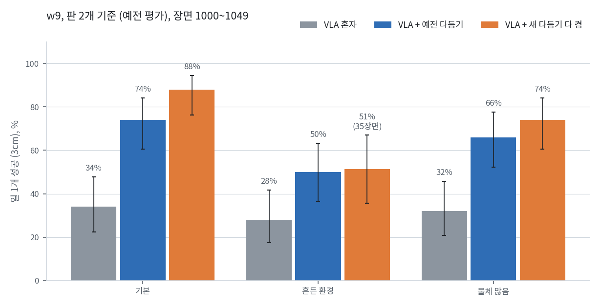
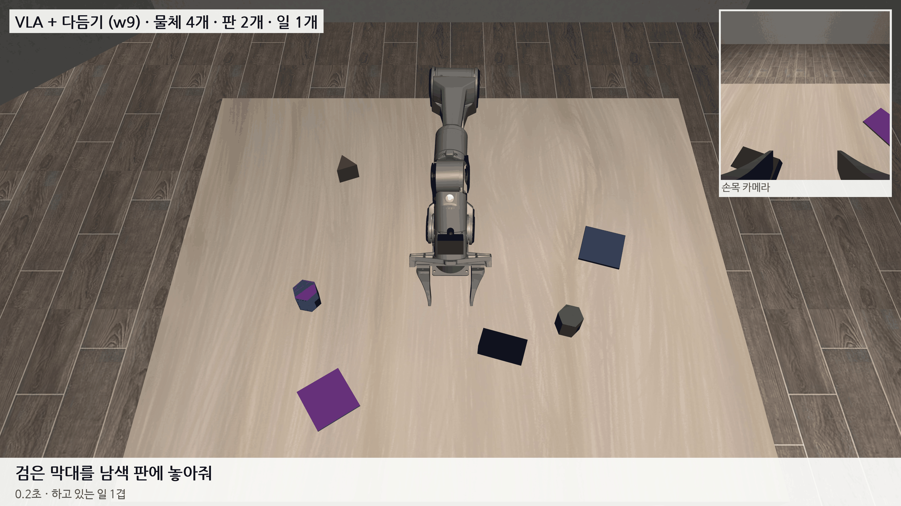
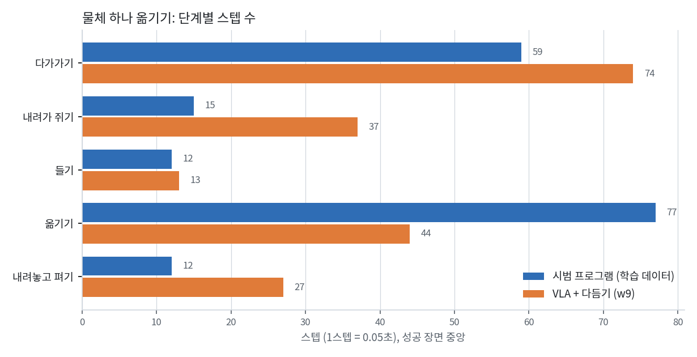
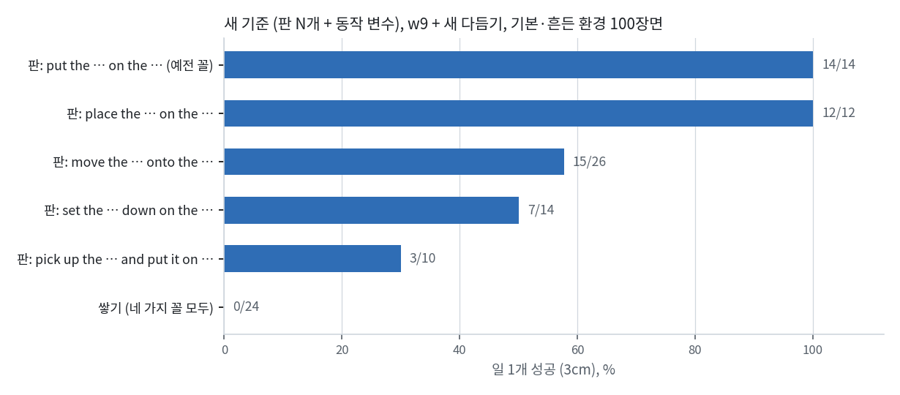

# 2026-10-30 w9: 판 2개에서는 일 1개 88% 까지, 그런데 판 개수와 동작이 고정돼 있었다

> 한 줄 요약: w9 는 판 2개를 놓는 예전 평가에서 일 1개 VLA 혼자 47/150 (31%), 예전 다듬기 95/150 (63%) 였고, 새 다듬기를 모두 켜면 기본 44/50 (88%), 물체 많음 37/50 (74%) 까지 올랐다. 흔든 환경에서 덜 오른 것은 놓기 마무리가 조명 탓에 든 물체를 다른 물체로 읽거나 놓는 높이를 몇 cm 틀려서였고, 둘 다 고쳤다. 사용자 지적으로 확인해 보니 평가가 판을 늘 2개만 놓고 있었고 (설정은 2~5개), 끼어드는 때·일 종류·지시문·지연·속도도 한 가지로 고정돼 있었다. 이것들을 모두 설정 파일의 범위로 옮겨 장면마다 뽑게 했고, 앞으로 숫자는 이 새 기준으로 다시 잰다.

## 1. w9 성적 (판 2개, 예전 기준)

w9 는 w8 에서 15,000스텝 더 학습한 모델이다. 더한 데이터는 DAgger 6차(세 설정 × 200장면, 이어받아 끝낸 418장면)이고, 손목 카메라 가리개를 고친 위치 입력으로 다시 계산했다. 검증 손실은 0.0790.

| 일 1개, 장면 1000~1049 | VLA 혼자 | 판 안 | 예전 다듬기 | 판 안 | 새 다듬기 다 켬 | 판 안 |
|---|---|---|---|---|---|---|
| 기본 | 17/50 | 23 | 37/50 | 40 | **44/50** | 44 |
| 흔든 환경 | 14/50 | 21 | 25/50 | 27 | 18/35 (35장면) | 21 |
| 물체 많음 | 16/50 | 19 | 33/50 | 32 | **37/50** | 36 |

- 새 다듬기는 어제 넣은 부품(손가락 지우기, 닫힐 때까지 붙잡기, 손목 카메라로 자리 다시 재기, 쥐는 자세 계산, 든 물체 가운데, 놓기 마무리)을 모두 켠 것이다.
- 같은 장면끼리 비교하면 기본은 새 다듬기만 성공 8, 예전만 성공 1, 물체 많음은 7 대 3 이다. 흔든 환경은 3 대 3 으로 오르지 않았다.
- 일 2개·3개 끼어들기 (예전 다듬기, 20장면)는 아직 낮다. 일 2개 7/20·1/20·2/20, 일 3개 2/20·0/20·1/20 (기본·흔든·많음).

검은 막대는 손목 사진에서 검은 손가락과 붙어 어제까지 가장 많이 놓친 물체다. 평가 기록을 보면 이 장면에서 다듬기는 내려가기 직전 손목 사진으로 막대 방향을 다시 확인해 쥐는 자세를 한 번 고쳤다.

## 2. 흔든 환경에서 새 다듬기가 덜 오른 까닭

예전 다듬기로는 성공하고 새 다듬기로는 실패한 흔든 환경 3장면(1006, 1019, 1023)을 다시 돌리며 놓기 마무리가 도는 동안 추정과 실제를 스텝마다 찍었다. 세 장면 모두 빨강·노랑 물체를 주황 판에 놓는 일이었다.

| 장면 | 손을 편 자리 (판 가운데에서) | 원인 |
|---|---|---|
| 1006 | 4.4cm (예전 0.8cm) | 조명이 바뀌어 손에 든 빨간 원기둥을 책상 저쪽의 다른 물체로 읽음. 그 물체 기준으로 '든 물체 가운데'를 4cm 틀리게 잡고 판 가운데에 맞춤 |
| 1019 | 3.4cm (예전 0.1cm) | 같은 원인 |
| 1023 | 13cm (예전 0.1cm) | 가운데는 0.8cm 로 맞췄지만 판 몇 cm 위에서 놓아 물체가 굴러감. 놓는 높이를 '쥘 때 물체가 책상 위에 있었다'고 보고 계산하는데 그게 틀림 |

고친 것:

- 손가락이 오므리면 물체는 그 방향으로 저절로 가운데에 온다. 그래서 든 물체가 손 가운데에서 어긋날 수 있는 것은 막대의 긴 축 방향뿐이고 (3.5cm 까지), 나머지 모양은 손 위치를 그대로 쓴다.
- 놓는 높이는 계산값 근처까지만 쓰고, 그다음에는 천천히 내리다가 판에 닿아 손이 멈추면 편다. VLA 없는 놓기 시험에서 닿음이 4번 모두 잡혔고 판 가운데에서 0.3, 0.3, 1.3, 0.3cm 에 놓였다.
- 평가 쪽 빈틈도 고쳤다. 물체가 판에 닿는 순간 성공으로 보고 '손 펴기 기다리기'로 넘어가는데, 그동안은 다듬기 없이 VLA 만 움직여 물체를 다시 들곤 했다. 실제 로봇에서는 다듬기가 늘 켜져 있으므로 그 구간에도 다듬기를 넣었다.

## 3. 판이 늘 2개였다

사용자가 판도 N개로 하고 있는지 물어 확인해 보니, 평가 코드가 판 개수를 '일 개수, 최소 2개'로 정해 두고 설정 파일의 판 개수(기본·흔든 2~5개, 물체 많음 3~6개)를 읽지 않았다. 학습 데이터는 판 2~6개로 모았으니 VLA 는 판이 많은 장면을 봤지만, 지금까지의 평가 숫자는 모두 판 2개(일 3개는 3개)라는 쉬운 조건이었다.

이제 평가·DAgger 모두 설정의 범위에서 판 개수를 뽑는다 (일 개수 이상). 같은 장면 50개에서 판 개수는 2개 16·3개 12·4개 14·5개 8 이 된다. 예전 숫자는 '판 2개 기준'으로 따로 적고 새 숫자와 섞지 않는다.

판 N개에서 w9 혼자 일 1개를 재 보니 판이 늘어도 떨어지지 않았다. 판 개수가 달라지면 물체 자리까지 달라져 같은 장면끼리 비교는 아니고, 차이는 우연 범위 안이다.

| w9 혼자, 일 1개 50장면 | 판 2개 (예전) | 판 N개 | 판 N개, 판 개수별 (2·3·4·5개) | 엉뚱한 판에 놓음 |
|---|---|---|---|---|
| 기본 | 17/50 (34%) | 23/50 (46%) | 7/16, 6/12, 6/14, 4/8 | 3 |
| 흔든 환경 | 14/50 (28%) | 18/50 (36%) | 7/16, 5/12, 3/14, 3/8 | 3 |

판을 잘못 고르는 일은 100장면 중 6번뿐이고, 실패 대부분은 여전히 물체를 쥐고도 판 가운데 3cm 안에 못 놓는 것이다. 물체 많음 설정은 이 단계에서 재지 않고 새 기준(6절)에서 잰다.

## 4. 동작도 한 가지였다: 동작 변수

판뿐 아니라 동작도 코드에 한 가지로 박혀 있었다. 사용자가 고른 세 가지(끼어드는 때, 일 종류·지시문, 지연·속도)에 실제 로봇에 도움이 될 세 가지를 더해 설정 파일 `motion` 칸으로 옮기고, 장면마다 범위에서 뽑게 했다.

| 변수 | 예전 | 지금 (장면마다 뽑음) |
|---|---|---|
| 끼어드는 때 | A 를 쥐고 30스텝 뒤 | 다가가는 중 (손이 A 에서 3~10cm) 20%, 쥔 직후 (1~10스텝) 20%, 옮기는 중 (쥔 채 20~80스텝) 40%, 놓기 직전 (든 A 가 판에서 3~8cm) 20% |
| 일 종류 | 판 위에 놓기 (판이 모자랄 때만 쌓기) | 판 75%, 다른 물체 위에 쌓기 25% |
| 지시문 | "put the … on the …" 한 가지 | 판 5가지, 쌓기 4가지 꼴 ("move the … onto …", "stack the … on …" 등) |
| 지연 | 9스텝 | 6~12스텝 |
| 속도 | 명령 그대로 | 명령 대비 0.8~1.2배 |
| 제어 잡음 | 없음 | 위치 0.015, 회전 0.0075 (동작 범위 ±1 기준) |
| 물체 마찰·무게 | 고정 | 마찰 0.6~1.4배, 무게 0.5~2배 |
| 손가락 마찰 | 2.0 | 0.6~1.0배 |

- 끼어들 때가 오지 않으면 (VLA 가 그 전에 놓았거나 못 쥠) 하던 일이 끝난 뒤 다음 지시를 준다.
- 시범 프로그램도 같은 네 가지 때에 끼어들기를 보여 주게 했다. 마찰·무게·속도·잡음을 켠 채 끼어드는 때마다 3장면씩, 12장면 모두 해냈다. 쌓기 일이 섞인 장면도 성공했다.
- 동작 변수를 끄고 (`PIPER_MOTION=0`) 판을 2개로 주면 예전 장면이 그대로 나온다. 판·동작 변수 코드를 넣은 뒤 (놓기 마무리를 고치기 전) 예전 w9 평가 12장면을 다시 돌려 스텝 수까지 12/12 같게 나오는 것을 확인했다.
- w9 에 동작 변수를 켜고 일 2개를 시험 삼아 돌려 보니, 처음 보는 지시문 꼴("pick up the … and put it on …")을 받은 한 장면에서 B 쪽으로 아예 가지 않았다. 학습 때 지시문을 다른 꼴로 바꿔 쓰는 옵션을 넣었다. 다른 장면에서는 VLA 가 끼어들 때(쥔 채 67스텝)보다 먼저 A 를 놓아, A 를 끝낸 뒤 B 지시가 나갔다.

## 5. 동작 하나당 몇 스텝인가

1스텝은 0.05초다. 시범 프로그램은 학습 데이터(일 1개 279장면, 일 2개 끼어들기 208장면), VLA 는 w9 + 새 다듬기, 기본 설정 12장면의 성공한 일에서 쟀다. VLA 쪽은 손이 물체 위 3cm 안, 쥠, 3cm 들림, 든 물체가 판 3cm 안, 놓음의 순간으로 나눴다.

| 물체 하나 옮기기 | 시범 프로그램 | VLA + 다듬기 |
|---|---|---|
| 다가가기 | 59 (36~90) | 74 (52~92) |
| 내려가 쥐기 | 15 (내려가기 10, 오므리기 5) | 37 (33~169) |
| 들기 | 12 | 13 |
| 옮기기 | 77 (32~148) | 44 (20~106) |
| 내려놓고 펴기 | 12 (내려놓기 10, 펴기 2) | 27 (9~31) |
| 물러나기 | 14 | |
| 합계 | 189 (9.5초) | 놓을 때까지 220 (11초) |

괄호는 장면 10~90% 범위다. VLA 가 확실히 느린 곳은 쥐기와 놓기로, 다듬기가 마지막 몇 cm 를 맞추는 데 시간을 쓴다. 옮기기는 장면마다 거리가 달라 바로 비교하기 어렵다.

끼어들기 (일 2개) 시범은 A 다가가 쥐기 71, A 쥔 뒤 끼어들기까지 36, A 빈 자리에 내려놓기 28, B 다가가 쥐기 103, B 옮겨 놓기 98, A 다시 다가가 쥐기 85, A 다시 옮겨 놓기 85 스텝으로, 합계 577스텝 (29초) 이었다.

## 6. 새 기준에서 w9: 무너진 곳은 지시문과 쌓기

새 기준 = 판 N개 + 동작 변수. w9 + 새 다듬기로 일 1개를 재니 기본 27/50 (54%), 흔든 환경 24/50 (48%) 로 판 2개 기준 (88%, 51%) 보다 크게 떨어졌다. 그런데 나눠 보면 떨어진 곳이 뚜렷하다.

- 판에 놓는 일을 예전과 같은 꼴(put, place)로 시키면 26/26 모두 성공했다. 이 장면들도 판 2~5개, 지연 6~12스텝, 속도 0.8~1.2배, 제어 잡음, 마찰·무게가 모두 흔들린 상태였다. 동작 변수 쪽으로는 꽤 튼튼하다.
- 같은 판 일이라도 처음 보는 꼴은 move 15/26, set … down 7/14, pick up … and put it on 3/10 로 떨어졌다. 손이 지시한 물체 근처에도 가지 않은 장면이 많아, 말을 못 알아들은 것으로 본다.
- 쌓기는 어떤 꼴로 시켜도 0/24 였다. 예전 꼴 "put the … on the (물체)" 로 시켜도 옮길 물체 3cm 안까지 간 장면이 없다. 학습 데이터에 쌓기가 거의 없었고, 물체 이름이 둘 나오면 어느 쪽을 집을지 헷갈리는 것으로 보인다 (가설).
- 처음에 지연 11~12스텝, 빠른 속도에서 떨어지는 것처럼 보였던 것은 낯선 지시문과 겹쳐서였다. 예전 꼴 판 일 26장면에는 지연 11~12스텝 12장면, 속도 1.07배 넘음 10장면, 손가락 마찰 0.8배 아래 10장면, 판 4~5개 10장면이 들어 있었고 모두 성공했다.

그래서 w10m 학습에서는 지시문 절반을 다른 꼴로 바꿔 쓰고, 쌓기 일이 뽑히는 몫을 15% 로 정했다 (일마다 같은 몫으로 두면 데이터가 1~2개뿐인 쌓기 일 수백 가지가 전체의 40% 가까이를 가져가 같은 장면을 수십 번 되풀이한다).

## 7. 새 기준으로 다시: w10m

새 기준 = 판 N개 + 동작 변수. 순서는 다음과 같고 GPU 가 비는 대로 이어서 돈다.

1. w9 를 새 기준으로 잰다: 혼자·새 다듬기 일 1개 세 설정 50장면, 일 2·3개 기본 20장면.
2. 같은 때에 새 데이터를 모은다: 시범 프로그램 세 설정 × 100장면 (CPU), 끼어들기 DAgger 깊이 2 세 설정 × 60, 깊이 3 × 20 (네 가지 때).
3. 사진 특징과 위치 입력을 계산하고, w9 에서 15,000스텝 더 학습한다 (w10m). 학습 표본의 지시문 절반은 다른 꼴로 바꿔 쓴다.
4. 1과 같은 장면에 일 2·3개 세 설정을 더해 w10m 을 잰다.

## 다음에 할 것

- 새 기준 w9 결과를 변수별로 나눠 (끼어드는 때, 쌓기, 지시문 꼴, 지연, 속도, 손가락 마찰) 어느 변수가 정확도를 가장 깎는지 본다.
- w10m 학습·평가. 새 기준에서 일 1·2·3개 모두 VLA 혼자와 다듬기를 따로 적는다.
- 판 N개에서 판 고르기 실패가 늘었는지 (끝난 자리에서 가장 가까운 판이 지시한 판인가) 본다.
- 논문용: 동작 변수를 하나씩 끄고 켜 본 결과, 다듬기 개입률.
