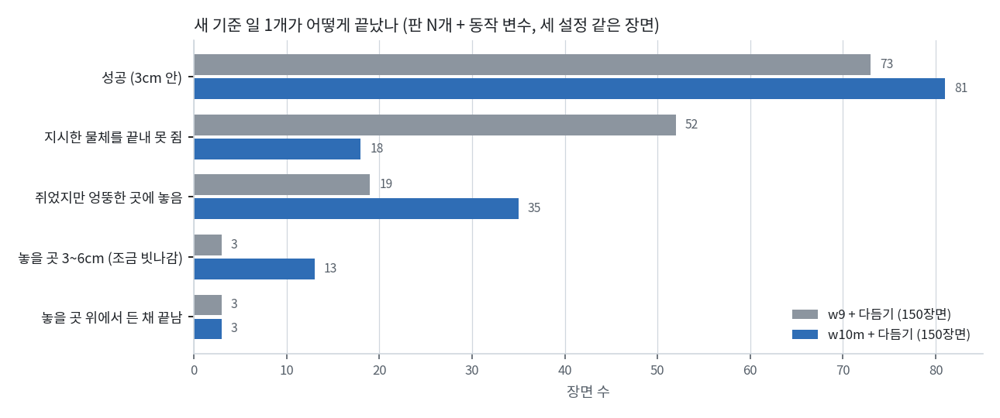
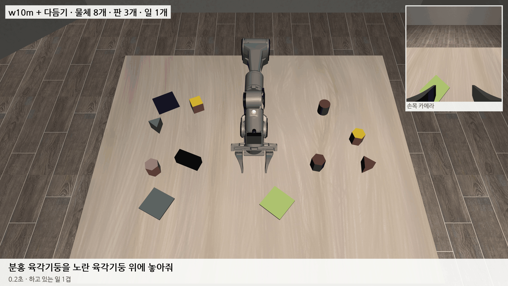

# 2026-10-31 w10m 은 쥐기가 나아졌고, 다듬기 버그 셋을 고쳐 새 기준 기본 설정 76%

> 한 줄 요약: 새 기준(판 N개 + 동작 변수)에서 w10m 은 일 1개 VLA + 다듬기 81/150 (54%) 으로 w9 (73/150) 보다 조금 나았고, 실패 꼴이 '지시한 물체를 못 쥠'(52 → 18장면)에서 '쥐었지만 엉뚱한 곳에 놓음'(19 → 35장면)으로 옮겨 갔다. 지시문을 표준 꼴로 바꿔 넣어 보는 시험은 효과가 없었다 (같은 장면 106개 52 대 53). 쌓기에서는 다듬기가 목표 물체 2cm 안만 놓을 곳으로 보던 것을 판처럼 '크기 + 5cm' 로 넓혀 같은 33장면 2 → 7 이 됐다. 실패 장면을 다시 돌려 스텝마다 따라가 보니 다듬기 쪽 버그가 셋 나왔다: 쥔 물체를 빈손으로 봄 (손가락 하나의 벌어짐만 보고 상한과 3mm 차이), 지연 탓에 VLA 가 먼저 오므리면 쥐는 자세 계산이 안 켜짐, 손이 10~13cm 앞까지 다가올 때 팔에 가린 찾기가 물체 기억을 1.4cm 틀리게 덮음. 셋을 고친 다듬기는 기본 설정 50장면에서 38/50 (76%, 예전 다듬기 28/50) 이다.

## 1. w10m 성적 (새 기준, 일 1개)

w10m 은 w9 에서 15,000스텝 더 학습했다. 더한 데이터는 새 기준 시범(세 설정 × 100장면, 쌓기 25%), 끼어들기 DAgger 깊이 2·3 이고, 학습 지시문 절반은 다른 꼴로 바꿔 썼다 (쌓기 일이 뽑히는 몫 15%). 검증 손실은 10,000스텝 0.0847, 15,000스텝 0.0881 로 w8·w9 처럼 끝에서 조금 올랐다.

| 새 기준, 일 1개 | VLA 혼자 | 판 안 | VLA + 다듬기 | 판 안 |
|---|---|---|---|---|
| 기본 | 7/22 (22장면) | 9 | 28/50 | 29 |
| 흔든 환경 | 13/50 | 17 | 23/50 | 27 |
| 물체 많음 | 미룸 | | 30/50 | 31 |
| 합계 | 20/72 (28%) | 26 | **81/150 (54%)** | 87 (58%) |
| (w9, 같은 장면) | 26/150 (17%) | 36 | 73/150 (49%) | 76 |

- VLA 혼자 기본은 22장면에서 GPU 메모리 부족으로 꺼졌고 (6절), 물체 많음은 다음 모델 데이터 모으기에 GPU 를 먼저 쓰려고 미뤘다. 같은 72장면에서 w9 혼자는 14/72 다.
- 다듬기를 켠 쪽을 일 종류로 나누면 판에 놓기 79/117 (w9 73/117), 쌓기 2/33 (w9 0/33) 이다. 판 일을 예전 꼴(put)로 시킨 것은 15/21, 처음 보는 꼴은 64/96 이다.
- 차이는 크지 않지만 실패하는 꼴이 뚜렷하게 바뀌었다.

평가 기록으로 VLA 가 지시한 물체를 쥐었는지 세면 w10m 은 132/150 (w9 98/150) 이다. w9 는 실패 77장면 중 52장면이 지시한 물체를 끝내 못 쥔 것이었는데, w10m 은 18장면뿐이다. 대신 쥔 뒤 엉뚱한 곳에 놓은 장면이 19 → 35, 놓을 곳 3~6cm 로 조금 빗나간 장면이 3 → 13 으로 늘었다. 막히는 곳이 쥐기에서 놓기로 옮겨 갔다.

일 2개 끼어들기 (기본 20장면) 는 1/20 이다. 일 단위로는 40개 중 12개를 해냈다 (A 6, B 6). B 를 하는 동안 다른 물체를 수십~백 스텝 쥐고 있던 장면이 많아, A 를 내려놓지 못했거나 A 를 다시 집은 것으로 보인다. 흔든·많음 일 2개와 일 3개는 GPU 를 아끼려고 미뤘다.

엉뚱한 곳에 놓은 35장면을 끝난 자리로 나누면 다음과 같다.

| 끝난 자리 | 장면 | 다듬기가 잡은 놓을 곳 |
|---|---|---|
| 판 일: 어느 판에서도 5cm 밖 | 15 | 없음 (한 번도 못 잡음) |
| 판 일: 어느 판에서도 5cm 밖 | 4 | 지시한 판 |
| 쌓기: 판도 목표 물체도 아닌 곳 | 10 | 없음 7, 다른 것 3 |
| 쌓기: 판 위 | 5 | 그 판 |
| 판 일: 어느 판에서도 5cm 밖 | 1 | 다른 판 |

판 일에서 쥐고 엉뚱한 곳에 놓은 20장면 중 15장면은 다듬기가 놓을 곳을 한 번도 잡지 못했다. 다듬기는 VLA 가 손을 펴려 할 때 손 아래 판(가운데에서 11.4cm 안)을 놓을 곳으로 잡는데, 그 순간이 오지 않았다는 뜻이다. 이유는 4절에서 따라가 본 장면으로 찾았다.

## 2. 지시문 꼴 탓인가: 표준 꼴로 바꿔 넣어 봄

어제 w9 에서 판 일을 예전 꼴로 시키면 거의 다 성공하고 처음 보는 꼴에서 떨어졌다. w10m 에서도 판 일 예전 두 꼴 20/25, 나머지 세 꼴 38/63 처럼 보였다. 그런데 VLA 가 받는 위치 입력 (지시문에서 읽은 옮길 물체·놓을 곳의 손 기준 자리) 은 꼴과 상관없이 0.1~2.7cm 로 정확했다. 해석기는 아홉 가지 꼴을 모두 읽는다.

그래서 VLA 에 들어가는 지시문만 해석기로 첫 꼴(put the … on the …)로 바꿔 넣는 길을 만들었다. 한국어 명령이 영어 첫 꼴로 바뀌어 들어가는 것과 같은 길이다. 다듬기와 성공 판정은 그대로다.

| w10m + 다듬기, 같은 장면 106개 | 3cm | 판 일 | 쌓기 |
|---|---|---|---|
| 지시문 그대로 | 53 | 52/80 | 1/26 |
| 표준 꼴로 바꿔 넣음 | 52 | 49/80 | 3/26 |

효과가 없었다. 꼴별 차이는 지시문 탓이 아니라 그 꼴이 뽑힌 장면이 달랐던 탓으로 본다. 꼴은 장면 번호로 뽑혀서 같은 꼴 안에 어려운 장면이 몰릴 수 있다. 이 길은 기본으로 꺼 두고 (모델 폴더 표시나 평가 옵션으로만 켬), 다음 학습에도 쓰지 않는다. 남은 44장면은 GPU 를 아끼려고 돌리지 않았다.

## 3. 쌓기: 목표 물체 옆 5~8cm 에서 펴는데 다듬기는 2cm 만 봤다

w10m 은 쌓기에서 지시한 물체를 쥐기는 한다 (w9 는 아예 안 쥠). 쌓기 33장면 중 31장면이 실패했는데, 놓으려고 손을 편 자리를 보니 8장면은 목표 물체에서 2.5~8.5cm 옆이었다. 판은 '판 반대각선 반 + 5cm' 안에서 펴면 놓을 곳으로 잡지만, 쌓을 물체는 바로 위 2cm 안만 잡아서 이 8장면에 다듬기가 붙지 않았다. 5장면은 VLA 가 목표 물체 대신 가까운 판으로 가져갔다 (다듬기는 지시문을 읽지 않으니 그 판에 맞춰 준다).

쌓을 물체도 판과 같은 규칙으로 '바닥 반지름 + 5cm' 안이면 놓을 곳으로 잡게 했다 (다듬기 부품 stk, 기본 꺼짐). 정육면체 8.2cm, 원기둥 7.3cm, 육각기둥 7.6cm 다. 다만 들고 있는 물체 바닥이 목표 물체 윗면 1.5cm 아래보다 높을 때만 잡는다. 책상까지 내려 펴는 동작은 끼어들기에서 '가까운 빈 자리에 내려놓기'일 수 있어서다. 놓기 마무리에서 목표 물체보다 낮으면 옆으로 가기 전에 먼저 들게 했다 (옆면을 밀지 않게).

| w10m + 다듬기, 쌓기 33장면 (같은 장면) | 기본 12 | 흔든 12 | 많음 9 | 합 |
|---|---|---|---|---|
| 예전 다듬기 | 1 | 0 | 1 | 2 (6%) |
| + stk | 3 | 1 | 3 | **7 (21%)** |

올랐지만 아직 낮다. 나머지는 VLA 가 판으로 가져가거나, 쥐고 든 채 목표 물체 위에서 끝내 펴지 않거나, 목표에서 10cm 넘게 떨어진 곳에서 폈다. 다음 모델(w11m)은 쌓기 일을 절반으로 모은 DAgger 와 시범을 더하고 쌓기 몫을 20% 로 올려 학습한다.

## 4. 실패 8장면을 다시 돌려 따라가 봄

평가와 같은 장면·일·동작 변수로 다시 돌리며 스텝마다 손 자리, VLA 의 그리퍼·높이 명령, 다듬기가 낸 명령, 다듬기 안의 상태(쥔 것, 놓을 곳, 노리는 물체)를 기록하고 작은 영상을 남기는 도구를 만들었다 (`piper_sim/world_trace.py`). 지시한 물체 3cm 안까지 가고도 끝내 못 쥔 장면과, 쥐었는데 판 옆에서 놓친 장면을 골랐다.

| 장면 | 일 | 무슨 일이 있었나 | 탓 |
|---|---|---|---|
| 기본 1001 | 갈색 육각기둥 → 연두 판 | 쥔 153스텝 중 111스텝을 다듬기가 '빈손'으로 봄. 그동안 VLA 가 판 7cm 앞에서 펴도 놓기 다듬기가 안 붙었고, 빈손 쥐기 다듬기가 그리퍼를 열어 든 물체를 세 번 떨어뜨림 | 다듬기 |
| 흔든 1014 | 청록 원기둥 → 보라 판 | 쥔 98스텝 내내 빈손으로 봄. 다듬기 기억 속 원기둥 자리가 실제와 27cm (조명이 바뀌어 다른 덩어리를 읽음) | 다듬기 |
| 기본 1005, 1026 / 흔든 1004 | 막대·원기둥·육각기둥 | VLA 가 물체 위 1.6~4cm, 윗면 5cm 위에서 오므리며 내려가는데 쥐는 자세 계산이 안 켜짐. 다듬기는 벌린 채 천천히 내리는 사이 VLA 는 쥐었다고 보고 빈손으로 놓을 곳 쪽으로 떠남 (지연 9~12) | 다듬기 |
| 흔든 1017 | 검은 정육면체 | VLA 가 물체로 가지 못하고 떠돎 | VLA |
| 흔든 1019 | 노란 정육면체 → 흰 판 | 쥐고 가다가 판 가운데 14.5cm 앞에서 폄 (다듬기 범위 11.4cm 밖). 들고 가는 동안 VLA 그리퍼 명령이 한 스텝씩 열고 닫기를 오감 | VLA |

다듬기 탓 셋 중 둘을 고쳤다.

- **쥔 것을 빈손으로 봄.** 다듬기는 그리퍼 손가락 하나의 벌어짐이 0.5~2.8cm 이면 무언가 쥔 것으로 본다. 그런데 시범 프로그램이 물체 가운데를 쥐어도 그 값이 원기둥 2.57, 육각기둥 2.65~2.73cm 로 상한과 3mm 차이뿐이다. VLA 가 조금 비껴 쥐면 한쪽 손가락이 더 벌어진 채 멈추고, 그 손가락 하나만 보니 '벌렸다'로 읽는다. 두 손가락 평균을 쓰고 상한을 쥔 물체(최대 2.73)와 활짝 편 값(3.5)의 가운데인 3.1cm 로 바꿨다 (부품 q2). 시범으로 쥔 뒤 손가락 하나를 2.85·2.95·3.1cm 로 바꿔 넣는 시험에서 예전 판단은 셋 다 빈손, 새 판단은 셋 다 쥔 것으로 봤다.
- **쥐는 자세 계산이 안 켜짐.** 이 계산은 그리퍼를 활짝 벌린 채 물체 가운데 3cm 안으로 내려올 때만 켰다. 지연이 크면 VLA 가 물체 위에서 먼저 오므리기 시작해 그 조건을 놓친다. 막대는 VLA 가 끝 쪽을 노려 가운데에서 3.4~4.3cm 였다. 빈손으로 다 닫히기 전이면 오므리는 중에도 켜고, 거리는 바닥 반지름 − 1cm (막대 3.9cm) 까지로 넓혔다 (부품 gq).
- 흔든 환경에서 다듬기 기억이 다른 덩어리를 읽는 문제(1014)는 아직 그대로다.

새 다듬기(stk, q2, gq 를 더함)로 같은 8장면을 다시 돌리니 기본 1001 은 성공으로 바뀌었다 (쥐는 자세 계산으로 쥐고, 놓기 마무리로 판 가운데 0.5cm 에 놓음). 나머지 7장면은 그대로 실패였는데, 둘(기본 1026, 흔든 1004)은 쥐는 자세 계산이 켜지고도 손가락이 물체 윗면에 걸려 허공에서 오므렸다. 계산이 노린 자리가 물체에서 1.5cm 쯤 손 쪽으로 틀려 있었다.

그래서 VLA 를 CPU 로 돌려 (GPU 줄을 쓰지 않으려고) 같은 두 장면을 다시 돌리며 다듬기 기억 속 물체 자리를 스텝마다 찍었다. 두 장면 모두 처음에는 0.1cm 로 정확하다가, 손이 물체 10~13cm 앞까지 다가오는 두세 스텝에 위 카메라가 물체를 0.5 → 1.4cm 틀리게 봤고 (팔이 물체 일부를 가림), 다듬기는 '손이 8cm 밖이면 지금 본 값으로 바로 고친다' 는 규칙으로 그 값을 받아들였다. 손이 가까워지면 기억을 더 고치지 않으니 틀린 자리가 굳었다. 다듬기에는 '평소보다 작게 보인 덩어리는 가린 것으로 보고 버린다' 는 규칙이 있었지만 손 10cm 안에서만 썼다.

- **가린 찾기로 기억을 덮음.** 작게 보인 덩어리는 손 거리와 상관없이 버리고, 기억과 다르게 보일 때 바로 고치는 거리를 8cm 에서 20cm 로 늘렸다 (그 안에서는 10번 연달아 다르게 보여야 고침, 부품 mocc). 같은 흔든 1004 를 다시 돌리니 기억 오차가 끝까지 0.1~0.2cm 였고 쥐는 자세 계산이 물체 가운데 0.1cm 에서 쥐었다 (예전 1.3cm 비껴 쥠). 이 장면은 그 뒤 VLA 가 물체를 판 1.8cm 위까지 가져갔다가 지나쳐 19cm 떨어진 곳에 놓아 실패했다.

| w10m, 기본 50장면 (같은 장면) | 3cm | 판 안 | 판 일 | 쌓기 |
|---|---|---|---|---|
| 예전 다듬기 | 28 | 29 | 27/38 | 1/12 |
| + stk, q2, gq | 31 | 33 | 27/38 | 4/12 |
| + stk, q2, gq, mocc | **38 (76%)** | 39 | **33/38** | 5/12 |

stk·q2·gq 로 늘어난 3장면은 모두 쌓기였고, mocc 를 더하자 판 일이 27 → 33 으로 올랐다. 예전 다듬기와 같은 장면끼리 견주면 새 다듬기만 성공 11, 예전만 성공 1 로 (부호 검정 p = 0.006) 우연으로 보기 어렵다. 흔든·많음 설정은 w11m 학습이 GPU 를 쓰는 동안 멈췄다가 이어서 잰다.

물체 8개 중에서 분홍 육각기둥을 쥐어 노란 육각기둥 위에 올렸다 (쌓기 넓힘 stk 까지 켠 다듬기). 쌓기 성공 7장면 중 다시 돌려도 성공한 장면이다. 먼저 고른 물체 많음 1011 (빨간 막대를 초록 원기둥 위에) 은 다시 돌리니 실패했다. 같은 장면·같은 설정이어도 GPU 계산 순서에 따라 조금씩 달라진다.

## 5. 다음 모델 w11m

w10m 을 새 기준으로 잰 결과가 w9 보다 나아서 w10m 에서 이어 간다. 이번에 더하는 데이터는 다음과 같다.

- 일 1개 DAgger 세 설정 × 100장면: 쌓기 일 50%, VLA 가 엉뚱한 물체를 쥐고 있으면 가까운 빈 자리에 내려놓고 지시한 물체로 가는 것까지 보여 줌.
- 끼어들기 DAgger 깊이 2 세 설정 × 60, 깊이 3 × 20: 돌아오는 일의 60% 는 VLA 가 먼저 해 보고 막히면 이어받음.
- 시범 프로그램 세 설정 × 80장면 (쌓기 50%): 240장면 중 220장면 성공, 구간 756개.

DAgger 는 03:20 에 시작했다. 흔든 설정은 39장면 중 36장면을 이어받아 끝냈다. 기본 설정에서는 이어받기 실패 4장면이 모두 VLA 가 혼자 하던 동안 물체를 90~180° 넘어뜨려 놓은 경우였다. 넘어진 물체는 시범 프로그램도 못 쥔다. 평가에서도 지시한 물체가 60° 넘게 기운 장면이 150장면 중 19장면 (성공 4) 이라, 넘어뜨리기는 따로 볼 문제다. 다만 정육면체는 90° 굴러도 모양이 같아 기운 것만으로 실패 원인이라고 하기는 이르다.

## 6. GPU 를 나눠 쓰다 생긴 일

- 평가 하나가 GPU 메모리 2.5~2.9GB 를 쓰게 되어 4개가 같이 돌면 11GB 를 넘는다. 어제 밤과 오늘 새벽 두 번, 네 번째로 뜬 평가가 메모리 부족으로 꺼졌다. 시범 모으기와 상관없이 GPU 작업을 늘 3개로 묶는 문지기를 띄웠다.
- 작업을 띄운 뒤 바로 다음 작업의 자물쇠를 다시 잡는 스크립트가 늘 먼저 잡아서, w11m DAgger 일꾼 셋이 00시부터 3시간 동안 하나도 못 띄웠다. 새로 쓰는 스크립트는 띄운 작업이 끝난 뒤에 다음 자물쇠를 잡는다.

## 다음에 할 것

- 새 다듬기(stk, q2, gq, mocc)로 흔든·많음 설정 일 1개, 일 2·3개를 잰다. 다듬기 부품을 하나씩 빼 본 결과도 논문용으로 정리한다.
- w11m: DAgger·시범을 더해 학습한 뒤 새 다듬기로 세 설정 일 1·2·3개를 잰다 (w10m 과 같은 다듬기로 견준다).
- VLA 몫으로 남은 것: 쌓기에서 판으로 가져감, 놓을 곳 위를 지나쳐 다른 곳에 놓음, 검은 물체로 못 감, 들고 가며 그리퍼 명령이 열고 닫기를 오감.
- 넘어뜨리기: 언제 (다가가기·내려가기·놓기) 어떤 물체가 넘어지는지 나눠 보고, 다듬기로 막을 수 있는지 본다.
- 흔든 환경에서 다듬기 기억이 다른 덩어리를 읽는 문제 (흔든 1014).
- 미룬 평가: w10m 혼자 기본 남은 28장면·물체 많음, w10m 일 2개 흔든·많음, 일 3개.
