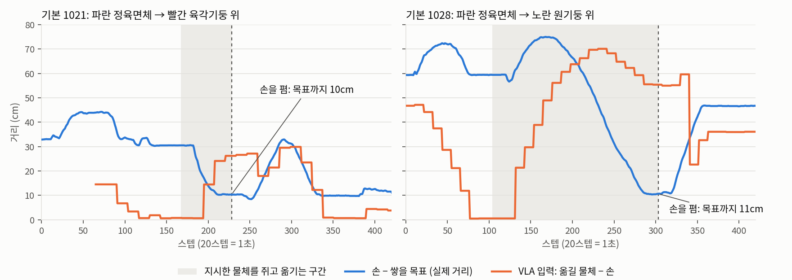

# 2026-11-02 새 다듬기는 세 설정에서 101/150 (67%), 남은 실패는 쌓기 — 목표 10cm 앞에서 손을 편다

> 한 줄 요약: 10/31 에 고친 다듬기(RC)를 흔든·물체 많음 설정까지 재 보니 w10m + 다듬기 일 1개가 세 설정 150장면에서 101/150 (67%) 이다 (예전 다듬기 81/150). 판에 놓는 일은 91/117 (78%) 까지 왔고, 쌓기는 10/33 으로 가장 약하다. 쌓기 실패 장면을 다시 돌려 보면 VLA 가 지시한 물체를 쥐고 목표 10~11cm 앞까지 와서 멈추고, 내려가 손을 편다. VLA 가 받는 놓을 곳 위치는 1cm 안으로 맞았고 다듬기는 손대지 않았다. 손이 멈춘 자리는 셋 다 로봇 밑동에서 36~37cm 였고, 놓을 곳이 40cm 넘게 먼 장면은 판 일도 55% 로 떨어진다 (40cm 안 82%). 또 '옮길 물체' 위치 입력이 처음 집은 자리에 묶여 있어 옮기는 동안 26~55cm 떨어진 것으로 보였는데, 이것이 끼어들기 학습의 '다른 물체를 쥐고 있으면 가까운 빈 자리에 내려놓기' 와 같아 보인다는 가설도 세웠다. 위치 입력이 쥔 물체를 따라가게 고쳐 w11m 을 그 입력으로 학습시키고 있다. 데이터 모으기도 고쳤다. VLA 가 놓을 곳에서 먼 곳에서 손을 펴려는 바로 그 순간에 시범 프로그램이 이어받고, VLA 구간에는 평가처럼 다듬기를 켠다.

## 1. 이틀 가까이 멈춰 있던 w11m 준비

10/31 오전 10:41 에 w11m 파이프라인이 학습 전 단계(새 데이터의 사진 위치 입력 계산)에서 멈춰 있었다. 위치 입력 계산 세 줄이 동시에 시작하면서 손목 카메라를 붙인 로봇 파일을 서로 다시 썼고, 그 사이 다른 줄이 빈 파일을 읽어 꺼졌다. 로봇 파일은 내용이 바뀌었을 때만, 다른 이름으로 다 쓴 뒤 한 번에 바꿔 끼우게 고쳤다. 끊긴 데이터(깊이 3 DAgger 흔든 설정 47개 중 32개)만 이어서 계산했다 (11/2 00:22 끝).

## 2. 새 다듬기 RC, 세 설정 일 1개

| w10m, 새 기준 일 1개 (같은 장면) | 예전 다듬기 | 새 다듬기 RC | 판 안 (RC) | 판에 놓기 (RC) | 쌓기 (RC) |
|---|---|---|---|---|---|
| 기본 50 | 28 | **38** | 39 | 33/38 | 5/12 |
| 흔든 환경 50 | 23 | **34** | 34 | 30/38 | 4/12 |
| 물체 많음 50 | 30 | **29** | 30 | 28/41 | 1/9 |
| 합계 150 | 81 (54%) | **101/150 (67%)** | 103 (69%) | 91/117 (78%) | 10/33 |

- RC 는 10/31 에 고친 다듬기다 (쥔 것을 빈손으로 보던 버그, 지연 탓에 쥐는 자세 계산이 안 켜지던 것, 팔에 가린 찾기로 물체 기억을 덮던 것, 쌓을 목표를 2cm 안만 보던 것). 다듬기는 지시문을 읽지 않는다.
- 물체 많음에서는 새 다듬기가 예전과 같다 (29 대 30). 같은 장면에서 새 다듬기만 성공한 것이 6, 예전만 성공한 것이 7 이라 우연 범위다. 예전만 성공한 7장면을 보면 VLA 가 다른 판 위에서 손을 폄 3, 다른 물체를 먼저 쥠 1, 지시한 물체를 못 쥠 1, 육각기둥이 넘어짐 1, 놓을 곳 9cm 밖 1 이다. 기본·흔든에서 효과가 컸던 부품 중 '팔에 가린 찾기로 물체 기억을 덮지 않기(mocc)' 가 물체가 빽빽한 장면에서는 손해일 수도 있어서, mocc 만 뺀 다듬기로 물체 많음 50장면을 다음 평가 때 같이 잰다.
- 판에 놓는 일은 기본 87%, 흔든 79%, 물체 많음 68% 다. 다듬기로 줄일 수 있는 실패는 거의 남지 않았고, 남은 것은 VLA 가 엉뚱한 물체로 가거나 놓을 곳으로 가지 않는 경우다.
- 기본 설정에서 VLA 가 처음 고른 물체와 놓을 곳이 둘 다 지시와 맞았던 32장면은 모두 성공했다. 실패 12장면은 모두 VLA 쪽 (놓을 곳 대신 목표 물체를 먼저 집음 2, 다른 물체 3, 쌓기에서 목표 앞에 내려놓음 2, 끝까지 들고 있음 1, 물체 3~7cm 앞에서 안 내려감 3, 육각기둥이 굴러감 1).

## 3. 쌓기 실패를 다시 돌려 봄: 목표 10cm 앞에서 손을 편다

기본 설정 쌓기 실패 셋(1006, 1021, 1028)을 같은 장면·같은 동작 변수로 다시 돌리며, 이번에는 VLA 가 받는 위치 입력까지 스텝마다 기록했다.

- 1021·1028 모두 VLA 가 파란 정육면체를 쥐고 목표 쪽으로 가다가 목표 10~11cm 앞에서 옆으로 움직이기를 멈추고, 4.4~5cm 내려가 손을 폈다. 그때 든 물체 바닥은 책상 위 4.3~4.7cm 로, 목표 윗면(5cm) 에 얹는 높이였다. 1006 은 18~20cm 앞에서 폈다.
- 그 순간 VLA 가 받은 '놓을 곳 − 손' 입력은 9.6cm 로 실제(10.4cm)와 1cm 안으로 맞았다. 손목 카메라에도 목표가 바로 앞에 보였다. 다듬기는 손대지 않았다 (쌓을 목표로 보는 범위는 바닥 반지름 + 5cm 라 10cm 는 밖이다).
- 다르게 보인 것은 '옮길 물체 − 손' 입력이다. 위치 입력은 팔에 가린 찾기를 피하려고 손 10cm 안에서 찾은 자리는 기억에 넣지 않는다. 그래서 물체를 쥐고 옮기는 동안 이 입력은 처음 집은 자리를 가리키고, 손이 멀어질수록 커진다 (손을 편 순간 1021 은 26cm, 1028 은 55cm).

가설: 끼어들기 데이터에는 'A 를 든 채 B 지시를 받으면 A 를 가까운 빈 자리에 내려놓는다' 는 시범이 많다. 그 순간 VLA 입력은 '지시한 물체(B)는 멀리 있고, 나는 무언가를 쥐고 있다' 이다. 쌓기에서 지시한 물체를 쥐고 옮기는 도중의 입력이 이와 같아 보인다. 시범 프로그램의 내려놓을 자리는 놓을 곳들을 피해 손에서 가까운 빈 자리라서, 놓을 곳 바로 바깥(6~10cm)이 많다. 아직 확인하지 않은 가설이다.

### 다른 설명: 먼 곳까지 팔을 덜 뻗는다

다시 보니 손을 편 자리는 셋 다 로봇 밑동에서 36~37cm 였고 (1021: 36.3cm, 1028: 36.0cm, 1006: 36.6cm), 목표는 39~46cm 에 있었다. 물체 많음 1047 (CPU 로 다시 돌린 장면) 도 물체가 42cm 에 있는데 손은 쥐는 높이에서 36cm 까지만 가서 물체 6cm 앞에서 빈손으로 오므렸다 (위치 입력은 1cm 안으로 맞음). 팔이 거기까지밖에 안 닿는 것은 아니다. 시범 프로그램은 46cm 까지 손목을 20° 안팎만 기울인 채 놓고, 다듬기가 붙은 성공 장면에서도 물체가 40~45cm 에 놓였다. 150장면을 놓을 곳 거리로 나누면 차이가 크다.

| w10m + RC, 놓을 곳이 밑동에서 | 40cm 안 | 40cm 넘음 |
|---|---|---|
| 판에 놓기 | 80/97 (82%) | 11/20 (55%) |
| 쌓기 | 7/19 (37%) | 3/14 (21%) |

그래서 '목표 10cm 앞에서 펴기' 는 VLA 가 먼 놓을 곳까지 팔을 덜 뻗는 것과 겹쳐 있을 수 있다. 쌓기는 가까워도 37% 라 거리만의 문제는 아니다. 둘 중 무엇인지는 아직 모른다. 아래 4절의 입력 고침은 첫 번째 설명을, 5절의 실수 순간 이어받기는 두 설명 모두를 겨냥한다 (먼 목표 앞에서 펴려는 순간 시범 프로그램이 이어받아 끝까지 옮겨 놓는다).

## 4. 위치 입력이 쥔 물체를 따라가게

두 손가락 평균 벌어짐이 쥔 범위(0.008~0.031)로 들어서는 순간 손 5cm 안에 기억이 있는 지시문 물체를 쥔 것으로 본다. 쥐는 동안에는 그 물체 기억을 손 자리로, 놓는 순간에는 놓은 손 자리로 둔다. 다른 칸은 그대로다. 사진을 다시 보지 않고 기록된 손가락 값과 손 자리만으로 계산할 수 있어서, 학습 데이터 16,068개 전부를 4분 만에 다시 만들었다. 표본 400개(77,182장)에서 장의 40% 가 옮길 물체 입력이 바뀌었고, 26% 는 10cm 넘게 줄었다.

다시 학습하지 않고 평가 때만 이 입력을 넣어 보면 기본 쌓기 12장면 4/12 로, RC 의 5/12 와 차이가 없다. 두 입력 모두 실패한 장면 중 셋은 물체가 끝난 자리가 목표에 가까워졌지만 (1021: 11.3 → 3.8cm, 1028: 10.8 → 8.9cm, 1035: 38.6 → 22.5cm, 1015 는 성공 → 실패), 학습 때 본 적 없는 입력이라 이것으로 판단할 수는 없다. 그래서 w11m 을 이 입력으로 학습시키기로 했다. w11m 은 DAgger 데이터와 입력이 함께 바뀌므로, 나아지지 않으면 입력만 원래대로 다시 학습해 둘을 갈라 본다.

## 5. 데이터 모으기: 실수하는 순간 이어받기, 다듬기를 켠 채

지금까지 DAgger 는 VLA 를 정해진 스텝(무작위 20~300) 동안 혼자 움직인 뒤 시범 프로그램이 이어받았다. 두 가지를 바꿨다.

- 실수 순간 이어받기: VLA 가 지시한 물체를 쥔 채 놓을 곳에서 4cm 밖에서 손을 펴려 하면, 그 스텝의 동작을 '쥔 채 멈춤' 으로 바꾸고 바로 시범 프로그램이 이어받는다. 위 2·3절의 실패가 일어나는 바로 그 상태에서 '계속 옮겨 목표 위에 놓기' 를 보여 주는 데이터다 (사람이 실수 순간에 끼어드는 HG-DAgger 와 같은 생각). 일 1개·끼어들기 깊이 2·3 모두에 넣었다.
- 다듬기를 켠 채: 쌓기 장면으로 시험해 보니 VLA 혼자서는 이어받기 전 230~337스텝 동안 세 장면 모두 물체를 쥐지 못했다. 혼자 돌리면 옮기는 단계까지 가지 못해, 그 단계의 실수가 데이터에 거의 담기지 않는다. 평가와 같은 다듬기를 켜고 돌리면 (저장은 시범 구간만) 6장면 중 셋은 VLA + 다듬기가 스스로 끝냈고, 실수 순간 이어받기가 두 번 걸려 한 번은 목표 위에 쌓는 시범이 저장됐다.

## 6. 지금 돌고 있는 것

- w11m 학습 (w10m 에서 15,000스텝, 위치 입력 = 쥔 물체 따라가기, 더한 데이터 = w10m 이 가 있는 상태에서 이어받아 성공한 DAgger 일 1개 267장면·깊이 2 142장면·깊이 3 39장면 + 시범 220장면) → 세 설정 일 1·2·3개 평가 (다듬기 RC). w10m 도 RC 로 일 2·3개 기본을 같이 잰다 (예전 일 2개 1/20 은 예전 다듬기).
- 이어서 w12m: w11m 으로 위 5절의 DAgger (일 1개 세 설정 × 150, 깊이 2 × 60, 깊이 3 × 20) → 학습 → 평가.

가장 높은 설정(w10m + RC)의 쌓기 성공 장면을 같은 설정으로 다시 돌려 찍었다. 막대는 손가락 벌림(7cm)보다 길어(9cm) 손목 방향을 맞춰야 쥔다. VLA 가 막대 위로 내려오면 다듬기가 쥐는 자세를 계산해 가운데를 쥐고, 목표 위에서 VLA 가 손을 펴려 할 때 목표 가운데로 맞춰 내려놓았다 (평가 때 223스텝, 11초).

## 다음에 할 것

- w11m 결과로 쥔 물체 따라가기 입력이 쌓기 '목표 앞에서 펴기' 를 줄이는지 본다 (w10m RC 와 같은 장면 짝으로, 놓을 곳 거리 40cm 안·밖을 나눠서). 나아지지 않으면 입력만 원래대로 학습해 갈라 본다.
- 먼 놓을 곳(40cm 넘음)에서 VLA 가 덜 뻗는 까닭: 손목 카메라에 보이는 목표 자리가 팔을 뻗을 때 달라지는지, 학습 데이터에서 먼 놓을 곳 시범의 몫이 얼마인지 본다.
- 일 2·3개 (끼어들기 깊이 N): w10m 과 w11m 을 같은 다듬기 RC 로 견준다. 일 1개가 80% 를 넘어야 깊이 2·3 도 올라가므로 쌓기부터 잡는다.
- w12m DAgger 에서 실수 순간 이어받기가 얼마나 걸리는지 (일 1개·끼어들기) 세어 보고, 적으면 쌓기 비율·VLA 스텝 범위를 늘린다.
- 물체 3~7cm 앞에서 안 내려가는 장면 (1042·1047·1048), 육각기둥이 넘어져 굴러가는 장면을 따라가 본다.
- 다듬기 부품 빼보기 (논문 표), VLA 혼자 w10m 남은 장면.
