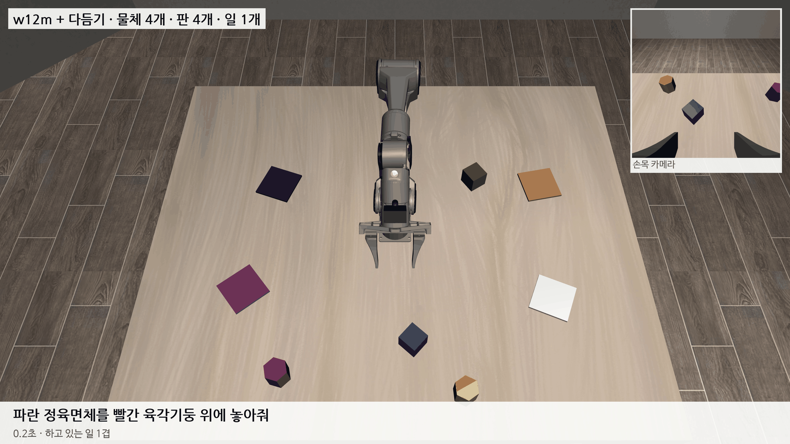
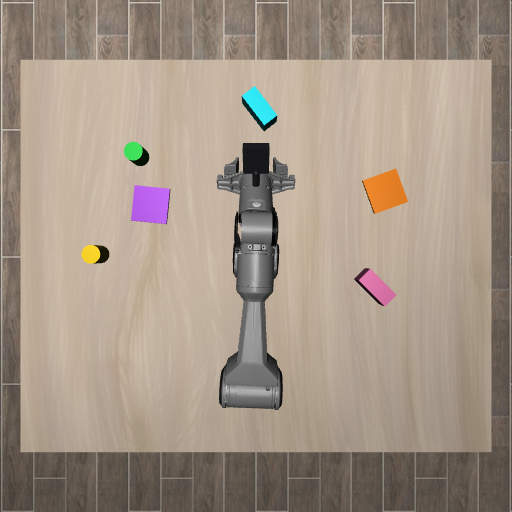
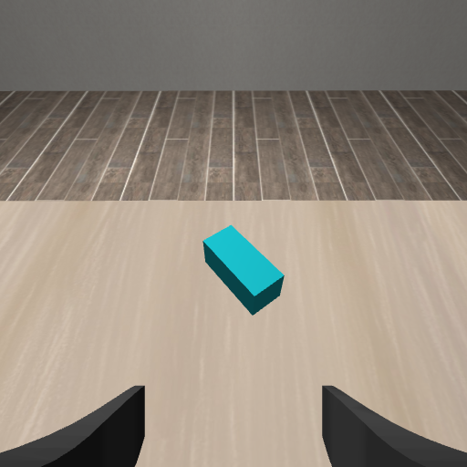

# 2026-11-04 95% 넘었던 블록 장면을 지금 기준·공개 벤치마크와 견주고, 실물 PiPER 연결 코드를 만들었다

> 한 줄 요약: 사용자가 물은 "95% 넘은 것" 은 10/23~24 블록 장면이다 (혼자 97.5~98.5%, 28항목 평균 94.5%). 블록 4개·판 4개·지시문 10개가 코드에 박혀 있었고, 보조가 지시문을 직접 읽었다 (그때 VLA 혼자 25.5%). 이것을 지금 기준(물체 2~14개, 흔들기, 지연 6~12스텝, 보조는 지시문을 안 읽음)과 LIBERO·LIBERO-Plus·CALVIN·SwitchVLA 에 견준 문서를 만들었다. 지금 기준의 일 1개 81% 는 LIBERO 에서 SmolVLA 가 낸 87% 와 비슷한 자리지만, 끼어들기 일 2·3개는 0~2/60 이다. 그리고 시뮬에서 학습한 VLA 를 실물 PiPER 에 연결하는 코드(`11_실물_PiPER`)를 만들었다. 시뮬과 같은 입력·지연·동작 변환을 쓰고 팔에는 관절 각도로 내보낸다. 실물 팔에는 아직 못 돌려 봤고, 시뮬 팔에 붙여 코드 길을 확인했다.

## 1. 95% 는 어디서 나왔나

| 블록 장면 (10/22~24) | 성공률 |
|---|---|
| 혼자 (일 1개, 200장면) | 97.5~98.5% |
| 28항목 평균 (단독 10 + 전환 12 + 돌아오기 6) | 94.5% (판 안 94.6%), 95% 넘는 항목 20개 |
| 처음 보는 장면에서 B 하기 / 돌아오기 | 95.0% / 95.8% |
| 끼어들기 '셋 다' (240장면) | 90.4% |
| 같은 시기 VLA 혼자 (10/22) | 25.5% |

그때 장면은 색 블록 4개, 판 4개, 지시문 10개가 코드에 박혀 있었다. 보조(grasp_assist)는 지시문을 읽어 어느 블록을 어느 판으로 옮길지 알고 손을 이끌었다. 10/24 에 사용자가 "하드코딩 아닌걸로, 물체 N개·여러 모양, 모든 변수에서 95%" 로 방향을 바꿨고, 10/26 부터는 논문에서 VLA 의 몫을 가르려고 보조를 지시문을 읽지 않는 다듬기로 바꿨다.

## 2. 지금 기준·공개 벤치마크와 견주기

자세한 표는 [기준과_벤치마크_비교](../10_문서/기준과_벤치마크_비교.md) 에 있다. 요점만 적는다.

| | 일 1개 | 이어서·끼어들기 |
|---|---|---|
| 블록 장면 + 지시문 읽는 보조 | 97.5~98.5% | 셋 다 90.4% |
| 지금 기준 w12m + 다듬기 (11/3) | 121/150 (81%), VLA 혼자 49/150 | 깊이 2: 2/60, 깊이 3: 0/60 |
| LIBERO (SmolVLA 0.45B, 지연 없음) | 87.3% | — |
| LIBERO-Plus (카메라·시작 자세 등 흔들기) | 95% 대 모델이 30% 아래로 | — |
| CALVIN ABC→D (GR-1, 5개 연달아) | 1개째 85.4% | 5개째 40.1% |
| SwitchVLA (쥔 채 전환, 시뮬) | — | 50.9% |

- 블록 장면 95% 는 장면이 고정되어 쉬웠고 보조가 지시문을 읽었으니 지금 기준과 바로 비교하면 안 된다.
- 지금 기준의 일 1개 81% 는 지연·흔들기·물체 수가 다 들어간 숫자라, 조건은 LIBERO 보다 어렵다. 다만 다듬기를 켠 숫자다.
- 끼어들기는 공개 연구도 아직 낮다 (5개 연달아 40%, 쥔 채 전환 51%). 원래 일로 돌아오기까지 재는 공개 벤치마크는 못 찾았다.

w12m 은 11/3 아침에 다 끝났다. 일 1개는 w11m 과 같고 (121 vs 122/150), 끼어들기는 실수 순간 이어받기 데이터를 더했는데도 나아지지 않았다 (깊이 2: 일 단위 32/120, 깊이 3: 34/180).

가장 높은 설정(w12m + 다듬기)의 성공 장면이다. 11/2 에 따라가 본 그 장면으로, w10m 은 목표가 밑동에서 45cm 로 멀어 10cm 앞에서 손을 펴 실패했는데 w12m 은 끝까지 가져가 쌓았다.

## 3. 실물 PiPER 연결 코드

`11_실물_PiPER/real_piper` (연구실 PC `~/smolVLA/real_piper` 와 같음). 설명서는 [README](../11_실물_PiPER/README.md).

시뮬레이터도 이미 "손끝 변화량 → 역기구학 → 관절 위치" 로 팔을 움직이고 있었다 (10/3 에 실물을 생각해 그렇게 만들었다). 그래서 실물에서도 같은 계산을 그대로 옮기면 된다. 실물 팔 SDK(piper_sdk)는 관절 각도(0.001°)를 받는다.

- **운동학**: 시뮬이 쓰는 로봇 + 그리퍼 모델에서 메시만 뺀 8 KB 파일. 처음 뽑았을 때 관절 범위가 0.046 처럼 이상했는데, 로봇 파일에 각도 단위가 없어 라디안 값을 '도' 로 읽은 것이었다 (robosuite 안에서는 라디안). 단위를 라디안으로 고정했다.
- **관측**: VLA 가 받는 손 방향은 그리퍼 끝점이 아니라 `robot0_right_hand` 몸의 사원수였다 (그리퍼 끝점의 방향과 90° 다름). 실물도 같은 몸으로 계산한다.
- **사진**: 시뮬 관측 사진은 위아래가 뒤집힌 MuJoCo 그림이다. 실물 사진도 세로 시야각 75° 정사각형으로 잘라 512 로 줄이고 위아래를 뒤집어 넣는다.
- **지연**: 실물에서는 다른 스레드에서 추론하고, 그동안 지난 계획을 계속 실행하다가 새 계획이 오면 그동안 실행한 만큼 버린다 (시뮬 평가 규칙과 같음).
- **안전**: 손끝 목표를 작업 공간·책상 위 2 cm 이상으로 자르고, 한 스텝 관절 이동을 4° 로 묶고, 시작 전 확인, Ctrl-C 로 멈춤.
- **보정 도구**: 관절 0점이 시뮬 모델과 같은지 (`check_fk.py`), 위 카메라 내부값·자리 (`calib_top_camera.py`), 실물 사진으로 색 분포 다시 맞추기 (`fit_colors.py`), 카메라 달 때 볼 시뮬 기준 사진 (`sim_reference.py`).

| 위 카메라 (책상 위 0.85 m, 밑동 바로 위, 사진 위쪽 = 로봇 앞) | 손목 카메라 |
|---|---|
|  |  |

### 시뮬 팔에 붙여 확인한 것

| 시험 | 결과 |
|---|---|
| 같은 동작에서 관절 목표 (실물용 역기구학 vs 시뮬 제어기, 60스텝) | 차이 0.0000° |
| 관절 → 손끝 위치·손 사원수 vs 시뮬 관측 | 최대 0.9 mm |
| 같은 순간 VLA 출력 (실물용 관측 vs 시뮬 관측, 같은 잡음, 12순간) | 대부분 0.02 이하, 그리퍼를 쥐는 순간 0.1 |
| 실물용 코드 길 전체로 장면 끝까지 (VLA 혼자, 16장면) | 실물용 길 4/16, 시뮬 평가 길 7/16 (둘 다 시뮬 평가의 VLA 혼자 32% 안팎). 결과가 갈린 3장면(1003·1006·1009)은 추론 잡음 차이 — `tests/test_traj_same_noise.py` 로 잡음을 같게 하면 8장면 모두 결과가 같고 (성공 장면은 스텝 수 1 안팎 차이), 처음 50스텝 손끝 차이 0.03~0.27 cm |
| 실제 시간 길 (연습 모드, 가짜 카메라) | 한 스텝 50 ms (20 Hz) 지킴. 추론 한 번 0.7초 (다른 시험과 GPU 를 나눠 씀) |

실제 시간 길에서 처음에는 루프 안 추론이 1.6초로 예열 때(0.67초)보다 느렸다. CUDA 그래프를 메인 스레드에서 녹화하고 다른 스레드에서 쓴 탓으로 보고, 예열도 추론 스레드에서 하게 바꾸니 0.8초 안팎이 됐다.

### 아직 모르는 것

- 실물 팔 관절 0점·부호가 시뮬 모델과 같은지 (check_fk.py 로 먼저).
- 시뮬 그림으로만 학습한 VLA 가 실물 사진에서 얼마나 되는지. 처음에는 잘 안 될 가능성이 크다. 실물 시범(WeGo 플러그인 원격 조종)을 모아 시뮬 + 실물로 더 학습하는 것이 다음 순서다.
- 다듬기는 시뮬 내부 값을 쓰는 곳이 있어 아직 실물로 옮기지 않았다. 실물은 지금 VLA 혼자다 (시뮬 VLA 혼자 31~33%).

## 다음에 할 것

- 연구실에서 실물 PiPER 로: CAN 점검 → check_fk → 카메라 달기·보정 → 색 맞추기 → 연습 모드 → 느린 속도로 실물.
- 실물 시범 모으기: WeGo 플러그인 원격 조종 기록을 우리 학습 데이터 꼴(사진 512 위아래 뒤집힘, 손끝·손 방향·손가락)로 바꾸는 도구.
- 다듬기를 실물로 옮기기 (시뮬 내부 값 대신 위 카메라 찾기·관절 각도만 쓰게).
- 끼어들기 깊이 2·3: w12m 도 0~2/60. 블록 장면에서 90% 를 만든 것은 지시문을 읽는 '빈 자리에 내려놓기' 보조였다. 원칙(다듬기는 지시문을 안 읽음)을 지키며 VLA 가 배우게 할지, 지시문을 읽는 보조를 따로 보고할지 정한다.
