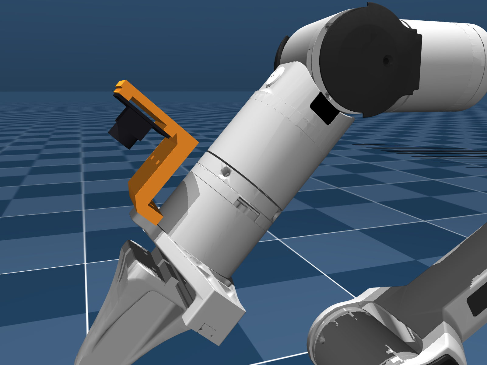
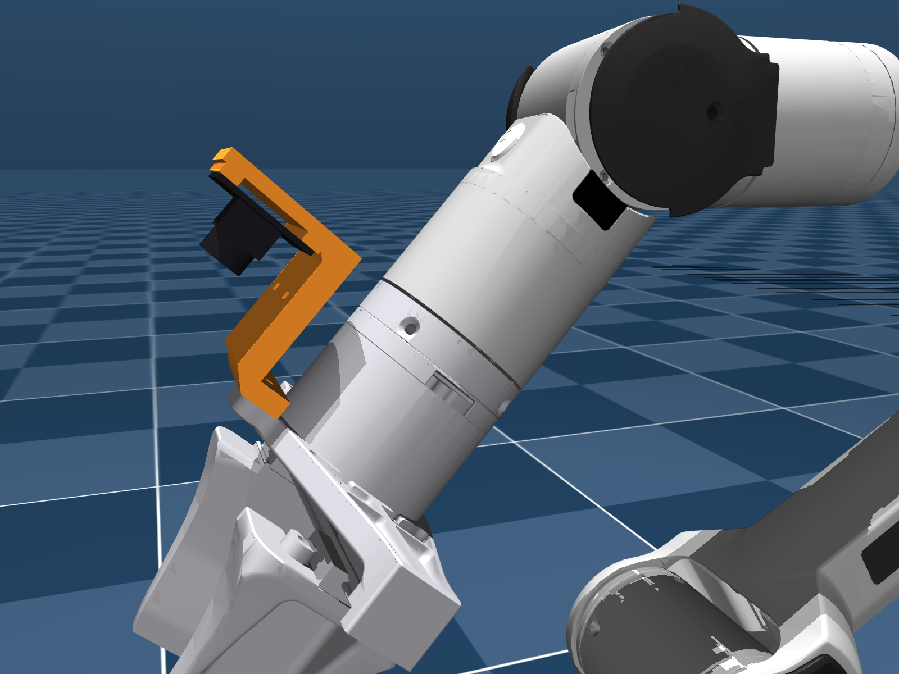
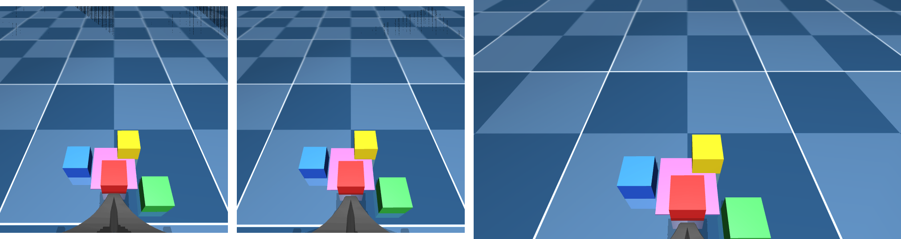
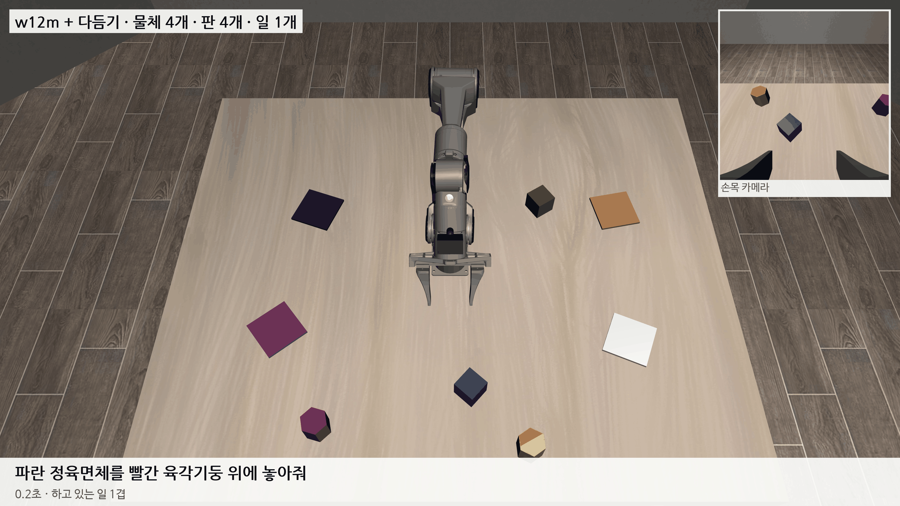

# 2026-11-05 U20CAM 손목 카메라 마운트를 0–70 mm·0–100 mm 그리퍼 두 가지로 만들었다

> 한 줄 요약: 연구실 손목 카메라 U20CAM을 PiPER 그리퍼에 다는 3D 프린트 마운트 STL을 만들었다. 그리퍼 형에 따라 0–70 mm용과 0–100 mm용 두 가지다. 그리퍼 옆 탭(M3 구멍 2개)에 나사 2개로 붙이고, 카메라는 시뮬 손목 카메라와 같은 자리(J6 축에서 70 mm)에 오게 했다. 그리퍼와 겹침 0, 팔 관절 8,100자세에서 팔과 닿음 0, 시뮬과 같은 75° 화면에 마운트가 보이지 않는 것을 CAD와 MuJoCo로 확인했다. 아직 뽑아서 끼워 보지는 않았다.

## 1. 무엇을 만들었나

사용자가 vertical-cloud-lab/robot-arms#4 의 PiPER 카메라 마운트(HQ 카메라 + Pi 5 용)를 보여 주며, 우리 U20CAM에 맞는 STL을 부탁했다. 이어서 0–70 mm형과 0–100 mm형 두 가지를 요청했다.

원래 설계를 고치지 않고 새로 만들었다. U20CAM은 USB로 PC에 바로 꽂으니 Pi가 필요 없고, 카메라도 가볍다. 그래서 탭에만 붙이는 한 덩어리로 충분하다.

| 0–70 mm형 | 0–100 mm형 |
|---|---|
|  |  |

- **카메라 자리:** 우리 시뮬의 `eye_in_hand`는 link6 좌표 (−70, 0, 20) mm에서 손가락 방향을 본다. 탭 쪽이다.
  - 마운트도 광축을 같은 x = −70에 두었다.
  - 광학 중심은 약 4 mm 앞(z ≈ 24)이다. 플랜지 면 뒤로 부품이 나가지 않게 하는 규칙 때문이다.
- **두 그리퍼의 차이:** 탭 구멍이 축에서 36 mm와 38 mm, 탭 뒷면이 플랜지에서 48 mm와 50.5 mm다.
  - 0–70 mm형은 시뮬 모델(Menagerie) 메시에서 구멍을 직접 찾았다.
  - 0–100 mm형은 AgileX 공개 STEP에서 찾았다. robot-arms#4 의 좌표값과 같았다.
- **보드 구멍 간격:** 자료마다 달랐다. SO-ARM100 마운트는 27.0 mm, U20CAM 전용 SO100 마운트는 28.0 mm다. 그래서 대각선 홈으로 둘 다 받게 했다.

## 2. 확인한 것

| 검사 | 0–70 mm | 0–100 mm |
|---|---|---|
| 그리퍼와 겹침 | 0 mm³ | 0 mm³ (닿는 면 두께 0.002 mm만) |
| 플랜지 면 뒤로 나감 | 없음 | 없음 |
| J4 ±105°·J5 ±70°·J6 한 바퀴, 8,100자세에서 팔과 닿음 | 0 (link5까지 15.0 mm 이상) | 0 (16.8 mm 이상) |
| 시뮬 75° 화면에 마운트 | 안 보임 | 안 보임 |

U20CAM을 긴 변이 손가락 방향과 수직이 되게 달면, 넓은 화면에 마운트가 보인다. 설명서에 다는 방향을 적었다.

## 3. 아직 모르는 것

- 실제로 뽑아서 끼워 보지 않았다. 탭 나사 깊이, 보드 구멍 간격, 렌즈 높이는 실물로 확인해야 한다.
- **U20CAM 시야각 (가설):**
  - 1080P는 가로 106°, 대각 130°다. 16:9의 세로는 60° 안팎으로 어림했다.
  - 그러면 시뮬의 75° 정사각형을 잘라 낼 수 없을 수 있다. 짧은 변 정사각형을 쓰면 물체가 약 1.3배 크게 보인다.
  - 체커보드로 시야를 잰 뒤 시뮬 fovy를 맞출지, 실물 화면을 맞출지 정한다.

가장 높은 설정(w12m + 다듬기)은 11/4 와 같다. 성공 장면은 그대로 둔다.

## 다음에 할 것

- 연구실 그리퍼가 0–70 mm형인지 확인하고 마운트를 뽑기 (PETG 권장, 받침 없이 옆으로 눕혀서).
- U20CAM 보드 구멍 간격과 렌즈 높이를 캘리퍼로 재기.
- U20CAM 체커보드 보정으로 실제 시야각 재기. 75°에 못 미치면 시뮬 손목 카메라 fovy를 실물에 맞출지 정하기.
- 실물 PiPER 처음 연결 (12_PiPER_조작법_및_설치법 예제 01부터).
