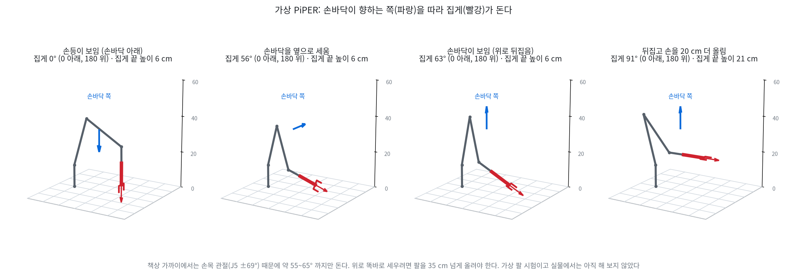

# 2026-11-23 웹캠 PiPER 조종: B 로 돌아가면 그리퍼도 닫힘, 집게가 손바닥 방향을 따라감

> 한 줄 요약: B 로 처음 자세에 돌아가면 그리퍼도 닫히게 했고, 집게가 늘 아래만 보던 것을 손바닥이 향하는 쪽을 따라 돌게 바꿨다. 가상 팔에서 손바닥을 옆으로 세우면 집게 56°, 위로 뒤집으면 63°, 손을 20 cm 더 들면 91° 까지 돈다 (0 = 아래, 180 = 위). PiPER 는 손목 관절이 ±69° 라 책상 가까이에서는 집게를 똑바로 위로 세울 수 없다. 실물 팔로는 아직 시험하지 않았다.

## 오늘 결과 한눈에

| 무엇을 봤나 | 결과 |
|---|---|
| B 로 처음 자세에 갈 때 그리퍼 (가상 팔·가짜 노트북) | 7 cm → 0 으로 닫히며 도착. `--home-grip keep` 이면 예전처럼 그대로 |
| 손바닥 아래 (손등이 보임) | 집게 0°, 예전 방식과 차 3° 안 |
| 손바닥 옆으로 세움 | 집게 54~56° (손 높이 +5 / +15 cm) |
| 손바닥 위로 뒤집음 | 집게 63° (+5 cm), 91° (+20 cm) |
| 어느 쪽으로 돌려도 팔 마디·집게가 책상에 닿나 | 닿지 않음 |
| 손을 4초에 걸쳐 뒤집는 동안 한 박자(10 ms) 집게 회전 | 최대 1.2° (휙 돌지 않음) |
| 계산 시험 (test_geometry.py) | 44개 모두 통과 (11/20 36개 + 오늘 8개) |

코드와 설명은 [11_실물_PiPER/webcam_piper](../11_실물_PiPER/webcam_piper/README.md) 맨 위 "11/23 더한 것" 에 있다.

## 목표

- 사용자 요청 두 가지: "B 로 초기자세 잡으면 그리퍼도 접히게", "손등이 보이면 집게가 아래를 향하듯이, 손바닥이 보이면 집게도 위로 향하게. 지금은 그리퍼가 360도 안 돌아간다."

## 한 일

**B 로 돌아갈 때 그리퍼 닫기.** robot_server 에 `--home-grip close|keep` 을 더했다. 기본은 close 다. 11/20 에는 쥔 물체를 떨어뜨리지 않으려고 그리퍼를 건드리지 않았는데, 처음 자세는 시범을 새로 시작하는 자리라서 닫힌 채로 시작하는 쪽이 낫다.

**손바닥 방향 재기.** MediaPipe 손 21점 중 손목, 검지 뿌리, 새끼 뿌리 세 점이 이루는 면의 수직 방향을 손바닥 쪽으로 쓴다. 오른손과 왼손은 부호가 반대다. 11/18 실물 기록(카메라 두 대)에서 손을 엎었을 때 이 방향이 아래 −0.8 ~ −0.9 로 나와서 맞게 잡히는 것을 확인했다. 엄지 → 네 손가락 방향은 집게가 닫히는 줄로 그대로 쓴다. 두 방향 모두 떨림 거르기(1€ 필터 + 3° 멈춤 구역)를 거친다.

**손바닥 방향 → 집게 방향.**
- 손바닥이 아래에서 20° 안으로만 기울면 예전처럼 똑바로 아래로 둔다. 손을 조금 기울일 때마다 집게가 흔들리지 않게 하려는 것이다.
- 20° 를 넘으면 나머지 각도를 0~180° 로 늘려서 손바닥이 향하는 쪽으로 집게를 돌린다.
- 같은 방향이라도 집게를 반 바퀴 돌린 자세가 두 개 있다. 그중 지금 자세에 가까운 쪽을 고른다. 이것이 없으면 손을 뒤집는 도중에 집게가 반 바퀴 휙 돈다.

**닿는 데까지만, 먼저 들고 나서 돌기.**
- 역기구학은 위치가 먼저, 방향이 그다음이다. 방향이 닿지 않으면 닿는 데까지만 돈다. 방향 목표는 실제 방향보다 15° 까지만 앞서게 해서, 닿지 않는 목표를 향해 관절이 계속 끝까지 밀리지 않게 했다.
- 집게를 옆이나 위로 세우면 집게 몸통(끝 → 6번 마디 12 cm)과 손가락이 집게 끝보다 아래로 내려간다. 그래서 다음 방향에 필요한 높이를 먼저 계산해서, 집게 끝을 그만큼 들어 올린 뒤에 돈다.
- 그래도 팔 마디가 책상 위 1 cm 안으로 내려갈 자세가 나오면 그 박자는 움직이지 않는다. 서버 창에 `arm would touch the table` 이 뜬다.

**끄는 방법.** teleop·robot_server 에 `--down-only` 를 주면 예전처럼 집게는 늘 아래다.

## 알게 된 것

- PiPER 는 집게를 360° 돌릴 수 없다. 5번 관절(손목 꺾기)이 ±69°, 6번 관절(집게 돌리기)이 ±119° 다. 관절 각도 6만 개를 뽑아 집게 끝 높이별로 집게가 얼마나 위를 볼 수 있는지 봤다.

| 집게 끝 높이 | 집게가 가장 위로 향하는 각도 (0 아래, 180 위) |
|---|---|
| 16 cm 아래 | 약 70~120° |
| 35 cm 넘게 | 약 176° (거의 똑바로 위) |

- 그래서 책상 가까이에서 손바닥을 위로 뒤집으면 집게는 옆을 조금 넘는 데까지만 간다. 손을 높이 들수록 더 위로 선다.
- 손바닥을 위로 뒤집었을 때 집게는 팔 앞쪽(밑동에서 먼 쪽)으로 눕는다. 5번 관절이 반대쪽으로 꺾이는 자세다.

## 막힌 것과 해결

| 문제 | 원인 | 해결 |
|---|---|---|
| 처음 판에서 손바닥을 옆·위로 돌렸을 때 기대보다 덜 돎 | 방향 목표를 한 번에 크게 바꿔서 역기구학이 위치를 지키느라 방향을 거의 못 따라감 | 먼저 들고 나서 돌기, 방향 목표는 실제보다 15° 까지만 앞섬 |
| 손을 뒤집는 도중 집게가 반 바퀴 돌 수 있음 | 같은 방향에 집게를 반 바퀴 돌린 자세가 둘 | 지금 자세에 가까운 쪽을 고름. 한 박자 최대 1.2° |
| 집게를 옆으로 세우면 손가락이 책상에 닿을 수 있음 | 집게 끝 높이만 지키고 있었음 | 몸통 12 cm·손가락 5 cm 만큼 필요한 높이를 계산해 먼저 들어 올림 |

## 측정한 수치

| 항목 | 값 | 조건 |
|---|---|---|
| 손바닥 옆으로 세웠을 때 집게 | 54~56° | 가상 팔, 종이 + 앞 30 cm, 손 높이 +5 / +15 cm |
| 손바닥 위로 뒤집었을 때 집게 | 63° / 91° | 가상 팔, 손 높이 +5 / +20 cm |
| 뒤집는 동안 한 박자 집게 회전 | 최대 1.2° | 4초에 걸쳐 0 → 180° |
| B 로 돌아갈 때 그리퍼 | 7 cm → 0 | 가상 팔, 가짜 노트북 |

진짜 손과 카메라로 손바닥 방향이 얼마나 정확히 잡히는지, 실물 팔에서 같은 각도가 나오는지는 측정해 보지 않았다.

## 다음에 할 것

- 사람이 옆에 있을 때 실물 팔로 시험한다. 처음에는 손을 10 cm 위로 든 채, 손바닥을 천천히 옆으로만 세워 본다.
- 손바닥을 옆으로 세울 때 카메라에서 손가락이 겹쳐 보여 방향이 튀는지 본다. 튀면 손바닥 방향 거르기를 더 세게 한다.
- 집게를 옆으로 세워 쥐는 일이 실제로 필요한 물체(세워진 병, 상자 옆면)로 시범을 하나 모아 본다.
