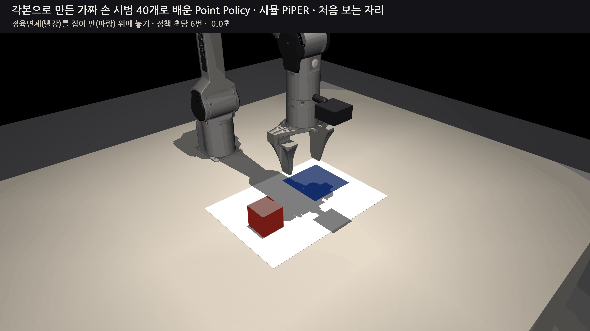
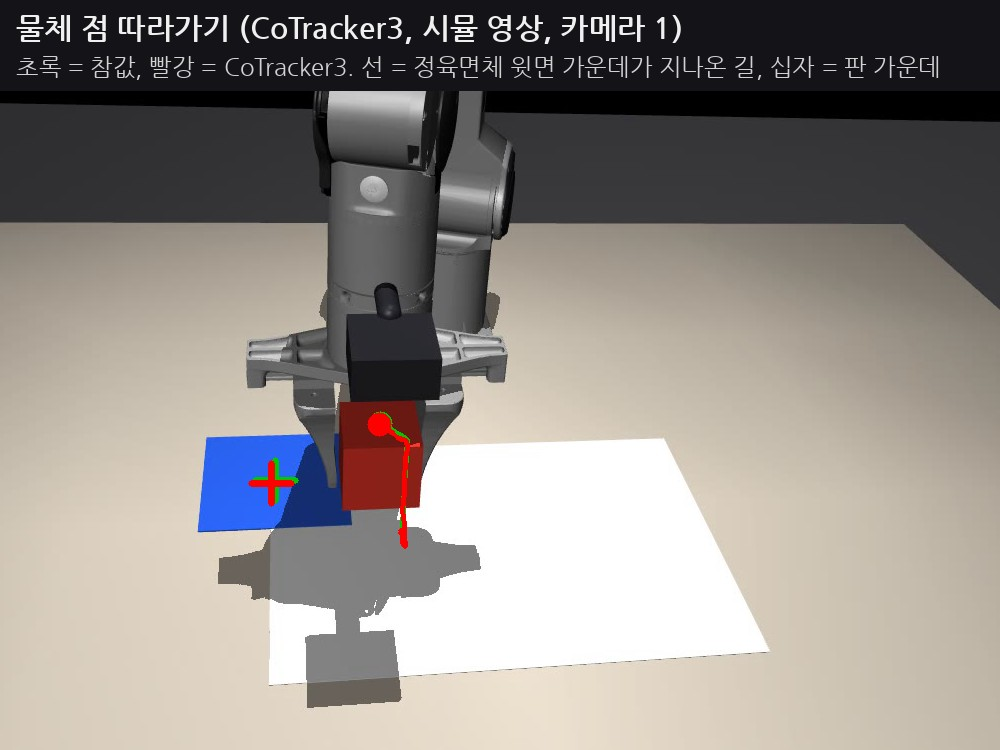
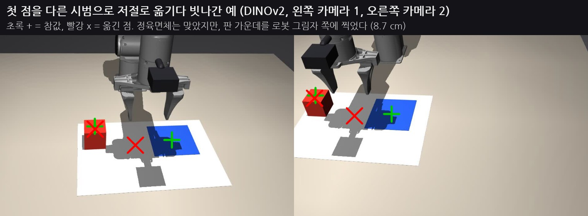
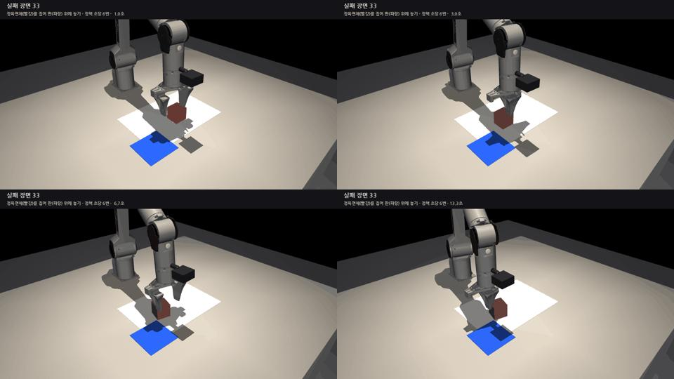

# 2026-11-27 Point Policy 방식으로 다시 만들기: 사람 손 영상 → 시뮬 PiPER, placo 역기구학

> 한 줄 요약: 교수님이 말씀하신 논문 Point Policy 처럼, 사람이 진짜 물체를 옮기는 영상(카메라 두 대)에서 손·물체 점만 뽑아 정책을 배우고 시뮬 PiPER 로 실행하는 길을 따로 만들었다 (`11_실물_PiPER/point_policy`, MediaPipe 실시간 조종은 그대로). 각본으로 만든 가짜 손 시범 40개로 배운 정책이 처음 보는 자리 50장면 중 47개를 성공했고, placo 역기구학을 붙여도 같았다. 진짜 손 시범은 아직 모으지 않았다.

 
각본으로 만든 가짜 손 시범 40개로 배운 정책. 학습 때 없던 자리 (평가 장면 0번), 시뮬 4K.

## 오늘 결과 한눈에

| 무엇을 봤나 | 결과 |
|---|---|
| 손 → 로봇 궤적을 시뮬에서 그대로 재생 (가짜 시범 40개) | 40개 모두 성공 (numpy 역기구학, placo 역기구학 둘 다) |
| 학습한 정책, 처음 보는 자리 50장면 | **47개 성공 (94%)** |
| 같은 정책을 placo 역기구학으로 실행 / placo 로 만든 자료로 다시 학습 | 47개 / 47개 (실패 3장면이 셋 다 같음) |
| 물체 점을 영상에서 따라간 것(CoTracker3)으로 학습 | **46개 성공 (92%)** (참값 물체 점보다 1장면 적음) |
| 물체 점 따라가기 오차 (영상 40개, 첫 점은 직접 찍음) | 시범마다 가운데값의 가운데: 정육면체 7.0 mm, 판 4.7 mm. 40개 중 14개는 한때 5 cm 넘게 튐 |
| placo 역기구학 (목표 240곳) | 1 cm 넘게 틀린 곳 2 → 0, 한 번 21 → 1.1 ms, 방향 오차 가운데 21 → 11.5° |
| 찬혁님 URDF 와 우리 시뮬 모델 | 같은 관절 각도에서 집게 끝 가운데값 7 mm, 최대 15 mm 다름 |

## 목표

사용자 요청 (11/27 밤): "미디어 파이프 말고 논문처럼", "데이터 수집하는 거는 실제 손으로 움직이는데 로봇은 시뮬레이션으로", "미디어 파이프 버전은 남겨두고 따로".
이어서 "placo 적용하고 이 프로젝트에 좋은 것들 있으면 적용". 논문 요약도 함께 정리했다.

논문 Point Policy (Haldar·Pinto, 뉴욕대, arXiv 2502.20391) 를 원문 표로 확인한 것:
로봇 조종 데이터 없이 사람 영상 190개(일 8가지)로 Franka 를 가르쳐, 배울 때 본 물체 120번 중 106번 (88%), 처음 보는 물체 110번 중 82번 (74%).
비교 방법 넷은 0~16번. 두 카메라 삼각측량을 빼고 깊이 센서를 쓰면 60번 중 54번이 0번이 된다.

## 한 일

1. **새 폴더** `11_실물_PiPER/point_policy` (연구실 PC `~/smolVLA/point_policy`). webcam_piper 는 고치지 않고, A4 보정·삼각측량·PiPER 운동학만 읽어서 쓴다.
2. **시뮬 장면** (`sim_scene.py`): real_piper 의 로봇 모델에 책상·정육면체(4.5 cm)·판(10 cm)을 붙였다. 관절은 파이썬 PD + 중력 보상, 그리퍼는 모델의 위치 모터.
   처음에 팔이 하나도 안 움직였는데, 로봇 모델 파일에 각도 단위가 없어 MuJoCo 가 관절 한계를 '도'로 읽었기 때문이었다 (±2.6 rad → ±2.6°). 라디안으로 읽게 고쳤다.
3. **손 → 로봇** (`points.py`, `build_dataset.py`): 논문 식 그대로 엄지·검지 끝 가운데 = 집게 끝, 첫 장면 손바닥 → 지금 손바닥 회전 × 아래를 본 집게, 7 cm 보다 가까우면 닫힘.
   PiPER 는 집게를 똑바로 아래로 세우면 책상 위 11 cm 까지만 닿아서, 손에서 나온 자세를 역기구학으로 풀어 PiPER 가 할 수 있는 자세로 바꾼 뒤 로봇 점 5개를 만든다 (논문에 없는 것).
4. **정책** (`model.py`, `train.py`): 점 하나가 토큰 하나인 트랜스포머 (4층, 256). 지난 10걸음(1.7초)을 보고 앞으로 20걸음(3.3초)의 로봇 점과 집게를 낸다. 초당 6번, 겹치는 예측은 지수 가중 평균.
5. **시뮬 평가** (`sim_eval.py`): 낸 점에 집게 모양을 맞춰(Kabsch) 자세를 되찾고, 역기구학으로 1/6초 동안 관절을 옮긴다. 물체 점은 시뮬 참값.
6. **가짜 손 시범** (`synth_demos.py`): 카메라 없이 전체 길을 시험하려고, 각본으로 손 21점과 물체 점을 만들어 webcam_piper `calib.json` 의 진짜 두 카메라 자리로 화면에 비추고 3 px 잡음을 얹었다. 진짜 녹화와 같은 파일 꼴이라 뒤의 코드가 똑같이 돈다.
7. **진짜 손 쪽** (`record.py`, `hand_points.py`, `annotate.py`, `object_points.py`, `mirror.py`): 카메라 두 대 녹화, 영상 → 손 21점, 첫 장면 물체 점 찍기, CoTracker3 로 따라가기, 녹화하는 동안 시뮬 PiPER 가 손을 따라 움직이는 창.
   녹화는 진짜 카메라 대신 시뮬 영상을 넣어 저장만 확인했다 (2초 59장, 초당 30장, 보정 그대로). 진짜 카메라와 손으로는 돌려 보지 않았다.
8. **물체 점** (`object_points.py`): 사용자 허락을 받고 CoTracker3 (facebook/cotracker3, 102 MB) 와 DINOv2-base (facebook/dinov2-base, 346 MB) 를 받았다.
   논문의 DIFT 는 Stable Diffusion 2.1 공식판이 Hugging Face 에서 내려가 DINOv2 로 바꿨다. 시험은 가짜 시범을 두 카메라 자리에서 그린 시뮬 영상으로 했다 (`render_synth_video.py`).
9. **placo** (`placo_ik.py`): 우리 시뮬 모델의 관절 사슬로 URDF 를 만들어 (시뮬과 3.5e-13 m 까지 같음) placo KinematicsSolver 에 넣었다. `--ik placo` 로 켠다.
   기존 `.venv` 는 건드리지 않으려고 `point_policy/.venv` 를 따로 만들어 placo 만 넣고, torch·mujoco 는 기존 `.venv` 것을 빌려 쓴다.

## 알게 된 것

- **손 → 로봇 바꾸기는 시뮬에서 맞는다**: 가짜 시범 40개를 학습 없이 그대로 재생하면 40개 모두 판 위에 놓였다 (손가락 끝 가운데 오차 1~2 mm, 집게 열림·닫힘 98~100% 일치).
- **점만으로 배운 정책이 새 자리에서 94%**: 실패 3장면은 역기구학을 바꿔도, placo 자료로 다시 배워도 똑같은 3장면이었다. 그중 둘은 정육면체가 로봇 쪽 끝(앞 21 cm)에 있었고, 하나는 시작 자리 바로 아래였다.
  33번 장면은 집게가 정육면체 옆으로 내려가 쥐지 못하고 둘레에서 맴돌았다. 원인은 측정해 보지 않았다.
- **CoTracker3 는 잘 따라가지만, 판 가운데가 가려지면 튄다**: 첫 점을 직접 찍으면 시범마다 가운데값 오차가 정육면체 7.0 mm, 판 4.7 mm 다. 다만 정육면체를 판 위에 올린 뒤 판 가운데가 가려지는 구간에서 40개 중 14개가 한때 5 cm 넘게 튀었다.
- **첫 점을 저절로 옮기기는 무늬 없는 물체에서 약하다**: 화면마다 따로 DINOv2 로 찾으면 판이 30 cm 넘게 빗나갔다. 첫 장면의 물체 높이는 기준 시범과 같다는 점을 써서 두 카메라를 한 3D 점으로 묶으니 정육면체 4~15 mm, 판 대부분 5~25 mm 로 줄었다. 그래도 2개는 판을 로봇 그림자 쪽으로 9~11 cm 빗나가게 찍었다.
  그래서 진짜 녹화에서는 시범마다 첫 장면을 직접 찍기(클릭 네 번)를 권한다. 진짜 물체는 무늬가 있어 다를 수 있지만 측정해 보지 않았다.
- **placo 의 무게 고르기**: 찬혁님 값(방향 0.01)은 방향을 맞추느라 위치가 95% 16.5 mm, 최대 32 cm 틀렸다. 0.001 로 낮추면 위치 최대 3.1 mm 에 1 cm 넘게 틀린 곳이 없고 방향도 기존보다 잘 맞는다.
- **두 PiPER 모델이 다르다**: 찬혁님 URDF(AgileX)와 우리 시뮬 모델은 고정 변환을 최소제곱으로 맞춰도 같은 관절에서 집게 끝이 가운데값 7 mm, 최대 15 mm 다르다 (방향은 0.2° 안). 실물로 옮길 때 어느 쪽이 진짜 팔과 맞는지 재야 한다.

 실패 장면 33 (1, 3, 6.7, 13.3초). 정육면체가 시작 자리 바로 아래에 있었다.

## 막힌 것과 해결

| 문제 | 원인 | 해결 |
|---|---|---|
| 시뮬 팔이 하나도 안 움직임 (재생 0/40) | 로봇 xml 에 각도 단위가 없어 관절 한계를 '도'로 읽음 | `spec.compiler.degree = False` |
| CoTracker3 가 11 GB 를 넘음 | 오프라인 모델이 영상 219장을 한 번에, 특징은 200장씩 | 모델 크기(384×512)로 줄여 넣고 fp16, 두 장에 한 장, 특징 16장씩 → 3.6 GB, 시범 하나 8초 |
| 물체 점이 30 cm 넘게 빗나감 | 무늬 없는 판, 화면마다 따로 찾음 | 첫 장면 높이를 써서 두 화면을 한 3D 점으로 (위 '알게 된 것') |
| 그림에 초록 막대가 보임 | 로봇 충돌 모양과 사이트가 그려짐 | 그릴 때 무리 0·사이트 숨김 |
| 시뮬 영상에서 A4 종이를 못 찾음 | 정육면체·판이 종이 위에 있음 | 녹화 시험은 저장된 보정으로. 진짜 카메라에서는 11/18 에 된 기능 |

## 측정한 수치

| 항목 | 값 | 조건 |
|---|---|---|
| 정책 성공 (처음 보는 자리) | 47/50 (94%) | 가짜 손 시범 40개, 4층 트랜스포머 2만 걸음 (4분), 물체 점 참값 + 1 px |
| placo 로 실행 / placo 자료로 학습 | 47/50 / 47/50 | 같은 50장면 (seed 1000) |
| 따라간 물체 점으로 학습 | 46/50 (92%), 들어 올림 47 | 같은 시범을 시뮬 영상으로 그려 CoTracker3 로 따라감, 첫 점은 참값 + 1.5 px |
| 물체 점 오차 (CoTracker3) | 정육면체 7.0 mm, 판 4.7 mm (시범마다 가운데값의 가운데) | 영상 40개, 1280×960 두 대 |
| placo 역기구학 | 위치 최대 3.1 mm, 1 cm 넘게 틀린 곳 0/240, 1.1 ms | 방향 무게 0.001 |
| numpy 역기구학 | 위치 가운데 0.03 mm, 1 cm 넘게 틀린 곳 2/240 (최대 18 cm), 21 ms | webcam_piper piper_kin |

## 새 용어

Point Policy, 로봇 점, 삼각측량, CoTracker3, DINOv2, DIFT, Kabsch 맞춤, placo, 이차 계획(QP), URDF → [용어사전](../용어사전.md)

## 다음에 할 것

- 80 cm 카메라 기둥 두 벌을 출력해 세우고, 진짜 손으로 정육면체 시범 30개쯤 모으기 (`record.py`, 정육면체·판 크기를 `task_cube.json` 에 맞춤).
- 진짜 영상에서 손 점이 얼마나 빠지는지, 물체 점 따라가기가 판이 가려질 때 얼마나 튀는지 재기. 튀면 '보이는 동안만 쓰기' 또는 판 점을 판 귀퉁이로 바꾸기.
- 실패 3장면 원인 보기 (로봇 쪽 끝, 시작 자리 바로 아래).
- placo 에 자기 몸 부딪힘 피하기 넣기, 실물 PiPER 와 두 모델 중 어느 쪽이 맞는지 재기.
