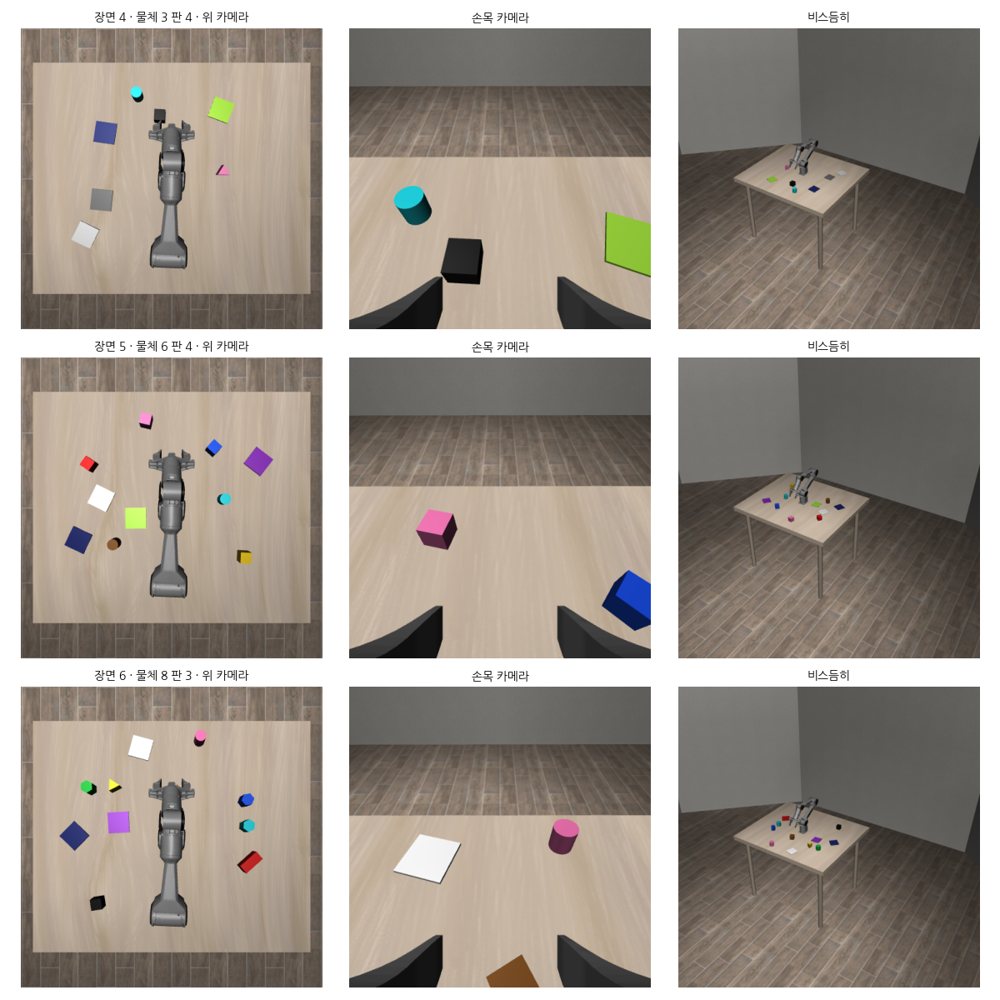
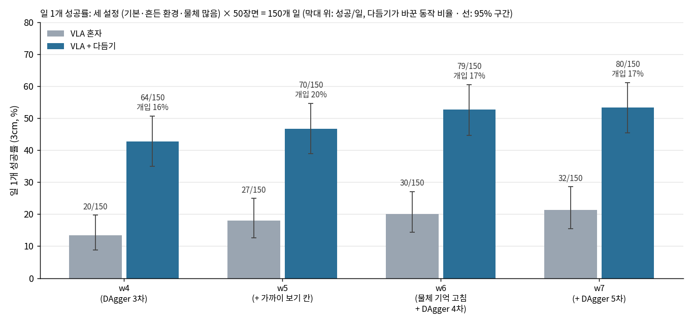
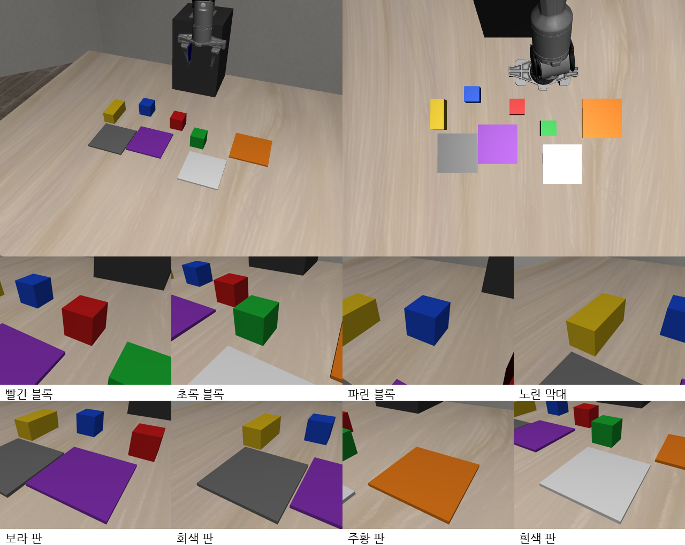
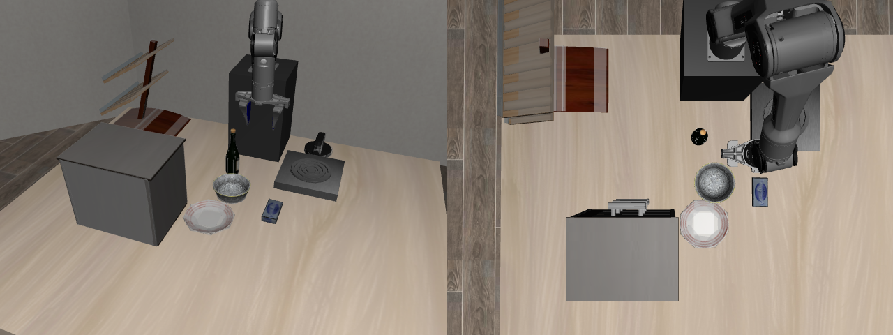
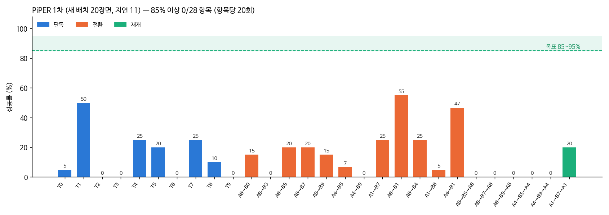

# PiPER 결과물

연구실 실물 팔인 AgileX PiPER(WeGo Robotics 공급)를 시뮬레이터에 그대로 옮긴 디지털 트윈에서 얻은 결과입니다. 10/3 부터는 PiPER 만 개선하고 있습니다. 팔·카메라·제어 방식은 [05_로봇팔_제원/PiPER.md](../../05_로봇팔_제원/PiPER.md)에 있습니다.

## 한눈에

모든 숫자는 학습에 쓰지 않은 장면(1000번대)에서, 실제 로봇처럼 모델이 계산하는 동안에도 팔이 움직이는 조건(지연)으로 잰 것입니다. 성공은 물체가 판 가운데에서 3cm 안에 놓인 것이고, 판 안에만 놓인 것도 따로 셉니다.

| 기간 | 장면과 과제 | VLA 혼자 (3cm / 판 안) | VLA + 보조 (3cm / 판 안) | 자세히 |
|---|---|---|---|---|
| 10/24 ~ 지금 | 모양 5가지 · 물체 최대 14개 · 로봇 둘레, 일 1개 150장면 | 21% / 31% (w7) | **53% / 55%** (w7 + 다듬기) | 아래 1절, [10/28 일지](../../03_일지/2026-10-28.md) |
| 10/22 ~ 10/24 | 색 블록, 옮기는 도중 끼어들기 28항목 | 23.2% / 37.0% (np3) | **94.5% / 94.6%** (np3 + 보조), 셋 다 217/240 (90.4%) | 아래 2절, [10/24 일지](../../03_일지/2026-10-24.md) |
| 10/20 ~ 10/22 | 색 블록, 받침대 없이 책상 위, 쥔 직후 지시가 바뀌는 28항목 | 25.5% / 39.3% (np1) | 93.8% / 94.6% (np2 + 보조) | [10/22 일지](../../03_일지/2026-10-22.md) |
| 10/4 ~ 10/19 | 색 블록, 받침대 위 28항목 | 20.7% / 35.7% (als2) | 61.4% / 64.3% (als2 + 보조) | [10/19 일지](../../03_일지/2026-10-19.md) |
| 10/3 ~ 10/4 | LIBERO-Goal 물체(그릇·서랍·와인 등) 28항목 | 혼자 13.5%, 일 바꾸기 19.5%, 돌아오기 3.3% (piper_s1) | – | 아래 4절 |

10/24 까지의 '보조'는 지시문을 읽고 옮길 물체와 판을 직접 골랐습니다. 10/26 부터 쓰는 '다듬기'는 지시문을 읽지 않습니다. 어떤 물체를 어느 판에 놓을지는 VLA 가 정하고, 다듬기는 손이 아주 가까이 왔을 때 마지막 몇 cm 만 맞춥니다.

## 1. 여러 모양·N개 장면 (10/24 ~ 지금)

장면은 연구실 PC 의 설정 파일(`piper_sim/worlds/*.json`)로 만듭니다. 코드에 물체를 적어 두지 않아서, 설정만 바꾸면 모양·개수·자리가 바뀝니다. 모양은 정육면체, 막대, 원기둥, 육각기둥, 삼각기둥 5가지이고 물체 색 8가지, 판 색 6가지입니다. 물체는 로봇 둘레 어디에나 놓입니다.

| 설정 | 물체 | 판 | 다른 점 |
|---|---|---|---|
| 기본 | 2~8개, 색이 모두 다름 | 2~5개 | |
| 흔든 환경 | 기본과 같음 | 2~5개 | 장면마다 조명 세기·방향, 책상 색, 물체 색, 위 카메라 자리(±1cm, ±1.5°)를 바꿈 |
| 물체 많음 | 6~14개, 같은 색 다른 모양도 있음 | 3~6개 | |

평가는 설정마다 장면 1000~1049 (50장면), 지연 9스텝(0.45초)입니다. 일 1개는 "put the red cube on the orange square" 같은 지시 하나이고, 일 2개는 A 를 옮기는 도중 B 명령이 오는 것입니다.

### 모델별 성적 (일 1개, 세 설정 × 50장면 = 150개 일)

| 모델 | 바꾼 것 | VLA 혼자 3cm | 판 안 | VLA + 다듬기 3cm | 판 안 | 다듬기가 바꾼 동작 |
|---|---|---|---|---|---|---|
| w4 | DAgger 3차 | 20/150 (13%) | 31 | 64/150 (43%) | 69 | 16.2% |
| w5 | 위치 입력에 '가까이 보기' 칸 | 27/150 (18%) | 40 | 70/150 (47%) | 78 | 19.6% |
| w6 | 물체 기억이 덮이던 버그 고침 + DAgger 4차 | 30/150 (20%) | 54 | 79/150 (53%) | 88 | 17.5% |
| w7 | DAgger 5차 | 32/150 (21%) | 47 | **80/150 (53%)** | 83 | 17.3% |

- DAgger 는 VLA 가 직접 움직이다 넘겨준 자리에서 시범 프로그램이 이어받아 끝내고, 그 이어받은 동작을 학습 데이터에 더하는 방법입니다.
- 다듬기의 어느 부분이 효과를 내는지 빼 보면 (w4, 기본 50장면), 놓기 다듬기만 켜도 동작 1% 만 바꾸고 성공이 8 → 17/50 으로 두 배가 됩니다 ([10/28 일지 1절](../../03_일지/2026-10-28.md)). VLA 는 맞는 판까지는 스스로 가는데 마지막 몇 cm 가 빗나간다는 뜻입니다.
- 일 2개 끼어들기 (기본 20장면, 둘 다 성공): w6 + 다듬기 2/20, w7 + 다듬기 6/20. 다음 목표입니다.

### 4K 시연

| GIF | 내용 |
|---|---|
| [world_w6r_s1020.gif](img/world_w6r_s1020.gif) | w6 + 다듬기, 물체 8개 중 파란 삼각기둥을 남색 판에. 239스텝 중 다듬기가 바꾼 것은 9스텝 |
| [world_w4r_s1046.gif](img/world_w4r_s1046.gif) | w4 + 다듬기, 빨간 막대를 주황 판에. 320스텝 중 32스텝 |
| [world_w3r_many_s1006.gif](img/world_w3r_many_s1006.gif) | w3 + 다듬기, 물체 13개 중 분홍 정육면체를 보라 판에. 145스텝 중 9스텝 |
| [world_w2r_s1010.gif](img/world_w2r_s1010.gif) | w2 + 다듬기, 빨간 삼각기둥을 연두 판에. 352스텝 중 9스텝 |
| [world_w1ba_s1008.gif](img/world_w1ba_s1008.gif) | w1b + 예전 보조, 초록 삼각기둥을 회색 판에 |
| [world_expert_k3.gif](img/world_expert_k3.gif) | 시범 프로그램, 물체 8개 · 판 3개, 일 3개 끼어들기 |

## 2. 색 블록 장면 (10/4 ~ 10/24)

색 블록 4개(빨강·초록·파랑 4.5cm 정육면체, 노란 막대 9×4×4cm)와 색 판 4개(10cm)만 있는 장면입니다. 과제는 모두 "X 블록을 Y 위에"이고, 혼자 하는 일 10개, 일 바꾸기 12쌍, 원래 일로 돌아오기 6개를 합쳐 28항목입니다.
이유와 과제 목록: [10/4 일지 2절](../../03_일지/2026-10-04.md), 물체: [07_물체](../../07_물체/README.md)

| 언제 | 바뀐 것 |
|---|---|
| 10/4 | LIBERO 물체 장면에서 색 블록 장면으로 바꿈 |
| 10/5 | 동작을 '이번 스텝에 얼마나'(변화량)에서 '어디로'(절대 목표 위치)로 바꿈 |
| 10/14 | 계산을 빠르게 해 지연 11스텝(0.56초) → 9스텝(0.45초) |
| 10/20 | 받침대를 빼고 팔을 책상 위에 바로 둠, 손목을 기울여 쥠 |
| 10/22 | 새 기준: 쥔 직후가 아니라 옮기는 도중에 새 지시가 옴 |
| 10/24 | 옮기는 도중 끼어들기에서 '셋 다'(B 를 하고, 돌아와 A 를 마치고, 그동안 B 도 무너지지 않음) 217/240 (90.4%), np3 + 보조 |

### 시범 프로그램 결과

| 항목 | 학습용 장면 2000~2019 | 새 장면 1000~1019 |
|---|---|---|
| 혼자 하는 과제 10개 | 과제마다 20/20 | 과제마다 **20/20 (200/200)** |
| 일 바꾸기 12쌍 | 쌍마다 10/10 | 쌍마다 **10/10 (120/120)** |
| 원래 일로 돌아오기 6개 | 10/10 | 모두 **10/10 (60/60)** |

### 4K 시연

| GIF | 내용 |
|---|---|
| [k4_midcarry_1002.gif](img/k4_midcarry_1002.gif) | 옮기는 도중 한국어로 끼어들기 |
| [k4_all3_1019.gif](img/k4_all3_1019.gif) | 한국어 끼어들기, A1→B7 장면 1019 |
| [k4_fix_1004.gif](img/k4_fix_1004.gif) | 한국어 끼어들기, A4→B9 장면 1004 |
| [korean_demo_1002.gif](img/korean_demo_1002.gif), [korean_demo_1005.gif](img/korean_demo_1005.gif) | 한국어 명령 시연 |
| [korean_point_1002.gif](img/korean_point_1002.gif) | 가리키기 시연 |

모델별 28항목 성적 그림은 `img/score_piper_*.png` 에 있고, 각 그림이 실린 날의 일지에서 설명합니다.

## 3. 평가 기준 (색 블록·LIBERO 장면)

| 항목 | 값 |
|---|---|
| 장면 | 학습에 안 쓴 무작위 배치 1000번대 (학습·교정 시범은 2000번대만) |
| 추론 지연 | 11스텝 = 0.56초 (연구실 GTX 1080 Ti), 10/14 부터 9스텝 = 0.45초. 지연 동안 앞 계획을 실행하고, 그 앞부분을 넣고 다음 계획을 계산 (지연 흉내내기) |
| 시간 제한 | 단계(A, B, 재개)마다 600스텝 = 30초. 가장 긴 시범 프로그램(T3, 최대 558스텝)보다 조금 넉넉하게 |
| 전환 규칙 | 전환 뒤 손이 처음 자세 7cm 안에 들어가면 실패 |
| 95% 판정 | 최종은 100장면 중 95번 이상 |

## 4. LIBERO-Goal 물체 장면 (10/3 ~ 10/4 기록)

### 시범 프로그램 결과 (새 배치)

| 항목 | 결과 | 항목 | 결과 |
|---|---|---|---|
| T0 가운데 서랍 | 20/20 | A8→B0 | 10/10 |
| T1 그릇 → 스토브 | 20/20 | A8→B3 | 10/10 |
| T2 와인 → 캐비닛 위 | 20/20 | A8→B5 (재개) | 10/10 (10/10) |
| T3 위 서랍 + 그릇 | 20/20 | A8→B7 (재개) | 10/10 (10/10) |
| T4 그릇 → 캐비닛 위 | 20/20 | A8→B9 (재개) | 10/10 (10/10) |
| T5 접시 밀기 | 20/20 | A4→B5 (재개) | 10/10 (10/10) |
| T6 치즈 → 그릇 | 20/20 | A4→B9 (재개) | 10/10 (10/10) |
| T7 스토브 켜기 | 20/20 | A1→B7 (재개) | 10/10 (10/10) |
| T8 그릇 → 접시 | 20/20 | A8→B1, A8→B4, A1→B8 | 각 10/10 |
| T9 와인 → 선반 | 20/20 | A4→B1 | 9/10 → 실패 장면 고침 |

### 학습 데이터

| 데이터 | 개수 | 장면 |
|---|---|---|
| 정상 수행 1차 | 596 | 2000~2059 |
| 전환·재개 1차 | 843 파일 | 2000~2029 |
| 오래 멈춘 구간 잘라 냄 | 프레임 16% | — |

### 학생 모델 piper_s1 (새 배치 1000~1019, 지연 0.56초, 각 20번, 10/4 04:06)

piper_s1 은 Panda v6b 에서 출발해 1차 시범(정상 596 + 전환·재개 843)으로 20,000스텝 학습했습니다.

| 묶음 | 평균 | 가장 잘한 것 |
|---|---|---|
| 단독 10개 | 13.5% | T1 그릇→스토브 50% |
| 전환 12쌍 | 19.5% | A8→B1 55%, A4→B1 47% |
| 재개 6개 | 3.3% | A1→B7→A1 20% |
| 85% 이상 | 0 / 28 | |

전체 표: [score_s1_heldout.md](score_s1_heldout.md)

궤적을 보고 찾은 원인

| 실패 | 원인 | 고친 것 |
|---|---|---|
| 그릇 테두리를 놓침 | 손을 0.7cm 높게(95.6cm) 오므림. 시범이 테두리 끝 0.2cm 만 걸쳐 쥐어 여유가 없었다 | 시범이 1.2cm 깊게 쥐도록 → 1.2cm 높게 오므려도 6/6 잡힘. 그릇 시범을 다시 모음 |
| 서랍 손잡이를 놓침 | 손이 손잡이에서 3~6cm 빗나간 곳에서 오므림 | 교정 시범(학생이 빗나간 자리에서 시범 프로그램이 이어 받음), A2C2 보정 |

이 결과를 보고 10/4 에 색 블록 장면으로 바꿨습니다 (2절).
