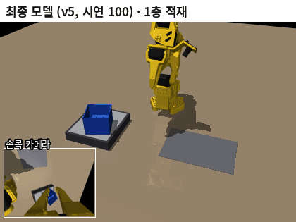

# 08 개인 논문 — YOLOv8 무게 인식 + ACT 순차 적재

> 캡스톤(스마트팩토리 비전 검사) 결과를 학술대회 논문으로 마무리하는 폴더입니다.
> 이 저장소의 본 연구(SmolVLA 태스크 전환)와는 **별개**이며, 다른 폴더의 파일은 건드리지 않습니다.
>
> **다른 PC(Windows)에서 이어받을 때는 [이어받기_Windows.md](이어받기_Windows.md) 부터** — 최종 수치, 제출 전 할 일, 파일 위치, 재현 방법.

## 한눈에

| 항목 | 내용 |
|---|---|
| 논문 | Jetson Orin Nano 기반 YOLOv8 무게 인식과 ACT 모방학습을 이용한 스마트 팩토리 순차 적재와 시연 설계 분석 (교수님 확인 대기) |
| 학회 양식 | 대한전자공학회 학술대회 2단 양식 (`논문양식.docx`) |
| 저자 | 이지용, 김한민, 정철훈, 장민기, 고병철 (계명대학교 컴퓨터공학전공) |
| 제출 마감 | **2026-10-19 (월)** — 대한전자공학회 2026 추계학술대회 (실험·원고는 10/11 완료) |
| 실제 시스템 | 컨베이어 색 분류 → 저울 위 파란 통 → 7-segment 무게 인식(YOLOv8) → 118g 이상이면 SO-101 이 통을 1층 → 옆 → 2층 순서로 적재 |
| 연산 장치 | **Jetson Orin Nano** (ACT 는 PC 에서 학습 → 체크포인트만 Orin Nano 로 옮겨 실행) |
| 문제 | 실제 로봇팔이 파손되고 ACT 실측 결과가 남아 있지 않음 |
| 해결 | 실제와 같은 SO-101(손목 카메라 모델)·저울·분류 통을 MuJoCo 로 만들고, **ACT 정량 평가를 시뮬레이션으로 다시 수행** |

## 우리가 한 일 (용어 풀이)

| 용어 | 뜻 (무엇을 했나) |
|---|---|
| **시연** | 로봇이 따라 배울 모범 동작. 시뮬레이션에서 스크립트(역기구학)로 자동으로 만듦 |
| 규칙 1 **여유 두고 잡기** (예전 표기 R1) | 집게를 통 벽 바깥 9mm 에 두고 내려가 잡음 → 집게가 벽 위에 걸리는 실패를 없앰 |
| 규칙 2 **늘 같은 곳 잡기** (예전 표기 R2) | 통이 돌아가 있어도 항상 같은 벽(컵은 손잡이 오른쪽 면)을 잡음 → 같은 장면에서 시연 동작이 두 갈래로 갈리지 않음 |
| 규칙 3 **놓고 물러나기** (예전 표기 R3) | 2층에 놓은 뒤 그리퍼를 벌리고 5mm 물러났다가 올라감 → 놓은 통을 끌어 올려 기울이지 않음 |
| **규칙 시연 / 사람식 시연** | 세 규칙을 모두 지킨 시연 / 사람처럼 그때그때 가까운 곳을 잡는 시연 |
| **학습 전 시연 점검** | 시연마다 "잡는 순간의 손목 각도"를 모아 가장 넓은 빈 구간을 잼. 수십 도가 비어 있으면 잡는 방식이 둘로 갈린 것 → 학습 전에 다시 만듦 |
| **무게 확인 재시도** | 단계를 마친 뒤 저울에 통이 남아 있으면(60g 이상) 같은 단계를 다시 실행 |
| **연속 성공률** | 1층 → 옆 → 2층을 이어서 실행해 세 단계 모두 성공한 비율 (실제 셀과 같은 조건) |
| 모델 이름 v1 · v4 · v5 | 초기 설계 · + 늘 같은 곳 잡기 · 세 규칙 모두 (규칙 시연) |
| 모델 이름 v6 · v9 | + 외관 무작위화(조명·책상 색·카메라 위치) · + 잡동사니가 놓인 장면의 시연 |
| 모델 이름 v10 · v11 · v12 | + 공장형 장면 시연 단계당 300 · 500 · 800개 (v12 는 무늬 책상 등 외관 변화가 큰 공장 장면 300개 포함) |
| 모델 이름 int | 통·컵·상자 세 물체를 단계별 정책 하나로 함께 배운 통합 정책 |

## 원칙

- 측정하지 않은 수치는 논문에 쓰지 않는다. 시뮬레이션 수치는 시뮬레이션이라고 밝힌다.
- 7-segment 수치(FPS 59.5, 정분류율 91.7% 등)는 팀이 실측한 초안 값을 그대로 쓴다.
- 수치를 적을 때는 측정 조건(장치, 시행 횟수, 시드)을 함께 적는다.
- 개인정보(전화번호 등)가 든 원본 HWP 는 올리지 않는다.

## 폴더

| 폴더 | 내용 |
|---|---|
| [일지/](일지/) | 날짜별 진행 기록 |
| [물체/](물체/) | 로봇팔 구매·출력용 STL — SO-101 부품·카메라 마운트(공식, Apache-2.0), 실험용 통·큐브 |
| [기록/](기록/) | 초안 검토, 실제 시스템 정리, 시뮬레이션 설계, 실험 계획 |
| [코드/](코드/) | 시뮬레이션·시연 생성·ACT 학습·평가 코드 사본 |
| [결과/](결과/) | 수치(JSON), 그림, GIF |
| [논문/](논문/) | 최종 원고 |

## 최종 모델 적재 장면 (시뮬레이션)

단계마다 시연 100번으로 학습한 ACT 정책이 1층 → 옆 → 2층으로 연속 적재한다. 왼쪽 아래 작은 창은 정책이 보는 손목 카메라 화면이다. 200회 평가에서 연속 성공률은 **99.0%** (95% CI 96.4–99.7%)이고, 집기에 실패해 통이 저울에 남으면 같은 단계를 다시 실행하게 하면 **200/200 = 100%** 다.

## 진행 상황 (10/11 완료)

- [x] 실제 시스템 분석, MuJoCo 셀, 스크립트 전문가 (10/6)
- [x] 시연 설계 규칙 3가지 (여유 두고 잡기 · 늘 같은 곳 잡기 · 놓고 물러나기): 연속 28 → **99.0%** (200회), 무게 확인 재시도 **200/200** (10/7~9)
- [x] 시연 수·DART 로는 안 됨, 외관 무작위화 98%, 학습 전 시연 점검 지표 (10/8~9)
- [x] ② 다른 물체: 컵 20 → 46% (규칙 300개 88%), 상자 56 → **100%** (10/10~11)
- [x] ① 잡동사니·공장형: v9 잡동사니 88%, v11 공장형 44 → **82%**, ③ 세 물체 통합 정책 평균 72% / 공장형 59% (10/10~11)
- [x] 팔레트 2×2×2: 35 → 55 → 65% (5번 칸 원인 = 전문가 역기구학, 위치 우선으로 수정) (10/9~11)
- [x] 원고: 기존 구조 [`논문/paper.pdf`](논문/paper.pdf), 새 구조 [`논문/paper_v2.pdf`](논문/paper_v2.pdf) (각 5쪽), 심사용 4쪽
- [ ] 교수님 제목·원고 선택, 공저자 동의, 학회 업로드 (사람이 할 일 → [이어받기_Windows.md](이어받기_Windows.md) 1절)

## 일지

시연 설계 버전(v1·v2·v3·v4·v5)이 각각 무엇인지는 [2026-10-07 일지의 "시연 설계 버전 정리"](일지/2026-10-07.md#시연-설계-버전-정리-v1--v2--v3--v4--v5) 에 그림과 함께 정리했다.

| 날짜 | 요약 |
|---|---|
| [2026-10-11](일지/2026-10-11.md) | 밤샘 보강: 공장형 44→82%, 컵 46→88%, 상자 100%, 통합 120k, 팔레트 65%, 논문 v2 (새 구조) 완성, 인수인계 |
| [2026-10-10](일지/2026-10-10.md) | 잡동사니·공장형 평가 (v5·v6·v9), 팔레트 5번 칸 원인 발견, 통합 40k→80k, 논문 구조 새로 짜기 |
| [2026-10-09](일지/2026-10-09.md) | v67, 팔레타이징 v2, 카메라 비교, 무게 재시도 200/200, 컵·상자·잡동사니·공장 환경 준비 |
| [2026-10-08](일지/2026-10-08.md) | 시연 수 포화, DART 효과 없음, **무작위화 v6 이 최종 견고 모델 (연속 98%, 평균 98%)**, CLAHE 는 오히려 손해 → 제외, v8 탈락, 넓은 무작위화의 정밀도 맞교환, 모방학습 검증(카메라 가림 0/30), 논문 MCP→TCP 정정·부제 변경 |
| [2026-10-07](일지/2026-10-07.md) | 시연 설계를 고쳐 연속 28%(v1) → 62%(v2) → 82%(v4) → **96%(v5), 200회 평가 99.0% — 목표 달성**. 기존 모델 견고성 16조건(책상 어두우면 0~30%), 저울 재시도 +16%p, 무작위화·CLAHE 학습 시작 |
| [2026-10-06](일지/2026-10-06.md) | 초안·코드 분석, 시뮬레이션 셀(통 벽 잡기, 전문가 20/20), 시연 200개, n100 학습 시작, 메모리 사고 대책 (사진·GIF 포함) |
