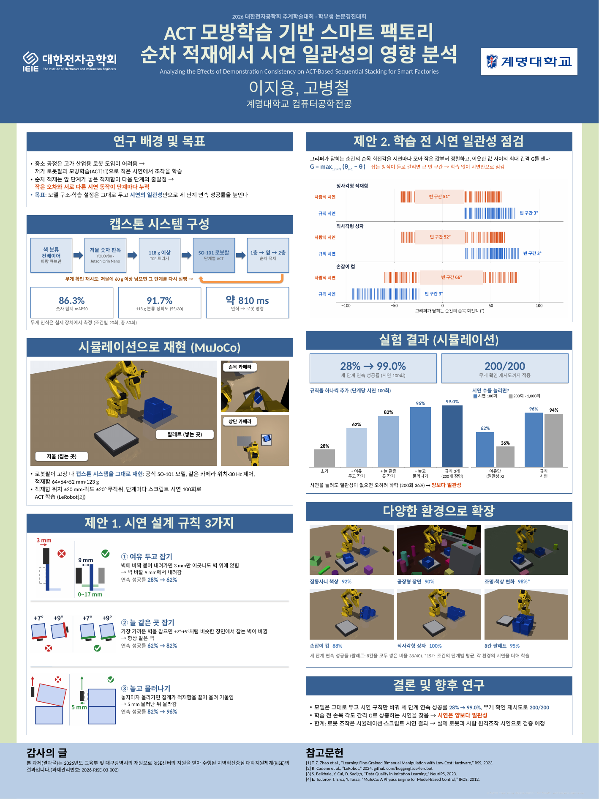

# 학회 포스터 (2026 대한전자공학회 추계학술대회, 포스터 세션)



| 파일 | 용도 |
|---|---|
| [포스터_ACT적재_90x120cm.pptx](포스터_ACT적재_90x120cm.pptx) | 고칠 때 (PowerPoint, 슬라이드 1장 = 가로 90 cm × 세로 120 cm) |
| [포스터_ACT적재_90x120cm.pdf](포스터_ACT적재_90x120cm.pdf) | 인쇄소에 보낼 파일 (90 × 120 cm, 글꼴 포함) |
| [포스터_미리보기.png](포스터_미리보기.png) | 한눈에 보기 |
| [이전_1031_자체디자인/](이전_1031_자체디자인/) | 10/31 에 직접 디자인했던 이전 판 (내용·숫자는 같음) |

## 템플릿과 로고 (2026-11-04)

- **템플릿**: Genigraphics 연구 포스터 템플릿, Standard Design, 세로 48″ × 36″ (genigraphics.com/templates).
  - 무료이고, 라이선스는 **CC BY-SA 4.0**. 그래서 오른쪽 아래의 템플릿 출처 줄을 그대로 둠.
  - 템플릿이 36 × 48 in (3 : 4)라서 90 × 120 cm 로 비율 그대로 줄임 (0.984배).
  - 템플릿에서 그대로 쓴 것: 파란 제목 띠, 양옆 띠, 아래 띠, 섹션 제목 막대, 테두리 상자, 테마 색과 글꼴 (Calibri + 맑은 고딕).
  - PowerPoint 의 디자인 → 적용(Variants) → 색에서 색 테마를 바꾸면 띠·막대 색이 같이 바뀜.
- **대한전자공학회 로고**: 학회 정식 로고 (흰색).
  - 학회 공식 브로셔 표지에서 잘라 씀 (theieie.org/download/brochure_kor_20260109.pdf).
  - 홈페이지에는 작은 이미지만 있음 (228 × 50, 80주년판 496 × 159).
  - 브로셔 로고(401 × 85 px)를 투명 배경으로 바꾸고 가장자리를 매끄럽게 5배로 키움 (2080 × 510).
- **계명대학교 로고**: 교표(방패형) 시그니처 기본형 (좌우 조합, 한글).
  - 계명대 홈페이지 → 학교소개 → 계명상징 → 로고마크 자료실에서 받은 2000 px 원본을 씀.
  - 흰 여백만 잘라 내고, 흰 상자 안에 넣음.

## 학회 규정 (학회 홈페이지 "논문발표 안내", 2026-10-31 확인)

학회가 주는 포스터 **파일 양식은 없음** (2023~2026 학술대회 페이지, 학회 자료실·논문양식 게시판 모두 확인). 정해진 것은 아래 규정과 패널 견본 그림뿐.

| 항목 | 규정 | 이 포스터 |
|---|---|---|
| 패널 | 가로 100 cm × 세로 180 cm | 90 × 120 cm 한 장 (전지 1장 방식) |
| 제목·저자·소속 칸 | 가로 90 cm × 세로 20 cm | 맨 위 90 × 18.5 cm 파란 띠 |
| 제목·저자 글자 | 25~30 mm | 제목 84 pt (29.6 mm), 저자 72 pt (25.4 mm) |
| 각 장 제목 | 15~20 mm | 54 pt (19.1 mm) |
| 발표 내용 | 7~10 mm | 본문 21~24 pt (7.4~8.5 mm), 주석·참고문헌 19~20 pt (6.7~7.1 mm) |
| 부착 | 발표 5분 전 직접 부착, 끝나고 5분 안에 제거, 저자 1명은 포스터 앞에서 답변 | |
| 논문번호 | 학회가 패널 위에 붙임 | |

지원 프로그램(RISE) 규정에 따라 포스터 왼쪽 아래 "감사의 글"에 사사 문구를 넣음.

## 다시 만들기 (연구실 PC)

```bash
cd ~/ACT/act_sim
systemd-run --user --unit=act-poster-render -p MemoryMax=4G paper/poster/run_renders.sh   # 시뮬레이션 장면 1600×1200 렌더
.venv/bin/python paper/poster/fig_poster.py      # 손목 각도 그림, 규칙 개념도 (인쇄 크기)
python3 paper/poster/prep_images.py               # 배경 정리·자르기
PYTHONPATH=<python-pptx> python3 paper/poster/make_poster_tpl.py ~/ACT/포스터/포스터_ACT적재_90x120cm.pptx   # 템플릿 판
# 이전 자체 디자인 판: paper/poster/make_poster.py
```

- 로고 손질: `logos_prep.py` (브로셔 표지 JPEG, 계명대 원본 JPG 를 받아 `logos/` 에 PNG 저장)
- PDF 는 LibreOffice 로 변환 (맑은 고딕 → Noto Sans CJK KR, Calibri → Carlito 로 대신 그림).
- 파일 썸네일: `set_thumbnail.py`
