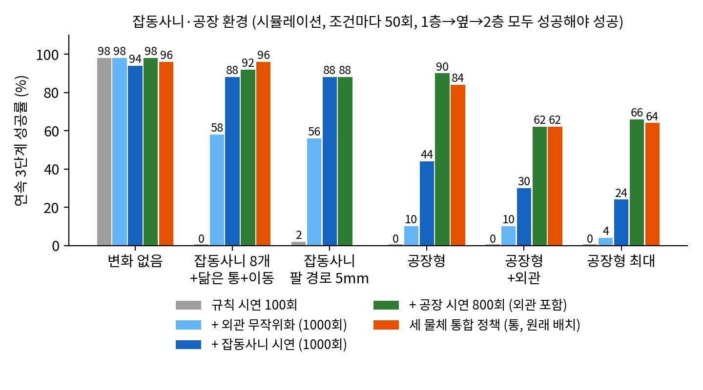
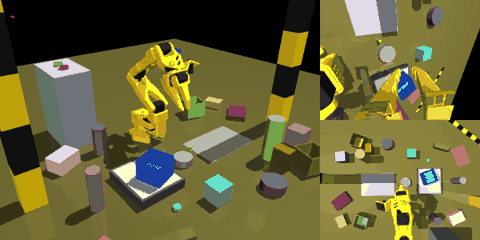
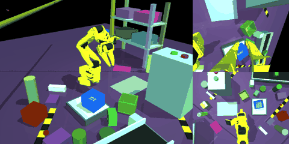
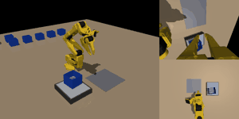
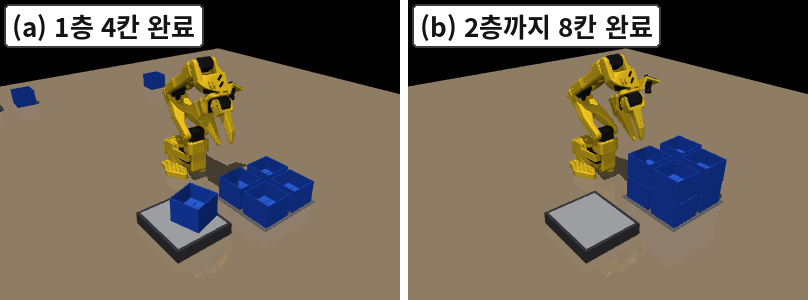
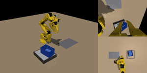
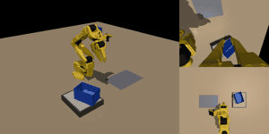

# 2026-10-11 (일) — 08 개인논문 ACT 적재

목표: **오늘 안에** 실험 마무리 + 논문 v1·v2·심사용 4쪽 완성 · "모두 100 가까이" (성공 기준은 그대로: 위치 15mm, 높이 8mm, 기울기 10°, 앞 통 10mm, 잡동사니 10mm, 구조물 접촉 없음). 모두 시뮬레이션.

## 19:30 주말 마감 — 최종 정확도 (실험은 여기서 끝)

사용자 지시(16:40): **v12 와 팔레트 2·6번 칸 보강이 마지막 개선.** 이후 새 실험 없음. 무게 인식만 실제 하드웨어 실측, 나머지는 모두 MuJoCo 시뮬레이션.

| 실험 | 최종 결과 |
|---|---|
| 무게 인식 (YOLOv8n, Jetson Orin Nano 실측) | mAP50 86.3%, 기준값(118g) 분류 91.7% (55/60) |
| 기본 3단계 적재 (통): 초기 설계 → 세 규칙 | 28% → **99.0%** (200회 연속) |
| + 무게 확인 재시도 | **200/200** |
| 외관 무작위화 | 98% |
| 직사각형 상자: 사람식 → 규칙 시연 | 56% → **100%** |
| 손잡이 컵: 사람식 → 규칙 시연 → 규칙 300 + 관절 잡음 | 20% → 46% → **88%** |
| 잡동사니 전부 / 팔 경로 5mm (v12) | **92% / 88%** |
| 공장형: v9 → v10 → v11 → **v12** | 44 → 68 → 82 → **90%** |
| 공장형 + 외관 / 공장형 최대 (v12) | 62% / 66% |
| 세 물체 통합 정책 (120k, 6조합 평균) | 변화 없음 72%, 공장형 59% (통·상자 원래 배치 96~98%) |
| **팔레트 2×2×2 (8칸 연속, 40회)** | 35 → 55 → 65 → 82.5 → **95%** |

논문 반영 (오늘 오후)
- 저자: **이지용, 고병철** (김한민·정철훈·장민기 이름은 한글·영문 모두 뺌)
- 그림 5장: ① 시스템 구성(Mermaid, `결과/그림/fig1_system.mmd`) ② 시뮬레이션 셀(칸 이름 크게) ③ 시연 점검(한 단 폭용으로 새로 그림) ④ 연속 적재 6장면(새로 추가) ⑤ 팔레트 8칸(새로 추가, v2 원고만)
- R1·R2·R3 → **여유 두고 잡기 · 늘 같은 곳 잡기 · 놓고 물러나기**, ①~④ 설계 번호 → "+ 여유 두고 잡기 (100)" 처럼 내용으로. README 에 용어 풀이 표
- 원고 v1·v2 5쪽, 심사용 4쪽 (MISSING 없음). 표 4 "+공장" 열 = v12, 팔레트 = 95%

## 19:10 마지막 결과 ① 공장형+외관 보강 (v12) — 공장형 82 → **90%**, 공장형 최대 46 → **66%**

v11 의 공장형+외관 실패를 장면별로 나눠 보니 **무늬 있는 책상**(줄무늬·체크·얼룩)에 몰려 있었음 (조명 밝기·색조는 차이 없음). 무늬 책상 + 공장 장면 시연이 전체의 약 15% 뿐이라, 그 장면만 담은 시연을 단계당 300개 더 만들어 (`gen_data.py --factory-mix 0 0 --look2 1`, 시드 56000+) v11 에서 이어 학습 +20k (`run_v12.sh`).

| 조건 (연속 50회) | v11 (공장 시연 500) | **v12 (+ 공장·외관 시연 300)** |
|---|---|---|
| 변화 없음 | 98 | **98** |
| 잡동사니 전부 | 86 | **92** |
| 잡동사니 팔 경로 5mm | 80 | **88** |
| 공장형 | 82 | **90** |
| 공장형 + 외관 | 58 | **62** |
| 공장형 최대 | 46 | **66** |

| 책상 외관별 (`factory_vis_diag.py`) | 공장형+외관 v11 → v12 | 공장형 최대 v11 → v12 |
|---|---|---|
| 무늬 없음 (26회) | 69 → 58 | 58 → 69 |
| **무늬 있음** (24회) | **46 → 67** | **33 → 63** |

| v12 공장형+외관 성공 | v12 공장형+외관 실패 (옆 단계) |
|---|---|
|  |  |

- 노린 곳(무늬 책상)은 크게 오름 (46 → 67%, 33 → 63%). 그 덕에 공장형 최대가 46 → 66% 로 오름
- 공장형+외관 **전체는 58 → 62% 로 차이가 작음**: 무늬 없는 책상 쪽이 69 → 58% 로 내려감 (26회라 ±10%p 는 오차 범위). 원고에도 "차이가 작았다"고 그대로 적음
- 다른 조건은 떨어지지 않고 함께 오름 (잡동사니 86 → 92, 팔 경로 5mm 80 → 88, 공장형 82 → 90)
- 논문 표 4 "+공장" 열 = v12 (정해 둔 규칙대로 마지막 회차)

## 18:31 마지막 결과 ② 팔레트 2·6번 칸 보강 — 8칸 연속 82.5 → **95%** (38/40)

| 팔레트 8칸 연속 (40회) | 결과 | 칸별 (1~8번) |
|---|---|---|
| v2 | 35% | 90 · 95 · 100 · 100 · 52 · 98 · 98 · 95 |
| v3 관절 잡음 | 55% | 92 · 98 · 100 · 88 · 78 · 88 · 90 · 92 |
| + 5번 칸 시연 수정 | 65% | 92 · 98 · 98 · 92 · 95 · 85 · 88 · 88 |
| + 1·4·6·7·8번 칸 시연 +100 · 관절 잡음 | 82.5% | 100 · 95 · 100 · 100 · 98 · 90 · 98 · 100 |
| **+ 2·6번 칸 시연 +100 (최종)** | **95%** | 100 · **100** · 100 · 100 · 97.5 · **100** · 97.5 · 100 |

| 8칸 모두 성공 (최종, 시뮬레이션) |
|---|
|  |

- 보강한 2번(95 → 100%)·6번(90 → 100%) 칸 모두 40/40. 남은 실패 2회는 5번·7번 칸 각 1회 (첫 20회는 20/20)
- 체크포인트: 1 `pal3n05_s1@50000`, 2 `pal4n05_s2@50000`, 3 `pal2n05_s3`, 4 `pal3n05_s4@50000`, 5 `pal3n05_s5`, 6 `pal4n05_s6@70000`, 7 `pal3n05_s7@50000`, 8 `pal3n05_s8@50000` (k=25 재예측)

## 15:05 팔레트 약한 칸 보강 — 8칸 연속 65 → **82.5%** (33/40)

| 팔레트 8칸 연속 (40회) | 결과 | 칸별 (1~8번) |
|---|---|---|
| v2 | 35% | 90 · 95 · 100 · 100 · 52 · 98 · 98 · 95 |
| v3 관절 잡음 | 55% | 92 · 98 · 100 · 88 · 78 · 88 · 90 · 92 |
| + 5번 칸 시연 수정 | 65% | 92 · 98 · 98 · 92 · 95 · 85 · 88 · 88 |
| **+ 1·4·6·7·8번 칸 시연 +100 · 관절 잡음** | **82.5%** | 100 · 95 · 100 · 100 · 98 · 90 · 98 · 100 |

| 8칸 모두 성공 (시뮬레이션) |
|---|
|  |

- 컵과 같은 방법(시연 늘리기 + 관절 잡음)이 팔레트에서도 효과. 남은 약한 칸 = 6번(90%), 2번(95%) → 같은 방법으로 한 번 더 (`run_pallet_more2.sh`, 저녁 7시경)

## 13:40 ③ 통합 120k (80k 에서 +40k) — 평균 소폭 상승, 최종 모델로 사용

| 조합 (80k → 120k) | 변화 없음 | 잡동사니 전부 | 공장형 | 공장형+외관 | 공장형 최대 |
|---|---|---|---|---|---|
| 통 · 원래 | 88 → **96** | 84 → **96** | 74 → **84** | 62 → **62** | 58 → **64** |
| 통 · 반전 | 72 → **68** | 68 → **72** | 52 → **54** | 54 → **56** | 46 → **56** |
| 상자 · 원래 | 92 → **98** | 92 → **98** | 84 → **90** | 58 → **72** | 56 → **66** |
| 상자 · 반전 | 88 → **72** | 90 → **80** | 82 → **82** | 64 → **74** | 66 → **70** |
| 컵 · 반전 | 56 → **46** | 52 → **48** | 40 → **32** | 36 → **34** | 32 → **40** |
| 컵 · 원래 | 26 → **54** | 18 → **26** | 8 → **12** | 10 → **20** | 12 → **28** |
| **6조합 평균** | 70 → **72** | 67 → **70** | 57 → **59** | 47 → **53** | 45 → **54** |

- 원래 배치의 통·상자는 **96~98%** (잡동사니 96~98%, 공장형 84~90%) 로 단일 물체 모델 수준. 반전 배치·컵은 오르내림이 섞임 (50회 기준 ±10%p 는 오차 범위)
- 평균은 40k → 80k 에서 크게 (48 → 70), 80k → 120k 에서 조금 (70 → 72) 오름 → 학습량보다는 **물체·배치를 함께 배울 때의 간섭** 이 남은 원인으로 보임 (특히 컵: 단독 컵 정책은 88% 인데 통합에서는 46~54%)
- 논문에는 정해 둔 규칙대로 **마지막 회차(120k)** 를 씀 (가장 좋은 회차를 고르지 않음)

## 10:15 v11 (v9 + 단계마다 공장 시연 500개) — 공장형 **82%**

| 조건 | v9 | v10 (공장 300) | **v11 (공장 500)** |
|---|---|---|---|
| 변화 없음 | 94 | 98 | **98** |
| 잡동사니 전부 | 88 | 88 | 86 |
| 팔 경로 5mm | 88 | 84 | 80 |
| 공장형 | 44 | 68 | **82** |
| 공장형 + 외관 | 30 | 50 | **58** |
| 공장형 최대 | 24 | 48 | 46 |

- 공장 시연 수에 따라 공장형이 44 → 68 → 82% 로 꾸준히 오름. 잡동사니·팔 경로 조건은 50회 기준 차이 없는 수준 (86~88, 80~84)
- 외관까지 바뀌는 공장형(58%)·최대(46%)는 아직 낮음 — 시연의 외관 무작위화는 v6 범위(1단계) 와 넓은 범위(2단계)를 반씩 썼는데, 공장 구조물 + 외관 변화가 겹치는 장면이 시연에 충분하지 않음. 오늘은 여기까지 (논문 표 4 의 "+공장" 열 = v11)
- 오케스트레이터의 작업은 07:13 모두 끝남. 남은 것: ③ 통합 120k 평가 (진행 중), 팔레트 약한 칸 보강 (시연 생성 중)

## 07:20 팔레트 2×2×2 (8칸 연속, 40회) — 35 → 55 → **65%**

| 팔레트 | 칸별 성공 (1~8번) | 8칸 연속 |
|---|---|---|
| v2 (잡음 없음) | 90 · 95 · 100 · 100 · **52** · 98 · 98 · 95 | 35% |
| v3 (관절 잡음 0.05, 5번 칸 예전 시연) | 92 · 98 · 100 · 88 · **78** · 88 · 90 · 92 | 55% |
| **v3 + 5번 칸 위치 우선 IK 시연** | 92 · 98 · 98 · 92 · **95** · 85 · 88 · 88 | **65%** |

- 5번 칸 수정이 연속 시퀀스에서도 효과 (78 → 95%)
- 남은 약한 칸: 1번(92, y +7mm 치우침), 4번(92, y +9mm), 6~8번(85~88, 가끔 크게 벗어남: y 표준편차 10~21mm)
- **마지막 보강 (`run_pallet_more.sh`)**: 약한 칸 1·4·6·7·8번에 시연 100개씩 추가 + 관절 잡음, 이어 학습 +20k → 8칸 연속 다시 평가 (`pallet5`, 오후 결과). 컵 46 → 88% 와 같은 방법
- `pallet_eval.py` 가 칸마다 다른 체크포인트(`이름@스텝`)를 받도록 수정

## 03:45 밤사이 보강 결과 — 대부분 크게 오름

### 1) 공장형 (통) — v10 = v9 + 공장 시연 300개 (v9 에서 이어 학습 +20k)

| 조건 | v9 | **v10** |
|---|---|---|
| 변화 없음 | 94 | **98** |
| 잡동사니 전부 | 88 | 88 |
| 팔 경로 5mm | 88 | 84 |
| 공장형 | 44 | **68** |
| 공장형 + 외관 | 30 | **50** |
| 공장형 최대 | 24 | **48** |

- 공장 장면을 시연에 넣자 공장형 조건이 20~24%p 오름 (잡동사니 시연이 58 → 88 로 올린 것과 같은 경향). 아직 부족 → **v11** (단계마다 공장 시연 500개) 학습 중

> **정정 (04:10)**: 처음에 "공장 시연 900개"라고 적었으나 추가 생성분은 단계마다 200개(3단계 합계 600개)라서 단계당 공장 시연은 **300 + 200 = 500개**. v11 첫 실행이 1900개를 요구해 시작 직후 멈췄고, 1500개(v9 1000 + 공장 500)로 고쳐 다시 시작

### 2) ② 손잡이 컵 — 규칙 시연 300개 + 관절 잡음 (100개 정책에서 이어 학습 +20k)

| 컵 | 1층 | 옆 | 2층 (연속) |
|---|---|---|---|
| 사람식 100 | 64 | 32 | 20 |
| 규칙 100 | 90 | 56 | 46 |
| **규칙 300 + 잡음** | 96 | 88 | **88** |

- 표 3 (사람식 vs 규칙, 같은 시연 100개) 은 그대로 두고, 규칙 시연을 늘리면 88% 까지 오른다는 것을 별도 행으로

### 3) ② 직사각형 상자 (시연 100개, 05:00 완료)

| 상자 | 1층 | 옆 | 2층 (연속) |
|---|---|---|---|
| 사람식 (로봇 쪽 벽 → 긴 벽·짧은 벽이 바뀜) | 84 | 68 | **56** |
| 규칙 시연 (늘 같은 짧은 벽) | 100 | 100 | **100** |

- **56 → 100%**. 시연 점검의 빈 구간도 53° → 4° — 점검 지표가 학습 전에 차이를 예고한 그대로

| 상자 규칙 — 3단계 성공 | 상자 사람식 — 2층 실패 |
|---|---|
|  |  |

### 4) ③ 통합 모델 40k → **80k** (물체 3 × 배치 2, 단계별 정책 하나)

| 조합 | 변화 없음 | 잡동사니 전부 | 공장형 | 공장형+외관 | 공장형 최대 |
|---|---|---|---|---|---|
| 통 · 원래 | 70 → **88** | 50 → **84** | 36 → **74** | 40 → **62** | 36 → **58** |
| 통 · 반전 | 58 → **72** | 36 → **68** | 28 → **52** | 30 → **54** | 34 → **46** |
| 상자 · 원래 | 64 → **92** | 44 → **92** | 44 → **84** | 44 → **58** | 28 → **56** |
| 상자 · 반전 | 70 → **88** | 54 → **90** | 50 → **82** | 42 → **64** | 52 → **66** |
| 컵 · 반전 | 24 → **56** | 28 → **52** | 18 → **40** | 22 → **36** | 12 → **32** |
| 컵 · 원래 | 0 → **26** | 0 → **18** | 0 → **8** | 0 → **10** | 0 → **12** |

- 학습량만 2배로 해도 모든 조합이 크게 오름 → 40k 는 확실히 학습 부족이었음. 80k 에서도 손실이 계속 내려가는 중 (2층 0.081 → 0.0755 / 마지막 10k) → **120k** 이어 학습 중
- 남은 약점은 컵 (특히 원래 배치): 여러 물체를 한 정책이 배우면 컵의 "손잡이 옆 면 잡기" 가 가장 늦게 배워짐

### 5) 문제와 처리
- 01:00 GPU 메모리 부족으로 상자 규칙 2층 학습이 시작 30초 만에 죽음 (v10 학습이 끝난 자리에 학습을 넣는 순간 v10 평가 4개가 렌더러를 잡음) → 오케스트레이터가 자동으로 다시 시작 (01:24)
- 감시 스크립트 오탐: "FAILED" 를 셀 때 자기 경고 문장까지 세서 매시간 경고가 이어짐 → 실제 작업 실패 줄만 세도록 수정

## 진행 중 (03:45)

| 작업 | 상태 | 예상 |
|---|---|---|
| v11 (v9 + 공장 시연 500/단계, v10 에서 +20k) | 04:10 다시 시작 (GPU 자리 대기) | 결과 08~09시 |
| ③ 통합 120k (80k 에서 +40k) | 1층·옆 학습 중, 2층 대기 | 결과 11~12시 |
| ③ 통합 80k 평가 | **완료** (04:06, 위 표) | — |
| ② 상자 규칙 2층 → 평가 | 학습 16k/30k | 06시 |
| 팔레트 8번 칸 → 8칸 연속 평가 (수정 전·후) | 학습 14k/30k | 08~09시 |
| 논문 v1·v2·심사용 4쪽 결과 채우기 · 최종 일지 · 인수인계 | 결과 후 | 오후~저녁 |
