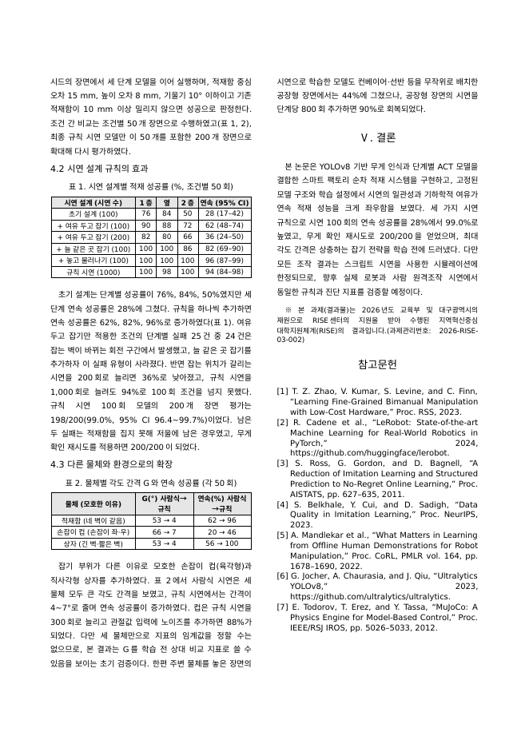
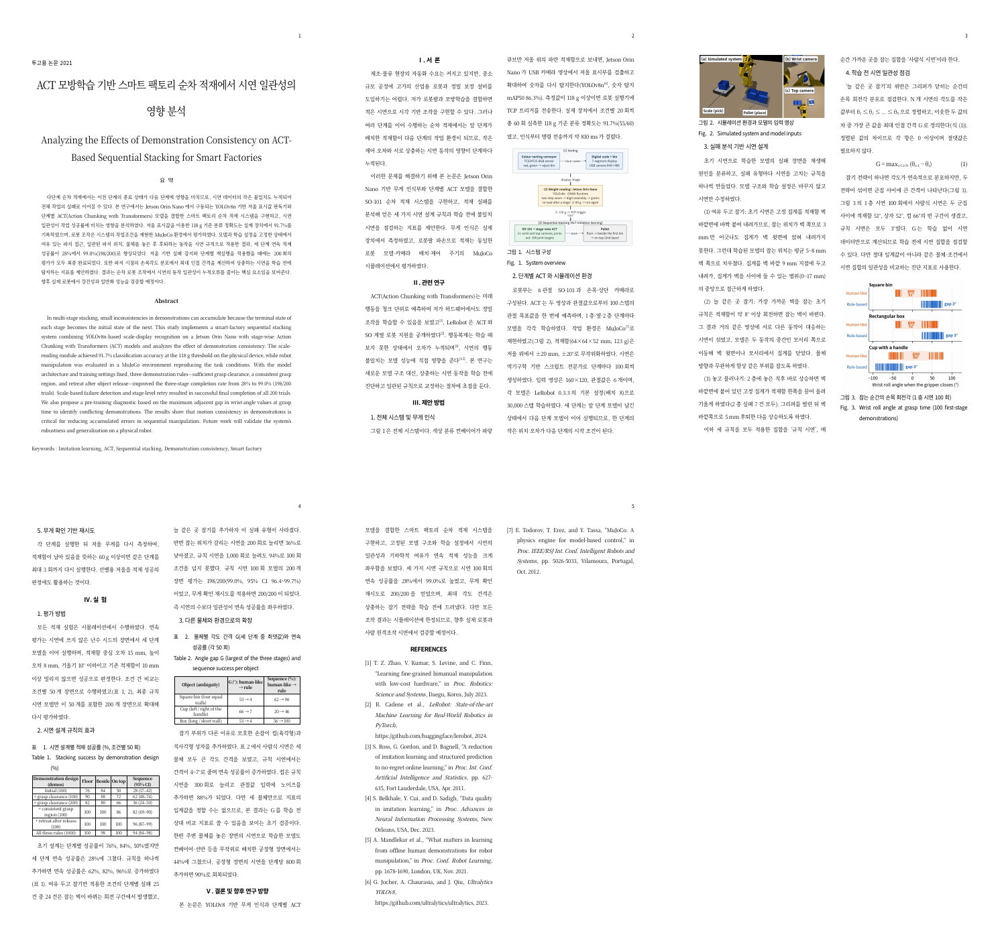
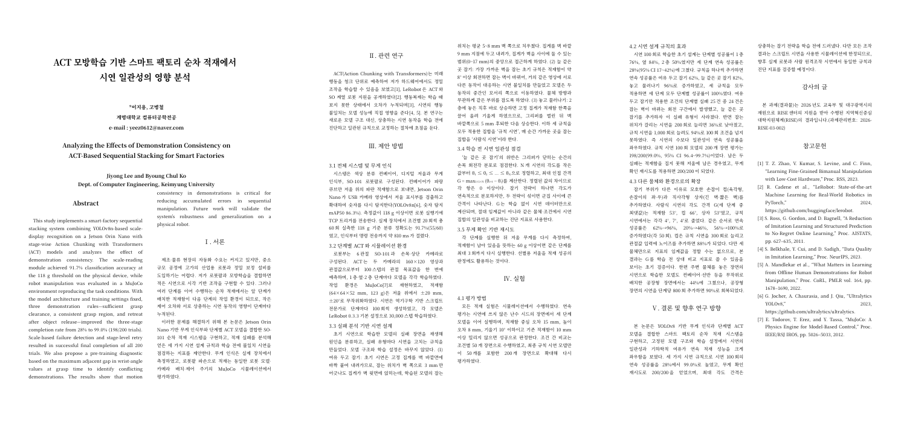

# 2026-10-14 (수) — 08 개인논문 ACT 적재

목표: 지도교수 검토 의견을 반영해 제출용 원고를 다시 만들기. 실험은 10/11 에 끝났고 오늘은 원고 작업만 함 (새 실험 없음).

## 제출 방식이 바뀜 — 학부생 논문경진대회

대한전자공학회 2026 추계학술대회 **학부생 논문경진대회**에 내기로 함. 안내에 따르면 파일을 **두 개** 냄 (마감 10/19).

| 제출 파일 | 양식 | 분량 | 저자 정보 |
|---|---|---|---|
| 프로시딩 게재용 | 학술대회 양식 (2단) | 1~5쪽 | 적음 |
| 서면 심사용 | 논문지 양식 | 4쪽 | **블라인드** (저자·소속 쓰면 탈락) |

- 지도교수 의견 "학술대회는 3쪽 정도로 줄이기" = **프로시딩 게재용**
- "학회 뒤에 7~8쪽으로 늘려 국내 논문지에 내기" = full paper (지금 제출하지 않음, 초안만 만들어 둠)
- 서면 심사용 4쪽은 위 둘과 별개의 파일

## 오늘 만든 원고 3개 (연구실 PC `~/ACT/제출_1014/`)

| 파일 | 쪽수 (연구실 PC 미리보기) | 내용 |
|---|---|---|
| 프로시딩 게재용 | 3쪽 | 교수님 수정본을 줄임. 그림 3, 표 2, 참고문헌 7 |
| 서면 심사용 (블라인드) | 4쪽 | 같은 내용을 논문지 양식으로. 그림·표 영문, 캡션 한글+영문, 저자 정보 없음 |
| full paper 초안 | 7쪽 | 교수님 수정본 전체 + 표 3개(공장 시연 수, 통합 정책, 팔레트 칸별)와 논의·한계 절 추가 |

이제 원고는 코드로 다시 만들지 않고 **교수님이 고친 docx 를 바탕으로** 고침 (`코드` 폴더 밖, 연구실 PC `act_sim/paper/prof/`).

## 검토 의견별로 한 일

| 의견 (요지) | 반영 |
|---|---|
| 학술대회용은 3쪽 정도로 | 프로시딩 게재용 3쪽 |
| 영문 초록을 절반으로 | 약 270단어 → 약 135단어 |
| 서론은 동기·목표, 관련 연구는 따로 | 교수님이 나눈 구조(서론 / 관련 연구 / 제안 방법 / 실험 / 결론) 유지 |
| 초기 시스템 성공률 문장은 실험에서 언급 | 서론에서 빼고 실험 절 첫 문장으로 |
| 기존 연구 문단은 저널에만 | 3쪽·4쪽에서는 빼고 full paper 에만 둠 |
| 조작 실험이 시뮬레이션에 한정됨을 밝히기 | 평가 방법 절 첫 문장과 결론에 명시 |
| 조건이 없는 DART 비교는 빼기 | 3쪽·4쪽에서 뺌. full paper 에는 조건(잡음 0.005 rad, 시연 1,000회)을 적고 넣음 |
| 글자 폰트 확인 | 본문 글꼴이 빠진 문단이 있었음 → 모두 HY신명조로 통일 |
| 50회 실험과 200회 검증의 관계 | 아래 "바로잡은 것" 참고 |
| 참고문헌 출처 재확인 | 18개를 출판사 페이지와 대조함 (RSS, PMLR, NeurIPS, ICLR, MakerWorld). 3쪽·4쪽은 7개로 줄임 |

### 바로잡은 것 — 200회 평가는 "별도 장면"이 아님

- 기본 비교(표): 조건별 **50개 장면** (장면 번호 0~49)
- 확대 평가: 최종 정책만 **장면 번호 0~199 를 다시 실행** = 기본 50개 장면 + 새 150개 장면 → 198/200
- 그래서 "별도의 200개 장면"이 아니라 **"50개를 포함한 200개 장면으로 확대해 다시 평가"** 라고 고쳐 씀
- 무게 확인 재시도(200/200)는 또 다른 200개 장면 실행 (첫 시도 198/200)

## 양식 대조 (경진대회 안내 페이지의 양식 파일)

| 제출 파일 | 안내 페이지의 양식 | 사용한 파일 | 확인 |
|---|---|---|---|
| 프로시딩 게재용 | `theieie_conference_2column.docx` (63,608 바이트) | 같은 파일 (63,608 바이트) | A4·여백·2단·글꼴·글자 크기 같음 |
| 서면 심사용 | `paper_sample02.docx` (64,919 바이트) | 같은 파일 (64,919 바이트) | 양식의 스타일 그대로 사용 |

양식 예시에 맞춰 고친 곳
- 프로시딩 게재용: 참고문헌 8pt → **9pt**, 장 제목 **앞뒤 빈 줄** (양식 예시와 같게). 고친 뒤에도 3쪽
- 서면 심사용: 캡션 번호를 양식처럼 `그림<탭>1.<탭>제목` / `Fig.<탭>1.<탭>Title`, 수식을 별도 줄로 빼고 끝에 **(1)**, 양식 예시 그림 파일이 문서 안에 남아 있던 것 삭제. 고친 뒤에도 4쪽
- 서면 심사용 양식의 요구: 한글 요약 + 영문 Abstract + 키워드 5개 이하, 그림·표는 영문, 캡션은 한글·영문 병기(마침표 없음), 참고문헌은 영문·서명 이탤릭·본문 인용은 위첨자 → 모두 맞춤

## 용어 통일 (세 원고 모두)

| 예전 단어 | 바꾼 단어 | 비고 |
|---|---|---|
| 통 | **적재함** (처음 나올 때 "파란 적재함") | 10/11 에 바꾼 것 그대로 |
| 셀 | **시스템 / 환경** | 10/11 에 바꾼 것 그대로 |
| 정책 | **모델** | 교수님 수정본에서 다시 "정책"으로 쓰여 있던 것을 세 원고 모두 "모델"로 통일 (프로시딩 14곳, 서면 심사용 15곳, full paper 39곳) |
| 잡음 | **노이즈** | 이번에 새로 바꿈 (1곳, 1곳, 12곳) |

- 영문 초록도 맞춤: policies → models, policy architecture → model architecture, smart-factory cells → systems
- 로봇 설계 파일을 뜻하던 "공식 SO-101 모델"은 "공식 SO-101 로봇 모델"로 써서 학습된 모델과 구분
- 바꾼 뒤 쪽수: 프로시딩 3쪽, 서면 심사용 4쪽, full paper 7쪽
- 10/11 까지의 이전 원고(`paper.docx`, `paper_v2.docx`)는 헷갈리지 않게 `논문/이전_1011/` 로 옮김 (용어는 예전 그대로)

## 지원 프로그램 안내 반영 — 사사 문구

학교의 재학생 학술논문경진대회 지원 프로그램(RISE) 안내문에 **발표 논문과 포스터에 사사 문구를 꼭 표기**하라고 되어 있는데, 지금까지의 원고에는 없었음.

> 본 과제(결과물)는 2026년도 교육부 및 대구광역시의 재원으로 RISE센터의 지원을 받아 수행된 지역혁신중심 대학지원체계(RISE)의 결과입니다.(과제관리번호: 2026-RISE-03-002)

| 원고 | 한 일 | 쪽수 |
|---|---|---|
| 프로시딩 게재용 | 결론 뒤에 작은 글씨(8pt) 한 문단으로 넣은 **추가본**을 따로 만듦 (`1_프로시딩게재용_3쪽_사사문구추가.docx`) | 3쪽 |
| 서면 심사용 (블라인드) | 넣지 않음. 지역·사업 이름이 소속을 짐작하게 할 수 있음 | 4쪽 그대로 |
| full paper 초안 | 참고문헌 앞에 "감사의 글" 절로 넣음 | 7쪽 |

- "감사의 글" 제목과 빈 줄을 두면 참고문헌 마지막 항목이 4쪽으로 넘어감 (넘친 양 41pt, 약 3줄) → 제목 없이 "※"로 시작하는 한 문단으로 줄임
- 참고문헌 줄 간격을 288 → 264 로 조금 줄임 (글자 크기 9pt 는 그대로). 3쪽 오른쪽 단에 약 41pt(3줄) 여유
- 지도교수 검토가 끝나면 최종본에 이 문구가 들어가 있는지 확인할 것

지원 서류(참가 등록비 신청서, 출장신청서·복명서, 정산서)는 개인정보가 들어가므로 이 저장소에 올리지 않음.

## 지도교수 최종 검토 반영 (오후) — 제출 파일 확정본

지도교수가 서면 심사용 파일에 직접 고친 내용(제목·요약·Abstract·서론 한 문장)과 메모 7개, 카카오톡 의견을 반영함.

| 의견 | 반영 |
|---|---|
| 제목은 핵심만 | **ACT 모방학습 기반 스마트 팩토리 순차 적재에서 시연 일관성의 영향 분석** (영문 Analyzing the Effects of Demonstration Consistency on ACT-Based Sequential Stacking for Smart Factories) — 세 원고와 지원비 서류 모두 |
| 요약·Abstract 구조: 주장 → 방법 → 실험 → 분석·향후 연구 | 교수님 문장 그대로 (정책 → 모델, policies → models 만 바꿈) |
| 취소줄 문장은 분량을 줄여야 할 때 삭제 | 서면 심사용: 남김 (취소줄만 없앰). 프로시딩: 초록을 줄이라는 10/13 의견에 맞춰 첫 문장 삭제 |
| 그림 1·3 크게, 심사용은 4쪽을 조금 넘어도 됨 | 그림 1~3 모두 단 폭 가득 (그림 1: 0.57 → 0.98), 표 글씨 7 → 8pt, 설명 보강 → **4쪽 반** |
| 수식: 절댓값인지 괄호인지 | 정렬한 각도의 이웃 차이라 항상 0 이상 → 보통 괄호 G = max (θ_{i+1} − θ_i), 표기도 θ_(i) → θ_i |
| "실제 로봇 검증은 향후 과제" 는 결론에서만 | 4.1 에서 삭제, 결론 장 이름을 "결론 및 향후 연구 방향" 으로 |
| 프로시딩은 그림·표 빼고 글과 참고문헌 위주 (학회 뒤 저널과 중복 방지) | 그림 3개·표 2개 삭제, 표의 숫자는 본문 글로 → **3쪽** |

보강한 설명 (서면 심사용, 일부는 프로시딩에도)
- 규칙마다 고친 실패: 잡는 위치가 벽 쪽으로 3 mm 만 어긋나도 집게가 벽 윗면에 얹힘(학습된 모델은 평균 5~8 mm 치우침) / 잡는 벽이 바뀌는 시연이 섞이면 모델이 두 동작의 중간인 모서리로 감 / 놓은 직후 상승하면 집게가 적재함을 끌어 올려 기울임(2층 실패 7건 모두) — 모두 10/7 일지의 분석
- 학습 설정(영상 160×120, 관절값 6개, 배치 8), 단계가 이어지며 오차가 다음 단계의 시작 조건이 된다는 점
- "시연의 수보다 일관성이 연속 성공률을 좌우" (200회 36%, 규칙 1,000회 94% < 100회 96%)

검토하다 바로잡은 것
- 그림 3(1층, 시연 100회)의 빈 구간은 적재함 51° · 상자 52° · 컵 66°, 규칙 시연 3° 인데, 보강 문장에 표 2 값(53°·4°)을 적었던 것을 고침. 표 2 는 **세 단계 중 최댓값**이라고 캡션과 본문에 밝힘
- 표 1 영문 규칙 이름을 초록과 같게 (retreat before lifting → retreat after release), 그림 3 영문 캡션에 "(100 first-stage demonstrations)"
- 프로시딩 소속 줄 글꼴을 양식처럼 HY신명조로

자동 점검 결과
- 용지·여백·단 설정이 양식 파일과 같음 (두 원고), 메모·변경 추적·취소줄·색 글씨 없음, 문서 속성의 작성자 비어 있음
- 서면 심사용: 이름·소속·e-mail·사사 문구·"대구" 등 블라인드 위반 문자열 없음 (그림 파일 안까지 확인)
- 두 원고의 수치는 결과 파일과 같음

제출 파일: `논문/제출_1014/1_프로시딩게재용_교수님1014반영.docx`, `2_서면심사용_블라인드_교수님1014반영.docx` (예전 판은 `이전/`)

## 쪽수에 대해 알아 둘 것

- 연구실 PC 에는 양식 글꼴(HY신명조)이 없어서 PDF 는 대체 글꼴로 만든 미리보기임. Word 에서 여는 PC 의 글꼴에 따라 줄 간격이 달라져 쪽수가 조금 달라짐
- 줄 간격이 넓은 경우와 좁은 경우 두 가지로 확인: 프로시딩 3쪽 / 3쪽, 서면 심사용 4쪽 / 4쪽, full paper 8쪽 / 7쪽
- 제출 전에 Windows Word 에서 쪽수를 한 번 더 확인할 것

## 남은 일 (사람이 할 일)

- [ ] 저자 구성 확정
- [x] 사사 문구가 들어간 프로시딩 게재용 (교수님 1014 반영본에 포함)
- [ ] Windows Word 에서 쪽수 확인: 프로시딩 ≤ 5쪽(목표 3쪽), 서면 심사용 4쪽
- [ ] 서면 심사가 블라인드이므로 이 저장소(공개)의 공개 범위를 제출 기간 동안 어떻게 할지 결정
- [ ] 저자 중 1명 이상 대한전자공학회 회원인지 확인
- [ ] 10/19(월)까지 경진대회 전용 링크로 두 파일 업로드
