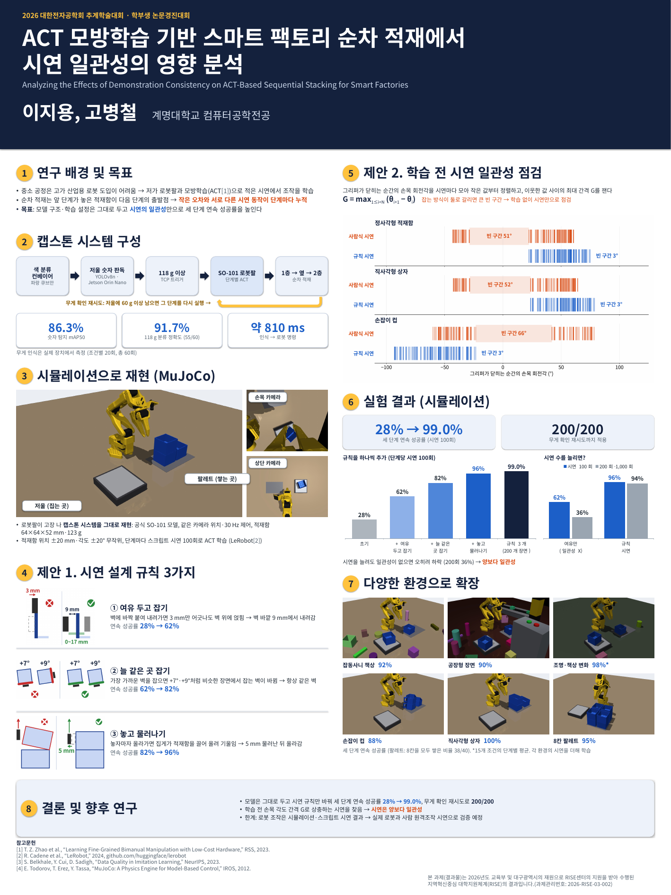

# 2026-10-31 (토) — 08 개인논문 ACT 적재: 학회 포스터

목표: 대한전자공학회 2026 추계학술대회 포스터 세션(11/27~28)에 붙일 포스터 만들기. 새 실험 없음 — 숫자는 모두 논문과 같음.

## 학회 포스터 양식 찾기

- 학회가 주는 포스터 **파일 양식(템플릿)은 없음**: 2023~2026 추계·하계 학술대회의 "논문발표 안내", "논문제출 안내", "학부생 논문경진대회" 페이지와 학회 본 사이트 자료실(2006년 논문 양식 2개), 논문양식 게시판(논문지 양식 4개)을 모두 확인
- 정해진 것은 **패널 견본 그림 + 크기·글자 규정**뿐: 패널 100 × 180 cm, 제목·저자·소속 90 × 20 cm (하계는 50 × 20 cm), 글자 제목·저자 25~30 mm / 장 제목 15~20 mm / 내용 7~10 mm, A4 12장·B4 10장·전지 1장 중 하나
- 인터넷 검색에는 유료 포스터 템플릿(크몽)만 나옴

## 만든 포스터 — 90 × 120 cm 한 장

| 구역 | 내용 |
|---|---|
| 제목 띠 (90 × 20 cm) | 제목 2줄 84 pt (29.6 mm), 영문 제목, 저자 72 pt (25.4 mm), 소속 |
| 1 연구 배경 및 목표 | 순차 적재에서 오차·시연 불일치가 쌓이는 문제, 목표 |
| 2 캡스톤 시스템 구성 | 흐름도(컨베이어 → 저울 판독 → TCP 트리거 → SO-101 단계별 ACT → 적재, 무게 확인 재시도), 실측 86.3% / 91.7% / 약 810 ms |
| 3 시뮬레이션으로 재현 | 새로 렌더한 장면(1600 × 1200) + 손목·상단 카메라 화면 |
| 4 제안 1. 시연 설계 규칙 3가지 | 규칙마다 전(✗)·후(✓) 개념도 + 연속 성공률 28 → 62 → 82 → 96% |
| 5 제안 2. 학습 전 시연 점검 | G 정의, 손목 각도 그림(사람식 51~66° / 규칙 3°) |
| 6 실험 결과 | 28% → 99.0%, 200/200, 막대그래프 2개(규칙 추가 / 시연 수 늘리기 — 파워포인트 차트라 숫자 고칠 수 있음) |
| 7 다양한 환경으로 확장 | 잡동사니 92%, 공장형 90%, 조명·책상 변화 98%(15조건 단계 평균), 컵 88%, 상자 100%, 8칸 팔레트 95% |
| 8 결론 및 향후 연구 | 3줄 |
| 아래 | 참고문헌 4개, RISE 사사 문구 (지원비 조건) |

- 그림은 논문 그림(400 × 300 px, 인쇄하면 약 75 dpi)을 쓰지 않고 **같은 장면·같은 전문가·같은 카메라로 1600 × 1200 다시 렌더**함 (`render_scenes.py`, 메모리 제한 유닛에서 7분). 8칸 팔레트 렌더에서 전문가가 8칸 모두 성공
- 손목 각도 그림과 규칙 개념도는 **인쇄 크기로 그려** 그림 안 글자도 7 mm 이상
- 글꼴은 맑은 고딕(Windows 기본). 이 PC 미리보기는 Noto Sans CJK 로 대신 그림 — 맑은 고딕이 조금 좁아서 Windows 에서는 줄이 덜 넘어감
- 포스터 파일 (`논문/포스터/`): 고칠 때 pptx, 인쇄소용 PDF(90 × 120 cm, 글꼴 포함)

## 남은 일 (사람이 할 일)

- [ ] 교수님 확인 (특히 그림·표가 들어간 점 — 포스터는 논문집에 실리지 않음)
- [ ] 학교·연구실 로고를 넣을지 결정 (제목 띠 오른쪽 빈자리)
- [ ] 인쇄소에 PDF 로 90 × 120 cm 출력 주문 (학회 전까지)
