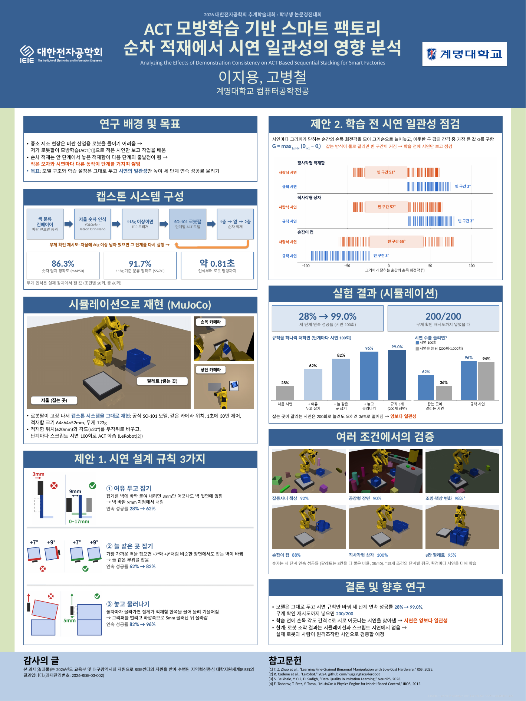
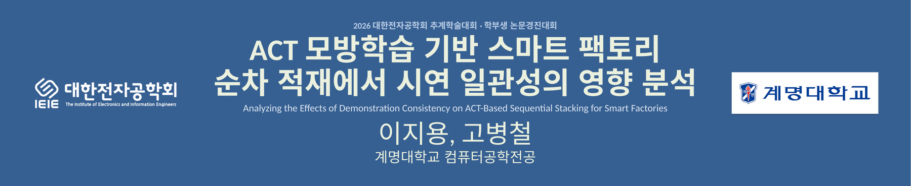
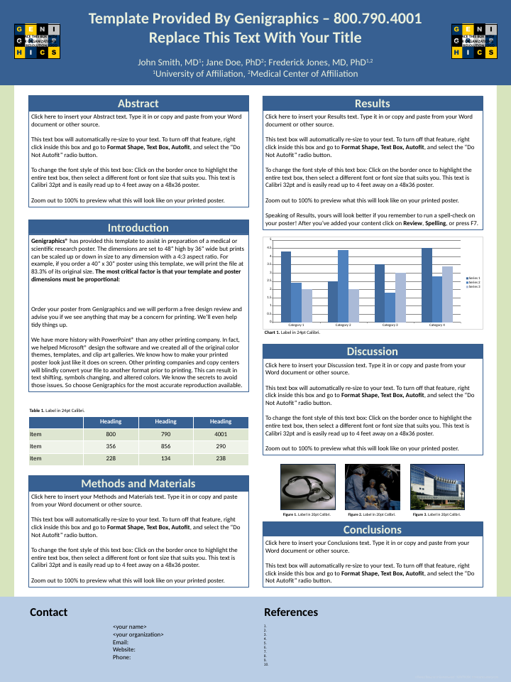

# 2026-11-04 (수) — 08 개인논문 ACT 적재: 포스터를 무료 템플릿으로 다시 만듦 + 학회·학교 로고

요청: 10/31 에 직접 디자인한 포스터 대신 **인터넷에 공개된 템플릿**을 쓰고, **대한전자공학회·계명대학교 마크**를 넣기. 새 실험은 없고, 내용과 숫자는 10/31 포스터와 같다.

## 결과 — 90 × 120 cm 한 장

제목 띠 (왼쪽 대한전자공학회, 오른쪽 계명대학교):

## 템플릿

| 항목 | 내용 |
|---|---|
| 고른 템플릿 | Genigraphics 연구 포스터 템플릿, Standard Design, 세로 48″ × 36″ (`PPTX-Genigraphics-Poster-Template-48x36.pptx`, 513 KB) |
| 출처 | genigraphics.com/templates |
| 라이선스 | **CC BY-SA 4.0**. 오른쪽 아래 템플릿 출처 줄을 그대로 둠 |
| 고른 이유 | 라이선스가 분명함. 세로 3 : 4 라서 90 × 120 cm 에 비율 그대로 맞음 (0.984배). 제목 띠 양옆에 로고 자리가 있음 |
| 그대로 쓴 것 | 파란 제목 띠, 양옆 띠, 아래 띠, 섹션 제목 막대(파란 칸 + 흰 글씨), 테두리 상자, 테마 색(Office)·글꼴(Calibri + 맑은 고딕) |
| 바꾼 것 | 제목 띠 높이 152 → 185 mm (학회 규정 90 × 20 cm 안). 아래 띠 150 → 84 mm. 단 너비 388 → 400 mm. 템플릿 예시 글·사진·차트와 바깥 안내문은 지움. 'Contact' → 감사의 글 (RISE 사사), 'References' → 참고문헌 |

받은 그대로의 템플릿:

- 다른 후보: PosterPresentations.com 은 다운로드 페이지가 검색되지 않았다. 다른 검색 결과는 출처가 불분명한 복사 사이트라 쓰지 않았다.

## 로고

| 로고 | 어디서 | 처리 |
|---|---|---|
| 대한전자공학회 (정식 로고, 흰색) | 학회 공식 브로셔 표지 (`brochure_kor_20260109.pdf`, 16.5 MB) | 홈페이지에는 작은 이미지만 있다 (228 × 50, 80주년판 496 × 159 + 슬로건). 브로셔 표지의 401 × 85 px 로고를 투명 배경으로 바꾸고 가장자리를 매끄럽게 5배 확대했다 (2080 × 510). 파란 제목 띠 위에 바로 놓음 |
| 계명대학교 (교표 방패형 시그니처, 좌우 조합, 한글) | 계명대 홈페이지 → 학교소개 → 계명상징 → 로고마크 자료실 | 2000 × 768 원본에서 흰 여백만 잘라 냈다 (1654 × 295). 흰 상자 안에 넣음 |

- 처음에는 80주년 로고(컬러)를 쓰려 했다. 사용자가 브로셔의 정식 로고가 낫다고 해서 그것으로 바꿨다. 80주년 로고는 기념판이고 슬로건이 붙어 있다.
- 처음 확대본은 영문 작은 글씨 획 일부가 끊겼다. 경계값을 0.32~0.68 에서 0.10~0.50 으로 바꿔 획을 살렸다.
- 학회 로고를 더 선명하게 하려면 학회 사무국에 원본(AI)을 요청할 수 있다. 지금 판도 미리보기에서 가장자리가 깨끗하다.

## 학회 글자 규정 확인

| 항목 | 규정 | 이 포스터 |
|---|---|---|
| 제목·저자·소속 칸 | 90 × 20 cm | 90 × 18.5 cm 제목 띠 |
| 제목·저자 | 25~30 mm | 제목 84 pt (29.6 mm), 저자 72 pt (25.4 mm) |
| 장 제목 | 15~20 mm | 54 pt (19.1 mm) |
| 내용 | 7~10 mm | 본문 21~24 pt (7.4~8.5 mm), 주석·참고문헌 19~20 pt |

## 내용 확인 (10/31 판과 자동 비교)

- 두 pptx 의 글자를 뽑아 숫자·단어를 비교했다. 빠진 것은 섹션 번호 배지 1~8 뿐이다 (템플릿 제목 막대에는 번호가 없음). 늘어난 것은 '감사의 글' 제목뿐이다.
- 그래프 안 한글 라벨: LibreOffice 는 차트 안에서 숫자와 한글 사이에 빈칸을 넣는다 ("200 회"). 그래서 막대 이름과 범례를 차트 밖 글상자로 그리고, 막대 위치에 맞췄다. 막대 숫자는 파워포인트 차트 그대로라 고칠 수 있다.
- 제목 띠 줄 간격을 고정값(pt)으로 해서 PowerPoint(맑은 고딕)와 LibreOffice(Noto Sans CJK)에서 줄 위치가 같다.
- 파일 검사(pptx 스키마 검사) 통과. PDF 는 900 × 1200 mm 이고 글꼴이 모두 들어 있다.

## 파일

- 포스터: [`논문/포스터/`](../논문/포스터/) — pptx(고칠 때), PDF(인쇄소용), 미리보기 PNG. 10/31 판은 `이전_1031_자체디자인/` 으로 옮김
- 코드: [`코드/paper/poster/make_poster_tpl.py`](../코드/paper/poster/make_poster_tpl.py) (템플릿 판), `logos_prep.py` (로고 손질), `set_thumbnail.py` (파일 썸네일), `template/`, `logos/` (출처 README 포함)

## 남은 일 (사람이 할 일)

- [ ] 교수님 확인
- [ ] 인쇄소에 PDF 로 90 × 120 cm 출력 주문 (학회 11/27 전까지)

## 추가: 단위 표기 고침 (사용자 요청 "ms 이런 단어들 전체적으로 수정")

| 전 | 후 |
|---|---|
| 약 810 ms (인식 → 로봇 명령) | 약 0.81초 |
| 30 Hz 제어 | 1초에 30번 제어 |
| 3 mm, 9 mm, 0~17 mm, 5 mm, ±20 mm, 64×64×52 mm | 3mm, 9mm, 0~17mm, 5mm, ±20mm, 64×64×52mm (숫자에 붙여 씀) |
| 118 g, 60 g, 123 g | 118g, 60g, 123g |

- mm·g·° 는 흔히 쓰는 단위라 그대로 두고 띄어쓰기만 없앴다. 규칙 개념도 그림 속 글자(3mm, 9mm, 0~17mm, 5mm)도 다시 그렸다 (`fig_poster.py` → `prep_images.py`).
- 영어 약어(mAP50, TCP 트리거, YOLOv8n, Jetson Orin Nano)는 그대로 둠.

## 추가: 어색한 한글 문장 다듬기 (사용자 요청 "나머지 한글도 어색한 부분 고쳐줘")

뜻과 숫자는 그대로 두고 말만 다듬었다. 규칙 설명은 논문 본문(집게가 벽 윗면에 얹힘, 벽 바깥 9mm, 그리퍼를 벌리고 바깥쪽으로 5mm 후퇴)과 맞췄다.

| 구역 | 전 | 후 |
|---|---|---|
| 배경 | 중소 공정은 고가 산업용 로봇 도입이 어려움 → 저가 로봇팔과 모방학습(ACT)으로 적은 시연에서 조작을 학습 | 중소 제조 현장은 비싼 산업용 로봇을 들이기 어려움 → 저가 로봇팔이 모방학습(ACT)으로 적은 시연만 보고 작업을 배움 |
| 배경 | 작은 오차와 서로 다른 시연 동작이 단계마다 누적 | 작은 오차와 시연마다 다른 동작이 단계를 거치며 쌓임 |
| 목표 | …시연의 일관성만으로 세 단계 연속 성공률을 높인다 | …시연의 일관성만 높여 세 단계 연속 성공률 올리기 |
| 캡스톤 | 파랑 큐브만 / 저울 숫자 판독 / 118g 이상 / 단계별 ACT | 파란 큐브만 통과 / 저울 숫자 인식 / 118g 이상이면 / 단계별 ACT 모델 |
| 캡스톤 | 숫자 탐지 mAP50 / 118g 분류 정확도 / 인식 → 로봇 명령 | 숫자 탐지 정확도 (mAP50) / 118g 기준 분류 정확도 / 인식부터 로봇 명령까지 |
| 시뮬레이션 | 적재함 위치 ±20mm·각도 ±20° 무작위 | 적재함 위치(±20mm)와 각도(±20°)를 무작위로 바꾸고 |
| 규칙 ① | 벽에 바짝 붙여 내려가면 3mm만 어긋나도 벽 위에 얹힘 → 벽 바깥 9mm에서 내려감 | 집게를 벽에 바짝 붙여 내리면 3mm만 어긋나도 벽 윗면에 얹힘 → 벽 바깥 9mm 지점에서 내림 |
| 규칙 ② | …잡는 벽이 바뀜 → 항상 같은 벽 | …비슷한 장면에서도 잡는 벽이 바뀜 → 늘 같은 부위를 잡음 |
| 규칙 ③ | 놓자마자 올라가면 집게가 적재함을 끌어 올려 기울임 → 5mm 물러난 뒤 올라감 | 놓자마자 올라가면 집게가 적재함 한쪽을 끌어 올려 기울어짐 → 그리퍼를 벌리고 바깥쪽으로 5mm 물러난 뒤 올라감 |
| 점검 | …작은 값부터 정렬하고, 이웃한 값 사이의 최대 간격 G를 잰다 / 큰 빈 구간 → 학습 없이 시연만으로 점검 | …크기순으로 늘어놓고, 이웃한 두 값의 간격 중 가장 큰 값 G를 구함 / 빈 구간이 커짐 → 학습 전에 시연만 보고 점검 |
| 결과 그래프 | 초기 / 여유만 (일관성 X) / 규칙 시연 / 200회 · 1,000회 | 처음 시연 / 잡는 곳이 갈리는 시연 / 규칙 시연 / 시연을 늘림 (200회·1,000회) |
| 결과 | 시연을 늘려도 일관성이 없으면 오히려 하락 (200회 36%) | 잡는 곳이 갈리는 시연은 200회로 늘려도 오히려 36%로 떨어짐 |
| 결론 | 상충하는 시연을 찾음 / 한계: 로봇 조작은 시뮬레이션·스크립트 시연 결과 → … 검증 예정 | 서로 어긋나는 시연을 찾아냄 / 한계: 로봇 조작 결과는 시뮬레이션과 스크립트 시연에서 얻음 → 실제 로봇과 사람이 원격조작한 시연으로 검증할 예정 |

- 그대로 둔 것: 제목(제출한 논문 제목), 규칙 이름 3개, RISE 사사 문구(정해진 문구), 그림 속 '사람식 시연'·'규칙 시연'(논문에서 정의한 용어), 영어 약어.
- 결론 상자가 2줄 늘어서 결과 그래프 높이를 132 → 124mm, 점검 그림 폭을 388 → 380mm 로 줄였다. 그래프 범례는 두 줄로 쌓음.
- 섹션 제목 '다양한 환경으로 확장' → **'여러 조건에서의 검증'** (사용자 선택). 환경마다 그 환경의 시연을 더해 학습했으므로, '일반화'처럼 처음 보는 환경에서 통한다는 뜻으로 읽히는 말은 피했다.
