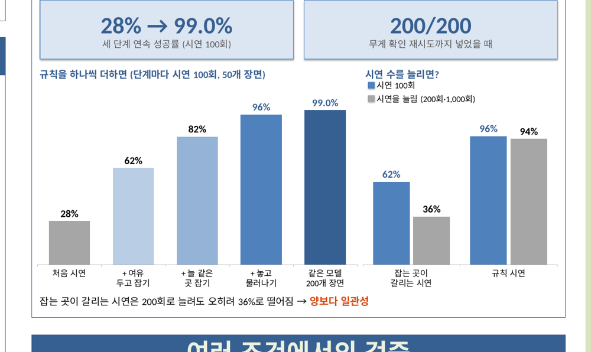
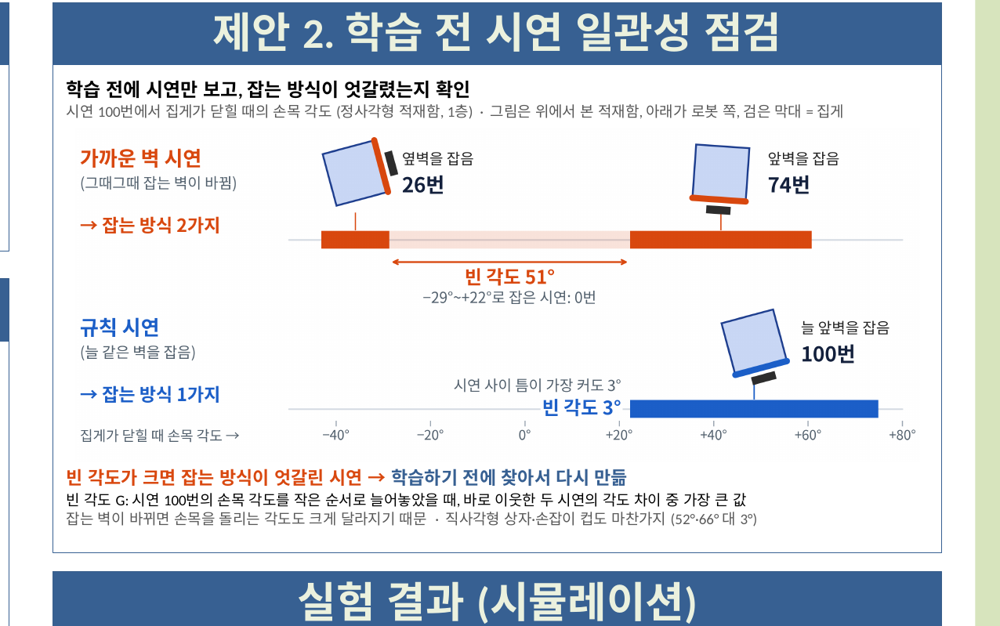

# 2026-11-16 (월) — 08 개인논문 ACT 적재: 포스터 다시 검토, 4곳 고침

요청: 학회(11/28 포스터 세션 5, 07번) 전에 포스터를 한 번 더 검토. 새 실험은 없고 숫자도 바꾸지 않았다.

## 검토 — 논문 원문과 대조

- 포스터의 숫자를 서면 심사용 원고(표 1, 본문)와 하나씩 맞춰 봤다. 틀린 숫자는 없었다.
- 용어 규칙(적재함·모델·노이즈·TCP 트리거)과 학회 규정(글자 크기, 90 × 120 cm 가 판 100 × 180 cm 에 들어감)을 지켰다. 사사 문구도 있다.
- 사진 해상도: 가장 큰 장면 사진 145 ppi, 나머지 200 ppi 이상. 96 ppi 짜리는 상자 그림자뿐이다.

## 고친 것

| | 전 | 후 | 이유 |
|---|---|---|---|
| 1 | 막대 이름 "규칙 3개 (200개 장면)", 제목 "(단계마다 시연 100회)" | "같은 모델 200개 장면", 제목 "(단계마다 시연 100회, 50개 장면)" | 96%(48/50)와 99.0%(198/200)는 **같은 모델**을 50개·200개 장면에서 잰 값이다. 막대가 이어져 있어 무언가를 더해 오른 것처럼 보였다 |
| 2 | ③ "그리퍼를 벌리고" | "집게를 벌리고" | 나머지는 모두 "집게" |
| 3 | 참고문헌 [3]·[4] 본문 인용 없음 | 배경 "…단계를 거치며 쌓임[3]", 시뮬레이션 "MuJoCo[4]로 …" | 논문도 [Belkhale] 을 시연 불일치 문장에 인용 |
| 4 | "무게 인식은 실제 장치에서 잰 값 (조건별 20회, 총 60회)" | "분류 정확도는 실제 장치에서 잰 값 (…)" | 86.3% 는 숫자 탐지 모델의 mAP50 이라 60회 실측 값이 아니다 |

## 제안 1 그림에 "집게" 이름 붙이기 (사용자 요청)

검은 직사각형이 집게(그리퍼)라는 것을 처음 보는 사람도 알 수 있게, 세 그림에 "집게" 이름과 가는 선을 넣었다 (`fig_poster.py` 의 `tag()`).

- ① 오른쪽(✓): 검은 집게와 회색 집게를 위에서 한 괄호로 묶음 → 두 손가락이 한 집게라는 것이 보임. "9mm" 글자와 겹치지 않게 괄호를 그 위로 지나가게 했고, ✗·✓ 표시는 조금 위로 옮김
- ② 왼쪽(✗): 첫 상자 앞의 검은 막대에 "집게". ✗ 표시와 붙어 보이지 않게 ✗·✓ 표시를 오른쪽으로 2 단위 옮김
- ③ 왼쪽(✗): 기울어진 적재함 옆 검은 막대에 "집게"

글자 크기는 다른 그림 글자와 같은 20 pt (인쇄 약 8~9 mm).

- 이어서 반대쪽 검은 막대에도 모두 "집게"를 붙여 봤지만 (② 는 이름이 4개가 됨), 사용자가 **전으로 되돌리기**로 함 → 그림마다 "집게" 하나씩인 위 판으로 되돌림 (커밋 96f1d5b 의 포스터·`fig_poster.py`)

(같은 날 앞서 사용자에게 보인 확인용 그림에서 "+7° +9°" 가 잘려 보였던 것은 두 부분을 잘라 이어 붙인 경계선 때문이었고, 포스터 자체는 잘린 곳이 없었다.)

## 제안 2 그림을 새로 그림 (사용자 요청)

사용자가 반원 그림을 봐도 무슨 말인지 모르겠다고 했다. 지금까지 쓴 그림(반원 눈금, 점 반원, 막대 히스토그램, 줄 그림)과 다른 방식으로 다시 그렸다 (`fig_poster.py` 의 `audit_groups()`, 포스터는 `img/audit_groups.png`).

- 시연마다 **어떻게 잡았는지**를 위에서 본 적재함 그림으로 보여 줌 (아래가 로봇 쪽, 검은 막대 = 집게, 제안 1 ② 그림과 같은 모양)
- 그 아래 한 줄 눈금에 그 무리의 **손목 각도 범위**를 막대로 표시
  - 사람식 시연: 옆벽을 잡음 26번 (−43~−29°) / 앞벽을 잡음 74번 (+22~+61°) → 사이 **빈 각도 51°** → 잡는 방식 2가지
  - 규칙 시연: 늘 앞벽을 잡음 100번 (+22~+75°) → **빈 각도 3°** → 잡는 방식 1가지
- 무리 ↔ 벽 대응: 규칙 시연은 늘 같은 벽(로봇 쪽 −x 벽)을 잡고, 그 각도 범위(+22~+75°)가 74번 무리(+22~+61°)를 담는다. 26번 무리는 그 밖이라 다른 벽이다. 사람식 시연은 적재함이 약 +10° 넘게 돌면 옆벽으로 바꿔 잡아서, 26% 가 옆벽이다 (`expert.py` v2b 설명, `minority_share` 0.26)
- 포스터 설명 줄도 "손목 방향을 반원에 표시" → "손목 각도 · 그림은 위에서 본 적재함, 아래가 로봇 쪽, 검은 막대 = 집게" 로 바꿈. 발표 대본의 제안 2 문단도 앞벽 74번·옆벽 26번으로 맞춤

- 이어서 사용자가 "사람식 시연"의 어감이 이상하다고 함 (사람이 직접 한 시연처럼 들림). 포스터에서는 **"가까운 벽 시연"** (그때그때 잡는 벽이 바뀜) 으로 바꿈. 위 그림이 바뀐 판이다
  - 제출한 논문은 "사람식 시연" 그대로라, 발표 대본 예상 질문에 "가까운 벽 시연 = 논문의 사람식 시연" 을 적어 둠

## 포스터 전체 다시 검토: 어감 고친 곳 8개 (사용자 확인 후)

사용자가 "학습 전에 고친다"의 어감을 짚었고, 전체를 다시 보며 어색한 곳을 모아 확인받은 뒤 모두 고쳤다. 숫자는 바꾸지 않았다.

| 칸 | 전 | 후 |
|---|---|---|
| 제안 2 | 빈 각도가 크면 → 잡는 방식이 엇갈린 시연 → 학습 전에 고친다 | 빈 각도가 크면 잡는 방식이 엇갈린 시연 → 학습하기 전에 찾아서 다시 만듦 |
| 제안 2 | 직사각형 상자·손잡이 컵도 같음 | …도 마찬가지 |
| 결론 | 학습 전에 손목 각도 간격 G로 서로 어긋나는 시연을 찾아냄 → 시연은 양보다 일관성 (화살표 앞뒤가 안 이어짐, G 이름도 다름) | 두 줄로: 시연 수를 늘려도 나아지지 않음 (200회 36%, 1,000회 94%) → 시연은 양보다 일관성 / 빈 각도 G로 잡는 방식이 엇갈린 시연을 학습하기 전에 찾아낼 수 있음 |
| 실험 결과 | 그래프 "잡는 곳이 갈리는 시연" | "가까운 벽 시연" (제안 2와 같은 이름), 아래 줄 "가까운 벽 시연(잡는 벽이 바뀜)은 200회로 늘려도 오히려 36%로 떨어짐" |
| 제안 1 ② | → 늘 같은 부위를 잡음 | → 적재함이 돌아가도 늘 같은 벽을 잡음 |
| 캡스톤 | 숫자 탐지 정확도 (mAP50) | 숫자 탐지 성능 (mAP50) — mAP 는 정확도가 아님 |
| 시뮬레이션 | 로봇팔이 고장 나서 | 실제 로봇팔이 파손되어 |
| 검증 | *15개 조건의 단계별 평균. 환경마다 시연을 더해 학습 | *조명·책상 15개 조건의 단계별 평균. 조건마다 시연을 더해 학습 |

- 결론이 3줄 → 4줄이 됐지만 칸 안에 들어감. 칸 사이 여백은 왼쪽 12.5 mm, 오른쪽 11.1 mm 로 전과 같음
- 발표 대본도 같은 말로 맞춤 ("가까운 벽 시연", "학습하기 전에 찾아서 다시 만들 수 있습니다")

## "빈 각도"를 처음 듣는 사람도 알게 (사용자 요청)

"3°가 무슨 말인지, 뭐가 벌어진 건지" 모르겠다는 의견. 포스터와 대본에 무엇과 무엇 사이가 벌어진 것인지 적었다.

- 그림: 51° 아래에 "−29°~+22°로 잡은 시연: 0번" (처음엔 "이 사이에는 시연이 하나도 없음" 이었으나 사용자가 무슨 말인지 모르겠다고 해서, 위의 26번·74번과 같은 꼴의 숫자로 바꿈), 3° 위에 "시연 사이 틈이 가장 커도 3°"
- 그림 아래 설명 (2줄 → 3줄):
  - 빈 각도가 크면 잡는 방식이 엇갈린 시연 → 학습하기 전에 찾아서 다시 만듦
  - 빈 각도 G: 시연 100번의 손목 각도를 작은 순서로 늘어놓았을 때, 바로 이웃한 두 시연의 각도 차이 중 가장 큰 값
  - 잡는 벽이 바뀌면 손목을 돌리는 각도도 크게 달라지기 때문 · 직사각형 상자·손잡이 컵도 마찬가지 (52°·66° 대 3°)
- 제안 2 칸이 8 mm 길어져 오른쪽 칸 사이 여백이 11.1 → 8.4 mm (왼쪽 12.5 mm 그대로)
- 대본 제안 2 문단을 자세히 (무엇을 재는지 → 왜 손목인지 → 3° 와 51° 가 뜻하는 것), 약 1분 반. 예상 질문에 "빈 각도가 정확히 뭔가요? (키 순서 비유)", "왜 손목 각도를 보나요?" 추가

## 질문 대비

- 손잡이 컵 88% 는 규칙 시연 100회로는 46% 였고, 규칙 시연 300회 + 관절 노이즈로 88% 가 됐다. "양보다 일관성인데 컵은 시연을 늘렸다"는 질문에는 "일관성을 먼저 맞춘 뒤에는 늘린 양이 도움이 됐다"고 답한다.

## 발표 대본

[`논문/포스터/발표대본.md`](../논문/포스터/발표대본.md): 약 2분 대본(포스터 칸 순서대로), 30초판, 예상 질문 7개. 숫자는 포스터·논문과 같다.

## 파일

- [`논문/포스터/`](../논문/포스터/) pptx · PDF(인쇄소용) · 미리보기 갱신, pptx 파일 검사 통과
- 만드는 코드: [`코드/paper/poster/make_poster_tpl.py`](../코드/paper/poster/make_poster_tpl.py)

## 다음

- [ ] 교수님 확인
- [ ] 인쇄소에 PDF 로 90 × 120 cm 출력 (11/28 전까지)
