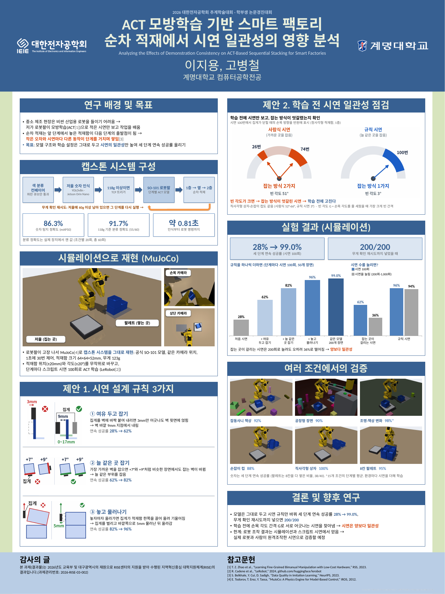
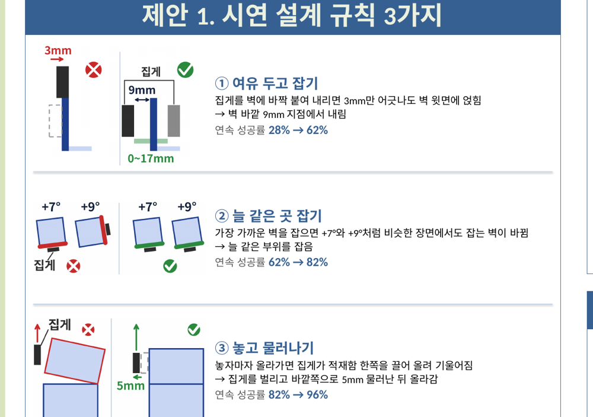

# 2026-11-16 (월) — 08 개인논문 ACT 적재: 포스터 다시 검토, 4곳 고침

요청: 학회(11/28 포스터 세션 5, 07번) 전에 포스터를 한 번 더 검토. 새 실험은 없고 숫자도 바꾸지 않았다.

## 검토 — 논문 원문과 대조

- 포스터의 숫자를 서면 심사용 원고(표 1, 본문)와 하나씩 맞춰 봤다. 틀린 숫자는 없었다.
- 용어 규칙(적재함·모델·노이즈·TCP 트리거)과 학회 규정(글자 크기, 90 × 120 cm 가 판 100 × 180 cm 에 들어감)을 지켰다. 사사 문구도 있다.
- 사진 해상도: 가장 큰 장면 사진 145 ppi, 나머지 200 ppi 이상. 96 ppi 짜리는 상자 그림자뿐이다.

## 고친 것

| | 전 | 후 | 이유 |
|---|---|---|---|
| 1 | 막대 이름 "규칙 3개 (200개 장면)", 제목 "(단계마다 시연 100회)" | "같은 모델 200개 장면", 제목 "(단계마다 시연 100회, 50개 장면)" | 96%(48/50)와 99.0%(198/200)는 **같은 모델**을 50개·200개 장면에서 잰 값이다. 막대가 이어져 있어 무언가를 더해 오른 것처럼 보였다 |
| 2 | ③ "그리퍼를 벌리고" | "집게를 벌리고" | 나머지는 모두 "집게" |
| 3 | 참고문헌 [3]·[4] 본문 인용 없음 | 배경 "…단계를 거치며 쌓임[3]", 시뮬레이션 "MuJoCo[4]로 …" | 논문도 [Belkhale] 을 시연 불일치 문장에 인용 |
| 4 | "무게 인식은 실제 장치에서 잰 값 (조건별 20회, 총 60회)" | "분류 정확도는 실제 장치에서 잰 값 (…)" | 86.3% 는 숫자 탐지 모델의 mAP50 이라 60회 실측 값이 아니다 |

## 제안 1 그림에 "집게" 이름 붙이기 (사용자 요청)

검은 직사각형이 집게(그리퍼)라는 것을 처음 보는 사람도 알 수 있게, 세 그림에 "집게" 이름과 가는 선을 넣었다 (`fig_poster.py` 의 `tag()`).

- ① 오른쪽(✓): 검은 집게와 회색 집게를 위에서 한 괄호로 묶음 → 두 손가락이 한 집게라는 것이 보임. "9mm" 글자와 겹치지 않게 괄호를 그 위로 지나가게 했고, ✗·✓ 표시는 조금 위로 옮김
- ② 왼쪽(✗): 첫 상자 앞의 검은 막대에 "집게". ✗ 표시와 붙어 보이지 않게 ✗·✓ 표시를 오른쪽으로 2 단위 옮김
- ③ 왼쪽(✗): 기울어진 적재함 옆 검은 막대에 "집게"

글자 크기는 다른 그림 글자와 같은 20 pt (인쇄 약 8~9 mm).

- 이어서 반대쪽 검은 막대에도 모두 "집게"를 붙여 봤지만 (② 는 이름이 4개가 됨), 사용자가 **전으로 되돌리기**로 함 → 그림마다 "집게" 하나씩인 위 판으로 되돌림 (커밋 96f1d5b 의 포스터·`fig_poster.py`)

(같은 날 앞서 사용자에게 보인 확인용 그림에서 "+7° +9°" 가 잘려 보였던 것은 두 부분을 잘라 이어 붙인 경계선 때문이었고, 포스터 자체는 잘린 곳이 없었다.)

## 질문 대비

- 손잡이 컵 88% 는 규칙 시연 100회로는 46% 였고, 규칙 시연 300회 + 관절 노이즈로 88% 가 됐다. "양보다 일관성인데 컵은 시연을 늘렸다"는 질문에는 "일관성을 먼저 맞춘 뒤에는 늘린 양이 도움이 됐다"고 답한다.

## 발표 대본

[`논문/포스터/발표대본.md`](../논문/포스터/발표대본.md): 약 2분 대본(포스터 칸 순서대로), 30초판, 예상 질문 7개. 숫자는 포스터·논문과 같다.

## 파일

- [`논문/포스터/`](../논문/포스터/) pptx · PDF(인쇄소용) · 미리보기 갱신, pptx 파일 검사 통과
- 만드는 코드: [`코드/paper/poster/make_poster_tpl.py`](../코드/paper/poster/make_poster_tpl.py)

## 다음

- [ ] 교수님 확인
- [ ] 인쇄소에 PDF 로 90 × 120 cm 출력 (11/28 전까지)
