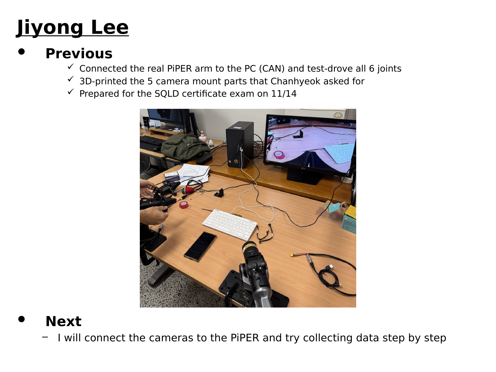
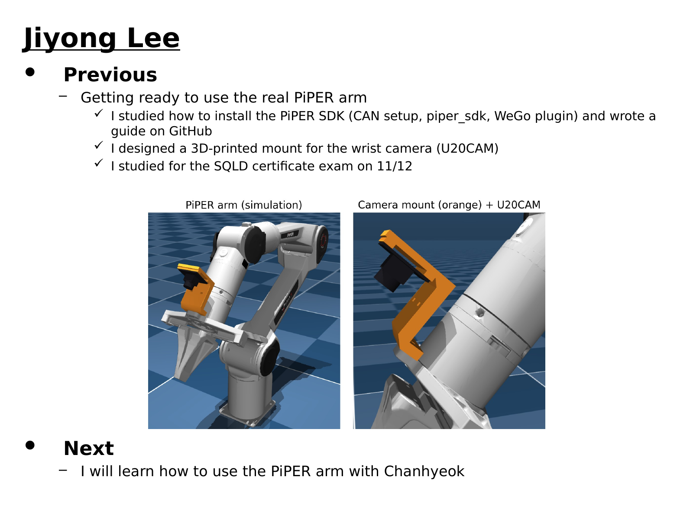
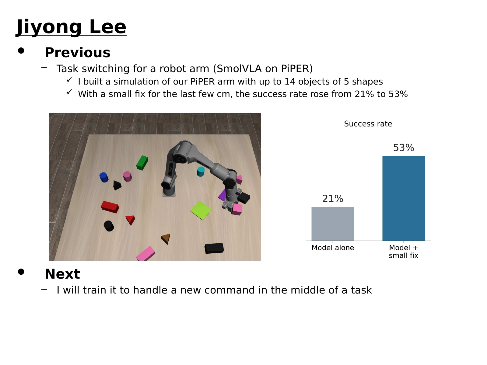
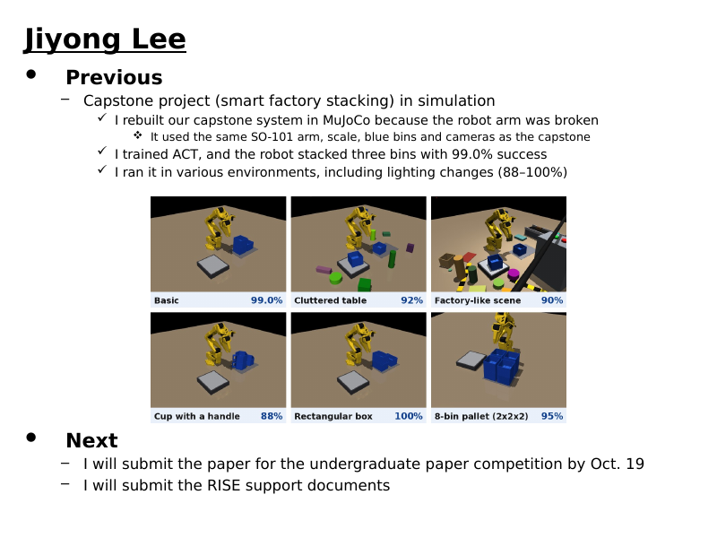

# 09 주간보고

연구실 랩미팅 주간보고(슬라이드)와 발표 대본을 날짜별로 모은 폴더입니다. 대본은 영어 문장 아래에 한글 해석을 달았고, 교수님이 물어보실 만한 질문과 답도 같이 적었습니다.

## 목록

| 날짜 | 내용 | 슬라이드 | 대본 |
|---|---|---|---|
| [2026-11-13](#2026-11-13) | 실물 PiPER 첫 시험 조종 (CAN 연결, 관절 6개), 찬혁님 부탁 카메라 마운트 부품 5개 3D 프린트, 11/14 SQLD 시험 준비. 다음은 PiPER 에 카메라를 연결해 데이터 수집을 하나씩 해 보기 | [pptx](2026-11-13/주간보고_11_13_이지용.pptx) | [약 30초 + 예상 질문 5개](2026-11-13/대본_11_13.md) |
| [2026-11-12](#2026-11-12) | 실물 PiPER 준비: PiPER SDK 설치법 조사·설명서, U20CAM 손목 카메라 3D 프린트 마운트 설계, 11/12 SQLD 공부. 다음은 찬혁님과 PiPER 사용법 배우기 | [pptx](2026-11-12/주간보고_11_12_이지용.pptx) | [약 30초 + 예상 질문 6개](2026-11-12/대본_11_12.md) |
| [2026-10-29](#2026-10-29) | PiPER 디지털 트윈(모양 5가지, 물체 최대 14개)에서 SmolVLA 로 집어 옮기기. VLA 혼자 21%, 마지막 몇 cm 를 맞추는 보정 단계를 더하면 53% | [pptx](2026-10-29/주간보고_10_29_이지용.pptx) | [약 30초 + 예상 질문 14개](2026-10-29/대본_10_29.md) |
| [2026-10-14](#2026-10-14) | 캡스톤 적재 시스템을 시뮬레이션으로 다시 만들고 여러 환경에서 실행 (기본 99.0%, 잡동사니 92%, 공장형 90%, 컵 88%, 상자 100%, 8칸 팔레트 95%) | [pptx](2026-10-14/주간보고_10_14_이지용.pptx) | [약 1분 + 예상 질문 19개](2026-10-14/대본_10_14.md) |

## 작성 규칙 (연구실 선배 안내)

| 항목 | 규칙 |
|---|---|
| 양식 | 연구실 주간보고 pptx (표지 1장 + 내용 1장), 영어 |
| Previous | 과거형 또는 현재완료형, 문장 끝에 마침표 없음, 교수님이 다시 묻지 않게 구체적으로 |
| 사진 | 참고 슬라이드처럼 그림을 붙임 |
| Next | 미래형 (I will ...) |

슬라이드는 날짜 폴더의 `코드/make_weekly_*.py` 로 만듭니다. 연구실 주간보고 양식 파일을 입력으로 받고, 양식 파일 자체는 올리지 않습니다.

## 2026-11-13

- Previous: 11/12 실물 PiPER 를 CAN 으로 PC 에 연결해 관절 6개를 움직여 봄. 같은 날 자세 8개에서 손 위치를 시뮬레이션 모델과 비교 (늘 같은 6.3 mm 어긋남을 빼면 평균 2.7 mm, 최대 4.6 mm, 근거 `real_piper/reference/fk_check_2026-11-12.json`). 사용자 요청으로 이 숫자 줄은 슬라이드에서 빼고 대본 예상 질문에만 쉬운 말로 남김
- Previous: 찬혁님이 부탁한 카메라 마운트 부품 5개 3D 프린트 완료
- Previous: 11/14 SQLD 시험 준비 (발표가 시험 전날이라 '준비했다'로 씀)
- Next: PiPER 에 카메라를 연결해 데이터 수집을 하나씩 해 보기
- 그림: 11/12 연구실 사진 (그리퍼에 단 마운트, 뽑은 부품, 모니터의 손목 카메라 화면, 실물 PiPER). 사진 속 설명 글자는 사용자 요청으로 뺌. 원본 사진은 올리지 않고 자른 그림만 올림
- 그리퍼는 11/12 에 명령에 반응하지 않았음 — 대본 예상 질문 3번
- 그림은 `코드/fig_weekly_1113.py`, 슬라이드는 `코드/make_weekly_1113.py`

## 2026-11-12

- Previous: PiPER SDK 설치법 조사 (CAN 설정, piper_sdk, WeGo 플러그인) → [12_PiPER_조작법_및_설치법](../12_PiPER_조작법_및_설치법/README.md). 사용자 요청대로 '설치법까지만' 적음
- Previous: U20CAM 손목 카메라 3D 프린트 마운트 → [손목카메라_마운트_U20CAM](../11_실물_PiPER/손목카메라_마운트_U20CAM/README.md). 그림은 시뮬레이션 렌더 (아직 뽑지 않음)
- Previous: 11/12 SQLD 자격증 시험 공부
- Next: 찬혁님과 PiPER 사용법 배우기
- 날짜는 10/14·10/29 다음 2주 간격으로 11/12 로 잡음
- 최종 슬라이드는 사용자가 손으로 고친 것 (첫 줄 짧게, GitHub 링크 줄). 그 위에 체크 글머리(10/14 처럼)·흰 배경만 넣음 — 편집기가 슬라이드를 양식의 다른 마스터(초록 캠퍼스 그림)로 옮겨도 흰색이 되게 슬라이드에 흰 배경과 마스터 그림 숨김을 직접 넣었다
- 그림은 `코드/fig_weekly_1112.py`, 슬라이드는 `코드/make_weekly_1112.py`

## 2026-10-29

- 그림 왼쪽: 물체 13개가 놓인 '물체 많음' 장면 (시뮬레이션). 오른쪽: 일 1개 성공률 (3cm 안), 세 설정(기본·흔든 환경·물체 많음) × 50장면 = 150개 일, w7 모델
- VLA 혼자 32/150 (21%), 판 안에 놓은 것 47/150. 보정 단계(일지의 '다듬기')를 더하면 80/150 (53%), 판 안 83/150. 보정이 바꾼 동작은 전체의 약 17%
- 일 2개 끼어들기(A 를 옮기는 도중 B 명령)는 기본 설정 20장면 중 6장면에서 둘 다 성공. 대본의 예상 질문 11번에 적음
- 숫자의 근거: [10/28 일지](../03_일지/2026-10-28.md) 5절, [PiPER 결과물](../06_결과물/PiPER/README.md)
- 슬라이드에는 전문 용어(VLA, digital twin, pick and place)를 쓰지 않고 쉬운 말로 적음. 모델·로봇 이름(SmolVLA, PiPER)만 남김
- SmolVLA 작업을 처음 보고하는 자리라 대본 첫머리에 무엇인지 한 줄씩 넣음. 대본은 짧은 문장 8개 (약 30초)
- 그림은 `코드/fig_weekly_1029.py`, 슬라이드는 `코드/make_weekly_1029.py`

## 2026-10-14

- 그림: 시뮬레이션의 여러 환경과 세 단계 연속 성공률 (8칸 팔레트는 8개 모두 쌓은 비율). 각 환경의 시연으로 학습한 모델의 결과이며, 조명·책상 변화(15조건 단계 평균 98%)는 글로만 적음
- 가장 어려운 조건(공장형 + 조명·책상 변화 함께)은 약 60% — 대본의 예상 질문에 적음
- 숫자의 근거: [08_개인논문_ACT적재 일지 10/7](../08_개인논문_ACT적재/일지/2026-10-07.md), [10/14](../08_개인논문_ACT적재/일지/2026-10-14.md)
- 슬라이드는 `코드/make_weekly_1014.py`
