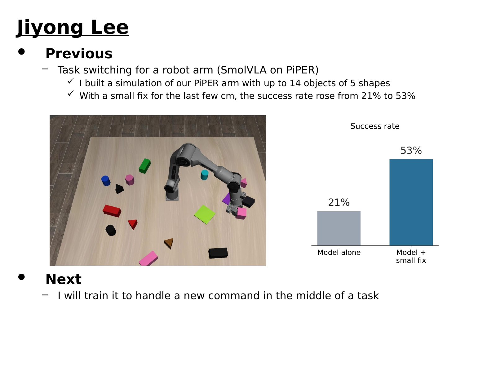
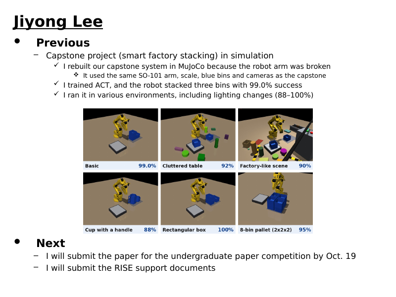

# 09 주간보고

연구실 랩미팅 주간보고(슬라이드)와 발표 대본을 날짜별로 모은 폴더입니다. 대본은 영어 문장 아래에 한글 해석을 달았고, 교수님이 물어보실 만한 질문과 답도 같이 적었습니다.

## 목록

| 날짜 | 내용 | 슬라이드 | 대본 |
|---|---|---|---|
| [2026-10-29](#2026-10-29) | PiPER 디지털 트윈(모양 5가지, 물체 최대 14개)에서 SmolVLA 로 집어 옮기기. VLA 혼자 21%, 마지막 몇 cm 를 맞추는 보정 단계를 더하면 53% | [pptx](2026-10-29/주간보고_10_29_이지용.pptx) | [약 1분 + 예상 질문 14개](2026-10-29/대본_10_29.md) |
| [2026-10-14](#2026-10-14) | 캡스톤 적재 시스템을 시뮬레이션으로 다시 만들고 여러 환경에서 실행 (기본 99.0%, 잡동사니 92%, 공장형 90%, 컵 88%, 상자 100%, 8칸 팔레트 95%) | [pptx](2026-10-14/주간보고_10_14_이지용.pptx) | [약 1분 + 예상 질문 19개](2026-10-14/대본_10_14.md) |

## 작성 규칙 (연구실 선배 안내)

| 항목 | 규칙 |
|---|---|
| 양식 | 연구실 주간보고 pptx (표지 1장 + 내용 1장), 영어 |
| Previous | 과거형 또는 현재완료형, 문장 끝에 마침표 없음, 교수님이 다시 묻지 않게 구체적으로 |
| 사진 | 참고 슬라이드처럼 그림을 붙임 |
| Next | 미래형 (I will ...) |

슬라이드는 날짜 폴더의 `코드/make_weekly_*.py` 로 만듭니다. 연구실 주간보고 양식 파일을 입력으로 받고, 양식 파일 자체는 올리지 않습니다.

## 2026-10-29

- 그림 왼쪽: 물체 13개가 놓인 '물체 많음' 장면 (시뮬레이션). 오른쪽: 일 1개 성공률 (3cm 안), 세 설정(기본·흔든 환경·물체 많음) × 50장면 = 150개 일, w7 모델
- VLA 혼자 32/150 (21%), 판 안에 놓은 것 47/150. 보정 단계(일지의 '다듬기')를 더하면 80/150 (53%), 판 안 83/150. 보정이 바꾼 동작은 전체의 약 17%
- 일 2개 끼어들기(A 를 옮기는 도중 B 명령)는 기본 설정 20장면 중 6장면에서 둘 다 성공. 대본의 예상 질문 10번에 적음
- 숫자의 근거: [10/28 일지](../03_일지/2026-10-28.md) 5절, [PiPER 결과물](../06_결과물/PiPER/README.md)
- 슬라이드에는 전문 용어(VLA, digital twin, pick and place)를 쓰지 않고 쉬운 말로 적음. 모델·로봇 이름(SmolVLA, PiPER)만 남김
- SmolVLA 작업을 처음 보고하는 자리라 대본 첫머리에 무엇을 왜 하는지 두 문장을 넣음
- 그림은 `코드/fig_weekly_1029.py`, 슬라이드는 `코드/make_weekly_1029.py`

## 2026-10-14

- 그림: 시뮬레이션의 여러 환경과 세 단계 연속 성공률 (8칸 팔레트는 8개 모두 쌓은 비율). 각 환경의 시연으로 학습한 모델의 결과이며, 조명·책상 변화(15조건 단계 평균 98%)는 글로만 적음
- 가장 어려운 조건(공장형 + 조명·책상 변화 함께)은 약 60% — 대본의 예상 질문에 적음
- 숫자의 근거: [08_개인논문_ACT적재 일지 10/7](../08_개인논문_ACT적재/일지/2026-10-07.md), [10/14](../08_개인논문_ACT적재/일지/2026-10-14.md)
- 슬라이드는 `코드/make_weekly_1014.py`
