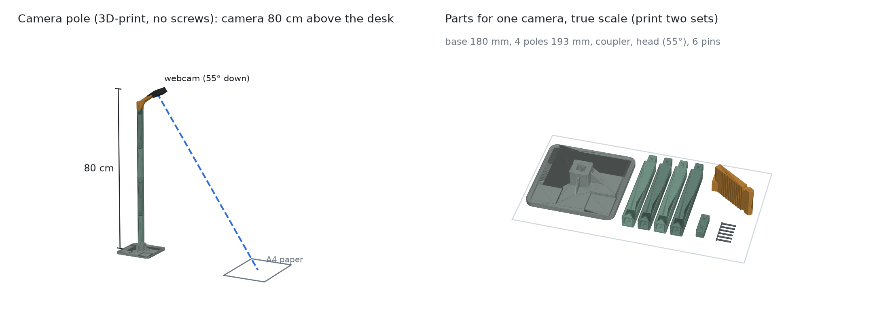

# 카메라 높은 기둥 (나사 없음)

연구실 웹캠 두 대(ABKO APC930)를 책상 위 80 cm 에 두고 55° 아래를 보게 하는 기둥이다. 11/17 의 C920 스탠드([../stand](../stand/README.md))와 같은 설계에서 높이만 올렸다. 두 대에 쓰니 **같은 것을 두 벌** 출력한다.

나사, 볼트, 접착제는 쓰지 않는다.
- 카메라는 원래 달린 모니터 집게로 건다. 기둥 꼭대기가 기울어진 "가짜 모니터 모서리"(두께 12 mm 판)라서, 모니터 위에 올리듯 걸치면 판이 기운 만큼 아래를 본다.
- 기둥은 24 mm 네모 막대 4개를 끼워 잇고, 출력한 핀을 꽂아 빠지지 않게 한다.



## 부품 (카메라 하나 몫)

STL 은 출력할 자세로 이미 눕혀 놓았다.

| 파일 | 개수 | 크기 (mm) | 하는 일 |
|---|---|---|---|
| `stl/1_base_x1.stl` | 1 | 180 × 180 × 42 | 받침대. 네 귀퉁이 홈에 동전·너트·모래주머니를 넣어 무게를 더한다 |
| `stl/2_pole_segment_x4.stl` | 4 | 24 × 193 × 24 | 기둥 막대. 아래에 촉, 위에 구멍 |
| `stl/3_coupler_x1.stl` | 1 | 16 × 50 × 16 | 기둥 맨 위와 머리를 잇는 양쪽 촉 |
| `stl/4_head_55deg_x1.stl` | 1 | 92 × 87 × 60 | 카메라를 거는 머리 (55° 아래) |
| `stl/4_head_45deg_x1.stl`, `4_head_65deg_x1.stl` | 필요하면 1 | | 덜 숙이거나 더 숙이고 싶을 때 |
| `stl/5_pins_x6.stl` | 1 판 (핀 6개) | 지름 3 mm | 이음마다 하나씩 (5개 + 남는 것 1) |

부품 7가지 모두 빈틈없이 닫힌 모양(manifold)인지 확인했다. 막대가 촉까지 193 mm 라서 프린터 판이 200 mm 보다 작으면 `--segments 5` 로 다시 만든다.

## 놓는 자리

| 머리 | 카메라 가운데 높이 | 기둥에서 카메라까지 (사람 쪽) | 기둥에서 종이 + 까지 |
|---|---|---|---|
| 45° | 81.6 cm | 8.1 cm | 86.7 cm |
| **55° (기본)** | **80.0 cm** | **9.3 cm** | **63.2 cm** |
| 65° | 78.2 cm | 10.2 cm | 45.3 cm |

카메라를 옮겼으니 처음 켤 때 종이 모서리 보정부터 다시 한다 (사용설명서 5절).

## 출력과 조립

출력 설정과 조립 순서는 [C920 스탠드 설명](../stand/README.md#출력-설정)과 같다. PLA, 층 0.2 mm, 벽 3줄, 채움 20~30%, 받침 없음, 막대는 가장자리(brim) 켜기.

## 다시 만들기

```bash
python make_stand.py                     # stl/ 과 preview.png
python render.py                         # render.png (주간보고 그림)
python make_stand.py --cam-height 900 --segments 5   # 더 높이
python make_stand.py --panel 15          # 집게가 헐거우면 판을 두껍게
```
manifold3d, numpy, matplotlib 가 필요하다.

## 아직 확인하지 않은 것

- 출력해 보지 않았다.
- APC930 은 판매처 정보에 '클립형'(모니터 집게)으로 적혀 있어서 이 걸이 방식과 맞다. 하지만 본체 크기와 집게가 벌어지는 폭은 인터넷에서 찾지 못했고 재 보지도 않았다. 12 mm 판을 모니터처럼 잡을 것으로 보고 만들었다. 렌더링 속 카메라는 C920 크기를 대강 그린 상자다.
- 80 cm 기둥이 18 cm 받침으로 넘어지지 않는지는 세워 봐야 안다. 받침 홈에 무게를 넣는 것을 권한다.
- 높은 곳에서 손이 더 잘 보이는지는 측정해 보지 않았다 (11/27 주간보고의 다음 할 일).
