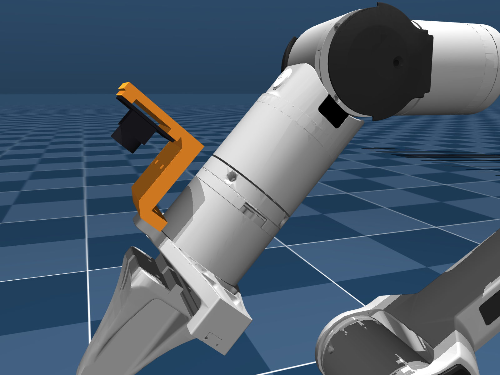
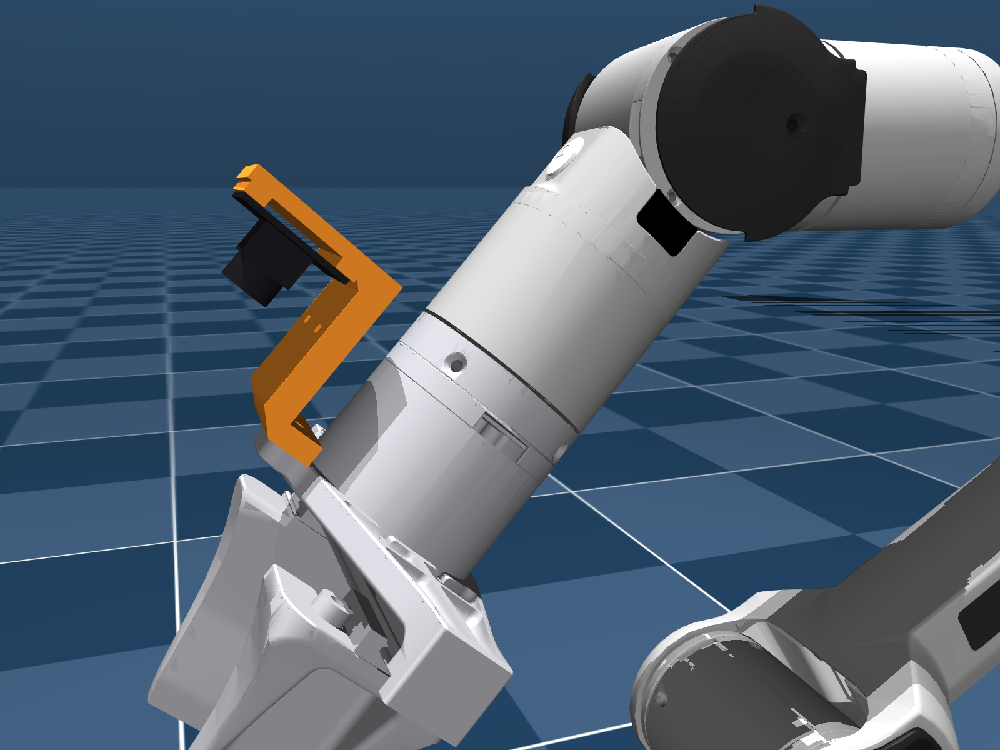
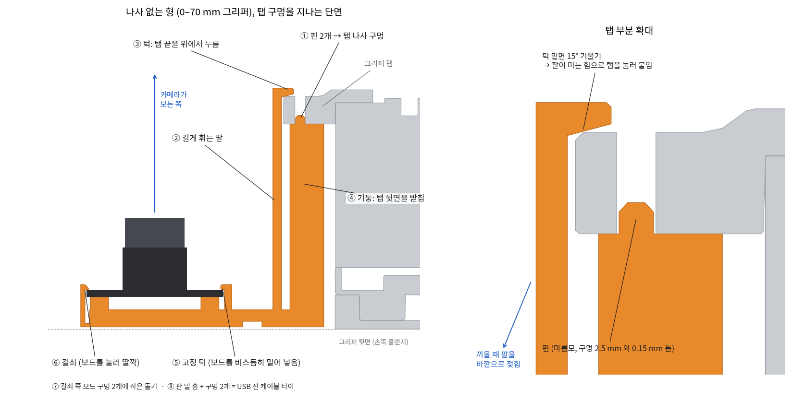
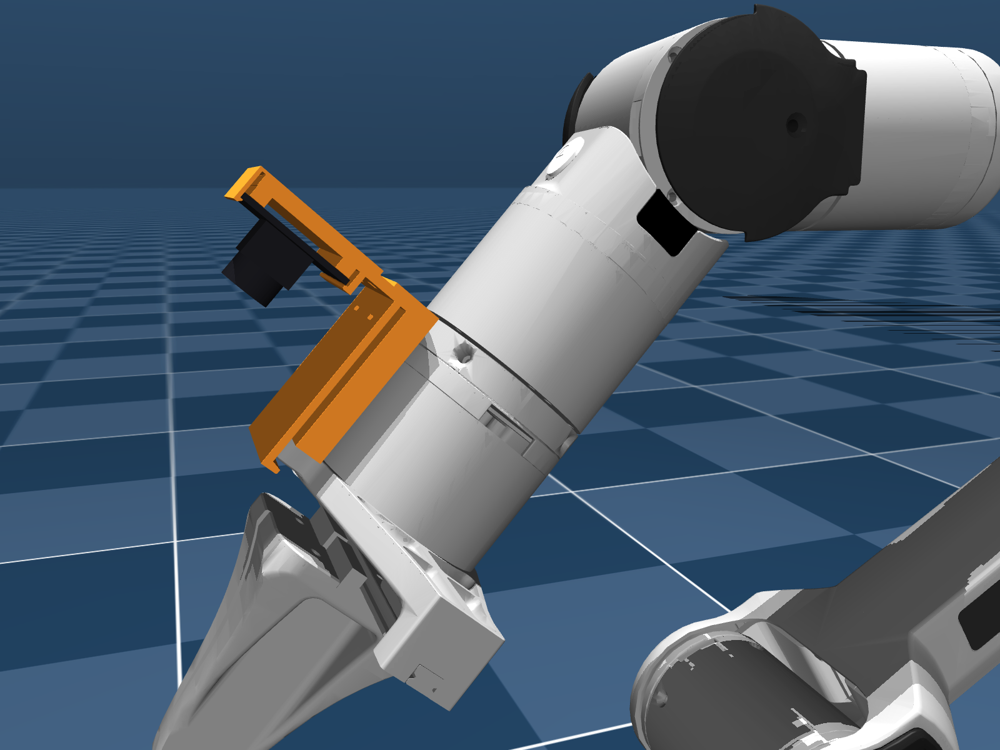
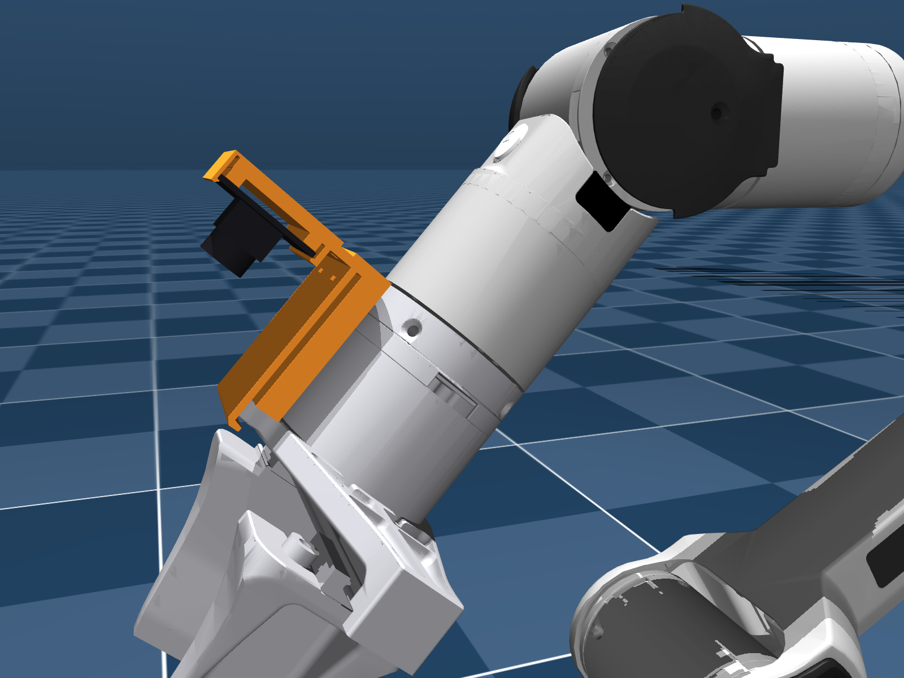
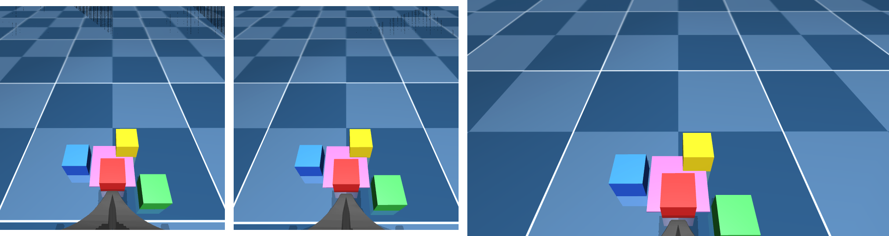

# PiPER 손목 카메라 마운트 — U20CAM 용 (0–70 mm형, 0–100 mm형)

> 2026-11-05. 연구실 손목 카메라 Innomaker **U20CAM**(32×32 mm USB 보드, M12 렌즈)을 PiPER 그리퍼에 다는 3D 프린트 부품이다.
> 그리퍼 손가락 판 옆의 탭에 M3 나사 2개로 붙인다. AgileX가 "카메라 설치 자리"로 남겨 둔 곳이고, 구멍 2개가 12 mm 간격으로 있다.
> 카메라는 **시뮬레이터 손목 카메라와 같은 자리**에 온다. J6 축에서 탭 쪽으로 70 mm 떨어져 손가락 방향을 똑바로 본다.
> 그래서 실물 손목 화면이 시뮬에서 학습한 VLA가 보던 화면과 비슷해진다.
>
> 나사 없이 손으로 끼우는 형도 있다 (11/5 오후, [아래 절](#나사-없는-형-115-오후-추가)).
>
> **아직 뽑아서 끼워 보지 않았다.** 아래 "확인한 것"은 모두 CAD와 시뮬 검사다.

| 0–70 mm형 | 0–100 mm형 |
|---|---|
|  |  |

주황색이 마운트, 검은색이 U20CAM이다. 카메라 모양은 보드·렌즈 홀더·렌즈를 어림잡아 그렸다.

## 나사 없는 형 (11/5 오후 추가)

> 나사 6개(M3 2, M2 4)와 M2 너트 4개 없이 손으로 끼우는 판이다. 카메라 자리와 뽑는 방향은 나사형과 같다.
> 이것도 **아직 뽑아서 끼워 보지 않았다.** 아래 숫자는 CAD·시뮬 검사와 보 공식 어림이다.



| 0–70 mm형 | 0–100 mm형 |
|---|---|
|  |  |

**어떻게 잡나**
- **그리퍼 쪽**
  - 기둥이 탭 밑을 받친다. 기둥 위의 핀 2개가 탭 나사 구멍에 들어가 앞뒤·좌우를 잡는다.
    - 구멍은 지름 2.5 mm이고 앞뒤로 뚫려 있다. 핀은 마름모 단면(대각선 2.2 mm)이라 0.15 mm 틈이 있다.
  - 길이 약 50 mm의 휘는 팔이 탭 바깥 끝을 돌아 올라간다. 끝의 턱이 탭 앞면 모서리를 위에서 누른다.
  - 턱 밑면이 15° 기울어 있다. 팔이 안쪽으로 미는 힘이 마운트를 탭 쪽으로 당겨 붙인다. 그래서 탭 두께가 0.3 mm쯤 달라도 흔들리지 않는다.
  - 뽑은 모양에서는 팔 끝이 1.2 mm 안쪽으로 기울어 있다. 끼우면 그만큼 바깥으로 밀리면서 누르는 힘이 생긴다.
- **카메라 보드 쪽**
  - 기둥 쪽 가장자리를 고정 턱 밑으로 비스듬히 밀어 넣는다.
  - 반대쪽 가장자리를 누르면 걸쇠(두께 1 mm인 얇은 벽)가 휘었다가 딸깍 걸린다.
  - 걸쇠 쪽 보드 구멍 2개에 작은 돌기(높이 1.2 mm)가 들어가 보드가 미끄러지지 않는다.
  - 돌기는 대각선 1.4 mm로 가늘게 했다. 보드 구멍 간격이 27.0~28.2 mm 중 어느 값이어도 들어간다.

**준비물:** 케이블 타이 1개 (폭 4 mm 이하, USB 선 묶기). 나사·너트는 필요 없다.

**뽑기:** 나사형과 같다. 옆으로 눕혀 뽑으면 받침이 필요 없다. 크기는 약 55~57 × 56~58 mm, 높이 36 mm다.
- 아래로 향한 면은 케이블 타이 구멍 2개의 천장(폭 2.5 mm 다리)뿐이다.
- 무게는 꽉 채우면 PLA 약 32 g, 채움 40%면 약 17 g으로 어림한다.
- 걸쇠와 팔이 휘는 부품이라 **PETG를 권한다.** PLA도 되지만 여러 번 빼고 끼우면 걸쇠가 약해질 수 있다.

**끼우기**
1. **보드:** 렌즈가 앞(손가락 쪽)을 보게 들고, 기둥 쪽 가장자리를 고정 턱 밑에 비스듬히 넣는다.
   - 반대쪽 가장자리를 눌러 걸쇠에 건다. 돌기 2개가 보드 구멍에 들어갔는지 본다.
   - 화면 방향은 나사형 조립 2번과 같다. 긴 변이 손가락이 벌어지는 방향이 되게 한다.
2. **그리퍼:** 팔 위쪽을 손가락으로 바깥으로 3~4 mm 젖힌다.
   - 핀 2개를 탭 구멍에 맞춰 마운트를 탭 뒷면까지 밀어 올리고, 팔을 놓는다. 턱이 탭 앞면 모서리에 걸린다.
3. **빼기:** 팔을 바깥으로 젖히고 마운트를 플랜지 쪽으로 내린다.
   - 보드는 걸쇠를 손톱으로 바깥으로 젖히고 들어낸다.
4. **선:** USB 선은 판 위 걸쇠 벽과 팔 사이로 지나게 한다. 판의 구멍 2개와 밑면 홈에 케이블 타이를 끼워 묶는다.
   - 홈이 있어 타이가 플랜지 면 뒤로 나가지 않는다.
   - 선이 팔 바깥쪽을 누르지 않게 한다. 팔은 끼울 때 바깥으로 젖혀진다.

**확인한 것 (CAD·시뮬, 11/5)**

| 검사 | 0–70 mm형 | 0–100 mm형 |
|---|---|---|
| 그리퍼와 겹침 | 0 mm³ | 0 mm³ (AgileX STEP 솔리드 13개. 손가락 판은 0.01 mm 떼고 계산) |
| 핀 ~ 탭 구멍 벽 | 0.15 mm | 0.15 mm |
| 턱 ~ 탭 앞면 모서리 | 0.03 mm (닿음) | 0.03 mm (닿음) |
| 그 밖에서 그리퍼와 가장 가까운 곳 | 0.31 mm | 0.40 mm |
| 플랜지 면 뒤로 나간 곳 | 없음 (z ≥ 0.5 mm) | 없음 |
| 0–70 손가락(link7·8, z ≥ 63.5 mm)과 | 떨어짐 (마운트는 z ≤ 56.4) | (STEP 손가락은 위 겹침 검사에 포함) |
| J4 ±105°, J5 ±70°, J6 한 바퀴 (8,100자세) 동안 팔과 닿음 | 0자세 (link5와 가장 가까울 때 6.1 mm, 나사형 15.0) | 0자세 (7.7 mm, 나사형 16.8) |
| 시뮬 75° 화면 / U20CAM 넓은 화면에 마운트 | 안 보임 / 안 보임 | 안 보임 / 안 보임 |
| 카메라 보드 (구멍 간격 27.0·27.6·28.0·28.2)와 겹침 | 0 | 0 |

- 핀과 턱은 일부러 닿거나 가깝게 둔 곳이다. 기둥 윗면은 탭 뒷면에 닿는다.
- 판이 탭 밑까지 들어가서, 팔을 굽혔을 때 link5와 가장 가까운 거리가 나사형보다 짧다 (볼록 껍질로 잰 값, 위 표). 그래도 닿는 자세는 없었다.
- 화면 검사는 U20CAM 광학 중심(z ≈ 24 mm)에서 했다.
  - 시뮬 카메라 자리(z = 20 mm, 4 mm 뒤)에서 그린 75° 화면에는 턱 끝이 맨 아래 가장자리에 몇 줄 보인다 (`img/70_snap_wrist_views.png` 왼쪽).
  - 실제 카메라는 그 자리에 없으므로 실물 화면과는 상관없다.
- 0–100 mm형의 겹침은 AgileX STEP 솔리드와 OCC로 계산했다.
- 휘는 곳 어림 (외팔보, PLA E = 3.5 GPa, 폭 36 mm, 앞이 0–70 · 뒤가 0–100):

| 휘는 곳 | 길이 | 두께 | 휘는 양 | 변형률 | 힘 |
|---|---|---|---|---|---|
| 그리퍼 팔, 끼울 때 | 50~53 mm | 2 mm | 4.0 mm | 0.4~0.5% | 약 7~8 N |
| 그리퍼 팔, 끼운 뒤 | 50~53 mm | 2 mm | 1.2 mm | 0.13~0.14% | 약 2.1~2.4 N → 턱 기울기로 탭을 약 8~9 N으로 누름 |
| 보드 걸쇠 | 8.5 mm | 1 mm | 0.5 mm | 1.0% | 약 26 N |

- PLA를 한 번 휘게 할 때는 변형률 2~3% 아래가 안전하다고 본다. 셋 다 그 아래다.
- 보드 걸쇠는 짧아서 누르는 힘이 26 N(약 2.6 kgf)이다. 렌즈 말고 보드 가장자리를 누른다.

**주의 (나사 없는 형)**
- 보드 앞면 가장자리를 고정 턱 쪽 0.6 mm, 걸쇠 쪽 0.5 mm 덮는다. 그 안에 부품이 있으면 걸린다. U20CAM 설명서에 없어 확인하지 못했다.
- 보드의 기둥 쪽과 그 반대쪽 가장자리에는 벽이 있다. USB 커넥터나 선은 옆(손가락이 벌어지는 방향)으로 빼야 한다.
  - 이 방향이 화면 방향(조립 1번)과 안 맞으면 나사형을 쓴다.
- 핀(2.2 mm)과 돌기(1.4 mm)는 작다. 비틀어 빼지 말고 팔·걸쇠를 젖혀서 뺀다.
- 보드 구멍 간격을 캘리퍼로 잰 뒤 `python u20cam_mount_snap.py --hole-spacing 28.0`처럼 다시 만들면, 돌기가 그 자리에 오고 굵어진다 (대각선 1.9 mm).
- 탭 치수는 메시·STEP에서 잰 값이다. 실물에서 바깥 끝 ~ 구멍 4.0 mm, 바깥쪽 두께 6.5 mm가 맞는지 본다.
  - 다르면 `cad/u20cam_mount_snap.py`의 `Snap.edge_off`, `Snap.tab_t`를 고친다.

## 어느 것을 뽑나

| | 0–70 mm형 | 0–100 mm형 |
|---|---|---|
| 손가락이 최대로 벌어지는 폭 | 70 mm | 100 mm |
| 손가락 판 폭 | 약 145 mm | 약 164 mm |
| 탭 구멍이 J6 축에서 떨어진 거리 | 36 mm | 38 mm |
| 탭 뒷면이 그리퍼 뒷면(플랜지)에서 떨어진 거리 | 48 mm | 50.5 mm |
| 파일 (나사형) | `u20cam_mount_70.stl` | `u20cam_mount_100.stl` |
| 파일 (나사 없는 형) | `u20cam_mount_70_snap.stl` | `u20cam_mount_100_snap.stl` |
| 치수를 잰 모델 | MuJoCo Menagerie PiPER (우리 시뮬 모델) | AgileX 공개 그리퍼 STEP |

PiPER 기본 그리퍼는 0–70 mm형이고, 우리 시뮬도 이 그리퍼다. 그리퍼를 자로 재서 고른다.

## 파일

| 파일 | 내용 |
|---|---|
| `u20cam_mount_70.stl`, `u20cam_mount_100.stl` | 뽑을 파일 (mm 단위). 뽑는 방향으로 눕혀 두었다 (바닥 = 36 mm 폭 면) |
| `u20cam_mount_70.step`, `u20cam_mount_100.step` | 고칠 때 쓰는 CAD (Onshape, Fusion 등에서 열림). 그리퍼에 단 자리 그대로 (플랜지 좌표) |
| `checks_70.json`, `checks_100.json` | 치수와 검사 결과 (간섭, 화면, 무게) |
| `sim_check.json` | 팔 관절을 돌려 본 충돌 검사 결과 |
| `cad/u20cam_mount.py` | 모양을 만드는 코드 (치수는 맨 위 `Params`) |
| `cad/sim_check.py` | MuJoCo 충돌 검사와 그림 |
| `u20cam_mount_70_snap.stl`, `u20cam_mount_100_snap.stl` | **나사 없는 형** 뽑을 파일 (뽑는 방향) |
| `u20cam_mount_70_snap.step`, `u20cam_mount_100_snap.step` | 나사 없는 형 CAD (뽑은 모양 그대로, 플랜지 좌표. 팔이 1.2 mm 안쪽으로 기운 상태) |
| `checks_snap_70.json`, `checks_snap_100.json`, `sim_check_snap.json` | 나사 없는 형 검사 결과 |
| `cad/u20cam_mount_snap.py` | 나사 없는 형 모양 코드 (치수는 `Snap`) |
| `cad/sim_check_snap.py`, `cad/fig_snap.py` | 나사 없는 형 MuJoCo 검사·그림, 단면 그림 |
| `img/` | 그림 |

## 준비물

| 부품 | 수 | 쓰는 곳 |
|---|---|---|
| M3×10 볼트 (육각 렌치용) | 2 | 마운트 → 그리퍼 탭 |
| M2×8 볼트 | 4 | U20CAM 보드 → 마운트 |
| M2 너트 | 4 | 마운트 뒷면 너트 자리에 끼움 |
| 케이블 타이 (폭 4 mm 이하) | 1 | USB 선을 기둥에 묶음 |

M3 나사는 탭에 약 4 mm 들어간다. 탭 두께는 70 mm형 7.9 mm, 100 mm형 8 mm이다.
- 탭 구멍은 그리퍼 플라스틱에 박힌 황동 인서트라고 한다 (robot-arms#4). 세게 조이지 않는다.
- 탭 구멍이 더 깊으면 M3×12도 된다.

## 뽑기

- **방향:** 옆으로 눕혀서 뽑는다. 36 mm 폭 면 하나를 바닥에 댄다. STL 은 이미 이 방향이라 슬라이서에서 그대로 놓으면 된다.
  - 모든 몸통이 같은 단면을 옆으로 민 모양이라 **받침(서포트)이 필요 없다.**
  - 가로 구멍과 홈은 폭 4.3 mm 이하라 작은 다리(브리지)로 뽑힌다.
- **크기:** 약 58 × 50 mm, 높이 36 mm.
- **무게:** 꽉 채우면 PLA 약 27 g이고, 채움 40%면 약 15 g으로 어림한다.
- **설정 (제안):** 층 0.2 mm, 벽 3줄, 채움 40%. PLA 또는 PETG.
  - 탭에 닿는 패드는 나사로 눌리므로, 오래 쓰려면 PETG가 낫다 (robot-arms#4 와 같은 의견).

## 조립

1. **너트:** 마운트 뒷면(플랜지 쪽 평평한 면)의 사각 자리 4곳에 M2 너트를 밀어 넣는다.
2. **카메라 방향 정하기.** U20CAM을 USB로 PC에 꽂고 화면을 본다.
   - **화면의 긴 변이 손가락이 벌어지는 방향**이 되게 보드를 돌린다.
   - 반대로 달면 넓은 화면 위아래에 마운트가 보인다 (검사에서 250~700점).
   - 보드 구멍은 정사각형이라 90°씩 돌려 달 수 있다.
   - USB 커넥터는 기둥 반대쪽이나 옆으로 가게 한다. 기둥과 보드 사이는 3~5 mm뿐이다.
   - 위아래가 뒤집혀 보이면 소프트웨어에서 돌린다 (`real_piper/config_real.json`의 `cameras.wrist.flip`).
3. **보드 붙이기:** 보드를 레일 2줄 위에 올리고, 렌즈 쪽에서 M2×8 4개로 조인다.
   - 구멍은 대각선 방향 홈이라, 구멍 간격 27~28.2 mm를 모두 받는다. 2절 참고.
4. **그리퍼에 붙이기:** 패드 윗면을 탭 뒷면(플랜지 쪽 면)에 대고, 플랜지 쪽에서 M3×10 2개를 넣어 조인다.
   - 두 나사 축 바로 아래는 비워 두었다. 렌치가 바로 들어간다.
5. **선 정리:** USB 선을 기둥 옆으로 빼고, 기둥의 구멍 2개에 케이블 타이를 끼워 묶는다.
   - 선은 팔을 따라 PC로 보낸다. J6을 크게 돌려도 당기지 않게 여유를 둔다.
6. **초점:** 렌즈를 돌려 맞춘다. 손가락 끝에서 10~20 cm 앞이 또렷하게 한다.

## 1. 시뮬 카메라와 같은 자리

좌표는 그리퍼 뒷면(J6 플랜지에 닿는 면)과 J6 축이 만나는 점을 원점으로 잡는다.
- +z: 손가락 쪽
- −x: 탭 쪽
- y: 손가락이 벌어지는 방향
- 0–70 mm형은 시뮬 모델의 link6 좌표와 같다.

| | 시뮬 손목 카메라 (`eye_in_hand`) | 이 마운트의 U20CAM |
|---|---|---|
| 광축 | x = −70, y = 0 | x = −70, y = 0 |
| 광학 중심 z | 20 mm | 약 24 mm (렌즈 앞이 보드 앞면에서 17 mm라고 어림) |
| 보는 방향 | +z (손가락 방향, 기울임 없음) | 같음 |
| 화면 위쪽 | 바깥 (축에서 먼 쪽) | 같게 달 것 (조립 2번) |

광학 중심이 시뮬보다 약 4 mm 앞이다. 마운트가 플랜지 면 뒤(z < 0)로 나가지 않게 하는 규칙 때문이다 (J5를 굽힐 때 link5와 부딪치지 않게).
- 물체까지 15~25 cm에서 크기 차이는 2~3%다.
- 필요하면 시뮬의 `eye_in_hand` z를 0.024로 바꿔 맞출 수 있다.

## 2. 확인한 것 (CAD·시뮬, 11/5)

| 검사 | 0–70 mm형 | 0–100 mm형 |
|---|---|---|
| 그리퍼와 겹침 | 0 mm³ (Menagerie 메시) | 0 mm³ (AgileX STEP 솔리드). 손가락 판과 0.36 mm³가 나왔는데, 두께 0.002 mm인 닿는 면이다 |
| 그리퍼와 가장 가까운 곳 (닿는 면 빼고) | 0.55 mm | 0.54 mm |
| 플랜지 면 뒤로 나간 곳 | 없음 (z ≥ 0.5 mm) | 없음 |
| 탭 구멍 위치 | 메시 구멍 중심과 같음 (−36, ±6) | AgileX STEP 좌표 (−45.91, 7.92/−4.08), robot-arms#4와 같음 |
| J4 ±105°, J5 ±70°, J6 한 바퀴 (8,100자세) 동안 팔(link1~5)과 닿음 | 0자세 (link5와 가장 가까울 때 15.0 mm) | 0자세 (16.8 mm) |
| 시뮬과 같은 75° 화면에 마운트가 보이나 | 안 보임 | 안 보임 |
| U20CAM 넓은 화면 (가로 106° × 세로 약 62°, 긴 변이 손가락 방향) | 안 보임 | 안 보임 |
| 같은 넓은 화면을 90° 돌려 달면 | 보임 (253점) | 보임 (710점) |
| 카메라 보드·렌즈와 마운트 겹침 | 0 | 0 |

- 충돌 검사는 MuJoCo가 각 부품을 볼록 껍질로 보고 계산한 것이라, 실제보다 넉넉하게 잡혔다.
- J1~J3은 시뮬 처음 자세로 두었다.

손목 화면: 왼쪽이 시뮬 카메라, 가운데가 마운트에 단 U20CAM(같은 75°), 오른쪽이 U20CAM 넓은 화면이다 (0–70 mm형).
오른쪽은 핀홀로 어림했다 (세로 62°, 16:9). 실제 렌즈는 가장자리가 휘어 더 넓게 보인다.



## 3. 주의와 한계

- **보드 구멍 간격이 자료마다 다르다.** SO-ARM100 공식 32×32 마운트는 27.0 mm, U20CAM 전용 SO100 마운트는 28.0 mm다. 둘 다 STL에서 직접 쟀다.
  - Innomaker 설명서에는 "구멍 4개, 지름 2.2 mm"만 있고 간격은 없다.
  - 그래서 홈으로 27~28.2 mm를 다 받게 했다. 실물 보드를 캘리퍼로 재 보고, 이 밖이면 `Params.hole_min/hole_max`를 고친다.
- **렌즈 높이는 어림이다.** 렌즈 앞이 보드 앞면에서 17 mm라고 잡았다 (Innomaker 케이스 도면의 깊이 20 mm에서 어림).
  - 이 값은 시뮬과 견주는 광학 중심 위치에만 쓴다. 마운트 모양은 바뀌지 않는다.
- **시야각이 시뮬보다 좁을 수 있다 (가설, 재지 않음).**
  - U20CAM-1080P는 가로 106°, 대각 130°다. 16:9 화면의 세로는 약 60°로 어림한다.
  - 시뮬 손목 카메라는 75° 정사각형이라, 같은 75° 정사각형을 잘라 낼 수 없을 가능성이 크다.
  - `real_piper/cameras.py`는 손목 카메라 내부값을 넣으면 "시야가 좁다"며 멈춘다. 내부값이 없으면 짧은 변 정사각형(약 60°)을 그대로 쓴다. 이 경우 물체가 시뮬보다 약 1.3배 크게 보인다 (tan 37.5° / tan 30°).
  - 실물 카메라를 체커보드로 보정해 시야각을 잰 뒤 정한다. 방법은 둘이다. 시뮬 `fovy`를 실물에 맞춰 다시 학습하거나, 화면을 75°로 맞춰 넣는다 (가장자리는 빈 채).
- **그리퍼 전원·CAN 선:** 0–100 mm형에서는 그리퍼 몸통의 손가락 쪽 옆면(플랜지 근처)에 꽂힌다 (robot-arms#4). 마운트는 탭 쪽에만 있어서 피한다. 0–70 mm형의 선 자리는 메시에 없어서 확인하지 못했다. 달기 전에 본다.
- **AgileX 그리퍼 STEP은 저장소에 넣지 않는다.** 라이선스가 없어서다. `cad/u20cam_mount.py`가 실행할 때 내려받아 `cad/.cache/`에 둔다.

## 4. 다시 만들기

```bash
cd 11_실물_PiPER/손목카메라_마운트_U20CAM/cad
pip install -r requirements.txt                # cadquery 등 (연구실 PC 는 따로 만든 가상환경에 설치)
python u20cam_mount.py                         # 두 형 STL·STEP·checks_*.json
MUJOCO_GL=osmesa python sim_check.py           # 팔 충돌 검사·그림 (mujoco, ~/smolVLA 의 Menagerie 모델 필요)
python u20cam_mount_snap.py                    # 나사 없는 형 STL·STEP·checks_snap_*.json (0-100 은 STEP 겹침 계산이라 10분쯤)
MUJOCO_GL=osmesa python sim_check_snap.py      # 나사 없는 형 팔 충돌 검사·그림
python fig_snap.py                             # 단면 그림
```

치수는 `cad/u20cam_mount.py`의 `Params`에 있다.

| 이름 | 뜻 |
|---|---|
| `cam_x` | 카메라 축 위치 |
| `plate_z0` | 판 뒷면 |
| `hole_min`, `hole_max` | 보드 구멍 간격 범위 |
| `pad_t` | 패드 두께 |
| `col_t` | 기둥 두께 |
| `rail_h` | 보드 밑 공간 |
| `lens_front` | 렌즈 높이 어림 |

## 출처

| 자료 | 쓴 것 |
|---|---|
| [vertical-cloud-lab/robot-arms#4](https://github.com/vertical-cloud-lab/robot-arms/issues/4) (MIT) | PiPER 탭(M3 인서트 2개, 12 mm, 70/100형 36/38 mm), "플랜지 뒤로 나가지 않기" 규칙, AgileX STEP 위치와 좌표값. 모양과 코드는 새로 만들었다 (HQ 카메라·Pi 5용 원래 설계와 다름) |
| [MuJoCo Menagerie agilex_piper](https://github.com/google-deepmind/mujoco_menagerie/tree/main/agilex_piper) (MIT) | 0–70 mm 그리퍼 link6 메시 (탭 구멍 위치, 몸통 지름 57 mm), 팔 충돌 검사 |
| [AgileX 그리퍼 STEP](https://cdn.shopify.com/s/files/1/0673/6848/5000/files/AgileX_Gripper-1-STP.STEP?v=1782224095) (SHA-256 6e6c9bb0…) | 0–100 mm 그리퍼 치수, 간섭 검사 (저장소에 넣지 않음) |
| [INNO-MAKER/U20CAM-1080P-S1](https://github.com/INNO-MAKER/U20CAM-1080P-S1), [U20CAM-720P](https://github.com/INNO-MAKER/U20CAM-720P), [U20CAM-CASE](https://github.com/INNO-MAKER/U20CAM-CASE) 설명서 | 보드 32×32 mm, 구멍 4개 지름 2.2 mm, M12 렌즈, 시야각 (1080P 가로 106°·대각 130°, 720P 가로 102°·대각 120°), 케이스 깊이 |
| [TheRobotStudio/SO-ARM100 32×32 UVC 마운트](https://github.com/TheRobotStudio/SO-ARM100/tree/main/Optional/SO101_Wrist_Cam_Hex-Nut_Mount_32x32_UVC_Module) (Apache-2.0) | 보드 구멍 간격 27.0 mm (STEP·STL에서 잼) |
| [Joeclinton1/SO100_U20CAM_mount](https://github.com/Joeclinton1/SO100_U20CAM_mount) (CC BY 4.0) | U20CAM 보드 구멍 간격 28.0 mm (STL에서 잼) |
| 우리 시뮬 `piper_sim/build_piper_xml.py` | 손목 카메라 자리 (link6에서 (−70, 0, 20) mm, +z를 봄, 세로 시야 75°) |
