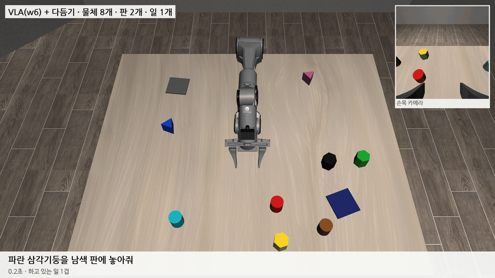
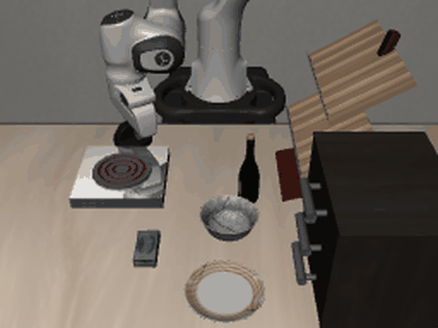
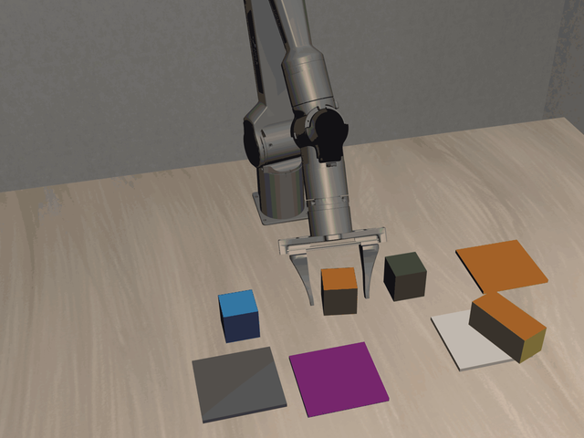
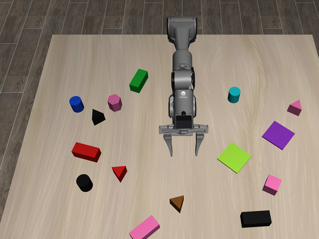
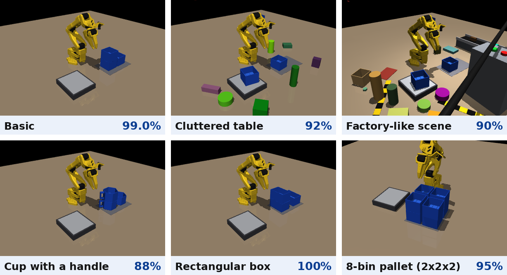

<div align="center">

# LAB-1309 연구 기록

**말로 일을 시키는 로봇팔이, 일하는 도중에 새 명령을 받아도 이어서 해내게 하기**

계명대학교 LAB-1309 학부연구생 이지용이 공부하고 실험한 것을 날짜별로 남기는 저장소입니다.



<sub>PiPER 디지털 트윈(시뮬레이션)에서 SmolVLA 가 "파란 삼각기둥을 남색 판에 놓아줘"를 해내는 장면. 오른쪽 위는 손목 카메라 화면이고, 마지막 몇 cm 는 다듬기가 맞춥니다.</sub>

<br><br>


[지금 하는 연구](#지금-하는-연구) · [지금 어디까지 왔나](#지금-어디까지-왔나) · [지금까지의 흐름](#지금까지의-흐름) · [주간보고](#주간보고) · [최근 일지](#최근-일지) · [저장소 둘러보기](#저장소-둘러보기)

</div>

## 지금 하는 연구

VLA(Vision-Language-Action)는 카메라 화면과 글로 된 명령을 받아 로봇 동작을 내는 모델입니다. 이 연구는 VLA 가 일하는 도중에 새 명령을 받았을 때를 다룹니다.

> 로봇이 A 를 옮기는 도중에 "B 해 줘"라는 새 명령을 받으면, 들고 있던 A 를 가까운 빈 자리에 내려놓고 B 를 한 다음, 다시 A 를 집어 마무리합니다. 처음 자세로 돌아가 다시 시작하지 않고, 사람처럼 이어서 합니다.


| | |
|---|---|
| 로봇 | AgileX PiPER 6축 팔 + 그리퍼 (WeGo Robotics 공급). 지금은 실물을 그대로 옮긴 시뮬레이션(디지털 트윈)에서 실험하고, 나중에 실물로 옮깁니다 |
| 모델 | SmolVLA (0.45B). 위 카메라와 손목 카메라 화면, 로봇 상태, 지시문을 보고 팔 동작을 냅니다 |
| 조건 | 모델이 계산하는 0.45초 동안에도 팔이 멈추지 않고 움직이는, 실제 로봇과 같은 조건으로 평가합니다 (연구실 GTX 1080 Ti 기준) |
| 원칙 | 일을 바꿀 때 처음 자세로 돌아가지 않습니다. 시뮬레이터만 아는 정답 좌표는 학습용 시범을 만들 때만 쓰고, 평가 때는 카메라로 찾은 위치만 씁니다 |

## 지금 어디까지 왔나

10/28 기준이고, 모두 시뮬레이션 결과입니다. 장면은 모양 5가지, 물체 최대 14개가 로봇 둘레에 놓이고, 기본 · 흔든 환경(조명·책상 색·카메라 자리를 바꿈) · 물체 많음 세 가지 설정이 있습니다.

<p align="center"></p>

| 일 1개 (세 설정 × 50장면 = 150개 일, w7) | 3cm 안에 놓음 | 판 안에 놓음 |
|---|---|---|
| VLA 혼자 | 32/150 (21%) | 47/150 (31%) |
| VLA + 다듬기 | **80/150 (53%)** | 83/150 (55%) |

- VLA 는 대부분 맞는 물체를 쥐고 맞는 판까지 가지만, 마지막 몇 cm 가 빗나갑니다.
- 그래서 지시문을 읽지 않는 '다듬기'를 붙였습니다. 어떤 물체를 어느 판에 놓을지는 VLA 가 정하고, 다듬기는 손이 아주 가까이 왔을 때 물체나 판 가운데로 맞춥니다. 바꾸는 동작은 전체의 약 17% 입니다.
- 일 2개 끼어들기는 기본 설정 20장면 중 6장면에서 둘 다 성공합니다. 이 상황을 직접 가르치는 학습이 다음 일입니다.
- 목표는 모든 설정에서 95%, 그다음은 실물 PiPER 입니다.

모델별 표와 4K 시연은 [06_결과물/PiPER](06_결과물/PiPER/README.md)에 있습니다.

## 지금까지의 흐름

| 9/14 ~ 10/3 | 10/4 ~ 10/24 | 10/24 ~ 지금 |
|:---:|:---:|:---:|
|  |  |  |
| **LIBERO · Franka Panda** | **PiPER · 색 블록** | **PiPER · 여러 모양, N개** |
| 일을 바꾸면 왜 실패하는지 찾았습니다. 실패의 80% 는 좁은 곳에서 맴도는 것이었고, 실제 로봇과 같은 지연(0.56초)을 넣자 크게 무너졌습니다 | 블록 4개와 판 4개로 28항목. VLA + 보조로 28항목 93.8%, 옮기는 도중 끼어들기에서 '셋 다' 90.4% | 모양 5가지, 물체 최대 14개, 로봇 둘레 어디든. 지시문을 읽지 않는 다듬기로 일 1개 53% |
| [LIBERO 실험 요약](04_실습/05_libero/README.md) · [Panda 결과](06_결과물/Panda/README.md) | [PiPER 결과 2절](06_결과물/PiPER/README.md) | [PiPER 결과 1절](06_결과물/PiPER/README.md) |

## 주간보고

| 10/29 | 10/14 |
|:---:|:---:|
| <a href="09_주간보고/2026-10-29/"></a> | <a href="09_주간보고/2026-10-14/"></a> |
| PiPER 디지털 트윈에서 집어 옮기기. VLA 혼자 21%, 보정 단계를 더하면 53%<br>[pptx](09_주간보고/2026-10-29/주간보고_10_29_이지용.pptx) · [대본과 예상 질문](09_주간보고/2026-10-29/대본_10_29.md) | 캡스톤 적재 시스템을 시뮬레이션으로 다시 만들기. 기본 99.0%, 여러 환경 88~100%<br>[pptx](09_주간보고/2026-10-14/주간보고_10_14_이지용.pptx) · [대본과 예상 질문](09_주간보고/2026-10-14/대본_10_14.md) |

작성 규칙과 전체 목록: [09_주간보고](09_주간보고/README.md)

## 최근 일지

| 날짜 | 내용 |
|---|---|
| [10/28](03_일지/2026-10-28.md) | 물체 기억이 덮이던 버그를 고쳐 VLA + 다듬기 일 1개 53%. 일 2개는 아직 2/20 |
| [10/27](03_일지/2026-10-27.md) | 물체 방향을 입력에 더하고 다듬기 버그 두 개를 고쳐 VLA + 다듬기 43% |
| [10/26](03_일지/2026-10-26.md) | VLA 가 물체를 쥐기 시작했고, 지시문을 읽지 않는 다듬기로 일 1개 35% |
| [10/25](03_일지/2026-10-25.md) | 흔든 환경과 같은 색 여러 모양에서도 물체 찾기가 되게 고침, DAgger 시작 |
| [10/24](03_일지/2026-10-24.md) | 옮기는 도중 끼어들기 '셋 다' 90.4%, 학습이 반올림에 지워지던 문제, 여러 모양·N개 장면 |
| [10/23](03_일지/2026-10-23.md) | 새 기준에서 돌아오기 79% → 93% |

전체 목록 (달마다, 한 줄 요약 포함): [03_일지](03_일지/README.md)

## 따로 한 것: ACT 적재 논문

<p align="center"></p>

캡스톤(스마트팩토리 비전 검사)의 적재 시스템을 MuJoCo 로 다시 만들고, SO-101 팔이 통을 1층, 옆, 2층 순서로 쌓는 세 단계를 ACT 로 학습시켰습니다. 세 단계를 이어서 모두 성공한 비율은 기본 장면 99.0%, 여러 환경에서 88~100% 입니다 (시뮬레이션). 대한전자공학회 2026 추계학술대회 학부생 논문경진대회에 10/14 제출했습니다. 자세한 것은 [08_개인논문_ACT적재](08_개인논문_ACT적재/README.md)에 있습니다.

## 저장소 둘러보기

| 폴더 | 내용 |
|---|---|
| [01_공부순서](01_공부순서/ROADMAP.md) | 처음부터 공부하는 순서: 딥러닝, 로봇, 모방학습, VLA 논문, 시뮬레이션, 실험 방법 |
| [02_논문노트](02_논문노트/README.md) | 읽은 논문 요약과 이 연구 어디에 썼는지 |
| [03_일지](03_일지/README.md) | 날짜별 연구 일지 (코랩 실습 일지는 `03_일지/공부`) |
| [04_실습](04_실습/README.md) | 직접 돌려 본 실습과 실험. `05_libero` 가 LIBERO 시기 본 실험이고, 실험 코드 사본은 `05_libero/코드` |
| [05_로봇팔_제원](05_로봇팔_제원/README.md) | Panda 와 PiPER 제원 비교 |
| [06_결과물](06_결과물/README.md) | 모델별 성공률, 그림, 4K GIF |
| [07_물체](07_물체/README.md) | 색 블록 장면의 물체: 사진, 크기, 3D 프린터용 STL, 시뮬레이터 정의 |
| [08_개인논문_ACT적재](08_개인논문_ACT적재/README.md) | ACT 적재 논문 (본 연구와 별개) |
| [09_주간보고](09_주간보고/README.md) | 랩미팅 주간보고 슬라이드와 영어 대본 |
| [10_문서](10_문서/README.md) | 연구 주제·논문 방향 초안 (10/3 기준), 다른 PC 에서 이어받기, 장비와 서버 설치 |
| [용어사전.md](용어사전.md) | 일지에 나오는 말 풀이 |

## 장비

| 항목 | 내용 |
|---|---|
| 로봇팔 | AgileX PiPER 6축 + 그리퍼 (WeGo Robotics 공급) |
| 카메라 | 위(또는 정면) 1대 + 손목 1대 |
| GPU | 연구실 GTX 1080 Ti (11GB), 개인 RTX 4070 Ti (12GB) |
| 소프트웨어 | Ubuntu, PyTorch, LeRobot, MuJoCo (LIBERO) |

사양별 주의사항: [10_문서/하드웨어.md](10_문서/하드웨어.md)

<details>
<summary><b>처음 공부한다면: 공부 순서와 문서 난이도</b></summary>

### 여기서 공부하는 것

| 분야 | 구체적으로 |
|---|---|
| 딥러닝 | PyTorch, Transformer, ViT, CLIP/SigLIP, Diffusion·Flow Matching |
| 로봇 | 자유도(DOF), 순기구학·역기구학, 회전 표현, 제어 주기와 지연 |
| 모방학습 | Behavior Cloning, Action Chunking, ACT, Diffusion Policy |
| VLA 모델 | OpenVLA, SmolVLA, π0, Hi Robot, MemoryVLA 등 최신 논문 |
| 시뮬레이션 | LIBERO(MuJoCo) 환경에서 정책 평가 |
| 실물 로봇 | AgileX PiPER 6축 로봇팔 제어, 데이터 수집, 정책 실행 |
| 실험 방법론 | 평가 지표 설계, 재현성, ablation, 실험 기록 |

### 공부 순서 (약 3~4개월)

| 단계 | 내용 | 문서 |
|---|---|---|
| 0-A | 진짜 처음이라면 이것부터 (용어를 하나도 모를 때) | [00A_이것부터](01_공부순서/00A_이것부터.md) |
| 0 | 개발 환경 (Ubuntu, CUDA, PyTorch) | [00_환경설정](01_공부순서/00_환경설정.md) |
| 1 | 딥러닝 기초 | [01_딥러닝기초](01_공부순서/01_딥러닝기초.md) |
| 2 | 로봇 기초 | [02_로봇기초](01_공부순서/02_로봇기초.md) |
| 3 | 모방학습과 Action Chunking | [03_모방학습](01_공부순서/03_모방학습.md) |
| 4 | VLA 논문 읽기 | [04_VLA논문](01_공부순서/04_VLA논문.md) |
| 5 | 시뮬레이션 실습 (LIBERO) | [05_시뮬레이션실습](01_공부순서/05_시뮬레이션실습.md) |
| 6 | 실험 방법론 | [06_실험방법론](01_공부순서/06_실험방법론.md) |
| 부록 | 텐서플로우 기초 | [07_텐서플로우](01_공부순서/07_텐서플로우.md) |

같이 보면 좋은 것: [08_수학기초](01_공부순서/08_수학기초.md) (지금부터), [09_연구기본기](01_공부순서/09_연구기본기.md) (1~2개월 뒤), [10_주변분야](01_공부순서/10_주변분야.md) (3개월 뒤). 전체 로드맵과 주차별 일정은 [ROADMAP](01_공부순서/ROADMAP.md), 실습 LAB 6개는 [04_실습](04_실습/README.md), VLA 모델 총정리는 [VLA모델정리](10_문서/VLA모델정리.md)에 있습니다.

### 문서 난이도

| 난이도 | 문서 |
|---|---|
| 아주 쉬움 | [00A_이것부터](01_공부순서/00A_이것부터.md), [용어사전](용어사전.md), [09_연구기본기](01_공부순서/09_연구기본기.md), [06_실험방법론](01_공부순서/06_실험방법론.md) |
| 보통 | [00_환경설정](01_공부순서/00_환경설정.md), [02_로봇기초](01_공부순서/02_로봇기초.md), [LAB 01](04_실습/LAB01_pytorch기초.md), [LAB 03](04_실습/LAB03_로봇수학.md), [LAB 04](04_실습/LAB04_action_chunking.md) |
| 조금 어려움 | [01_딥러닝기초](01_공부순서/01_딥러닝기초.md), [03_모방학습](01_공부순서/03_모방학습.md), [08_수학기초](01_공부순서/08_수학기초.md), [LAB 02](04_실습/LAB02_transformer.md), [LAB 05](04_실습/LAB05_libero_smolvla.md) |
| 어려움 | [04_VLA논문](01_공부순서/04_VLA논문.md), [VLA모델정리](10_문서/VLA모델정리.md) |

모든 문서 맨 앞에 '쉬운 말 요약'이 있습니다. 어려우면 그것만 읽고 넘어가도 됩니다.

### 공부 방식

논문이나 문서를 읽고 다섯 줄로 요약하고, 코드를 직접 돌려 수치를 기록하고, 남에게 설명해 봅니다. 논문 1편, 코드 1개, 일지 1쪽을 한 묶음으로 잡습니다.

### VLA 가 처음이라면

사진을 보고 글을 이해하는 AI 에 로봇을 움직이는 능력을 붙인 모델입니다. "빨간 블록을 컵에 넣어"라고 말하면 카메라 영상을 보고 로봇팔 관절을 어떻게 움직일지 직접 냅니다.
어려운 이유는 세 가지입니다. 글은 틀리면 다시 쓰면 되지만 로봇은 잘못 움직이면 물건을 떨어뜨리고, 모델이 무거우면 느려서 실시간 제어가 안 되고, 사람이 도중에 말을 바꾸면 어떻게 대응할지 정해진 답이 없습니다.

</details>

## 다른 PC 에서 이어서 하기

```bash
git clone https://github.com/kakabab12/LAB-1309.git
```

GIF 와 영상 때문에 저장소가 큽니다 (1.5GB 쯤). 글만 볼 거라면 `git clone --depth 1` 로 받으면 훨씬 가볍습니다.
실험 코드는 연구실 PC 의 `~/smolVLA/` 에 있고, 사본이 [04_실습/05_libero/코드](04_실습/05_libero/코드/)에 있습니다. 처음부터 따라 하는 안내는 [10_문서/이어받기.md](10_문서/이어받기.md), Claude Code 로 이어서 할 때의 맥락은 [CLAUDE.md](CLAUDE.md)에 있습니다.

<sub>이 저장소는 개인 연구·공부 기록이며 연구실 공식 문서가 아닙니다. 숫자는 모두 시뮬레이션에서 잰 것입니다.</sub>
