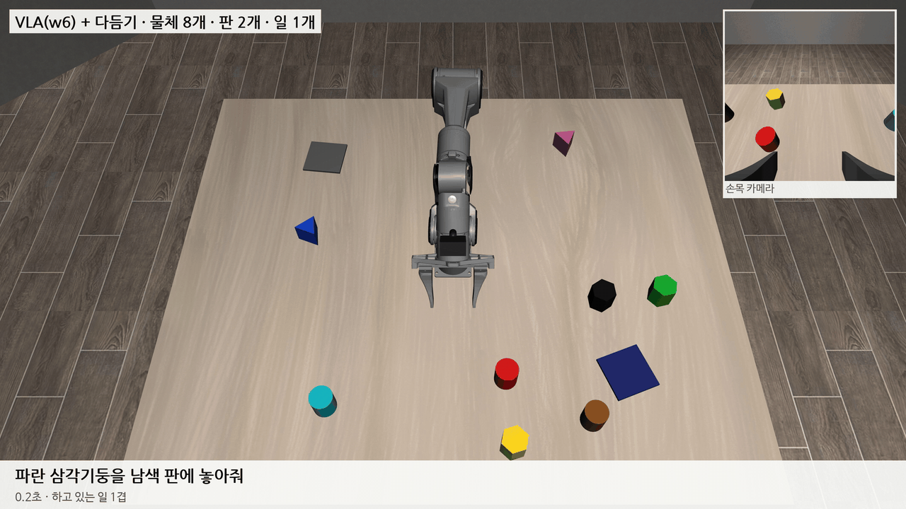
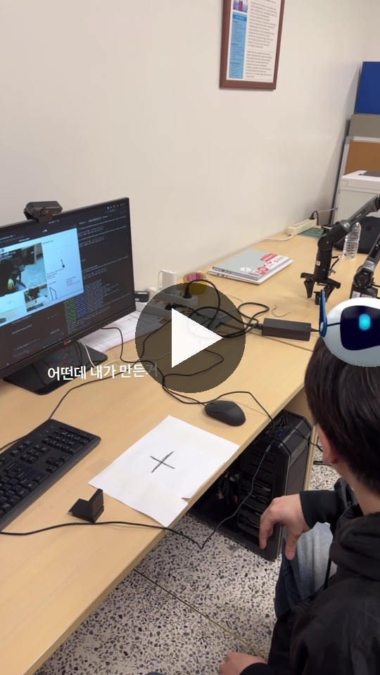
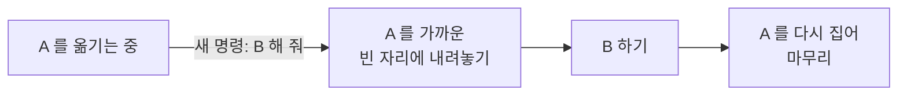
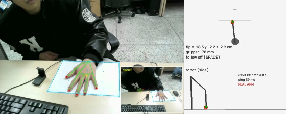
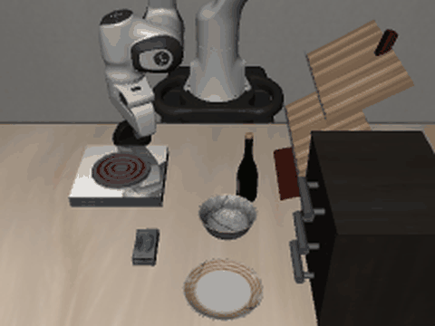
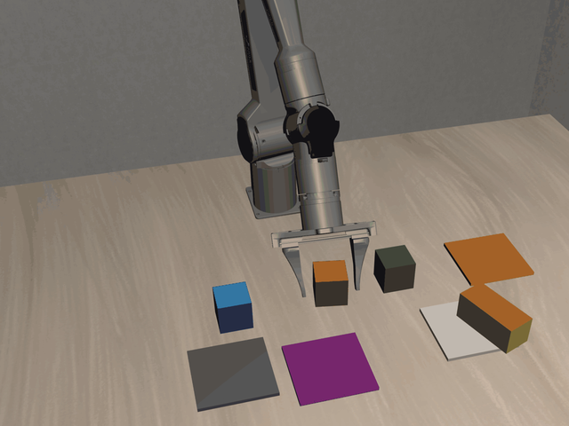
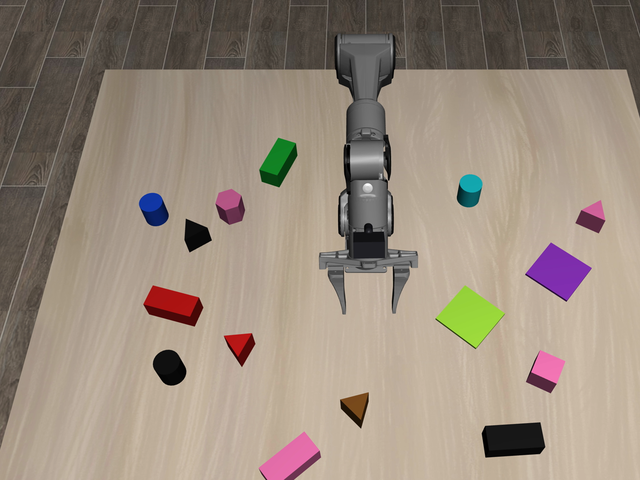
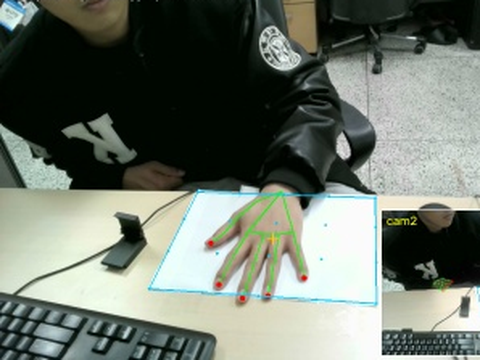
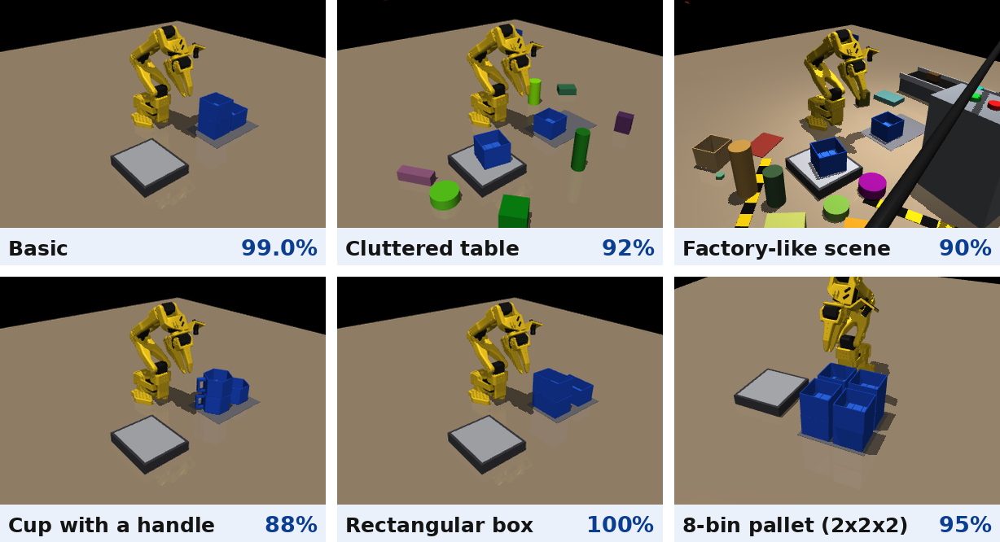

<div align="center">

<picture>
  <source media="(prefers-color-scheme: dark)" srcset="06_결과물/img/banner_dark.svg">
  
</picture>

<br>

**계명대학교 LAB-1309 학부연구생 이지용의 로봇 학습 연구 기록입니다.**<br>
카메라 화면과 말로 된 명령을 보고 로봇팔을 움직이는 AI(VLA)가, 일하는 도중에 새 명령을 받아도 처음으로 돌아가지 않고 이어서 해내게 만드는 연구를 합니다.<br>
시뮬레이션에서 시작해 연구실 실물 로봇팔 PiPER 로 옮기는 중입니다.

<br>

<a href="용어사전.md#python"></a>
<a href="용어사전.md#pytorch"></a>
<a href="용어사전.md#smolvla"></a>
<a href="용어사전.md#mujoco"></a>
<a href="용어사전.md#piper"></a>
<a href="용어사전.md#opencv"></a>
<br>
<sub>배지를 누르면 그 기술이 무엇이고 이 연구에서 어디에 썼는지 볼 수 있습니다 → <a href="용어사전.md#readme-배지에-나온-기술">용어사전</a></sub>
<br>
<a href="mailto:yeez0612@naver.com"></a>
<a href="https://github.com/kakabab12/My_portfolio"></a>
<a href="https://www.youtube.com/shorts/RBSCCwu8Yuc"></a>
<a href="https://github.com/kakabab12/LAB-1309/commits/main"></a>

<br>

[한눈에 보기](#한눈에-보기) · [연구 소개](#연구-소개) · [지금 어디까지 왔나](#지금-어디까지-왔나) · [실물 PiPER](#실물-piper-웹캠-원격조종) · [지금까지의 흐름](#지금까지의-흐름) · [저장소 안내](#저장소-안내) · [연락처](#연락처)

<br>


<a href="https://www.youtube.com/shorts/RBSCCwu8Yuc"></a>

<sub>왼쪽: 시뮬레이션에서 SmolVLA 가 "파란 삼각기둥을 남색 판에 놓아줘"를 해내는 장면 (오른쪽 위는 손목 카메라 화면)<br>오른쪽: 연구실 실물 PiPER 를 웹캠으로 잰 손 움직임으로 조종하는 시연 영상 (누르면 YouTube 로 갑니다)</sub>

</div>

<br>

## 한눈에 보기

<table>
<tr>
<td align="center" width="25%"><h3>81%</h3>시뮬레이션 일 1개 성공률<br><sub>VLA + 다듬기, 150장면, 11/3</sub></td>
<td align="center" width="25%"><h3>90.4%</h3>옮기는 도중 끼어들기 성공률<br><sub>VLA + 보조, 색 블록 장면, 240장면, 10/24</sub></td>
<td align="center" width="25%"><h3>0.7 cm</h3>실물 PiPER 가 웹캠 목표를 따라간 오차<br><sub>중간값, 80초 시험, 11/16</sub></td>
<td align="center" width="25%"><h3>99.0%</h3>ACT 순차 적재 성공률<br><sub>학술대회 논문, 시뮬레이션 기본 장면</sub></td>
</tr>
</table>

- **무엇을 하나**: 로봇이 A 를 옮기는 도중 "B 해 줘"라는 새 명령을 받으면, A 를 가까운 빈 자리에 내려놓고 B 를 한 뒤 다시 A 를 마무리하게 만듭니다.
- **어떻게**: SmolVLA(0.45B)를 실물 PiPER 와 똑같이 만든 시뮬레이션(디지털 트윈)에서 학습시키고, 마지막 몇 cm 를 맞추는 '다듬기'를 붙였습니다.
- **실물**: 시범 데이터를 모으려고 웹캠 두 대로 사람 손을 재서 실물 PiPER 를 움직이는 원격조종 도구를 만들었습니다.
- **논문**: 대한전자공학회 2026 추계학술대회 학부생 논문경진대회에 ACT 순차 적재 논문을 냈습니다 (포스터 발표 11/28).

> [!NOTE]
> 성공률은 모두 시뮬레이션에서 잰 것입니다. 실물 로봇팔에서 VLA 를 돌린 결과는 아직 없습니다.

## 연구 소개

VLA(Vision-Language-Action)는 카메라 화면과 글로 된 명령을 받아 로봇 동작을 내는 모델입니다. 이 연구는 VLA 가 일하는 도중에 새 명령을 받았을 때를 다룹니다.



- **로봇**: AgileX PiPER 6축 팔 + 그리퍼 (WeGo Robotics 공급). 실물을 그대로 옮긴 시뮬레이션에서 실험하고 실물로 옮깁니다.
- **모델**: SmolVLA (0.45B). 위 카메라와 손목 카메라 화면, 로봇 상태, 지시문을 보고 팔 동작을 냅니다.
- **조건**: 모델이 계산하는 동안(연구실 GTX 1080 Ti 에서 약 0.45초)에도 팔이 멈추지 않는, 실제 로봇과 같은 조건으로 평가합니다.
- **원칙**: 일을 바꿀 때 처음 자세로 돌아가지 않습니다. 시뮬레이터만 아는 정답 좌표는 학습용 시범을 만들 때만 쓰고, 평가 때는 카메라로 찾은 위치만 씁니다.

## 지금 어디까지 왔나

11/4 까지의 시뮬레이션 결과입니다. 장면은 모양 5가지, 물체 최대 14개가 로봇 둘레에 놓이고, 기본 · 흔든 환경(조명 · 책상 색 · 카메라 자리를 바꿈) · 물체 많음 세 가지 설정이 있습니다. 10/30 부터는 판 개수(2~5개), 지연, 팔 속도, 지시문 꼴도 장면마다 바뀝니다. 일 1개는 세 설정 × 50장면 = 150개 일이고, 학습에 쓰지 않은 장면에서 물체를 판 가운데 3 cm 안에 놓아야 성공입니다.

| 언제 | 모델 | VLA 혼자 | VLA + 다듬기 | 끼어들기 일 2개 (둘 다 성공) |
|---|---|---|---|---|
| 10/29 | w8 | 34/150 (23%) | 85/150 (57%) | 10/60 |
| 11/2 | w11m | 46/150 (31%) | **122/150 (81%)** | 기본 0/20, 흔든 1/20 |
| 11/3 | w12m | 49/150 (33%) | 121/150 (81%) | 2/60 |

- VLA 는 대부분 맞는 물체를 쥐고 맞는 판까지 가지만, 마지막 몇 cm 가 빗나갑니다. 그래서 지시문을 읽지 않는 '다듬기'를 붙였습니다. 어떤 물체를 어느 판에 놓을지는 VLA 가 정하고, 다듬기는 손이 아주 가까이 왔을 때 물체나 판 가운데로 맞춥니다.
- 10/30 에 평가를 위처럼 더 어렵게 바꾸고 10/31 에 다듬기를 고쳤습니다. 그래서 10/29 줄과 11/2 줄은 그대로 견줄 수 없습니다.
- 일 1개는 81% 까지 왔지만, 일 2개를 끼어들기로 이어서 하는 것은 아직 거의 안 됩니다. 지금 연구에서 가장 크게 남은 문제입니다.
- 목표는 물체 N개를 모두 끼어들기로 옮기는 것까지, 모든 설정에서 95% 입니다.

모델별 표, 그래프, 4K 시연 GIF 는 [06_결과물/PiPER](06_결과물/PiPER/README.md)에, 공개 벤치마크와 견준 표는 [10_문서/기준과_벤치마크_비교](10_문서/기준과_벤치마크_비교.md)에 있습니다.

## 실물 PiPER 웹캠 원격조종

시뮬레이션 연구와 따로, 실물 PiPER 에 가르칠 시범을 모으는 도구를 만들고 있습니다 (11/15 ~). 웹캠 두 대로 사람 손 21점(MediaPipe)을 재서, 사람 쪽 종이 위에서 손이 움직인 만큼 로봇 집게 끝도 로봇 쪽 종이 위에서 똑같이 움직입니다.

<p align="center"></p>

| 실물에서 확인한 것 | 결과 |
|---|---|
| 따라가기 80초 (11/16) | 집게 끝과 목표의 차이 중간값 0.7 cm |
| 처음 자세로 돌아가는 B 버튼 (11/20) | 1.75초 만에 관절 차 0.2° 안으로 돌아옴 |

- 손 떨림은 원유로(1€) 필터로 줄였습니다. 가상 손에서 멈춘 손의 흔들림이 3.4 mm 에서 1.3 mm 로 줄었습니다.
- 카메라를 책상 위 80 cm 에 두는 3D 프린트 기둥을 설계했습니다 ([stand_high](11_실물_PiPER/webcam_piper/stand_high/README.md)). 아직 출력하지 않았습니다.
- 석사형 VR 조종(tinybc)과 합칠 수 있게, 시범 기록을 같은 형식(zarr)으로 바꾸는 변환기와 200 Hz MIT 모드 보내기를 넣었습니다 (11/26, 가상 팔로만 시험).
- 진짜 손으로 잰 위치 오차와 지연은 아직 측정해 보지 않았습니다.
- 교수님이 말씀하신 논문 Point Policy 방식도 따로 만들었습니다 (11/27, [point_policy](11_실물_PiPER/point_policy/README.md)). 로봇을 움직이지 않고 사람이 진짜 물체를 옮기는 영상만 찍어, 손·물체 점으로 정책을 배워 시뮬 PiPER 로 실행합니다. 각본으로 만든 가짜 손 시범 40개로 처음 보는 자리 50장면 중 47개를 성공했고, 진짜 손 시범은 아직입니다. 역기구학은 찬혁님 VR 조종과 같은 placo 를 고를 수 있습니다.
- 코드와 설명: [webcam_piper](11_실물_PiPER/webcam_piper/README.md) · [사용 설명서](11_실물_PiPER/webcam_piper/사용설명서.md) · [노트북에서 실행하기](11_실물_PiPER/webcam_piper/노트북_실행.md)

## 지금까지의 흐름

| 9/14 ~ 10/3 | 10/4 ~ 10/24 | 10/24 ~ 11/4 | 11/15 ~ 지금 |
|:---:|:---:|:---:|:---:|
|  |  |  |  |
| **LIBERO · Franka Panda** | **PiPER · 색 블록** | **PiPER · 여러 모양, N개** | **실물 PiPER** |
| 일을 바꾸면 왜 실패하는지 찾았습니다. 실패의 80% 는 좁은 곳에서 맴도는 것이었습니다 | 블록 4개, 판 4개, 28항목. VLA + 보조 평균 94.5%, 옮기는 도중 끼어들기 90.4% | 모양 5가지, 물체 최대 14개. 지시문을 읽지 않는 다듬기로 일 1개 81% | 웹캠 손 조종으로 실물 팔 움직이기, 시범 모을 준비 |
| [LIBERO 실험](04_실습/05_libero/README.md) · [Panda 결과](06_결과물/Panda/README.md) | [PiPER 결과 2절](06_결과물/PiPER/README.md#2-색-블록-장면-104--1024) | [PiPER 결과 1절](06_결과물/PiPER/README.md#1-여러-모양n개-장면-1024--114) | [11_실물_PiPER](11_실물_PiPER/README.md) |

<details>
<summary><b>따로 한 것: ACT 순차 적재 논문 (대한전자공학회 2026 추계학술대회)</b></summary>

<br>

<p align="center"></p>

캡스톤(스마트팩토리 비전 검사)의 적재 시스템을 MuJoCo 로 다시 만들고, SO-101 팔이 통을 1층, 옆, 2층 순서로 쌓는 세 단계를 ACT 로 학습시켰습니다. 세 단계를 이어서 모두 성공한 비율은 기본 장면 99.0%, 여러 환경에서 88~100% 입니다 (시뮬레이션). 대한전자공학회 2026 추계학술대회 학부생 논문경진대회에 냈습니다 (포스터 발표 11/28). 자세한 것은 [08_개인논문_ACT적재](08_개인논문_ACT적재/README.md)에 있습니다.

</details>

## 저장소 안내

### 처음 왔다면

| 궁금한 것 | 여기부터 |
|---|---|
| 무엇을 했고 결과가 어떤지 | [06_결과물](06_결과물/README.md) → [03_일지](03_일지/README.md) (날짜별, 한 줄 요약 있음) |
| 실물 PiPER 를 직접 움직여 보고 싶다 | [12_PiPER_조작법_및_설치법](12_PiPER_조작법_및_설치법/README.md) → [웹캠 조종 사용 설명서](11_실물_PiPER/webcam_piper/사용설명서.md) |
| 매주 무엇을 했는지 | [09_주간보고](09_주간보고/README.md) (슬라이드 + 영어 대본) |
| VLA 와 로봇 학습을 처음 공부한다 | [01_공부순서](01_공부순서/README.md) → [용어사전](용어사전.md) |

### 폴더

| 분류 | 폴더 | 내용 |
|---|---|---|
| 결과와 기록 | [03_일지](03_일지/README.md) | 날짜별 연구 일지 |
| | [06_결과물](06_결과물/README.md) | 모델별 성공률, 그림, 4K GIF |
| | [09_주간보고](09_주간보고/README.md) | 랩미팅 주간보고 슬라이드와 영어 대본 |
| 실물 로봇 | [11_실물_PiPER](11_실물_PiPER/README.md) | 웹캠 원격조종, 시뮬에서 학습한 VLA 를 실물에 잇는 코드, 손목 카메라 마운트 STL |
| | [12_PiPER_조작법_및_설치법](12_PiPER_조작법_및_설치법/README.md) | 설치 (CAN 도구, piper_sdk, WeGo 플러그인), CAN 연결, 조작법, 예제 4개 |
| | [05_로봇팔_제원](05_로봇팔_제원/README.md) | Panda 와 PiPER 제원 비교 |
| | [07_물체](07_물체/README.md) | 색 블록 장면의 물체: 사진, 크기, 3D 프린터용 STL |
| 공부 | [01_공부순서](01_공부순서/README.md) | 딥러닝, 로봇, 모방학습, VLA 논문, 시뮬레이션, 실험 방법 공부 순서 |
| | [02_논문노트](02_논문노트/README.md) | 읽은 논문 요약과 이 연구 어디에 썼는지 |
| | [04_실습](04_실습/README.md) | 직접 돌려 본 실습. `05_libero` 는 LIBERO 시기 본 실험과 코드 사본 |
| 그 밖 | [08_개인논문_ACT적재](08_개인논문_ACT적재/README.md) | ACT 순차 적재 논문 (본 연구와 별개) |
| | [10_문서](10_문서/README.md) | 연구 주제 · 논문 방향 초안 (10/3 기준), 이어받기 안내, 장비와 서버 설치 |
| | [용어사전.md](용어사전.md) | README 배지에 나온 기술과 일지에 나오는 말 풀이 |

<details>
<summary><b>최근 일지와 주간보고</b></summary>

<br>

| 일지 | 내용 |
|---|---|
| [11/27](03_일지/2026-11-27.md) | Point Policy 방식으로 다시 만들기: 사람 손 영상 → 시뮬 PiPER (가짜 손 시범 40개로 새 자리 47/50), placo 역기구학, 80 cm 카메라 기둥 |
| [11/26](03_일지/2026-11-26.md) | 석사형 VR 조종 방식에 맞춤: 200 Hz follower, MIT 모드, 3차 중간 점 (켜는 옵션, 가상 팔로만), 시범 기록을 석사형 tinybc 형식(zarr)으로 바꾸는 변환기 |
| [11/23](03_일지/2026-11-23.md) | 웹캠 PiPER 조종: SPACE 를 눌러도 팔이 그대로, B 로 돌아가면 그리퍼도 닫힘, 집게가 손바닥이 향하는 쪽을 따라 돎. B 가 책상에 닿은 일과 고친 것 |
| [11/20](03_일지/2026-11-20.md) | 처음 자세로 돌아가는 B 버튼 (실물 1.75초, 관절 차 0.2° 안), 떨림 거르기 (가상 손 3.4 → 1.3 mm), 바탕화면 아이콘 |
| [11/15](03_일지/2026-11-15.md) | 웹캠으로 PiPER 원격조종: 노트북 카메라가 손을 재고 연구실 PC 가 팔을 움직임 |
| [11/4](03_일지/2026-11-04.md) | 95% 넘었던 블록 장면을 지금 기준 · 공개 벤치마크와 견줌, 실물 PiPER 연결 코드 |

| 주간보고 | 내용 |
|---|---|
| [11/27](09_주간보고/2026-11-27/) | 추계학술대회 포스터 출력, 원유로 필터로 손 떨림 줄이기, 로봇 팔 처음 자세 버튼. 다음은 카메라 기둥 3D 프린트 |
| [11/20](09_주간보고/2026-11-20/) | 포스터 완성, 웹캠 두 대 손 키포인트로 실물 PiPER 조종 첫 시험 |
| [11/13](09_주간보고/2026-11-13/) | 실물 PiPER 첫 시험 조종, 카메라 마운트 부품 3D 프린트 |

전체 목록: [03_일지](03_일지/README.md) · [09_주간보고](09_주간보고/README.md)

</details>

<details>
<summary><b>장비와 소프트웨어</b></summary>

<br>

| 항목 | 내용 |
|---|---|
| 로봇팔 | AgileX PiPER 6축 + 그리퍼 (WeGo Robotics 공급) |
| 카메라 | 시뮬레이션: 위 1대 + 손목 1대 / 실물 조종: 웹캠 ABKO APC930 2대 |
| GPU | 연구실 GTX 1080 Ti (11GB), 개인 RTX 4070 Ti (12GB) |
| 소프트웨어 | Ubuntu, Python, PyTorch, LeRobot, MuJoCo (LIBERO), OpenCV, MediaPipe, piper_sdk |

사양별 주의사항: [10_문서/하드웨어.md](10_문서/하드웨어.md)

</details>

<details>
<summary><b>처음 공부한다면: 공부 순서와 문서 난이도</b></summary>

### 여기서 공부하는 것

| 분야 | 구체적으로 |
|---|---|
| 딥러닝 | PyTorch, Transformer, ViT, CLIP/SigLIP, Diffusion · Flow Matching |
| 로봇 | 자유도(DOF), 순기구학 · 역기구학, 회전 표현, 제어 주기와 지연 |
| 모방학습 | Behavior Cloning, Action Chunking, ACT, Diffusion Policy |
| VLA 모델 | OpenVLA, SmolVLA, π0, Hi Robot, MemoryVLA 등 최신 논문 |
| 시뮬레이션 | LIBERO(MuJoCo) 환경에서 정책 평가 |
| 실물 로봇 | AgileX PiPER 6축 로봇팔 제어, 데이터 수집, 정책 실행 |
| 실험 방법론 | 평가 지표 설계, 재현성, ablation, 실험 기록 |

### 공부 순서 (약 3~4개월)

| 단계 | 내용 | 문서 |
|---|---|---|
| 0-A | 진짜 처음이라면 이것부터 (용어를 하나도 모를 때) | [00A_이것부터](01_공부순서/00A_이것부터.md) |
| 0 | 개발 환경 (Ubuntu, CUDA, PyTorch) | [00_환경설정](01_공부순서/00_환경설정.md) |
| 1 | 딥러닝 기초 | [01_딥러닝기초](01_공부순서/01_딥러닝기초.md) |
| 2 | 로봇 기초 | [02_로봇기초](01_공부순서/02_로봇기초.md) |
| 3 | 모방학습과 Action Chunking | [03_모방학습](01_공부순서/03_모방학습.md) |
| 4 | VLA 논문 읽기 | [04_VLA논문](01_공부순서/04_VLA논문.md) |
| 5 | 시뮬레이션 실습 (LIBERO) | [05_시뮬레이션실습](01_공부순서/05_시뮬레이션실습.md) |
| 6 | 실험 방법론 | [06_실험방법론](01_공부순서/06_실험방법론.md) |
| 부록 | 텐서플로우 기초 | [07_텐서플로우](01_공부순서/07_텐서플로우.md) |

같이 보면 좋은 것: [08_수학기초](01_공부순서/08_수학기초.md) (지금부터), [09_연구기본기](01_공부순서/09_연구기본기.md) (1~2개월 뒤), [10_주변분야](01_공부순서/10_주변분야.md) (3개월 뒤). 전체 로드맵과 주차별 일정은 [ROADMAP](01_공부순서/ROADMAP.md), 실습 LAB 6개는 [04_실습](04_실습/README.md), VLA 모델 총정리는 [VLA모델정리](10_문서/VLA모델정리.md)에 있습니다.

### 문서 난이도

| 난이도 | 문서 |
|---|---|
| 아주 쉬움 | [00A_이것부터](01_공부순서/00A_이것부터.md), [용어사전](용어사전.md), [09_연구기본기](01_공부순서/09_연구기본기.md), [06_실험방법론](01_공부순서/06_실험방법론.md) |
| 보통 | [00_환경설정](01_공부순서/00_환경설정.md), [02_로봇기초](01_공부순서/02_로봇기초.md), [LAB 01](04_실습/LAB01_pytorch기초.md), [LAB 03](04_실습/LAB03_로봇수학.md), [LAB 04](04_실습/LAB04_action_chunking.md) |
| 조금 어려움 | [01_딥러닝기초](01_공부순서/01_딥러닝기초.md), [03_모방학습](01_공부순서/03_모방학습.md), [08_수학기초](01_공부순서/08_수학기초.md), [LAB 02](04_실습/LAB02_transformer.md), [LAB 05](04_실습/LAB05_libero_smolvla.md) |
| 어려움 | [04_VLA논문](01_공부순서/04_VLA논문.md), [VLA모델정리](10_문서/VLA모델정리.md) |

모든 문서 맨 앞에 '쉬운 말 요약'이 있습니다. 어려우면 그것만 읽고 넘어가도 됩니다.

### 공부 방식

논문이나 문서를 읽고 다섯 줄로 요약하고, 코드를 직접 돌려 수치를 기록하고, 남에게 설명해 봅니다. 논문 1편, 코드 1개, 일지 1쪽을 한 묶음으로 잡습니다.

### VLA 가 처음이라면

사진을 보고 글을 이해하는 AI 에 로봇을 움직이는 능력을 붙인 모델입니다. "빨간 블록을 컵에 넣어"라고 말하면 카메라 영상을 보고 로봇팔 관절을 어떻게 움직일지 직접 냅니다.
어려운 이유는 세 가지입니다. 글은 틀리면 다시 쓰면 되지만 로봇은 잘못 움직이면 물건을 떨어뜨리고, 모델이 무거우면 느려서 실시간 제어가 안 되고, 사람이 도중에 말을 바꾸면 어떻게 대응할지 정해진 답이 없습니다.

</details>

<details>
<summary><b>내려받기와 이어서 하기</b></summary>

<br>

```bash
git clone --depth 1 https://github.com/kakabab12/LAB-1309.git
```

GIF 와 영상 때문에 전체 기록을 받으면 1.6GB 쯤 됩니다. `--depth 1` 로 마지막 판만 받으면 훨씬 가볍습니다.
시뮬레이션 실험 코드는 연구실 PC 의 `~/smolVLA/` 에 있고, 사본이 [04_실습/05_libero/코드](04_실습/05_libero/코드/)에 있습니다. 처음부터 따라 하는 안내는 [10_문서/이어받기.md](10_문서/이어받기.md), Claude Code 로 이어서 할 때의 맥락은 [CLAUDE.md](CLAUDE.md)에 있습니다.

</details>

## 연락처

<table>
<tr><td><b>이름</b></td><td>이지용 (Jiyong Lee) · 계명대학교 컴퓨터공학전공 · LAB-1309 학부연구생</td></tr>
<tr><td><b>이메일</b></td><td><a href="mailto:yeez0612@naver.com">yeez0612@naver.com</a></td></tr>
<tr><td><b>전화</b></td><td>010-4803-0454</td></tr>
<tr><td><b>GitHub</b></td><td><a href="https://github.com/kakabab12">@kakabab12</a> · 포트폴리오 <a href="https://github.com/kakabab12/My_portfolio">My_portfolio</a></td></tr>
</table>

<sub>이 저장소는 개인 연구 · 공부 기록이며 연구실 공식 문서가 아닙니다.</sub>
